# 같은 검색어인데 왜 환경마다 순위가 다를까요?

## 개발 서버에서 1위였던 글이 운영에서 2위예요

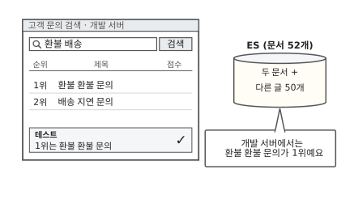

고객 문의 검색의 순위를 확인하는 테스트를 짰어요. 개발 서버에서 "환불 배송"을 검색하면 "환불 환불 문의"가 1위, "배송 지연 문의"가 2위라서 그대로 기대값으로 적었어요. 같은 두 문서를 다른 서버에 넣고 돌리면 어떻게 될까요?

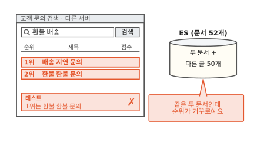

다른 서버에서는 순위가 거꾸로 나왔어요. 두 문서도 검색어도 그대로인데 말이에요. 두 서버는 무엇이 달랐을까요?

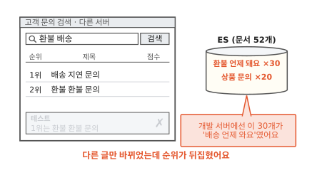

두 서버의 차이는 함께 들어 있는 다른 문서뿐이었어요. 개발 서버에는 "배송 언제 와요" 같은 글이 30개 있었어요. 다른 서버에는 그 자리에 "환불 언제 돼요" 같은 글이 30개 있었어요. 두 서버 모두 "상품 문의" 20개가 더 있어서 문서는 52개였어요. ES의 점수는 인덱스에 든 다른 문서들도 함께 보고 매겨요. 점수는 무엇으로 만들어질까요?

## 점수는 낱말마다 곱해서 더해요

[1편](01-inverted-index.md)의 역색인으로 "환불"이 든 문서를 찾았다면 이제 그 문서들에 순서를 매겨야 해요. ES가 기본으로 쓰는 공식은 **BM25**예요. 1990년대 런던 시티대학교의 검색 실험 시스템 Okapi에서 나와 지금까지 쓰이는 공식이에요. 검색어 낱말 하나마다 점수를 내서 더하는데 낱말 하나의 점수는 이렇게 생겼어요.

> 낱말 점수 = 2.2 × 드문 정도 × 횟수 몫

드문 정도는 그 낱말이 다른 문서들 속에서 얼마나 드문가예요. 횟수 몫은 이 문서에 그 낱말이 나온 횟수를 문서 길이로 고친 값이에요.

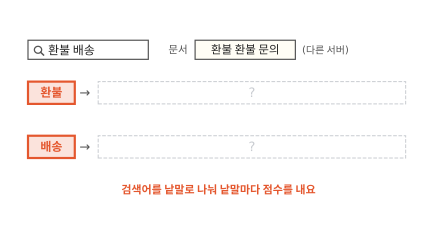

다른 서버의 "환불 환불 문의"로 해 볼게요. 검색어 "환불 배송"을 낱말 둘로 나눠 낱말마다 점수를 내요. "환불"의 점수는 얼마일까요?

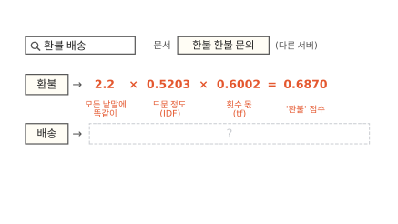

곱하는 것은 2.2와 드문 정도, 횟수 몫 셋이에요. 드문 정도는 IDF, 횟수 몫은 tf로 줄여 써요. 앞의 2.2(k1+1)는 모든 낱말에 똑같이 곱해지는 수라서 순위를 바꾸지 않아요. 순위를 정하는 건 뒤의 두 몫이에요. "배송"은 이 문서에 없는데 점수가 어떻게 될까요?

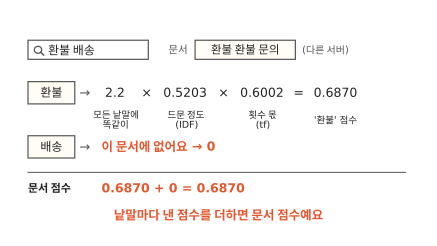

"배송"이 없으니 더할 몫은 0이에요. 그래서 이 문서의 점수는 "환불" 점수 0.687 그대로예요. 문서 하나의 점수가 어떻게 나왔는지 풀어 보여 주는 ES의 `explain` API로 보면 이 셋이 그대로 나와요. 직접 짠 파이썬 계산과 맞춰 보니 7.17과 9.2 모두 소수 넷째 자리까지 같았어요.[^lab]

```text
0.6870 score(freq=2.0), computed as boost * idf * tf from:
  2.2000 boost
  0.5203 idf ... 31 n, 52 N
  0.6002 tf  ... 2 freq, 1.2 k1, 0.75 b, 3 dl, 2.6154 avgdl
```

`n`은 이 낱말이 든 문서 수, `N`은 전체 문서 수, `freq`는 이 문서에서 낱말이 나온 횟수예요. `dl`은 이 문서의 길이(낱말 수), `avgdl`은 평균 길이예요. `k1`과 `b`는 아래에서 봐요. 여기의 boost는 검색할 때 주는 `boost`와는 다른, 공식에 늘 붙는 수예요.

??? info "심화: boost 2.2는 어디서 왔나"
    `explain`에 찍힌 2.2가 어디서 왔는지 궁금할 때 보는 칸이에요. 원래 BM25 식의 낱말 횟수 몫은 `f × (k1+1) / (f + k1 × …)`이에요. Lucene 8.0은 모든 낱말에 똑같이 곱해져 순위에 영향이 없는 `(k1+1)`을 빼서 횟수 몫이 1을 넘지 않게 했어요(LUCENE-8563). ES는 7.0부터 예전 점수 크기를 지키려고 이 값을 다시 곱하는 `LegacyBM25Similarity`를 기본 BM25로 써요. 7.17은 Lucene의 lucene-misc에 든 것을 써요. 9.2는 ES가 자기 코드로 옮겨 온 사본(`org.elasticsearch.lucene.similarity`)을 써요. 두 버전의 jar 파일로 확인했어요. 그래서 `explain`에 `boost 2.2`(기본 `k1` 1.2 + 1)가 찍히고 7.17.26과 9.2.0의 결과가 같았어요. 9.x의 이 클래스는 앞으로 없앨 것(deprecated)으로 표시돼 있어서 언젠가 2.2가 사라질 수 있어요. `k1`을 바꾸면 이 값도 `k1+1`로 바뀌어요.

    BM25 점수에는 위로 막힌 상한이 있어요. 횟수 몫이 1을 넘지 않으니 낱말 하나의 점수는 `boost × IDF`를 넘지 못해요. 9편의 WAND처럼 "이 낱말이 낼 수 있는 최고 점수"로 문서를 건너뛰는 방법이 이 상한에 기대요. `function_score`(점수에 다른 값을 섞는 질의)나 스크립트로 BM25 점수에 다른 값을 더한다면 이 크기를 알고 있어야 해요.

## 많이 나올수록 높지만 금방 배불러요

"환불"이 한 번 나온 문서보다 두 번 나온 문서가 더 환불 이야기일 가능성이 높아요. 그래서 낱말이 많이 나올수록 점수가 올라가요. 횟수를 그대로 쓰면 어떻게 될까요?

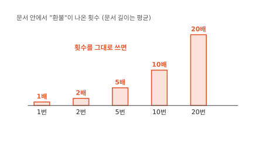

"환불"을 스무 번 적은 문서가 한 번 적은 문서보다 스무 배 점수를 받아요. 낱말을 일부러 잔뜩 넣는 글이 맨 위로 올라와요. BM25는 횟수를 어떻게 다룰까요?

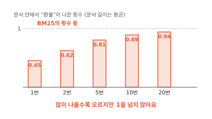

BM25는 나온 횟수 f를 그대로 쓰지 않아요. 문서 길이가 평균일 때 횟수 몫은 `f / (f + 1.2)` 꼴이라 횟수가 늘수록 1에 가까워져요. 한 번이면 0.45, 두 번이면 0.62예요. 다섯 번이면 0.81, 열 번이면 0.89예요. 스무 번을 넣어도 0.94에 그쳐요. 처음 몇 번은 크게 오르고 그 뒤로는 거의 안 올라요.

이 꺾이는 정도를 정하는 값이 `k1`(기본 1.2)이에요. 크게 잡으면 횟수가 더 오래 영향을 줘요. 기본값에서는 스무 번 나온 문서의 몫이 한 번 나온 문서의 2.1배예요. `k1`을 3으로 키우면 3.5배로 벌어져요.

## 드문 낱말일수록 무거워요

"환불 배송"으로 검색했을 때 "환불"과 "배송" 중 어느 쪽이 맞는 문서가 더 중요할까요? 모든 문서에 다 나오는 낱말이라면 그 낱말이 들어 있다는 사실로는 문서를 가려낼 수 없어요. 몇 문서에만 나오는 낱말이 들어 있다면 그 문서는 검색어와 꽤 관련이 있어요. 그래서 드문 낱말에 무게를 더 줘요. 이 몫을 **IDF**라고 불러요. inverse document frequency를 줄인 말이에요.

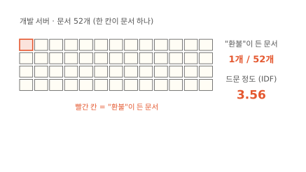

개발 서버의 문서 52개 가운데 "환불"이 든 문서는 "환불 환불 문의" 하나뿐이에요. 이때 "환불"의 무게는 3.56이에요. 다른 서버에서는 어떨까요?

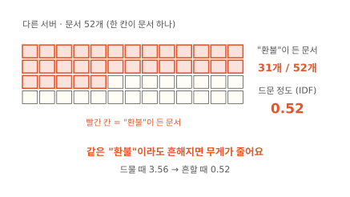

다른 서버에서는 "환불 언제 돼요" 30개까지 문서 31개에 "환불"이 있어요. 무게는 0.52로 줄어요. 같은 "환불"이라도 다른 문서들 속에서 얼마나 흔한가에 따라 무게가 일곱 배 가까이 달라져요.

IDF는 그 필드가 든 문서 수 N과 그 낱말이 든 문서 수 n으로 `ln(1 + (N - n + 0.5) / (n + 0.5))`처럼 계산해요(ln은 자연로그). n이 작을수록 커지고 n이 N에 가까워지면 0에 가까워져요. 샤드가 하나일 때는 인덱스 전체에서 세요. 샤드가 여럿이면 샤드마다 따로 세는데 이건 샤드 절에서 봐요.

처음 장면으로 돌아가 볼게요. "배송"이 흔한 곳에서는 "환불"이 드물어서 "환불"을 두 번 가진 문서가 4.707점으로 1위였어요. "환불"이 흔한 곳에서는 "환불"의 무게가 줄어요. 대신 "배송"이 드물어져요. 그래서 "배송 지연 문의"가 3.363점으로 1위가 되고 "환불 환불 문의"는 0.687점으로 내려갔어요. 두 문서 자체는 한 글자도 바뀌지 않았어요.

## 짧은 문서가 유리해요

같은 "환불" 한 번이라도 세 낱말짜리 문의 글과 삼백 낱말짜리 긴 공지에서 뜻이 달라요. 긴 글은 이것저것 다 다루다 보니 그 낱말이 우연히 들어갔을 수 있어요. 그래서 BM25는 횟수 몫을 계산할 때 문서 길이 dl을 인덱스의 평균 길이 avgdl과 비교해서 고쳐요.

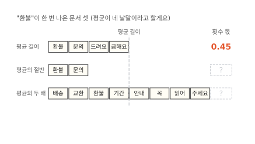

평균이 네 낱말이라고 하고 "환불"이 한 번 나온 문서 셋을 놓아 봐요. 평균 길이인 문서의 몫은 앞 절과 같은 0.45예요. 평균의 절반인 두 낱말짜리 "환불 문의"는 어떨까요?

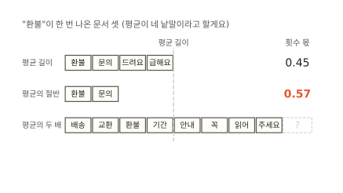

평균보다 짧으니 몫이 0.57로 커져요. 평균의 두 배인 여덟 낱말짜리 공지는 어떨까요?

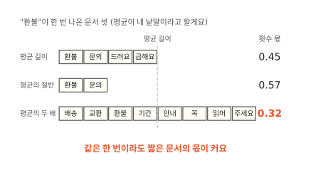

길면 몫이 0.32로 작아져요. 이 고치는 정도를 정하는 값이 `b`(기본 0.75)예요. 0이면 길이를 아예 안 보고 1이면 길이를 최대로 반영해요.

평균 길이 역시 같은 샤드의 다른 문서들에서 나와요. 그러니 짧은 문의 글만 있던 인덱스에 긴 공지 글이 잔뜩 들어오면 평균이 길어져요. 원래 있던 짧은 글들의 점수는 다 같이 조금씩 올라가요.

??? info "심화: 통계가 정확하지 않은 곳 세 군데"
    손으로 계산한 점수와 ES 점수가 조금 어긋날 때 보는 칸이에요.

    첫째, 문서 길이는 근삿값이에요. Lucene은 필드마다 문서 길이(분석 뒤 토큰 수)를 1바이트로 줄여 저장해요. 이 값을 norms라고 해요. 작은 길이는 정확하지만 길어질수록 구간이 거칠어져요. 7.17과 9.2에서 재 보니 40토큰까지는 정확했어요. 41은 40, 100은 96, 300은 280으로 저장됐어요. 동의어 필터처럼 같은 위치에 덧붙은 토큰은 기본값(`discount_overlaps: true`)으로는 길이에 세지 않아요. 짧은 문서만 쓴 이 편의 실험에서는 손계산과 딱 맞았어요. 긴 문서에서는 조금 어긋나요. `keyword` 필드는 기본으로 norms가 꺼져 있어서 길이 고침이 없어요.

    둘째, N과 n은 지운 문서를 포함해요([5편](05-merge.md)). 병합 전까지는 지운 문서가 통계에 남아 점수가 살짝 달라져요. 고치기도 지우고 새로 넣는 일이라 갱신이 잦은 인덱스일수록 오차가 커요. 문서를 많이 고치는 인덱스에서 같은 검색의 점수가 날마다 미세하게 흔들리는 이유가 여기 있어요.

    셋째, N은 "그 필드가 있는 문서 수"(Lucene의 `docCount`)예요. 필드가 비어 있는 문서는 세지 않아요.

## 통계는 샤드마다 따로예요

[3편](03-routing.md)에서 인덱스는 샤드로 나뉘고 샤드 하나가 완전한 Lucene 인덱스라고 했어요. 검색이 오면 샤드마다 자기 문서로 점수를 매겨요. 그런데 IDF와 평균 길이를 계산할 때 쓰는 "다른 문서들"도 그 샤드 안의 문서뿐이에요. 샤드마다 든 문서가 다르면 어떻게 될까요?

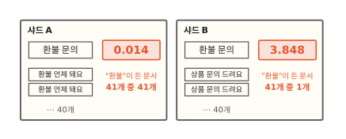

로컬에서 샤드 2개짜리 인덱스에 똑같은 글 "환불 문의"를 하나씩 서로 다른 샤드에 넣었어요. 한쪽 샤드에는 "환불 언제 돼요"를 40개, 다른 쪽에는 "상품 문의 드려요"를 40개 더 넣었어요. "환불"로 검색하면 두 글은 몇 점을 받을까요?

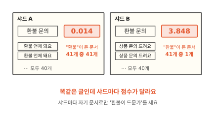

글자까지 똑같은 두 글이 0.014점과 3.848점을 받았어요. 샤드 A에서는 "환불"이 문서 41개 모두에 있었고 샤드 B에서는 하나뿐이었어요. 두 샤드의 통계를 합쳐서 매길 수는 없을까요?

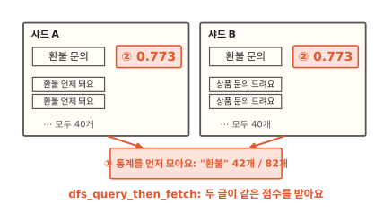

검색을 `search_type=dfs_query_then_fetch`로 보내면 ES는 점수를 매기기 전에 모든 샤드에 낱말 통계를 먼저 물어서 합쳐요. 그 합친 통계로 점수를 매기니 두 글이 똑같이 0.773점을 받았어요. 두 버전 모두 같았어요. 대신 샤드를 한 번 더 오가야 해서 조금 느려져요.

문서가 수백만 개쯤 되면 사정이 달라져요. 기본 라우팅을 쓰면 3편의 해시가 문서를 고르게 흩어요. 그래서 흔한 낱말의 통계는 샤드마다 거의 같아져요. 동전을 열 번 던지면 앞면 비율이 들쭉날쭉해요. 만 번을 던지면 거의 절반에 모이는 것과 같아요. 다만 몇 문서에만 나오는 드문 낱말은 문서가 많아도 샤드마다 n이 0, 2, 3처럼 달라서 점수 차이가 남아요.

라우팅 값을 직접 줘서 고객별로 샤드를 가르는 경우도 있어요(3편). 이때는 문서가 많아도 샤드마다 통계가 달라요. 기본 라우팅인 운영 인덱스에서는 이 차이가 잘 안 보이고 문서가 적은 개발·테스트 환경에서 크게 보여요. 샤드 수가 다른 두 환경을 비교할 때도 마찬가지예요.

??? info "심화: 통계 차이가 드러나는 다른 경우"
    같은 검색을 되풀이했는데 점수나 순서가 조금씩 바뀔 때 보는 칸이에요.

    복제본도 통계가 다를 수 있어요. 주 샤드와 복제본은 같은 문서를 갖지만 병합 시점이 달라요. 그래서 지운 문서가 남은 정도가 다르고 그만큼 N과 n이 달라요. 같은 검색을 반복할 때 어느 복사본이 답하느냐에 따라 점수가 미세하게 흔들려요. 점수가 같은 문서끼리 순서가 바뀌기도 해요. 같은 점수끼리는 샤드 안의 문서 번호(doc id) 순으로 정하는데 이 번호도 복사본마다 다를 수 있어요. 이 현상을 bouncing results라고 불러요. `preference`에 사용자 ID 같은 값을 주면 한 사용자의 검색이 늘 같은 복사본으로 가서 순서가 흔들리지 않아요.

    여러 인덱스를 한 번에 검색할 때도 통계는 인덱스마다 따로이고 그 안에서도 샤드마다 따로예요. 날짜별 인덱스처럼 성격이 다른 인덱스를 섞어 검색하면 같은 낱말의 무게가 인덱스마다 달라요. `dfs_query_then_fetch`는 검색 요청 하나 안의 모든 샤드 통계를 모아 줘요.

## 정확한 순위 테스트는 언제 쓸모 있을까요?

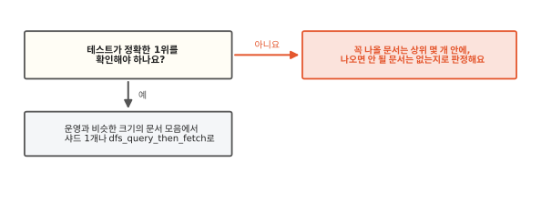

검색 품질을 지키려고 "이 검색어에는 이 문서가 1위"라는 테스트를 수십 개 만든다고 해 봐요. 운영 데이터는 수백만 건이고 테스트 환경에는 수백 건만 있어요. 점수는 함께 든 문서들에 기대니 수백 건 환경의 순위가 운영의 순위라는 보장이 없어요.

정확한 1위가 꼭 필요하지 않다면 모음이 바뀌어도 잘 안 깨지는 조건으로 판정해요. "꼭 나와야 하는 문서가 상위 몇 개 안에 있다"가 그런 조건이에요. "나오면 안 되는 문서는 결과에 없다"도 그래요. 순위 자체를 확인해야 한다면 운영과 비슷한 크기의 문서 모음을 써요. 샤드를 1개로 두거나 `dfs_query_then_fetch`로 샤드 차이도 없애요.

샤드 수만 달라도 테스트가 깨질 수 있어요. 같은 50건이라도 샤드 3개로 나뉘면 샤드마다 17건 안팎으로 IDF와 평균 길이를 따로 계산해요. 그래서 샤드 1개인 CI 서버에서 통과한 1위 테스트가 샤드 3개인 서버에서는 깨지기도 해요.

순위를 손보는 손잡이도 같은 테스트로 지켜봐요. 상품명에 "나이키 나이키 운동화 나이키 정품"처럼 브랜드를 여러 번 넣은 상품이 늘 위로 올라온다고 해 봐요. 횟수 몫은 이미 꺾여 있지만 1번과 3번 사이는 아직 차이가 커요. 문서 길이가 평균이면 0.45 대 0.71이에요. 상품명 필드의 `k1`을 낮추면 두 번째부터의 이득이 더 빨리 사라져요. 반복으로 길어진 상품명을 더 크게 벌주고 싶다면 `b`를 높여요. 길이가 고르고 짧은 필드는 길이 차이에 의미가 적어요. 이런 필드라면 반대로 `b`를 낮춰요.

`k1`과 `b`는 인덱스 설정의 `similarity`에 BM25 변형으로 정의해요. 필드 매핑에서 그 이름을 지정해 바꾸고 이미 있는 필드의 similarity를 바꾸려면 재색인이 필요해요. 이런 손잡이는 모든 검색의 순위를 바꾸니 순위 테스트로 영향을 확인한 뒤에 바꿔요. 색인할 때 같은 낱말 반복을 걸러 내는 방법도 따져 봐요.

## 다시 "환불 배송"을 검색해 볼게요

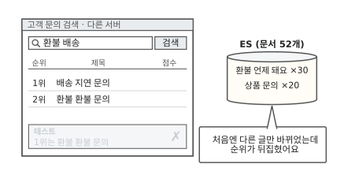

처음 장면의 다른 서버 화면으로 돌아왔어요. 그때는 다른 글 30개만 바뀌었는데 "환불 환불 문의"가 2위로 내려갔어요.

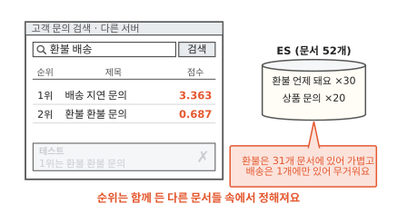

이제 점수를 직접 매길 수 있어요. 이 서버에서 "환불"은 문서 31개에 있어서 무게가 0.52로 가벼워요. "배송"은 문서 1개에만 있어서 3.56으로 무거워요. 그래서 "배송 지연 문의"가 3.363점, "환불 환불 문의"가 0.687점을 받아요.

문서가 52개든 5천만 개든 점수는 그 문서와 함께 든 다른 문서들 속에서 매겨져요.

### 이 편에서 줄여 그린 것

그림을 쉽게 하려고 실제와 다르게 줄인 곳이 다섯 군데 있어요.

1. 낱말은 띄어쓰기로 잘랐어요. 실험도 띄어쓰기로만 자르는 `whitespace` 분석기를 썼어요. 한국어 분석기로 자르면 낱말 수와 문서 길이가 달라져요. [2편](02-analyzer.md)에서 봐요.
2. 문서 길이를 낱말 수 그대로 그렸어요. Lucene은 길이를 1바이트 근삿값(norms)으로 저장해서 41토큰부터는 조금 달라져요. 이 편의 심화 칸 "통계가 정확하지 않은 곳 세 군데"에서 다뤄요.
3. 문서 길이 그림에서 평균을 네 낱말로 잡았어요. 처음 장면의 문서 모음은 평균이 2.6154 낱말이에요. 몫 0.57, 0.45, 0.32는 길이가 평균의 절반·평균·두 배일 때의 값이라 평균이 몇 낱말이든 같아요.
4. 전체 문서 수 N을 "문서 52개"처럼 그렸어요. 정확히는 그 필드가 있는 문서 수이고 지운 문서도 들어가요([5편](05-merge.md)). 같은 심화 칸에서 다뤄요.
5. 처음 장면의 문서 52개는 샤드 1개짜리 인덱스에 넣었다고 보고 그렸어요. 샤드가 여럿이면 문서 수와 평균 길이를 샤드마다 따로 세요. 이 편의 샤드 절에서 다뤄요.

### 이 편에서 새로 나온 말


[^lab]: 제 컴퓨터에 띄운 ES 7.17.26과 9.2.0에서 점수와 `explain`이 같았어요. 낱말은 띄어쓰기로만 자르는 `whitespace` 분석기로 잘랐어요. 짧은 문서만 써서 문서 길이 근삿값(norms) 영향이 없게 했어요.
