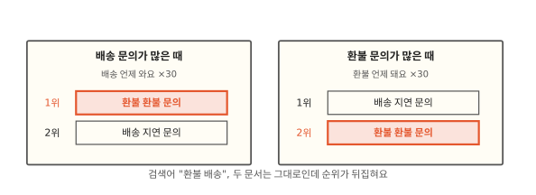
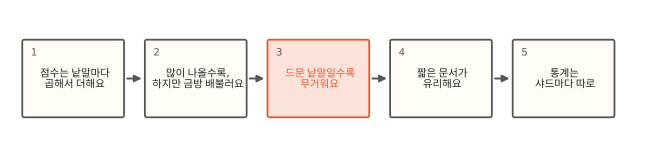
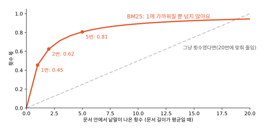
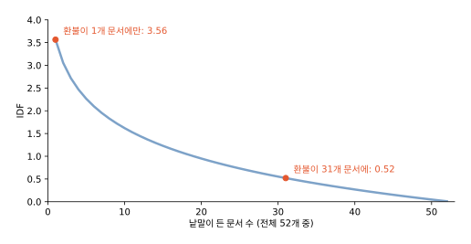
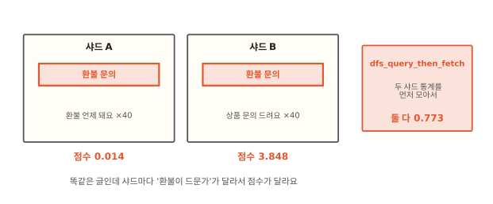

# 같은 검색어인데 왜 환경마다 순위가 다를까요?

## 개발 서버에서 1위였던 글이 운영에서 2위예요



고객 문의 검색의 순위를 확인하는 테스트를 짰어요. 개발 서버에서 "환불 배송"을 검색하면 "환불 환불 문의"가 1위, "배송 지연 문의"가 2위라서 그대로 기대값으로 적었어요. 그런데 다른 서버에서 같은 두 문서로 돌리니 순위가 거꾸로 나와요. 두 문서도 검색어도 그대로인데 말이에요.

두 서버의 차이는 함께 들어 있는 다른 문서뿐이었어요. 한 곳은 "배송 언제 와요" 같은 글이 많았고 다른 곳은 "환불 언제 돼요" 같은 글이 많았어요. ES의 점수는 인덱스에 든 다른 문서들도 함께 보고 매겨요.

## 점수의 재료에서 샤드별 통계까지



점수를 만드는 재료는 낱말이 나온 횟수, 낱말이 얼마나 드문가, 문서 길이 셋이에요. 이 가운데 드문 정도와 평균 길이가 다른 문서들로 정해진다는 데서 순위 뒤집힘이 나와요. 끝으로 그 "다른 문서"의 범위가 샤드 하나라는 점을 봐요.

## 점수는 낱말마다 곱해서 더해요

[1편](01-inverted-index.md)의 역색인으로 "환불"이 든 문서를 찾았다면 이제 그 문서들에 순서를 매겨야 해요. ES가 기본으로 쓰는 공식은 **BM25**예요. 1990년대 런던 시티대학교의 검색 실험 시스템 Okapi에서 나와 지금까지 쓰이는 공식이에요. 검색어 낱말 하나마다 점수를 내서 더하는데 낱말 하나의 점수는 이렇게 생겼어요.

> 점수 = 2.2 × (그 낱말이 얼마나 드문가) × (이 문서에 얼마나 많이 나오나, 문서 길이로 고친 값)

곱하는 것은 2.2, 드문 정도(IDF), 횟수 몫(tf)이에요. 앞의 2.2(k1+1)는 모든 낱말에 똑같이 곱해지는 수라서 순위를 바꾸지 않아요(7.17과 9.2에서 확인, 심화 칸). 순위를 정하는 건 뒤의 두 몫이에요. 문서 하나의 점수가 어떻게 나왔는지 풀어 보여 주는 ES의 `explain` API로 보면 이 셋이 그대로 나와요. 직접 짠 파이썬 계산과 맞춰 보니 7.17과 9.2 모두 소수 넷째 자리까지 같았어요.[^lab]

```text
0.6870 score(freq=2.0), computed as boost * idf * tf from:
  2.2000 boost
  0.5203 idf ... 31 n, 52 N
  0.6002 tf  ... 2 freq, 1.2 k1, 0.75 b, 3 dl, 2.6154 avgdl
```

`n`은 이 낱말이 든 문서 수, `N`은 전체 문서 수, `freq`는 이 문서에서 낱말이 나온 횟수, `dl`은 이 문서의 길이(낱말 수), `avgdl`은 평균 길이예요. `k1`과 `b`는 아래에서 봐요. 여기의 boost는 검색할 때 주는 `boost`와는 다른, 공식에 늘 붙는 수예요.

??? info "동료용 심화: boost 2.2는 어디서 왔나"
    원래 BM25 식의 낱말 횟수 몫은 `f × (k1+1) / (f + k1 × …)`이에요. Lucene 8.0은 모든 낱말에 똑같이 곱해져 순위에 영향이 없는 `(k1+1)`을 빼서 횟수 몫이 1을 넘지 않게 했어요(LUCENE-8563). ES는 7.0부터 예전 점수 크기를 지키려고 이 값을 다시 곱하는 `LegacyBM25Similarity`를 기본 BM25로 써요. 7.17은 Lucene의 lucene-misc에 든 것을, 9.2는 ES가 자기 코드로 옮겨 온 사본(`org.elasticsearch.lucene.similarity`)을 써요(두 버전 jar로 확인). 그래서 `explain`에 `boost 2.2`(기본 `k1` 1.2 + 1)가 찍히고 7.17.26과 9.2.0의 결과가 같았어요. 9.x의 이 클래스는 앞으로 없앨 것(deprecated)으로 표시돼 있어서 언젠가 2.2가 사라질 수 있어요. `k1`을 바꾸면 이 값도 `k1+1`로 바뀌어요.

    BM25 점수에는 위로 막힌 상한이 있어요. 횟수 몫이 1을 넘지 않으니 낱말 하나의 점수는 `boost × IDF`를 넘지 못해요. 9편의 WAND처럼 "이 낱말이 낼 수 있는 최고 점수"로 문서를 건너뛰는 방법이 이 상한에 기대요. `function_score`(점수에 다른 값을 섞는 질의)나 스크립트로 BM25 점수에 다른 값을 더한다면 이 크기를 알고 있어야 해요.

## 많이 나올수록 높지만 금방 배불러요



"환불"이 한 번 나온 문서보다 두 번 나온 문서가 더 환불 이야기일 가능성이 높아요. 그래서 낱말이 많이 나올수록 점수가 올라가요. 그런데 횟수를 그대로 쓰면 "환불"을 스무 번 적은 문서가 한 번 적은 문서보다 스무 배 점수를 받아요. 낱말을 일부러 잔뜩 넣는 글이 맨 위로 올라와요.

BM25는 나온 횟수 f를 그대로 쓰지 않고 횟수 몫(tf)을 `f / (f + 1.2)` 꼴로 만들어서(문서 길이가 평균일 때) 횟수가 늘수록 1에 가까워지게 해요. 한 번이면 0.45, 두 번이면 0.62, 다섯 번이면 0.81, 열 번이면 0.89예요. 처음 몇 번은 크게 오르고 그 뒤로는 거의 안 올라요. 이 꺾이는 정도를 정하는 값이 `k1`(기본 1.2)이에요. 크게 잡으면 횟수가 더 오래 영향을 줘요.

## 드문 낱말일수록 무거워요



"환불 배송"으로 검색했을 때 "환불"과 "배송" 중 어느 쪽이 맞는 문서가 더 중요할까요? 모든 문서에 다 나오는 낱말이라면 그 낱말이 들어 있다는 사실로는 문서를 가려낼 수 없어요. 몇 문서에만 나오는 낱말이 들어 있다면 그 문서는 검색어와 꽤 관련이 있어요. 그래서 드문 낱말에 무게를 더 줘요. 이 몫을 **IDF**(inverse document frequency)라고 불러요.

IDF는 그 필드가 든 문서 수 N과 그 낱말이 든 문서 수 n으로(샤드가 하나일 때는 인덱스 전체, 여럿이면 샤드마다 세요. 마지막 절에서 봐요) `ln(1 + (N - n + 0.5) / (n + 0.5))`처럼 계산해요(ln은 자연로그). n이 작을수록 커지고 n이 N에 가까워지면 0에 가까워져요. 문서 52개 중 "환불"이 1개에만 있으면 3.56, 31개에 있으면 0.52예요. 같은 "환불"이라도 다른 문서들 속에서 얼마나 흔한지에 따라 무게가 일곱 배 가까이 달라져요.

처음 장면으로 돌아가 보면 "배송"이 흔한 곳에서는 "환불"이 드물어서 "환불"을 두 번 가진 문서가 4.707점으로 1위였어요. "환불"이 흔한 곳에서는 "환불"의 무게가 줄고 "배송"이 드물어져서 "배송 지연 문의"가 3.363점으로 1위가 되고 "환불 환불 문의"는 0.687점으로 내려갔어요. 두 문서 자체는 한 글자도 바뀌지 않았어요.

## 짧은 문서가 유리해요

같은 "환불" 한 번이라도 세 낱말짜리 문의 글과 삼백 낱말짜리 긴 공지에서 뜻이 달라요. 긴 글은 이것저것 다 다루다 보니 그 낱말이 우연히 들어갔을 수 있어요. 그래서 BM25는 횟수 몫을 계산할 때 문서 길이(dl)를 인덱스의 평균 길이(avgdl)와 비교해서 고쳐요. 평균보다 짧으면 몫이 커지고 길면 작아져요. "환불"이 한 번 나온 문서라도 길이가 평균의 절반이면 0.57, 평균의 두 배면 0.32예요. 이 고치는 정도를 정하는 값이 `b`(기본 0.75)예요. 0이면 길이를 아예 안 보고 1이면 길이를 최대로 반영해요.

평균 길이 역시 같은 샤드의 다른 문서들에서 나와요. 그러니 짧은 문의 글만 있던 인덱스에 긴 공지 글이 잔뜩 들어오면 평균이 길어지고 원래 있던 짧은 글들의 점수가 다 같이 조금씩 올라가요.

??? info "동료용 심화: 통계가 정확하지 않은 곳 세 군데"
    첫째, 문서 길이는 근삿값이에요. Lucene은 필드마다 문서 길이(분석 뒤 토큰 수)를 1바이트(norms)로 줄여 저장해서 작은 길이는 정확하지만 길어질수록 구간이 거칠어져요. 7.17과 9.2에서 재 보니 40토큰까지는 정확했고 41은 40, 100은 96, 300은 280으로 저장됐어요. 동의어 필터처럼 같은 위치에 덧붙은 토큰은 기본값(`discount_overlaps: true`)으로는 길이에 세지 않아요. 짧은 문서만 쓴 이 편의 실험에서는 손계산과 딱 맞았지만 긴 문서에서는 조금 어긋나요. `keyword` 필드는 기본으로 norms가 꺼져 있어서 길이 고침이 없어요.

    둘째, N과 n은 지운 문서를 포함해요([5편](05-merge.md)). 병합 전까지는 지운 문서가 통계에 남아 점수가 살짝 달라져요. 고치기도 지우고 새로 넣는 일이라 갱신이 잦은 인덱스일수록 오차가 커요. 문서를 많이 고치는 인덱스에서 같은 검색의 점수가 날마다 미세하게 흔들리는 이유가 여기 있어요.

    셋째, N은 "그 필드가 있는 문서 수"(Lucene의 `docCount`)예요. 필드가 비어 있는 문서는 세지 않아요. `k1`, `b`는 인덱스 설정의 `similarity`에 BM25 변형으로 정의하고 필드 매핑에서 그 이름을 지정해 바꿔요. 이미 있는 필드의 similarity를 바꾸려면 재색인이 필요해요. 길이가 고르고 짧은 필드는 길이 차이에 의미가 적어서 `b`를 낮추는 쪽을 따져 봐요. 반대로 반복으로 길이를 부풀리는 일이 생기는 필드는 `b`를 올려서 긴 쪽을 벌주기도 해요(업무 판단 연습).

## 통계는 샤드마다 따로예요



[3편](03-routing.md)에서 인덱스는 샤드로 나뉘고 샤드 하나가 완전한 Lucene 인덱스라고 했어요. 검색이 오면 샤드마다 자기 문서로 점수를 매겨요. 그런데 IDF와 평균 길이를 계산할 때 쓰는 "다른 문서들"도 그 샤드 안의 문서뿐이에요.

로컬에서 샤드 2개짜리 인덱스에 똑같은 글 "환불 문의"를 하나씩 서로 다른 샤드에 넣었어요. 한쪽 샤드에는 "환불 언제 돼요"를 40개, 다른 쪽에는 "상품 문의 드려요"를 40개 더 넣었어요. "환불"로 검색하니 글자까지 똑같은 두 글이 0.014점과 3.848점을 받았어요. 한 샤드에서는 "환불"이 흔하고 다른 샤드에서는 드물었기 때문이에요.

검색을 `search_type=dfs_query_then_fetch`로 보내면 ES는 점수를 매기기 전에 모든 샤드에 낱말 통계를 먼저 물어서 합쳐요. 그 합친 통계로 점수를 매기니 두 글이 똑같이 0.773점을 받았어요. 두 버전 모두 같았어요. 대신 샤드를 한 번 더 오가야 해서 조금 느려져요.

문서가 수백만 개쯤 되고 기본 라우팅을 쓰면 3편의 해시가 문서를 고르게 흩어서 흔한 낱말의 통계는 샤드마다 거의 같아져요. 동전을 열 번 던지면 앞면 비율이 들쭉날쭉하지만 만 번 던지면 거의 절반이 되는 것과 같아요. 다만 몇 문서에만 나오는 드문 낱말은 문서가 많아도 샤드마다 n이 0, 2, 3처럼 달라서 점수 차이가 남아요. 라우팅 값을 직접 줘서(3편) 고객별로 샤드가 갈린다면 문서가 많아도 샤드마다 통계가 달라요. 기본 라우팅인 운영 인덱스에서는 이 차이가 잘 안 보이고 문서가 적은 개발·테스트 환경에서 크게 보여요. 샤드 수가 다른 두 환경을 비교할 때도 마찬가지예요.

??? info "동료용 심화: 통계 차이가 드러나는 다른 경우"
    복제본도 통계가 다를 수 있어요. 주 샤드와 복제본은 같은 문서를 갖지만 병합 시점이 달라서 지운 문서가 남은 정도가 다르고 그만큼 N과 n이 달라요. 같은 검색을 반복할 때 어느 복사본이 답하느냐에 따라 점수가 미세하게 흔들리고 점수가 같은 문서끼리 순서가 바뀌기도 해요. 같은 점수끼리는 샤드 안의 문서 번호(doc id) 순으로 정하는데 이 번호도 복사본마다 다를 수 있어요. 이 현상을 bouncing results라고 불러요. `preference`에 사용자 ID 같은 값을 주면 한 사용자의 검색이 늘 같은 복사본으로 가서 순서가 흔들리지 않아요.

    여러 인덱스를 한 번에 검색할 때도 통계는 인덱스마다(그 안에서 샤드마다) 따로예요. 날짜별 인덱스처럼 성격이 다른 인덱스를 섞어 검색하면 같은 낱말의 무게가 인덱스마다 달라요. `dfs_query_then_fetch`는 검색 요청 하나 안의 모든 샤드 통계를 모아 줘요.

## 정리

- BM25: ES의 기본 점수 공식이에요. 검색어 낱말마다 "얼마나 드문가"와 "이 문서에 얼마나 나오나(문서 길이로 고침)"를 곱해서 더해요.
- 횟수 몫은 많이 나올수록 커지지만 1에 가까워지며 금방 멈춰요(`k1`). 짧은 문서일수록 커져요(`b`).
- IDF: 낱말이 든 문서가 적을수록 커지는 무게예요. 인덱스에 든 다른 문서들로 정해지니 문서 모음이 바뀌면 순위도 바뀌어요.
- 이 통계는 샤드마다 따로 계산해요. 문서가 적으면 샤드마다 점수가 크게 달라지고 `dfs_query_then_fetch`로 맞출 수 있어요.

## 직접 해 보기

[lab/es/08_bm25.py](https://github.com/oya150/bedrock/blob/main/lab/es/08_bm25.py)는 처음 장면의 두 문서 모음과 샤드 실험을 차례로 만들고 ES 점수와 손계산을 나란히 찍어요. 점수 하나를 풀어 보는 요청은 이거예요.

```bash
curl 'localhost:9200/bm25/_explain/0' -H 'Content-Type: application/json' \
  -d '{"query":{"match":{"body":"환불"}}}'
```

`n`(낱말이 든 문서 수)과 `N`(전체 문서 수)을 보면서 문서를 몇 개 더 넣고 다시 불러 보세요. 같은 문서의 점수가 바뀌어요.

## 확인 문제

??? question "1. 스무 번 쓴 문서"
    "환불"을 한 번 쓴 짧은 문서와 스무 번 쓴 같은 길이의 문서가 있어요. 두 문서의 "환불" 점수는 몇 배쯤 차이가 날까요? (문서 길이는 평균이라고 해요)

    **풀이** 횟수 몫이 한 번이면 `1/(1+1.2)` = 0.45, 스무 번이면 `20/(20+1.2)` = 0.94예요. 두 배 남짓이에요. BM25가 횟수를 꺾어 주니 스무 배가 되지 않아요. 실제로는 스무 번 쓴 문서가 그만큼 길어서 길이 고침까지 받으면 차이가 더 줄어요.

??? question "2. 모든 문서에 있는 낱말"
    인덱스의 모든 문서에 "문의"가 들어 있어요. "환불 문의"로 검색하면 "문의"는 순위에 얼마나 영향을 줄까요?

    **풀이** N과 n이 같으면 IDF는 `ln(1 + 0.5/(N+0.5))`로 0에 아주 가까워요. "문의"는 거의 점수를 보태지 않고 순위는 사실상 "환불"로 정해져요. 모든 문서에 있는 낱말은 문서를 가려 주지 못하니 무게도 없어요.

??? question "3. 테스트가 다른 서버에서 깨져요"
    테스트 데이터 50건으로 "1위는 이 문서"를 확인하는 테스트가 CI 서버(샤드 1개)에서는 통과하는데 스테이징(샤드 3개, 같은 50건)에서는 깨져요. 왜일까요?

    **풀이** 같은 50건이라도 샤드 3개로 나뉘면 샤드마다 17건 남짓으로 IDF와 평균 길이를 따로 계산해요. 어느 문서가 어느 샤드에 갔느냐에 따라 점수가 달라지고 1위가 바뀔 수 있어요. 테스트에 `dfs_query_then_fetch`를 쓰거나 테스트 인덱스를 샤드 1개로 만들어요.

## 업무 판단 연습

??? question "순위 테스트를 어떻게 쓸까"
    검색 품질을 지키려고 "이 검색어에는 이 문서가 1위"라는 테스트를 수십 개 만들려고 해요. 운영 데이터는 수백만 건이고 테스트 환경에는 수백 건만 있어요. 무엇을 조심할까요?

    **풀이** 점수는 함께 든 문서들에 기대니 수백 건 환경의 순위가 운영의 순위라는 보장이 없어요. 정확한 1위 대신 "꼭 나와야 하는 문서가 상위 몇 개 안에 있다", "나오면 안 되는 문서는 결과에 없다"처럼 모음이 바뀌어도 잘 안 깨지는 조건으로 판정해요. 순위 자체를 확인해야 한다면 운영과 비슷한 크기의 문서 모음을 쓰고 샤드 1개나 `dfs_query_then_fetch`로 샤드 차이를 없애요.

??? question "상품명에 브랜드가 반복돼요"
    상품명에 "나이키 나이키 운동화 나이키 정품"처럼 브랜드를 여러 번 넣은 판매자의 상품이 "나이키 운동화" 검색에서 늘 위로 올라와요. 이 편의 내용으로 보면 어떤 손잡이가 있을까요?

    **풀이** BM25의 횟수 몫은 이미 꺾여 있지만 1번과 3번 사이는 아직 차이가 커요(문서 길이가 평균이면 0.45 대 0.71). 상품명 필드의 `k1`을 낮추면 두 번째부터의 이득이 더 빨리 사라져요. 반복으로 길어진 상품명을 더 크게 벌주고 싶다면 `b`를 높여요. 길이 차이가 의미 없는 필드라면 반대로 `b`를 낮춰요. 목적에 따라 방향이 달라요. 다만 이런 손잡이는 모든 검색의 순위를 바꾸니 순위 테스트(위 문제)로 영향을 확인한 뒤에 바꿔요. 색인할 때 같은 낱말 반복을 걸러 내는 방법도 따져 봐요.

[^lab]: [lab/es/08_bm25.py](https://github.com/oya150/bedrock/blob/main/lab/es/08_bm25.py). ES 7.17.26과 9.2.0에서 점수와 `explain`이 같았어요. 짧은 문서만 써서 문서 길이 근삿값(norms) 영향이 없게 했어요.

