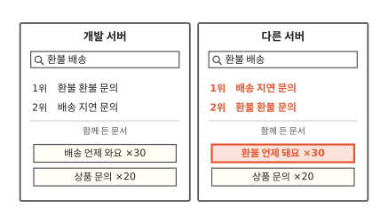
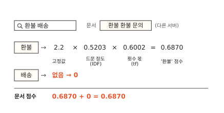
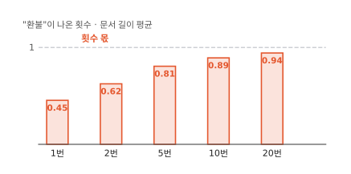
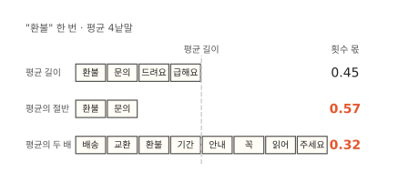

# BM25: ES가 검색 결과에 점수를 매기는 방법

같은 쇼핑몰 문의 두 개를 ES 두 곳에 넣고 "환불 배송"으로 검색했어요. 한 곳에서는 "환불 환불 문의"가 1위인데 다른 곳에서는 "배송 지연 문의"가 1위예요. 두 문의는 한 글자도 다르지 않아요. 이 글을 읽고 나면 ES가 검색 결과에 점수를 어떻게 매기는지 알게 돼요. 그걸 알면 같은 검색어의 순위가 곳마다 다른 이유와 순위를 확인할 때 무엇을 조심할지도 보여요.

!!! abstract "이 글에서 알게 되는 것"
    1. ES는 검색어를 낱말로 나눠 낱말마다 점수를 내고 더해요. 낱말 점수는 그 낱말이 얼마나 드문지와 문서에 몇 번 나왔는지로 정해요.
    2. 낱말이 많이 나올수록 점수가 오르지만 오르는 폭은 금방 줄어요. 같은 횟수라도 짧은 문서가 점수를 더 받아요.
    3. 드문 정도와 평균 길이는 함께 든 다른 문서로 세고 샤드마다 따로 세요. 그래서 문서 모음이나 샤드가 바뀌면 같은 문서의 순위도 바뀌어요.

## 1. 다른 문서만 바뀌었는데 순위가 뒤집혔어요

처음 장면의 두 곳은 ES가 돌아가는 컴퓨터, 곧 서버 두 대예요. 한 대는 미리 시험해 보는 개발 서버이고 다른 한 대는 그냥 다른 서버라고 할게요. 쇼핑몰 고객 문의를 ES에 넣고 "환불 배송"으로 검색해요. 개발 서버에서는 "환불 환불 문의"가 1위, "배송 지연 문의"가 2위였어요. 그래서 1위가 "환불 환불 문의"인지 확인하는 테스트를 만들었어요. 테스트는 결과가 기대한 대로 나오는지 프로그램이 대신 확인하는 일이에요. 같은 두 문서를 다른 서버에 넣고 테스트를 돌렸더니 "배송 지연 문의"가 1위로 나왔어요.

아래 그림에서 두 서버의 "함께 든 문서" 칸을 비교해 보세요.


**그림 1.** 두 서버는 함께 든 문서 30개만 달랐는데 1위와 2위가 바뀌었어요.
{ .fig-cap }

두 서버 모두 문서는 52개예요. 검색한 두 문서와 "상품 문의" 20개는 똑같아요. 남은 30개가 개발 서버에서는 "배송 언제 와요"였고 다른 서버에서는 "환불 언제 돼요"였어요. 검색한 두 문서는 한 글자도 바뀌지 않았어요. 그런데 순위가 바뀌었어요. ES는 점수를 매길 때 함께 든 다른 문서도 보거든요. 점수가 어떻게 만들어지는지부터 볼게요.

## 2. 점수는 검색어 낱말마다 내서 더해요

[1편](01-inverted-index.md)의 역색인으로 "환불"이나 "배송"이 든 문서를 찾았어요. 이제 찾은 문서에 순서를 매길 차례예요. ES는 문서마다 점수를 매겨서 높은 순으로 보여 줘요. 이 점수를 매기는 ES의 기본 공식이 **BM25**예요.[^okapi]

BM25는 검색어를 낱말로 나눠서 낱말마다 점수를 내요. 그 점수를 다 더하면 문서 점수예요. 낱말 하나의 점수는 세 수를 곱해서 내요.

> 낱말 점수 = 2.2 × 드문 정도 × 횟수 몫

2.2는 모든 낱말에 똑같이 곱하는 수라서 순위를 바꾸지 않아요. 드문 정도는 그 낱말이 든 문서가 다른 문서들 가운데 얼마나 적은가를 나타내요. 횟수 몫은 이 문서에 그 낱말이 나온 횟수를 문서 길이로 고친 값이에요. 이 둘이 순위를 정해요.

다른 서버의 "환불 환불 문의"로 계산해 볼게요. 아래 그림에서 "환불" 줄과 "배송" 줄을 차례로 보세요.


**그림 2.** "환불" 점수 0.687에 "배송" 점수 0을 더해서 문서 점수는 0.687이에요.
{ .fig-cap }

"환불"은 2.2에 드문 정도 0.52와 횟수 몫 0.60을 곱해서 0.687점이에요. "배송"은 이 문서에 없어서 0점이에요. 그래서 문서 점수는 0.687이에요. 검색할 때 `explain`을 붙이면 ES가 문서마다 이 계산을 풀어서 보여 줘요.

## 3. 낱말이 많이 나올수록 점수가 오르지만 오르는 폭은 줄어요

먼저 횟수 몫을 볼게요. "환불"이 한 번 나온 문서보다 두 번 나온 문서가 환불 이야기일 가능성이 높아요. 그래서 낱말이 많이 나올수록 점수를 더 줘요.

그런데 나온 횟수를 그대로 곱하면 문제가 생겨요. "환불"을 스무 번 적은 문서가 한 번 적은 문서의 스무 배 점수를 받아요. 낱말을 일부러 잔뜩 넣은 글이 늘 맨 위로 올라와요.

그래서 BM25는 횟수를 그대로 쓰지 않아요. 문서 길이가 평균일 때 횟수 몫은 횟수 ÷ (횟수 + 1.2)예요. 한 번이면 1 ÷ 2.2라서 0.45예요. 아래 그림에서 막대가 점선 1에 다가가는 모습을 보세요.


**그림 3.** 횟수 몫은 1번일 때 0.45에서 20번일 때 0.94까지 오르고 1을 넘지 않아요.
{ .fig-cap }

두 번이면 0.62예요. 다섯 번이면 0.81이고 스무 번을 넣어도 0.94예요. 처음 몇 번은 크게 오르고 그다음부터는 거의 오르지 않아요. 그래서 낱말을 잔뜩 넣어도 점수가 끝없이 오르지 않아요.

식에 든 1.2는 `k1`이라는 설정값이에요. `k1`을 키우면 횟수가 늘 때 몫이 더 오래 올라요. 줄이면 두 번째부터는 거의 오르지 않아요.

## 4. 같은 한 번이라도 짧은 문서가 점수를 더 받아요

횟수 몫은 문서 길이도 봐요. 세 낱말짜리 문의 글에 든 "환불" 한 번과 삼백 낱말짜리 공지에 든 "환불" 한 번은 무게가 달라요. 긴 글은 이것저것 다루다가 그 낱말이 우연히 들어갔을 수 있어요. 그래서 BM25는 문서 길이를 인덱스의 평균 길이와 비교해서 횟수 몫을 고쳐요.

"환불"이 한 번씩 나온 문서 셋을 놓아 볼게요. 쉽게 보려고 평균 길이를 네 낱말로 잡았어요. 아래 그림 오른쪽의 횟수 몫을 위에서부터 읽어 보세요.


**그림 4.** "환불"이 똑같이 한 번 나왔는데 평균 길이는 0.45, 절반 길이는 0.57, 두 배 길이는 0.32예요.
{ .fig-cap }

평균 길이인 문서는 3절과 같은 0.45예요. 평균보다 짧으면 몫이 커지고 길면 작아져요. 얼마나 고칠지는 `b`라는 설정값이 정해요. 기본은 0.75이고 0이면 길이를 보지 않아요. 1이면 길이를 가장 크게 반영해요.

평균 길이도 함께 든 다른 문서들로 계산해요. 짧은 문의 글만 있던 인덱스에 긴 공지가 잔뜩 들어오면 평균이 길어져요. 그러면 원래 있던 짧은 글은 평균보다 더 짧아져서 점수가 다 같이 조금 올라가요.

## 5. 드문 낱말일수록 점수가 무거워요

이제 드문 정도를 볼게요. "환불"이 모든 문서에 다 들어 있다면 "환불"이 들었다는 사실로는 문서를 가려낼 수 없어요. 몇 문서에만 든 낱말이라면 그 낱말이 든 문서는 검색어와 꽤 가까워요. 그래서 BM25는 드문 낱말에 무게를 더 줘요. 이 무게를 **IDF**라고 해요. 낱말이 든 문서가 적을수록 IDF가 커져요.

아래 그림은 개발 서버의 문서 52개를 한 칸씩 그린 거예요. 빨간 칸을 세어 보세요.


**그림 5.** 개발 서버에서는 52개 가운데 한 문서에만 "환불"이 있어서 IDF가 3.56이에요.
{ .fig-cap }

"환불"이 든 문서는 "환불 환불 문의" 하나뿐이에요. 다른 서버에서는 "환불 언제 돼요" 30개에도 "환불"이 들어 있어요. 아래 그림에서 빨간 칸이 얼마나 늘었는지 보세요.


**그림 6.** 다른 서버에서는 문서 31개에 "환불"이 있어서 IDF가 0.52로 줄었어요.
{ .fig-cap }

같은 "환불"인데 흔해지자 무게가 일곱 배 가까이 가벼워졌어요.

이제 1절에서 순위가 뒤집힌 까닭을 설명할 수 있어요. 개발 서버에서는 "배송 언제 와요" 30개 때문에 "배송"이 흔하고 "환불"이 드물어요. "환불 환불 문의"는 드문 "환불"을 두 번 가져서 4.707점으로 1위였어요. 다른 서버에서는 거꾸로 "환불"이 흔하고 "배송"이 드물어요. 그래서 "배송 지연 문의"가 3.363점으로 1위가 되고 "환불 환불 문의"는 0.687점으로 내려갔어요. 두 서버의 평균 길이는 같아서 횟수 몫은 그대로예요. 바뀐 건 다른 문서들로 센 IDF뿐이에요.

## 6. 드문 정도는 샤드마다 따로 세요

[3편](03-routing.md)에서 인덱스는 여러 샤드로 나뉘어 저장된다고 했어요. 샤드 하나는 혼자서도 검색할 수 있는 작은 인덱스예요. 검색이 오면 샤드마다 자기 문서에 점수를 매겨요. 이때 IDF와 평균 길이를 세는 "다른 문서들"도 그 샤드 안의 문서뿐이에요.

샤드가 2개인 인덱스가 있다고 해 볼게요. 똑같은 글 "환불 문의"를 샤드 A와 샤드 B에 하나씩 넣었어요. 샤드 A에는 "환불 언제 돼요"가 40개 더 있고 샤드 B에는 "상품 문의 드려요"가 40개 더 있어요. "환불"로 검색하면 두 글은 몇 점을 받을까요? 아래 그림에서 두 샤드의 점수 칸을 보세요.


**그림 7.** 똑같은 글이 샤드 A에서는 0.014점, 샤드 B에서는 3.848점을 받아요.
{ .fig-cap }

샤드 A에서는 문서 41개 모두에 "환불"이 있어서 IDF가 0에 가까워요. 샤드 B에서는 41개 가운데 하나에만 있어서 IDF가 커요. 글은 같은데 어느 샤드에 들어갔느냐에 따라 점수가 갈렸어요.

검색할 때 `search_type=dfs_query_then_fetch`를 붙이면 이 차이가 사라져요. ES는 점수를 매기기 전에 모든 샤드에 낱말 통계를 먼저 물어서 합쳐요. 아래 그림에서 가운데 상자의 숫자를 보세요.


**그림 8.** 두 샤드의 통계를 합치면 "환불"은 82개 가운데 42개에 있고 두 글 모두 0.773점을 받아요.
{ .fig-cap }

대신 샤드를 한 번 더 오가야 해서 검색이 조금 느려져요.

문서가 아주 많으면 사정이 달라요. ES는 기본으로 문서를 샤드에 고르게 흩어 넣어요(3편). 그러면 흔한 낱말의 통계는 샤드마다 거의 같아져요. 동전을 열 번 던지면 앞면이 나온 횟수가 들쭉날쭉하지만 만 번 던지면 거의 절반에 모이는 것과 같아요. 샤드마다 통계가 크게 다른 일은 문서가 적은 개발 서버나 테스트 서버에서 자주 생겨요.

## 7. 순위 테스트는 문서 모음이 바뀌어도 버티게 짜요

1절의 테스트로 돌아가 볼게요. 점수는 함께 든 문서들에 기대요. 그래서 문서가 수백 개인 테스트 서버의 1위가 문서가 수백만 개인 실제 서버에서도 1위라는 보장은 없어요. 샤드 수만 달라도 IDF를 세는 문서가 달라져서 순위가 바뀔 수 있어요.

정확한 1위가 꼭 필요하지 않다면 문서 모음이 바뀌어도 잘 깨지지 않는 조건으로 확인해요. "꼭 나와야 할 문서가 상위 몇 개 안에 있다"와 "나오면 안 될 문서가 결과에 없다"가 그런 조건이에요. 1절의 테스트를 "환불 환불 문의가 2위 안에 있다"로 바꾸면 두 서버에서 모두 통과해요.

순위까지 확인해야 한다면 실제 서버와 비슷한 크기의 문서 모음을 써요. 샤드를 1개로 두거나 `dfs_query_then_fetch`로 검색해서 샤드 차이도 없애요.

`k1`과 `b`를 바꿀 때도 이런 테스트가 쓸모 있어요. 두 값은 모든 검색의 순위를 함께 바꿔요. 그래서 바꾸기 전에 테스트로 순위가 어떻게 달라지는지 먼저 봐요.

??? info "심화: BM25 공식 그대로 보기"
    그림 속 숫자를 계산기로 따라 해 보고 싶을 때 보는 칸이에요. ln은 자연로그예요.

    ```text
    IDF     = ln(1 + (N - n + 0.5) / (n + 0.5))
    횟수 몫 = f / (f + k1 × (1 - b + b × dl / avgdl))
    낱말 점수 = (k1 + 1) × IDF × 횟수 몫
    ```

    N은 문서 수, n은 그 낱말이 든 문서 수예요. f는 이 문서에 그 낱말이 나온 횟수, dl은 이 문서의 길이(낱말 수), avgdl은 평균 길이예요. 개발 서버의 "환불"은 N 52, n 1이라서 IDF가 ln(1 + 51.5 / 1.5) = ln(35.33)으로 3.56이에요. 문서 길이가 평균이면 dl / avgdl이 1이라서 횟수 몫이 f / (f + k1)로 줄어요. 3절의 횟수 ÷ (횟수 + 1.2)가 이 꼴이에요.

    앞의 2.2는 k1 + 1이에요. Lucene 8.0은 순위에 영향이 없는 이 수를 공식에서 뺐어요. ES는 7.0부터 예전 점수 크기를 지키려고 이 수를 다시 곱해요. 그래서 ES 7.x부터 9.x까지 `explain`에 2.2가 찍혀요.[^legacy]

    손으로 계산한 값과 ES 점수가 조금 어긋나는 곳도 있어요. 첫째, N과 n에는 지웠지만 아직 병합되지 않은 문서도 들어가요([5편](05-merge.md)). 둘째, N은 그 필드가 있는 문서 수예요. 필드가 빈 문서는 세지 않아요. 셋째, Lucene은 문서 길이를 1바이트 근삿값으로 줄여 저장해요. 그래서 긴 문서는 길이가 조금 달라져요.

## 정리

처음 테스트가 깨진 까닭을 이제 설명할 수 있어요. ES는 BM25로 검색어 낱말마다 점수를 내서 더해요. 낱말 점수는 드문 정도인 IDF와 횟수 몫을 곱해서 내요.

횟수 몫은 낱말이 많이 나올수록 오르지만 1을 넘지 않아요. 같은 한 번이라도 평균보다 짧은 문서에서는 커지고 긴 문서에서는 작아져요. IDF는 그 낱말이 든 문서가 적을수록 커져요. 다른 서버에서는 "환불 언제 돼요" 30개 때문에 "환불"의 IDF가 3.56에서 0.52로 줄었어요. 그래서 "환불 환불 문의"가 2위로 내려갔어요.

IDF와 평균 길이는 함께 든 다른 문서로 세고 샤드마다 따로 세요. 순위 테스트는 "상위 몇 개 안에 있다"처럼 문서 모음이 바뀌어도 버티는 조건으로 짜요. 정확한 순위가 필요하면 `dfs_query_then_fetch`로 샤드 통계를 합쳐요.

[9편](09-top-k.md)에서는 맞는 문서가 수십만 개일 때 위 10개만 빨리 골라내는 방법을 봐요.

### 새로 나온 말

- **BM25**: ES의 기본 점수 공식. 검색어 낱말마다 점수를 내서 더해요. "환불 환불 문의"는 "환불" 0.687에 "배송" 0을 더해 0.687점이었어요.
- **횟수 몫**: 낱말이 나온 횟수를 문서 길이로 고친 값. 많이 나올수록 오르지만 1을 넘지 않아요. 평균 길이에서 1번 0.45, 20번 0.94였어요.
- **IDF**: 낱말이 드문 정도를 나타내는 무게. "환불"이 52개 가운데 1개에 있으면 3.56, 31개에 있으면 0.52였어요.
- **k1**: 횟수가 늘 때 횟수 몫이 얼마나 더 오를지 정하는 설정값. 기본은 1.2예요.
- **b**: 문서 길이를 얼마나 반영할지 정하는 설정값. 기본은 0.75예요.
- **dfs_query_then_fetch**: 모든 샤드의 낱말 통계를 먼저 합친 다음 점수를 매기는 검색 방식. 두 샤드의 "환불 문의"가 똑같이 0.773점을 받았어요.

[^okapi]: BM25는 1990년대 런던 시티대학교의 검색 실험 시스템 Okapi에서 나온 공식이에요. 이 편의 점수는 모두 공식에 예시 숫자를 넣어 계산한 값이에요. 낱말은 띄어쓰기로만 잘랐다고 봤어요. 한국어 분석기로 자르면 낱말 수와 문서 길이가 달라져요([2편](02-analyzer.md)).
[^legacy]: Lucene 8.0에서 `(k1+1)`이 빠졌어요(LUCENE-8563). ES는 7.0부터 `LegacyBM25Similarity`를 기본 BM25로 써서 이 값을 다시 곱해요. `k1`을 바꾸면 2.2도 `k1+1`로 바뀌어요.
