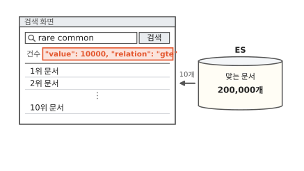
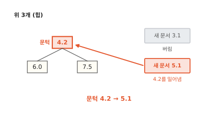
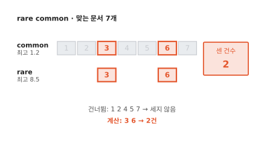
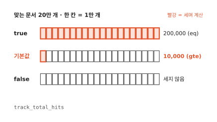
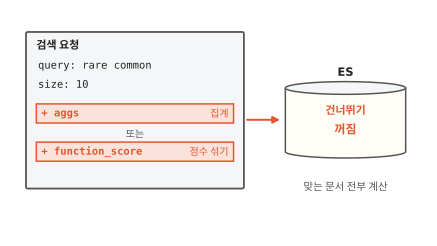

# 위 10개만 찾기: 문턱 아래 문서는 점수를 계산하지 않아요

쇼핑몰에서 "티셔츠"를 검색하면 결과 위에 "10,000+건"이라고 떠요. 티셔츠가 정확히 몇 개인지는 알려 주지 않아요. 이 글을 읽고 나면 ES가 위 10개를 찾으면서 대부분 문서의 점수를 계산하지 않고 건너뛰는 방법을 알게 돼요. 건수를 끝까지 세게 하거나 집계를 붙이면 이 건너뛰기가 꺼지기 때문에 검색이 갑자기 느려진 까닭을 찾을 때 쓸모가 있어요.

!!! abstract "이 글에서 알게 되는 것"
    1. ES는 지금까지 본 문서 가운데 점수가 높은 10개만 힙에 들고 있어요. 그중 가장 낮은 점수가 문턱이 되고 문턱을 넘을 수 없는 문서는 점수를 계산하지 않아요.
    2. 낱말마다, 그리고 문서 128개 묶음마다 낼 수 있는 최고 점수를 미리 알고 있어서 문턱 아래인 문서와 묶음을 통째로 건너뛰어요.
    3. 건너뛴 문서는 세지 않아서 건수가 "1만 개 이상"으로 나와요. 건수를 끝까지 세거나 집계, 점수 섞기를 붙이면 건너뛰기가 꺼져요.

## 1. 위 10개는 힙으로 골라요

처음 장면의 "10,000+건"이 어디서 오는지 따라 셀 수 있는 예로 볼게요. 검색 화면에 위 10개를 보여 주고 그 위에 건수도 적으려고 해요. 문서는 20만 개이고 모두 common이 들어 있어요. 그중 100개에 1개꼴로 rare도 들어 있어요. "rare common"으로 찾으면 둘 중 하나만 있어도 맞는 문서라서 20만 개가 다 맞아요. 아래 그림에서 ES가 보내 준 건수 칸을 보세요.

**그림 1.** 맞는 문서는 20만 개인데 건수 칸에는 10000과 gte가 왔어요.
{ .fig-cap }

`gte`는 "이상"이라는 뜻이에요. ES는 맞는 문서를 1만 개까지만 세고 그다음부터는 세지 않았어요. 쇼핑몰 화면의 "10,000+건"도 이렇게 1만 개에서 세기를 멈춘 결과예요. 화면에 보여 줄 건 위 10개뿐이라서 건수를 포기하고 다른 무언가를 아낀 거예요. 무엇을 아꼈는지 알려면 먼저 위 10개를 어떻게 고르는지부터 봐야 해요.

가장 쉬운 방법은 20만 개의 점수를 다 매기고 정렬해서 앞의 10개를 자르는 거예요. 그러면 20만 개의 점수를 모두 들고 있어야 해요. ES는 [알고리즘 10편](../algorithms/10-heap.md)의 힙을 써요. 지금까지 본 문서 가운데 점수가 높은 10개만 들고 있어요. 그 10개 중 가장 낮은 점수는 맨 위에 둬요. 그림은 10개 대신 3개로 줄여 그렸어요.

새 문서의 점수가 나오면 맨 위 점수와 비교해요. 아래 그림에서 새 문서 두 개가 각각 어떻게 되는지 보세요.

**그림 2.** 3.1은 맨 위 4.2보다 낮아서 버려지고 5.1은 4.2를 밀어내고 들어가요.
{ .fig-cap }

3.1은 4.2보다 낮아요. 힙에 있는 세 개보다 다 낮으니 위 3개에 들 수 없어서 버려요. 5.1은 4.2보다 높아서 4.2를 밀어내고 들어가요. 이제 힙에서 가장 낮은 점수는 5.1이에요.

그래서 맨 위 점수는 "이 점수를 넘어야 위 10개에 낄 수 있다"는 기준이 돼요. 이 기준을 **문턱**이라고 할게요. Lucene에서는 minimum competitive score라고 불러요. 힙에는 더 높은 점수만 들어오니까 문턱은 올라가기만 해요.

## 2. 문턱을 넘을 수 없는 문서는 점수를 계산하지 않아요

앞 절에서는 점수를 다 계산한 다음에 문턱으로 걸렀어요. 이걸 계산하기 전에 거를 수 있으면 20만 번 계산할 일이 크게 줄어요. 그러려면 계산해 보지 않고도 "이 문서는 아무리 잘 받아도 몇 점까지"를 알아야 해요.

[8편](08-bm25.md)에서 BM25는 낱말마다 드문 정도와 횟수 몫을 곱해서 점수를 냈어요. 횟수 몫은 아무리 커져도 1을 넘지 않아요. 그래서 낱말 하나가 낼 수 있는 점수에는 위가 정해져 있어요. 흔한 common은 드문 정도가 낮아서 최고 점수도 낮아요. 드문 rare는 최고 점수가 높아요.

여기서는 설명하기 쉽게 숫자를 정해 볼게요. common의 최고 점수는 1.2, rare는 8.5예요. 문턱은 지금 4.2까지 올라와 있어요. 맞는 문서는 1번부터 7번까지 일곱 개만 그렸어요. 아래 그림에서 어느 문서를 계산하는지 보세요.

**그림 3.** common만 든 문서는 최고 1.2라서 건너뛰고 rare도 든 3번과 6번만 계산해요.
{ .fig-cap }

1, 2, 4, 5, 7번에는 common만 있어요. 아무리 잘 받아도 1.2라서 문턱 4.2를 넘을 수 없어요. 점수를 계산해 봐야 힙에 못 들어가니 계산하지 않고 지나가요. 3번과 6번에는 rare도 있어서 1.2와 8.5를 더해 9.7까지 받을 수 있어요. 문턱을 넘을 수도 있으니 이 둘만 점수를 계산해요.

이렇게 낱말마다의 최고 점수를 더해 보고 문턱을 넘을 수 있는 문서만 계산하는 방법을 **WAND**라고 해요. weak AND를 줄인 이름이에요.

여기서 이런 생각이 들 거예요. 건너뛸 문서라도 하나씩 밟고 지나가면 시간이 들지 않을까요? 아래 그림에서 화살표가 어디로 가는지 보세요.

**그림 4.** rare 목록이 다음 번호를 내놓으면 common 목록은 그 번호로 껑충 가요.
{ .fig-cap }

밟지 않아요. 문턱을 넘으려면 rare가 꼭 있어야 하니까 rare 목록이 앞장서요. ① rare 목록에서 3을 꺼내면 ② common 목록은 1과 2를 지나치고 3으로 가요. [7편](07-intersection.md)에서 본 "이 번호 이상인 첫 문서로 가기", advance예요. ③ rare에서 6을 꺼내면 ④ common도 6으로 가요. 낱말 둘 중 하나만 있어도 되는 OR 검색인데도 7편의 AND 검색처럼 드문 쪽 목록이 길을 정해요.

## 3. 묶음마다 최고 점수를 적어 두면 묶음째 건너뛰어요

WAND로 common만 든 문서는 걸렀어요. 그런데 rare가 든 문서는 모두 9.7까지 받을 수 있다고 보고 계산했어요. rare의 최고 점수 8.5는 rare가 가장 잘 맞는 문서 하나에서 나온 점수예요. 다른 rare 문서는 그보다 훨씬 낮을 수 있어요. 목록 전체에서 하나뿐인 최고값을 모든 문서에 대면 기준이 너무 후해요.

[6편](06-terms-postings.md)에서 포스팅 목록은 문서 128개씩 묶음으로 나뉘어 있었어요. 아래 그림은 묶음 세 개를 그린 거예요. 묶음마다 rare가 든 문서가 있어요. 목록 전체의 최고 점수로 따지면 어떻게 되는지 보세요.

**그림 5.** 목록 전체의 최고 점수로 따지면 세 묶음 모두 9.7이라 다 열어 봐야 해요.
{ .fig-cap }

세 묶음 모두 9.7까지 받을 수 있으니 하나도 건너뛰지 못해요. 그래서 Lucene은 [7편](07-intersection.md)의 건너뛰기 표에 묶음마다 "이 묶음 안에서 나올 수 있는 최고 점수"를 함께 적어 둬요. 이번에는 묶음마다 그 안의 최고 점수로 따져 볼게요.

**그림 6.** 묶음 1과 3은 최고 3.6이라 문턱 4.2를 못 넘어서 통째로 건너뛰어요.
{ .fig-cap }

묶음 1에서는 common이 0.6, rare가 3.0까지만 나와요. 더해도 3.6이라 문턱 4.2를 넘지 못해요. 묶음 3도 3.6이에요. 두 묶음에는 rare가 들어 있지만 통째로 건너뛰어요. 열어 보는 건 9.7까지 나올 수 있는 묶음 2뿐이에요.

이렇게 묶음마다의 최고 점수로 묶음째 건너뛰는 방법을 **block-max WAND**라고 해요. Lucene 8부터 들어와서 ES 7.0부터 써요.

묶음마다 적어 두는 것은 점수 자체가 아니에요. 그 묶음에서 점수를 가장 크게 만들 수 있는 낱말 횟수와 문서 길이를 적어 둬요. 이 재료를 Lucene에서는 impacts라고 불러요. 검색할 때 이 재료로 최고 점수를 계산하니까 8편의 `k1`, `b`를 바꿔도 다시 색인할 필요가 없어요.

## 4. 건너뛴 문서는 세지 않아서 건수가 "1만 개 이상"이 돼요

이제 처음의 "1만 개 이상"으로 돌아갈 수 있어요. 2절의 문서 일곱 개로 다시 볼게요. 아래 그림에서 건수 칸을 보세요.

**그림 7.** 맞는 문서는 일곱 개인데 건너뛴 다섯 개는 세지 않아서 건수가 2가 돼요.
{ .fig-cap }

건너뛴 1, 2, 4, 5, 7번은 점수만 안 매긴 게 아니에요. 들여다보지도 않았으니 맞는 문서로 세지도 못했어요. 그래서 센 건수는 2예요. 정확한 7을 내려면 1번부터 7번까지 모두 지나가야 해요. 그러면 건너뛸 수가 없어요. 정확한 건수와 건너뛰기는 둘 중 하나만 고를 수 있어요.

ES는 7.0부터 둘을 섞은 기본값을 써요. 맞는 문서 1만 개째까지는 하나씩 지나가며 점수를 매기고 건수를 세요. 1만 개를 넘으면 그때부터 건너뛰기를 켜요. 이 경계를 정하는 값이 검색 요청의 `track_total_hits`예요. `true`를 주면 끝까지 세고 `false`를 주면 아예 세지 않아요. 숫자를 주면 그 수까지만 세요.

문서 20만 개를 한 칸에 1만 개씩 스무 칸으로 그려 볼게요. 세 가지 값에서 어디까지 세는지 보세요.

**그림 8.** 기본값은 첫 1만 개만 세며 계산하고 나머지는 건너뛰어서 10,000 (gte)가 나와요.
{ .fig-cap }

`true`면 스무 칸을 다 지나가서 건수가 정확한 200,000이에요. `eq`는 "같다"는 뜻이에요. 기본값이면 첫 칸만 세고 나머지는 건너뛰어서 `10000`과 `gte`가 와요. 처음 장면의 건수가 이 줄이에요. `false`면 힙이 차자마자 건너뛰기를 켜요.

세 경우 모두 위 10개는 똑같아요. 건너뛴 문서는 문턱을 넘을 수 없는 문서뿐이라서 위 10개에 들 수 없었거든요. 건수를 덜 셀수록 건너뛰기가 일찍 켜지고 계산이 줄어요.

## 5. 맞는 문서를 모두 봐야 하는 요청은 건너뛰지 못해요

건너뛰기는 "점수가 높은 몇 개만 필요하다"는 조건에서만 돼요. 이 조건이 깨지는 요청이 두 가지 있어요. 아래 그림에서 검색 요청에 덧붙인 빨간 줄을 보세요.

**그림 9.** 집계나 점수 섞기를 붙이면 건너뛰기가 꺼지고 맞는 문서를 전부 계산해요.
{ .fig-cap }

첫째는 집계(aggregation)예요. 쇼핑몰 검색에서 위 10개와 함께 "카테고리별 건수"를 달라고 하는 경우예요. 카테고리별 건수는 맞는 문서를 하나도 빼지 않고 봐야 낼 수 있어요. 그래서 건너뛰기가 꺼지고 `track_total_hits: true`와 같은 쪽이 돼요.

둘째는 점수에 다른 값을 섞는 `function_score`나 스크립트 점수예요. 2절에서 건너뛸 수 있었던 건 낱말마다 낼 수 있는 최고 점수를 미리 알아서였어요. 점수에 다른 값을 섞으면 ES는 그 최고 점수를 미리 알 수 없어요. 그래서 문턱과 비교하지 못하고 맞는 문서를 전부 계산해요.

두 경우 모두 위 10개만 찾던 검색에 한 줄을 붙였을 뿐인데 계산이 20만 번으로 돌아가요.

## 6. 건수는 필요한 만큼만 세요

건수를 끝까지 세면 건너뛰기가 꺼진다는 걸 봤어요. 그럼 정확한 건수가 필요할 때는 어떻게 할까요? 아래 갈림길을 위에서부터 따라가 보세요.

**그림 10.** 정확한 건수가 필요 없으면 기본값으로 충분해요. 필요하면 필요한 범위와 화면에서만 세요.
{ .fig-cap }

먼저 정확한 건수가 정말 필요한지 물어봐요. 수십만 건이 나오는 검색에서 "1만 건 이상"이나 "10,000+"로 보여 주는 서비스가 많아요. 기본값을 그대로 두면 이렇게 보여 줄 수 있어요.

꼭 필요하다면 몇 건까지 정확하면 되는지 정해요. 10만 건까지 정확하면 된다면 `track_total_hits`에 `100000`을 줘요. 끝까지 세야 한다면 그 숫자를 보여 주는 화면에서만 `true`를 줘요. 첫 페이지에서만 건수를 보여 준다면 다음 페이지 요청에는 줄 필요가 없어요.

집계도 같은 눈으로 봐요. 상품 검색 화면이 위 20개와 브랜드별 건수를 한 요청으로 받으면 위 20개를 찾는 건너뛰기도 함께 꺼져요. 브랜드별 건수가 조금 늦게 떠도 된다면 검색 요청에서 집계를 빼고 따로 받아요.

오래된 클라이언트가 붙이는 `rest_total_hits_as_int=true`도 살펴봐요. 7.0 이전 응답 모양에 맞추는 값인데 `track_total_hits`를 따로 주지 않으면 건수를 끝까지 세요.

## 정리

ES는 위 10개를 찾을 때 지금까지 본 점수 가운데 높은 10개만 힙에 들고 있어요. 힙에서 가장 낮은 점수가 문턱이고 문턱은 올라가기만 해요.

낱말마다 낼 수 있는 최고 점수가 정해져 있어서 ES는 계산해 보기 전에 "이 문서는 문턱을 넘을 수 없다"를 알 수 있어요. "rare common"에서 common만 든 문서가 그랬어요. 이렇게 거르는 방법이 WAND예요. 문서 128개 묶음마다 최고 점수를 적어 두면 rare가 든 묶음도 통째로 건너뛸 수 있어요. 이게 block-max WAND예요.

건너뛴 문서는 세지 않아요. 그래서 맞는 문서가 20만 개여도 건수는 "1만 개 이상"으로 와요. `track_total_hits`를 `true`로 주거나 집계, `function_score`를 붙이면 건너뛰기가 꺼지고 맞는 문서를 다 계산해요. 건수와 집계는 필요한 화면에서 필요한 만큼만 받아요.

이 글에서는 점수 순서로 위 10개를 골랐어요. 날짜나 가격처럼 필드 값으로 줄을 세우거나 집계를 낼 때 ES가 그 값을 어디서 읽는지는 [10편](10-doc-values.md)에서 볼게요.

### 새로 나온 말

- **문턱**: 힙에 든 위 10개 가운데 가장 낮은 점수. 이 점수를 넘어야 위 10개에 들어요. 그림 2에서는 4.2였다가 5.1로 올라갔어요.
- **WAND**: 낱말마다의 최고 점수를 더해 보고 문턱을 넘을 수 없는 문서는 계산하지 않는 방법. common만 든 문서는 최고 1.2라서 건너뛰었어요.
- **block-max WAND**: 문서 128개 묶음마다 최고 점수를 적어 두고 문턱을 못 넘는 묶음을 통째로 건너뛰는 방법. 묶음 1과 3은 최고 3.6이라 건너뛰었어요.
- **impacts**: 묶음 최고 점수를 계산하는 재료. 그 묶음에서 점수를 가장 크게 만드는 낱말 횟수와 문서 길이예요.
- **`track_total_hits`**: 건수를 몇 개까지 정확히 셀지 정하는 값. 기본값은 1만이고 `true`면 끝까지, `false`면 세지 않아요.
