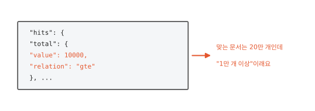
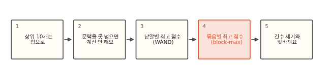
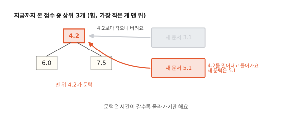
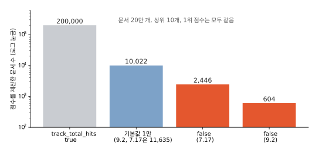

# 상위 10개만 필요하면 왜 다 계산하지 않아도 될까요?

## 건수가 "1만 개 이상"으로 나와요



검색 결과 화면에 "검색 결과 200,000건"을 보여 주려고 응답의 `hits.total`을 읽었더니 `10000`이 나와요. 옆에 `"relation": "gte"`가 붙어 있어요. 1만 개 이상이라는 뜻이에요. 맞는 문서가 분명 20만 개인데 ES는 왜 끝까지 세지 않을까요?

화면에 보여 줄 건 위에서 10개뿐이에요. ES는 20만 개를 다 세지 않기로 하면 그만큼 점수 계산을 건너뛸 수 있어요. 이 편은 상위 10개를 찾는 데 정말 필요한 일이 얼마나 되는지, 그리고 건수를 끝까지 세는 일이 왜 그 건너뛰기를 막는지 봐요.

## 힙에서 건수와의 맞바꿈까지



먼저 상위 10개를 고르는 힙과 그 힙이 만드는 "문턱"을 봐요. 그다음 문턱을 넘을 수 없는 문서를 계산 없이 지나가는 두 방법을 봐요. 하나는 낱말마다 낼 수 있는 최고 점수를 쓰고 다른 하나는 128개 묶음마다 최고 점수를 써요. 마지막으로 건수를 정확히 세는 일과 이 건너뛰기가 왜 함께 갈 수 없는지 봐요.

## 상위 10개는 힙으로 골라요



맞는 문서 20만 개의 점수를 다 매긴 뒤 정렬해서 위 10개를 고를 수도 있지만 그러면 20만 개를 다 기억하고 정렬해야 해요. ES는 [알고리즘 10편](../algorithms/10-heap.md)의 힙을 써요. 지금까지 본 문서 중 점수가 높은 10개만 들고 있는데 그 10개 중 가장 작은 점수가 맨 위에 오게 해요.

힙이 10개로 다 차기 전에는 어떤 문서든 들어가요. 다 찬 뒤에는 새 문서의 점수가 맨 위 점수보다 작으면 그 문서는 위 10개에 들 수 없으니 버려요. 크면 맨 위를 밀어내고 들어가요. 그래서 맨 위 점수는 "이 점수를 넘어야 위 10개에 낄 수 있다"는 **문턱**이 돼요. Lucene에서는 minimum competitive score라고 불러요. 문서를 볼수록 더 높은 점수가 들어오니 문턱은 올라가기만 해요. 여기까지는 점수를 계산한 뒤에 거르는 일이에요. 다음 절은 계산하기 전에 거르는 일이에요.

## 문턱을 넘을 수 없는 문서는 계산하지 않아요


문턱이 생기면 많이 건너뛸 수 있어요. 점수를 계산하기 전에 "이 문서가 아무리 잘 받아도 몇 점까지인가"를 알 수 있다면 문턱보다 낮은 문서는 아예 계산할 필요가 없어요.

[8편](08-bm25.md)에서 BM25 점수는 "낱말이 얼마나 드문가(IDF)"와 "문서에 얼마나 나오나(횟수 몫)"를 곱한다고 했어요. 횟수 몫이 1을 넘지 않으니 낱말 하나가 낼 수 있는 점수에는 위가 정해져 있어요. 예를 들어 "rare common"으로 검색할 때 거의 모든 문서에 있는 common의 최고 점수가 1.2이고 드문 rare가 8.5라고 해 봐요(그림의 숫자는 설명용이에요. 아래 실험에서는 common이 모든 문서에 있어서 점수가 거의 0이에요). 문턱이 4.2까지 올라왔다면 common만 든 문서는 아무리 잘 받아도 1.2라서 문턱을 넘을 수 없어요. 그런 문서는 점수를 계산하지 않고 지나가요. rare가 든 문서만 계산하면 돼요.

이렇게 낱말마다의 최고 점수를 더해 보고 문턱을 넘을 가능성이 있는 문서만 계산하는 방법이 **WAND**(weak AND)예요. 2003년 Broder 외의 논문에서 나왔어요. OR 검색인데도 [7편](07-intersection.md)의 AND처럼 드문 쪽 목록이 앞장서고 흔한 쪽은 "이 번호 이상인 첫 문서로 가기"(advance)로 건너뛰게 돼요.

## 묶음마다 최고 점수를 적어 두면 더 건너뛰어요

낱말 하나의 최고 점수는 그 낱말이 가장 잘 맞는 문서 하나에서 나와요. 목록 전체에서 하나뿐인 최고값을 기준으로 삼으면 그 값이 너무 높아서 거의 모든 문서가 "문턱을 넘을 수도 있다"로 판정돼요. 그래서 Lucene은 [7편](07-intersection.md)의 건너뛰기 표에 128개 묶음마다 "이 묶음 안에서 나올 수 있는 최고 점수"를 만드는 재료(횟수와 문서 길이의 조합)를 함께 적어 둬요. 점수 대신 재료를 적는 까닭은 점수 공식의 설정(8편의 `k1`, `b`)을 바꿔도 같은 재료로 최고 점수를 다시 계산할 수 있게 하려는 거예요. 그러면 문턱을 묶음 단위로 따질 수 있어요. 어떤 묶음은 common의 최고 점수가 0.6이고 rare가 아예 없으니 통째로 건너뛰어요.

이 방법을 **block-max WAND**라고 불러요. 2011년 Ding과 Suel의 논문에서 나왔고 Lucene 8(ES 7.0)부터 들어왔어요. 묶음 최고 점수로 건너뛴다는 생각은 같고 그걸 실제로 돌리는 실행기는 버전마다 달라졌어요(심화 칸). 파이썬으로 같은 상황(문서 20만 개, rare 1%)을 흉내 내 보니 모든 문서를 계산하면 20만 번, 묶음 최고 점수로 건너뛰면 937번 계산하고 위 10개가 똑같았어요.[^lab]

??? info "심화: impacts와 Lucene의 실행기"
    묶음마다 적는 재료를 Lucene에서는 impacts라고 불러요. 묶음 안 문서들의 (횟수, 문서 길이) 쌍 가운데 점수를 가장 크게 만들 수 있는 조합만 남겨 둔 목록이에요. BM25는 횟수가 클수록, 길이가 짧을수록 커지니 이 목록만 있으면 어떤 `k1`, `b`에서도 묶음 최고 점수를 계산할 수 있어요. 건너뛰기 표의 위층에도 같은 재료가 있어서 묶음 여러 개를 한꺼번에 건너뛰기도 해요.

    점수 상한은 구간마다 달라서 Lucene의 scorer는 `advanceShallow(target)`으로 문서 목록을 풀기 전에 앞쪽 묶음 정보만 옮겨 두고 `getMaxScore(upTo)`로 그 구간의 상한을 물어요. 상한을 모르는 질의(스크립트 점수 등)는 상한을 무한대로 돌려줘서 건너뛰기에서 빠져요. impacts는 횟수를 색인한 필드(`index_options`가 `freqs` 이상)에만 있어요.

    실행기는 버전마다 달라졌어요. 7.17의 Lucene 8.11에는 `WANDScorer`와 `BlockMaxConjunctionScorer`가 있고 9.2의 Lucene 10.3에는 여기에 낱말을 "꼭 봐야 하는 것"과 "아닌 것"으로 나눠 묶음 단위로 처리하는 `MaxScoreBulkScorer`가 더 있어요(두 jar의 클래스 목록으로 확인). 최근 Lucene에서 최상위 OR 질의는 주로 이쪽이 맡고 `WANDScorer`는 `minimum_should_match` 같은 경우에 남는 것으로 알려져 있어요. 아래 표에서 9.2가 7.17보다 훨씬 적게 계산한 데는 이런 변화가 겹쳐 있는 것으로 보여요. 다만 `profile`은 점수 계산을 감싸서 세기 때문에 실행 경로가 일반 요청과 다를 수 있어요. profile 없이 `took`만 보면 `track_total_hits: false`가 9.2에서 8 ms 안팎에서 3 ms 안팎으로 줄었고 7.17은 이 크기에서 차이가 작았어요.

## 그래서 건수는 끝까지 세지 않아요

여기까지 오면 처음 질문의 답이 나와요. 건너뛴 문서는 점수를 안 매긴 것은 물론 "맞는 문서"로 세지도 않았어요. 점수를 매기며 문서를 하나씩 내보내는 질의(두 낱말 OR처럼)는 정확한 건수를 내려면 맞는 문서를 하나하나 지나가야 하고 그러면 건너뛰기를 할 수 없어요. 낱말 하나짜리 질의처럼 통계만으로 셀 수 있는 질의는 예외예요. 둘 중 하나를 골라야 해요.

ES는 7.0부터 기본값을 정해 뒀어요. 맞는 문서 1만 개째까지는 하나하나 점수도 매기며 건수를 세고 그 뒤부터 건너뛰기를 켜요. 그래서 표의 점수 계산 횟수가 1만을 조금 넘어요(건너뛰기를 켜는 시점이 묶음 경계에 맞춰져서 딱 1만이 아니에요). 이 1만은 샤드마다 따로 세는 수라서 샤드가 여럿이면 샤드마다 1만 근처까지 센 뒤 합쳐서 1만으로 잘라 보여 줘요. 아래 실험은 샤드 1개예요. 그래서 1만 개가 넘으면 `"value": 10000, "relation": "gte"`가 나와요. 이 경계를 정하는 게 요청의 `track_total_hits`예요. `true`로 주면 끝까지 세고 `false`로 주면 아예 세지 않아요.



로컬 ES에 문서 20만 개(모두 common, 1%에 rare)를 넣고 "rare common"으로 상위 10개를 찾으면서 profile의 점수 계산 횟수(`score_count`)를 셌어요.

| `track_total_hits` | 7.17.26 | 9.2.0 | 건수 (`eq` 정확, `gte` 이상) |
|---|---|---|---|
| `true` | 200,000번 | 200,000번 | 200,000 (eq) |
| 기본값(1만) | 11,635번 | 10,022번 | 10,000 (gte) |
| `false` | 2,446번 | 604번 | 세지 않음 |

세 경우 모두 1위 점수는 같았어요. 집계를 붙여도 맞는 문서를 모두 지나가야 해서 `true`와 같은 쪽이 돼요(심화 칸). 건수를 끝까지 세면 20만 개를 다 계산하고 1만까지만 세면 1만 개쯤 계산한 뒤 건너뛰기로 바뀌어요. 세지 않으면 힙이 찬 뒤 곧바로 건너뛰기에 들어가요. 그래프는 세로를 로그 눈금으로 그려서 막대 길이 차이가 실제 차이보다 작아 보여요.

??? info "심화: 건너뛰기가 꺼지는 경우"
    건너뛰기는 "점수가 높은 몇 개만 필요하다"는 조건에서만 돼요. Lucene에서는 질의를 실행할 때 점수가 필요한 정도를 `ScoreMode`로 알려 주는데 위 10개만 모으는 수집기는 `TOP_SCORES`를 내고 그래야 WAND 계열이 켜져요.

    집계(aggregation)가 붙으면 맞는 문서를 모두 봐야 하니 `COMPLETE`가 되고 건너뛰기가 꺼져요. `track_total_hits: true`도 같아요. 점수가 아닌 필드로 정렬하면 점수 문턱 대신 정렬 값으로 건너뛰는 다른 장치(숫자 정렬 필드 값 기준 건너뛰기, 인덱스 정렬)가 쓰여요. 정렬 값으로 건너뛰는 장치는 7.x 중후반에 들어왔고(정확한 버전은 확인하지 못했어요) 필드 종류에 제한이 있어요. 인덱스 정렬은 색인 때 문서 순서를 정렬 필드대로 맞춰 두는 다른 기능이에요. `function_score`나 스크립트 점수가 붙으면 건너뛰기가 꺼졌어요(7.17.26과 9.2.0에서 `score_count` 200,000, `weight`만 줘도 같았어요). `min_score`는 같은 조건에서 건너뛰기가 거의 그대로 남았어요. 7.x 이전 응답 모양과 맞추려고 `rest_total_hits_as_int=true`를 주면 `track_total_hits`를 따로 주지 않는 한 건수를 끝까지 세요. 로컬에서 같은 검색에 이 값을 주니 두 버전 모두 `"total": 200000`이 나왔어요. 호환용 파라미터 하나가 건너뛰기를 조용히 꺼 버리니 오래된 클라이언트를 쓴다면 확인해 봐요.

## 정리

- 문턱: 위 10개를 든 힙의 맨 위 점수예요. 이걸 넘어야 위 10개에 들 수 있고 시간이 갈수록 올라가요.
- WAND: 낱말마다 낼 수 있는 최고 점수를 더해 봐서 문턱을 못 넘는 문서는 계산하지 않는 방법이에요.
- block-max WAND: 그 최고 점수를 128개 묶음마다 따로 둬서 묶음째 건너뛰는 방법이에요.
- 건너뛴 문서는 세지 않으니 건수와 맞바꿈이에요. ES는 기본으로 1만 개까지만 정확히 세요(`track_total_hits`).

## 직접 해 보기

[lab/es/09_es.py](https://github.com/oya150/bedrock/blob/main/lab/es/09_es.py)는 문서 20만 개를 넣고 `track_total_hits`를 세 가지로 바꿔 가며 점수 계산 횟수를 보여 줘요. [lab/es/09_topk.py](https://github.com/oya150/bedrock/blob/main/lab/es/09_topk.py)는 ES 없이 힙과 묶음 최고 점수로 건너뛰는 모습을 흉내 내요. 직접 보려면 이 요청에 `track_total_hits`만 바꿔 보세요.

```bash
curl 'localhost:9200/topk/_search' -H 'Content-Type: application/json' -d '{
  "profile": true, "size": 10, "track_total_hits": false,
  "query": {"match": {"body": "rare common"}}}'
```

`profile`은 질의가 낱말마다 무슨 일을 몇 번 했는지 보여 주는 옵션이에요(7편). 응답의 `breakdown.score_count`가 점수를 계산한 횟수예요.

## 확인 문제

??? question "1. 문턱이 낮을 때"
    검색을 막 시작해서 힙에 문서가 3개밖에 없어요. 이때도 문턱으로 문서를 건너뛸 수 있을까요?

    **풀이** 아직 못 해요. 위 10개를 찾는데 힙이 다 차지 않았다면 어떤 문서든 들어갈 자리가 있어서 문턱이 없어요. 힙이 찬 뒤에도 `track_total_hits`로 정한 개수만큼 세는 동안은 건너뛰지 않아요. 기본값이면 1만 개쯤 계산한 뒤부터 건너뛰어요.

??? question "2. 흔한 낱말만 있는 검색"
    "common filler"처럼 두 낱말 모두 흔한 검색은 "rare common"보다 건너뛰기가 잘 될까요, 안 될까요? 이 편의 원리로 짐작해 보세요.

    **풀이** 원리로는 덜 돼요. 두 낱말 모두 IDF가 작아 최고 점수가 고만고만하면 많은 문서가 "넘을 수도 있다"가 돼요. 그런데 실제로 로컬에서 재 보니(`track_total_hits: false`) 7.17은 문서의 84%를 계산했지만 9.2는 56개만 계산했어요. 이 데이터에서는 문서마다 점수 차이가 있어서 묶음 최고 점수로 거른 효과가 컸고 그 효과는 실행기 버전에 따라 크게 달랐어요. 원리로 짐작한 뒤 profile로 재 보는 게 안전해요.

??? question "3. 집계를 붙였더니 느려졌어요"
    상위 10개만 보여 주던 검색에 "카테고리별 건수" 집계를 붙였더니 크게 느려졌어요. 왜일까요?

    **풀이** 카테고리별 건수는 맞는 문서를 모두 봐야 낼 수 있어요. 그러면 문턱으로 문서를 건너뛸 수 없어서 맞는 문서 전부를 지나가게 돼요. 위 10개만 찾을 때 건너뛰던 몫이 모두 돌아온 거예요.

## 판단 연습

??? question "검색 결과 건수 표시"
    기획에서 "검색 결과 총 N건"을 정확한 숫자로 보여 달라고 해요. 검색어에 따라 수백만 건이 나오기도 해요. 어떻게 할까요?

    **풀이** 정확한 건수는 `track_total_hits: true`로 얻을 수 있지만 그만큼 건너뛰기가 꺼져서 큰 결과에서 느려져요. 그래서 "1만 건 이상"이나 "10,000+"로 보여 주는 서비스가 많아요. 정확한 숫자가 꼭 필요하다면 그 숫자가 필요한 화면(예: 첫 페이지)에서만 세거나, `track_total_hits`에 필요한 만큼의 숫자(예: 10만)를 줘서 그 안에서만 정확하게 세요. 지연이 얼마나 늘어나는지 실제 데이터로 재 보고 정해요.

??? question "검색과 필터 집계를 한 번에"
    상품 검색 화면이 검색 결과 위 20개와 브랜드별 건수 집계를 한 요청으로 받아요. 검색이 느리다는 불만이 와요. 무엇을 따져 볼까요?

    **풀이** 집계가 붙으면 맞는 문서를 모두 봐야 해서 위 20개만 찾는 건너뛰기가 꺼져요. 집계가 매번 꼭 필요한지, 첫 화면에서만 필요한지 따져 봐요. 집계를 따로 요청해 늦게 그려도 된다면 검색 요청에서는 집계를 빼서 위 20개만 빠르게 받고 집계는 따로 받거나 캐시해요.

[^lab]: [lab/es/09_topk.py](https://github.com/oya150/bedrock/blob/main/lab/es/09_topk.py)는 파이썬 흉내이고, 표의 숫자는 [lab/es/09_es.py](https://github.com/oya150/bedrock/blob/main/lab/es/09_es.py)로 ES 7.17.26과 9.2.0에서 쟀어요. 논문: Broder 외, "Efficient query evaluation using a two-level retrieval process"(CIKM 2003), Ding·Suel, "Faster top-k document retrieval using block-max indexes"(SIGIR 2011).
