# 상위 10개만 필요하면 왜 다 계산하지 않아도 될까요?

## 건수가 "1만 개 이상"으로 나와요

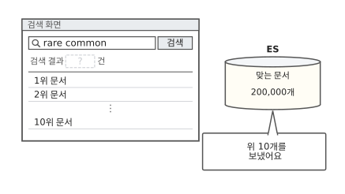

검색 화면에 위 10개를 보여 주고 그 위에 "검색 결과 200,000건"도 적으려고 해요. 제 컴퓨터에 띄운 ES에 문서 20만 개를 넣었어요. 모든 문서에 common이 있고 그중 1%에 rare가 있어요.[^lab] 그래서 "rare common"으로 찾으면 맞는 문서가 20만 개예요. ES는 위 10개를 보내 줬어요. 건수는 응답의 `hits.total`에 담겨 와요. 거기엔 무엇이 적혀 있을까요?

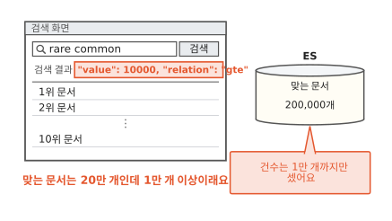

`10000`이 왔고 옆에 `"relation": "gte"`가 붙어 있어요. 1만 개 이상이라는 뜻이에요. 맞는 문서가 분명 20만 개인데 ES는 왜 끝까지 세지 않을까요?

화면에 보여 줄 건 위에서 10개뿐이에요. ES는 20만 개를 다 세지 않기로 하면 그만큼 점수 계산을 건너뛸 수 있어요. 위 10개를 찾는 데 정말 필요한 일은 얼마나 될까요? 먼저 위 10개를 어떻게 고르는지부터 봐요.

## 상위 10개는 힙으로 골라요

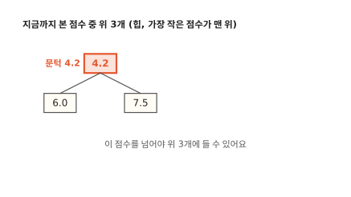

맞는 문서 20만 개의 점수를 다 매긴 뒤 정렬해서 위 10개를 고를 수도 있어요. 그러면 20만 개를 다 기억하고 정렬해야 해요. ES는 [알고리즘 10편](../algorithms/10-heap.md)의 힙을 써요. 지금까지 본 문서 중 점수가 높은 10개만 들고 있어요. 그 10개 중 가장 작은 점수가 맨 위에 오게 해요. 그림은 위 3개로 줄여 그렸어요.

힙이 다 차기 전에는 어떤 문서든 들어가요. 다 찬 뒤에 새 문서가 오면 어떻게 될까요?

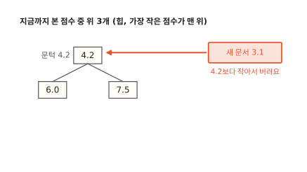

새 문서의 점수가 맨 위 점수보다 작으면 그 문서는 위에 들 수 없으니 버려요. 그림의 3.1은 4.2보다 작아서 버렸어요. 맨 위보다 큰 점수가 오면요?

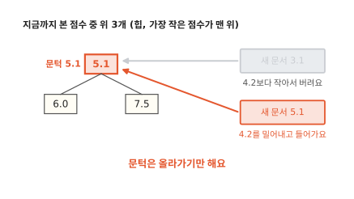

맨 위를 밀어내고 들어가요. 5.1이 들어오자 4.2가 밀려났고 맨 위는 5.1이 됐어요. 그래서 맨 위 점수는 "이 점수를 넘어야 위 10개에 낄 수 있다"는 **문턱**이 돼요. Lucene에서는 minimum competitive score라고 불러요. 문서를 볼수록 더 높은 점수가 들어오니 문턱은 올라가기만 해요.

여기까지는 점수를 계산한 뒤에 거르는 일이에요. 계산하기 전에 거를 수는 없을까요?

## 문턱을 넘을 수 없는 문서는 계산하지 않아요

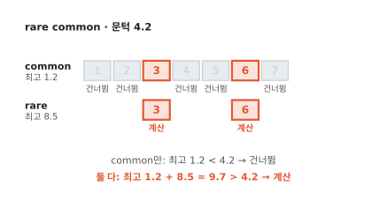

점수를 계산하기 전에 "이 문서가 아무리 잘 받아도 몇 점까지인가"를 알 수 있다면 문턱보다 낮은 문서는 계산할 필요가 없어요. [8편](08-bm25.md)에서 BM25 점수는 낱말이 얼마나 드문가를 나타내는 IDF와 문서에 얼마나 나오나를 나타내는 횟수 몫을 곱한다고 했어요. 횟수 몫이 1을 넘지 않으니 낱말 하나가 낼 수 있는 점수에는 위가 정해져 있어요.

그림에서 거의 모든 문서에 있는 common은 최고 점수가 1.2이고 드문 rare는 8.5예요. 그림의 숫자는 설명용이에요. 문턱은 4.2까지 올라와 있어요. 힙 절 끝의 5.1과 이어지는 장면은 아니에요. 문턱이 4.2인 어느 때를 떼어 봤어요. common만 든 문서는 어떨까요?

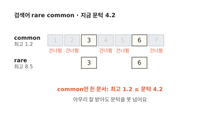

common만 든 문서는 아무리 잘 받아도 1.2라서 문턱 4.2를 넘을 수 없어요. 그런 문서는 점수를 계산하지 않고 지나가요. 그림에서 1, 2, 4, 5, 7번이에요. 남은 3번과 6번은요?

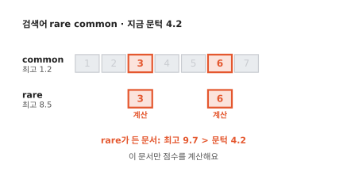

rare가 든 3번과 6번은 1.2와 8.5를 더해 9.7까지 받을 수 있어요. 문턱을 넘을 수도 있으니 이 둘만 점수를 계산해요. 이렇게 낱말마다의 최고 점수를 더해 보고 문턱을 넘을 수 있는 문서만 계산하는 방법이 **WAND**(weak AND)예요. 2003년 Broder 외의 논문에서 나왔어요. 그런데 건너뛸 문서를 하나하나 밟으며 지나가면 시간이 들지 않을까요?

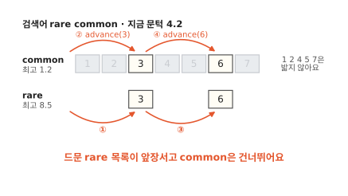

밟지 않아요. 드문 rare 목록이 앞장서거든요. ① rare 목록에서 3을 꺼내면 ② common 목록은 1과 2를 밟지 않고 3으로 곧장 가요. [7편](07-intersection.md)에서 본 "이 번호 이상인 첫 문서로 가기"(advance)예요. ③ 다음 rare 문서 6을 꺼내면 ④ common도 6으로 가요. OR 검색인데도 7편의 AND처럼 드문 쪽 목록이 앞장서는 거예요.

그런데 rare가 든 문서라고 모두 점수가 높을까요?

## 묶음마다 최고 점수를 적어 두면 더 건너뛰어요

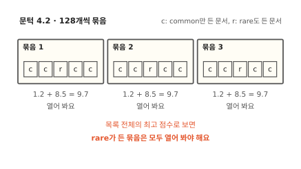

낱말 하나의 최고 점수는 그 낱말이 가장 잘 맞는 문서 하나에서 나와요. rare의 8.5도 rare가 가장 잘 맞는 문서 하나의 점수예요. 목록 전체에서 하나뿐인 이 최고값을 기준으로 삼으면 값이 너무 높아요. WAND가 common만 든 문서는 이미 걸렀어요. 그런데 rare가 든 문서는 모두 9.7까지 받을 수 있다고 보고 계산해야 해요. [7편](07-intersection.md)의 건너뛰기 표처럼 목록을 128개씩 묶어 보면 rare가 든 묶음은 모두 열어 봐야 하는 거예요. 기준을 좁힐 수는 없을까요?

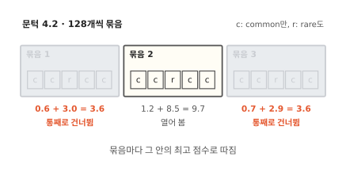

Lucene은 건너뛰기 표에 128개 묶음마다 "이 묶음 안에서 나올 수 있는 최고 점수"를 만드는 재료를 함께 적어 둬요. 재료는 횟수와 문서 길이의 조합이에요. 점수 대신 재료를 적어 두면 점수 공식의 설정(8편의 `k1`, `b`)을 바꿔도 같은 재료로 최고 점수를 다시 계산할 수 있어요. 그림의 묶음 1은 common이 0.6, rare가 3.0까지라서 더해도 3.6이에요. 묶음 2에는 rare 8.5와 common 1.2를 받는 문서가 들어 있어요. 이제 문턱을 묶음 단위로 따질 수 있어요.

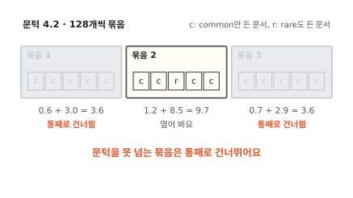

묶음 1과 3은 아무리 잘 받아도 3.6이라 문턱 4.2를 넘지 못해요. rare가 들어 있어도 통째로 건너뛰어요. 묶음 2만 열어 봐요. 이 방법을 **block-max WAND**라고 불러요. 2011년 Ding과 Suel의 논문에서 나왔고 Lucene 8(ES 7.0)부터 들어왔어요. 묶음 최고 점수로 건너뛴다는 생각은 같고 그걸 실제로 돌리는 실행기는 버전마다 달라졌어요(심화 칸).

파이썬으로 문서 20만 개, rare 1%인 같은 상황을 흉내 내 봤어요. 모든 문서를 계산하면 20만 번 계산해요. 묶음 최고 점수로 건너뛰면 937번 계산했고 위 10개가 똑같았어요.[^lab] 이렇게 많이 건너뛰어도 아무 탈이 없을까요? 처음 장면의 "1만 개 이상"이 여기서 나와요.

??? info "심화: impacts와 Lucene의 실행기"
    묶음 최고 점수를 실제로 어떻게 적어 두는지 궁금할 때 보는 칸이에요. 버전마다 무엇이 달라졌는지도 여기서 봐요.

    묶음마다 적는 재료를 Lucene에서는 impacts라고 불러요. 묶음 안 문서들의 (횟수, 문서 길이) 쌍 가운데 점수를 가장 크게 만들 수 있는 조합만 남겨 둔 목록이에요. BM25는 횟수가 클수록, 길이가 짧을수록 커져요. 그래서 이 목록만 있으면 어떤 `k1`, `b`에서도 묶음 최고 점수를 계산할 수 있어요. 건너뛰기 표의 위층에도 같은 재료가 있어서 묶음 여러 개를 한꺼번에 건너뛰기도 해요.

    점수 상한은 구간마다 달라요. 그래서 Lucene의 scorer는 `advanceShallow(target)`으로 문서 목록을 풀기 전에 앞쪽 묶음 정보만 옮겨 둬요. 그리고 `getMaxScore(upTo)`로 그 구간의 상한을 물어요. 상한을 모르는 질의(스크립트 점수 등)는 상한을 무한대로 돌려줘서 건너뛰기에서 빠져요. impacts는 횟수를 색인한 필드에만 있어요. `index_options`가 `freqs` 이상인 필드예요.

    실행기는 버전마다 달라졌어요. 7.17의 Lucene 8.11에는 `WANDScorer`와 `BlockMaxConjunctionScorer`가 있어요. 9.2의 Lucene 10.3에는 여기에 `MaxScoreBulkScorer`가 더 있어요. 낱말을 "꼭 봐야 하는 것"과 "아닌 것"으로 나눠 묶음 단위로 처리하는 실행기예요. 두 jar의 클래스 목록으로 확인했어요. 최근 Lucene에서 최상위 OR 질의는 주로 이쪽이 맡고 `WANDScorer`는 `minimum_should_match` 같은 경우에 남는 것으로 알려져 있어요.

    아래 표에서 9.2가 7.17보다 훨씬 적게 계산한 데는 이런 변화가 겹쳐 있는 것으로 보여요. 다만 `profile`은 점수 계산을 감싸서 세기 때문에 실행 경로가 일반 요청과 다를 수 있어요. profile 없이 `took`만 보면 `track_total_hits: false`가 9.2에서 8 ms 안팎에서 3 ms 안팎으로 줄었어요. 7.17은 이 크기에서 차이가 작았어요.

    두 낱말 모두 흔한 "common filler"로도 재 봤어요(`track_total_hits: false`). 원리로는 두 낱말 모두 IDF가 작아 최고 점수가 고만고만해서 덜 건너뛸 것 같아요. 그런데 7.17은 문서의 84%를 계산했고 9.2는 56개만 계산했어요. 이 데이터에서는 문서마다 점수 차이가 있어서 묶음 최고 점수로 거른 효과가 컸어요. 그 효과는 실행기 버전에 따라 크게 달랐어요. 원리로 짐작한 뒤 profile로 재 보는 게 안전해요.

## 건너뛰는 대신 치르는 값

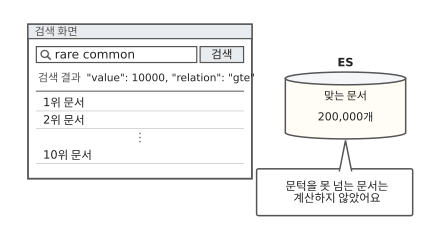

많이 건너뛰어도 탈이 없을지 물었죠. 여기까지 ES는 문턱을 넘을 수 없는 문서를 계산하지 않고 위 10개를 찾았어요. 20만 개를 다 계산하는 것과 크게 달라요.

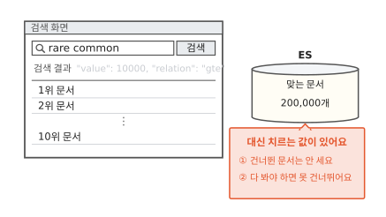

건너뛰는 데는 값이 따라요. 건너뛴 문서는 세지 않아요. 그리고 문서를 다 봐야 하는 요청에서는 건너뛰지 못해요. 첫째 값부터 볼게요.

### 첫째, 건너뛴 문서는 세지 않아요

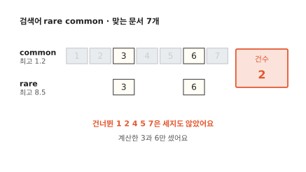

WAND 그림으로 돌아와 볼게요. 맞는 문서는 1부터 7까지 일곱 개예요. 건너뛴 1, 2, 4, 5, 7은 점수를 안 매긴 것은 물론 "맞는 문서"로 세지도 않았어요. 계산한 3과 6만 셌으니 건수는 2예요. 정확한 7을 얻으려면 어떻게 해야 할까요?

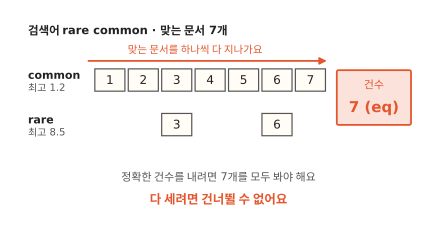

맞는 문서를 하나하나 다 지나가야 해요. 두 낱말 OR처럼 점수를 매기며 문서를 하나씩 내보내는 질의가 그래요. 정확한 건수를 내려면 이렇게 다 지나가야 해서 건너뛰기를 할 수 없어요. 낱말 하나짜리 질의처럼 통계만으로 셀 수 있는 질의는 예외예요. 둘 중 하나를 골라야 해요.

ES는 7.0부터 기본값을 정해 뒀어요. 맞는 문서 1만 개째까지는 하나하나 점수도 매기며 건수를 세요. 그 뒤부터 건너뛰기를 켜요. 이 경계를 정하는 게 요청의 `track_total_hits`예요. `true`로 주면 끝까지 세요. `false`로 주면 아예 세지 않아요. 처음 장면의 문서 20만 개로 세 가지를 다 재 보면 어떨까요?

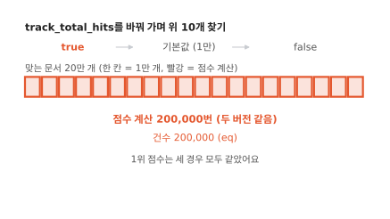

`true`면 20만 개를 다 지나가며 모두 계산했어요. 건수는 정확한 200,000이에요. 기본값이면요?

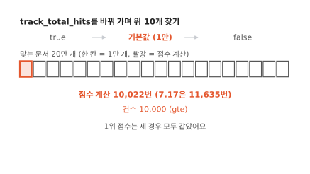

1만 개쯤 계산한 뒤 건너뛰기로 바뀌었어요. 계산 횟수가 1만을 조금 넘는 것은 건너뛰기를 켜는 시점이 묶음 경계에 맞춰져서예요. 건수는 `10000`에 `gte`예요. 처음 장면의 응답이 이 숫자였어요. 이 1만은 샤드마다 따로 세는 수예요. 샤드가 여럿이면 샤드마다 1만 근처까지 센 뒤 합쳐서 1만으로 잘라 보여 줘요. 이 실험은 샤드 1개예요. `false`면요?

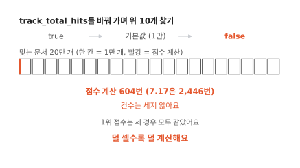

힙이 찬 뒤 곧바로 건너뛰기에 들어가요. 9.2는 20만 개 가운데 604번만 계산했어요.

그림의 숫자는 `profile`로 셌어요. `profile`은 질의가 낱말마다 무슨 일을 몇 번 했는지 보여 주는 옵션이에요(7편). 그 결과의 점수 계산 횟수(`score_count`)를 두 버전에서 모아 보면 이래요.

| `track_total_hits` | 7.17.26 | 9.2.0 | 건수 (`eq` 정확, `gte` 이상) |
|---|---|---|---|
| `true` | 200,000번 | 200,000번 | 200,000 (eq) |
| 기본값(1만) | 11,635번 | 10,022번 | 10,000 (gte) |
| `false` | 2,446번 | 604번 | 세지 않음 |

세 경우 모두 1위 점수는 같았어요. 건수를 덜 셀수록 건너뛰기가 일찍 켜져서 계산이 줄어요.

### 둘째, 다 봐야 하는 요청에서는 건너뛰지 못해요

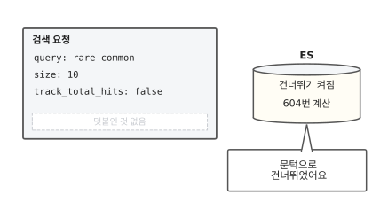

건너뛰기는 "점수가 높은 몇 개만 필요하다"는 조건에서만 돼요. 그림은 `track_total_hits: false`로 위 10개만 찾은 요청이에요. 9.2는 604번 계산했어요. 여기에 카테고리별 건수를 함께 달라고 하면 어떻게 될까요?

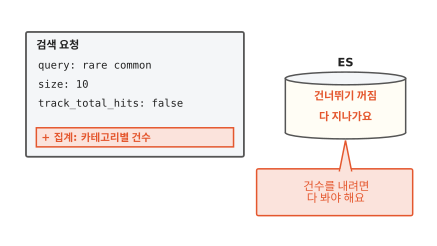

카테고리별 건수 같은 집계(aggregation)는 맞는 문서를 모두 봐야 낼 수 있어요. 그래서 건너뛰기가 꺼지고 `track_total_hits: true`와 같은 쪽이 돼요. 위 10개만 찾을 때 건너뛰던 몫이 모두 돌아오는 거예요. 점수 쪽에 손을 대는 요청은 어떨까요?

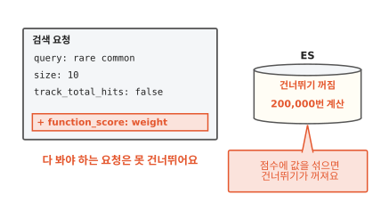

점수에 다른 값을 섞는 `function_score`나 스크립트 점수를 붙이면 건너뛰기가 꺼졌어요. 7.17.26과 9.2.0 모두 `score_count`가 200,000이었어요. `weight`만 줘도 같았어요. 위 10개만 찾던 검색에 이런 것을 붙이면 맞는 문서 전부를 계산하게 돼요.

??? info "심화: 건너뛰기가 꺼지는 경우"
    어떤 요청에서 건너뛰기가 켜지고 꺼지는지 더 자세히 알고 싶을 때 보는 칸이에요.

    Lucene에서는 질의를 실행할 때 점수가 필요한 정도를 `ScoreMode`로 알려 줘요. 위 10개만 모으는 수집기는 `TOP_SCORES`를 내고 그래야 WAND 계열이 켜져요. 집계가 붙으면 맞는 문서를 모두 봐야 하니 `COMPLETE`가 되고 건너뛰기가 꺼져요. `track_total_hits: true`도 같아요.

    점수가 아닌 필드로 정렬하면 점수 문턱 대신 정렬 값으로 건너뛰는 다른 장치가 쓰여요. 숫자 정렬 필드의 값을 기준으로 건너뛰는 장치와 인덱스 정렬이에요. 정렬 값으로 건너뛰는 장치는 7.x 중후반에 들어왔고 필드 종류에 제한이 있어요. 정확히 몇 버전부터인지는 확인하지 못했어요. 인덱스 정렬은 색인 때 문서 순서를 정렬 필드대로 맞춰 두는 다른 기능이에요. `min_score`는 같은 조건에서 건너뛰기가 거의 그대로 남았어요.

    7.x 이전 응답 모양과 맞추려고 `rest_total_hits_as_int=true`를 주면 `track_total_hits`를 따로 주지 않는 한 건수를 끝까지 세요. 로컬에서 같은 검색에 이 값을 주니 두 버전 모두 `"total": 200000`이 나왔어요. 호환용 파라미터 하나가 건너뛰기를 조용히 꺼 버리니 오래된 클라이언트를 쓴다면 확인해 봐요.

그렇다면 건수를 끝까지 세는 건 언제 할 만할까요?

## 건수를 끝까지 세는 건 언제 쓸모 있을까요?

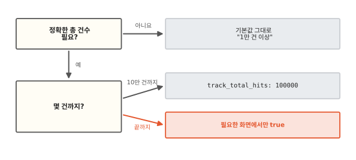

먼저 정확한 건수가 정말 필요한지 물어봐요. 수백만 건이 나오는 검색에서 "1만 건 이상"이나 "10,000+"로 보여 주는 서비스가 많아요. 기본값 그대로 두면 이렇게 보여 줄 수 있어요.

꼭 필요하다면 몇 건까지 정확하면 되는지 정해요. 10만 건까지면 `track_total_hits`에 `100000`을 줘서 그 안에서만 정확하게 세요. 끝까지 세야 한다면 그 숫자가 필요한 화면(예: 첫 페이지)에서만 `true`로 세요. 큰 결과에서 얼마나 느려지는지 실제 데이터로 재 보고 정해요.

집계도 같은 눈으로 봐요. 상품 검색 화면이 위 20개와 브랜드별 건수를 한 요청으로 받는다면 위 20개를 찾는 건너뛰기가 꺼져요. 집계가 매번 꼭 필요한지, 첫 화면에서만 필요한지 따져 봐요. 늦게 그려도 된다면 검색 요청에서는 집계를 빼요. 위 20개만 빠르게 받고 집계는 따로 받거나 캐시해요.

## 다시 "rare common"을 찾아 볼게요

처음 장면의 검색 화면으로 돌아왔어요. 맞는 문서는 20만 개인데 ES는 "1만 개 이상"이라고만 했어요.

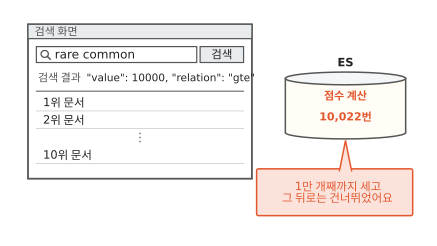

이제 그 까닭을 알아요. ES는 기본값대로 1만 개째까지 세며 점수를 매기고 그 뒤로는 문턱을 넘을 수 없는 문서를 건너뛰었어요. 9.2는 20만 개 가운데 10,022번만 계산했어요.

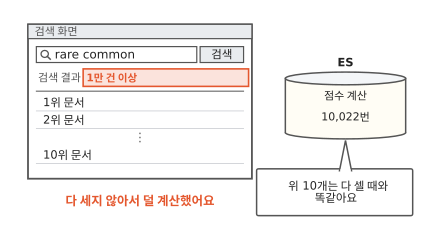

건너뛴 문서는 세지 않았으니 화면에는 "1만 건 이상"으로 보여 주면 돼요. 위 10개는 20만 개를 다 계산할 때와 똑같아요.

문서가 20만 개든 2억 개든 위 10개만 필요하면 ES는 문턱을 넘을 수 없는 문서를 건너뛰고 지나가요.

### 이 편에서 줄여 그린 것

그림을 쉽게 하려고 실제와 다르게 줄인 곳이 여섯 군데 있어요.

1. 힙을 3칸으로 그렸어요. 위 10개를 찾을 때 힙은 10칸이에요.
2. 그림의 점수는 설명용으로 정한 숫자예요. common 1.2, rare 8.5, 문턱 4.2와 묶음마다의 최고 점수가 그래요. 실험에서는 common이 모든 문서에 있어서 common의 점수가 거의 0이에요.
3. 묶음마다 최고 점수를 숫자로 적어 둔 것처럼 그렸어요. 실제로는 점수를 만드는 재료(impacts)를 적어 두고 검색할 때 그 재료로 최고 점수를 계산해요. 건너뛰기 표의 위층에도 같은 재료가 있어서 묶음 여러 개를 한꺼번에 건너뛰기도 해요. 이 편 첫 심화 칸에서 다뤄요.
4. 문서를 목록 순서대로 하나씩 보며 건너뛰는 것처럼 그렸어요. 9.2의 Lucene 10.3은 최상위 OR 질의를 주로 `MaxScoreBulkScorer`로 처리하는 것으로 알려져 있어요. 낱말을 "꼭 봐야 하는 것"과 "아닌 것"으로 나눠 묶음 단위로 처리해요. 이것도 첫 심화 칸에서 다뤄요.
5. 묶음 하나에 칸 5개를 그렸어요. 실제 묶음 하나에는 문서 128개가 들어요.
6. common과 rare가 같은 묶음을 나눠 쓰는 것처럼 그렸어요. 실제로는 낱말마다 목록이 따로라서 128개씩 끊는 경계도 낱말마다 달라요.

### 이 편에서 새로 나온 말

[^lab]: 문서 20만 개는 제 컴퓨터에 띄운 ES 7.17.26과 9.2.0의 샤드 1개짜리 인덱스에 넣었어요. 모든 문서에 common이 있고 1%에 rare가 있어요. 표의 숫자는 이 인덱스에서 "rare common"으로 위 10개를 찾으며 쟀고 937번은 ES 없이 파이썬으로 흉내 낸 숫자예요. 논문: Broder 외, "Efficient query evaluation using a two-level retrieval process"(CIKM 2003), Ding·Suel, "Faster top-k document retrieval using block-max indexes"(SIGIR 2011).
