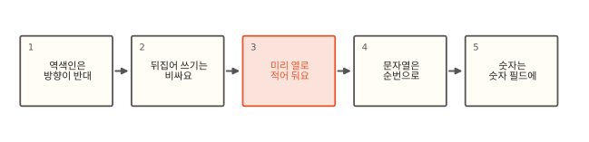
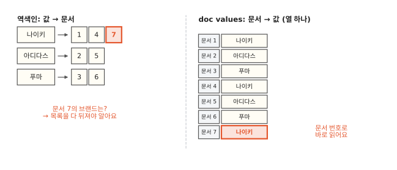
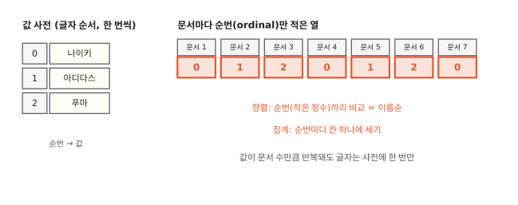
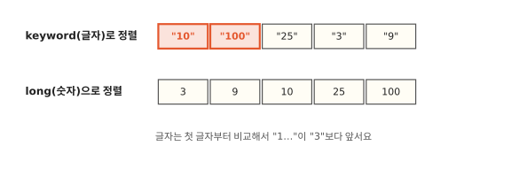

# 정렬·집계는 왜 역색인을 쓰지 않을까요?

## 제목으로 정렬했더니 오류가 나요

![두 상자. 왼쪽 "sort": [{"title": "asc"}] 아래 빨간 → Text fields are not optimised…, 밑에 제목으로는 정렬이 안 돼요. 오른쪽 "sort": [{"order_no_kw": "asc"}] 아래 빨간 → "10", "100", "25", "3", "9", 밑에 주문번호가 3보다 10이 먼저예요.](img/10/es10-open.svg)

주문 목록 화면에 "제목순 정렬"을 붙이려고 `text` 필드 `title`로 정렬했더니 ES가 오류를 돌려줘요. "text 필드는 문서마다 값이 필요한 일(집계, 정렬)에 맞지 않아서 기본으로 막혀 있다"는 내용이에요. 이번엔 `keyword` 필드에 담아 둔 주문번호로 정렬했더니 "10", "100", "25", "3", "9" 순서로 나와요. 3번 주문이 100번 주문보다 뒤에 있어요.

검색은 잘 되는 필드인데 정렬은 왜 안 될까요? 주문번호는 왜 이상한 순서로 나올까요? 둘 다 "문서에서 값으로" 가는 길이 역색인과 따로 있다는 데서 시작해요.

## 반대 방향에서 숫자 필드까지



먼저 정렬과 집계가 역색인과 반대 방향의 질문이라는 걸 봐요. 역색인을 그때그때 뒤집으면 왜 비싼지 보고 ES가 미리 만들어 두는 열 저장소를 봐요. 마지막으로 문자열은 그 열에 어떻게 담기는지, 숫자는 왜 숫자 필드에 담아야 하는지 봐요.

## 역색인은 방향이 반대예요



[1편](01-inverted-index.md)의 역색인은 "이 낱말이 든 문서는?"에 답하려고 만든 표예요. 값에서 문서로 가요. 검색은 이 방향의 질문이라 빨라요.

정렬과 집계는 질문 방향이 반대예요. 검색으로 문서 1만 개를 찾은 다음 "이 문서들을 브랜드 이름순으로 줄 세워라", "브랜드별로 몇 개인지 세라"를 해야 해요. 그러려면 문서마다 "이 문서의 브랜드는?"을 물어야 해요. 문서에서 값으로 가는 질문이에요. 역색인으로 이걸 알려면 "나이키" 목록, "아디다스" 목록… 모든 목록을 뒤져서 문서 7이 어디 있는지 찾아야 해요.

## 뒤집어 쓰기는 비싸요

역색인을 한 번 통째로 뒤집어 "문서 → 값" 표를 만들어 두면 되지 않을까요? 실제로 예전 ES는 그렇게 했고 이 표를 fielddata라고 불렀어요. 처음 정렬이 올 때 모든 낱말 목록을 훑어 표를 만들고 JVM 힙에 올려 뒀어요.

이 방법은 비싸요. 파이썬으로 문서 100만 개, 브랜드 1천 종을 만들어 검색 결과 1만 개를 브랜드순으로 정렬해 봤어요.[^lab] 역색인을 뒤집는 첫 정렬은 문서 100만 개 전부를 훑어야 해서 79 ms가 걸렸어요. 처음부터 "문서 → 값" 열이 있으면 매번 결과 1만 개만 읽으면 돼서 4 ms였어요. fielddata는 한 번 만들면 힙에 두고 다시 쓰지만 세그먼트가 새로 생길 때마다 그 세그먼트 몫을 또 만들어야 해요. 그리고 뒤집은 표는 힙에 올라가요. 문서가 수억 개면 힙이 감당하지 못해요. 그래서 ES는 `text` 필드의 fielddata를 기본으로 꺼 두었고 맨 처음의 오류가 그 표시예요. JVM 힙은 ES가 객체를 담는 메모리라서 여기가 차면 노드 전체가 멈추거나 느려져요.

## 그래서 미리 열로 적어 둬요

ES는 문서를 색인할 때 역색인과 함께 "문서 번호 순서대로 값을 한 줄로 적은 열"을 따로 만들어요. 이 열 저장소를 **doc values**라고 불러요. fielddata와 같은 "문서 → 값" 표이지만 fielddata는 정렬이 처음 올 때 힙에 만들고 doc values는 색인할 때 디스크에 만들어요. 데이터베이스의 열 지향 저장(column store)과 같은 생각이에요. 세그먼트([4편](04-refresh.md)에서 본, 한 번 만들면 고치지 않는 작은 역색인 묶음)마다 디스크에 쓰여서 [6편](06-terms-postings.md)의 용어 사전처럼 운영체제 파일 캐시로 읽고 힙을 거의 쓰지 않아요.

doc values는 `keyword`, 숫자, 날짜 같은 필드에서 기본으로 켜져 있어요. 정렬, 집계(조건에 맞는 문서를 묶어 세는 일), 스크립트로 점수나 값을 계산할 때 필드 값 읽기가 모두 이걸 써요. `text` 필드는 분석기([2편](02-analyzer.md))로 잘린 토큰 여러 개로 저장돼요. 제목 "나이키 에어맥스"는 "나이키"와 "에어맥스" 두 조각으로 잘리고 제목 전체 "나이키 에어맥스"는 어디에도 하나의 값으로 남지 않아요. 잘린 조각으로 줄 세우면 원하는 제목순이 나오지 않고 담으면 용량만 커서 doc values를 만들지 않아요. 제목으로 정렬하고 싶다면 같은 글을 `keyword` 하위 필드로도 넣어 그쪽으로 정렬해요.

로컬에서 `keyword` 필드의 `doc_values`를 끄고 정렬해 봤더니 두 버전 모두 "fielddata는 keyword에서 지원하지 않으니 doc values를 쓰라"는 오류가 났어요. 같은 필드로 `term` 검색은 1건이 잘 나왔어요. 역색인은 그대로 있고 doc values만 없는 상태예요.

??? info "심화: fielddata와 doc values"
    fielddata는 역색인을 뒤집은 표를 첫 사용 때 힙에 만들어요. 크기를 미리 알 수 없어서 `indices.breaker.fielddata.limit` 회로 차단기(힙이 넘치기 전에 요청을 거절하는 안전장치)가 힙을 지켜요. `text` 필드에 `"fielddata": true`를 주면 다시 켤 수 있지만(로컬에서 켜고 정렬하니 "푸마 클라우드"가 토큰 중 가장 작은 "클라우드"로 줄 섰어요) 분석된 토큰 하나하나가 값이 되니 "제목순 정렬"이 원하는 결과를 주지도 않고 힙만 커져요. 거의 언제나 `keyword` 하위 필드가 맞는 답이에요. fielddata 캐시는 기본으로 크기 상한이 없고(`indices.fielddata.cache.size`로 정해요) 세그먼트가 닫힐 때만 비워져요. 차단기는 새로 올리는 걸 거부할 뿐 이미 올라간 걸 줄여 주지 않아요. 지금도 fielddata를 쓰는 곳이 있어요. `_id`는 doc values가 없어서 `_id`로 정렬하면 fielddata를 써요. 로컬에서 `_id` 정렬이 7.17에서는 됐고 9.2에서는 `indices.id_field_data.enabled`를 켜라는 오류로 막혔어요(이 기본값은 8.0에서 바뀌었어요). 얼마나 쓰는지는 `GET _cat/fielddata?v`로 봐요.

    doc values는 색인 때 세그먼트마다 만들고 고치지 않아요(4편). 숫자 열은 값들의 최대공약수로 나누기, 최솟값을 뺀 차이만 적기, 값 종류가 적으면 표 번호로 적기 같은 방법으로 줄여 담아요. 정렬·집계에 절대 쓰지 않는 `keyword` 필드라면 `"doc_values": false`로 디스크를 아낄 수 있지만 나중에 켜려면 재색인해야 해요. 6편의 `_disk_usage`(7.15부터)로 보면 23만 낱말짜리 `keyword` 필드의 doc values가 1.5~1.6 MB로 역색인과 비슷한 크기였어요.

## 문자열은 순번으로 담아요



`keyword` 값을 문서마다 글자 그대로 적으면 "나이키"가 문서 수만큼 반복돼요. 그래서 세그먼트 안의 서로 다른 값만 글자 순서로 한 번씩 사전에 적고 0, 1, 2… 번호를 붙여요. 열에는 문서마다 그 번호만 적어요. 이 번호를 **순번**(ordinal)이라고 해요.

사전이 글자 순서라 순번의 크고 작음이 이름의 순서와 같아요. 그래서 한 세그먼트 안에서는 글자를 비교하지 않고 작은 정수끼리 비교하면 돼요. 브랜드별 건수도 순번마다 칸 하나를 두고 세면 끝나요. 글자는 다 센 다음 칸 번호를 사전에서 찾아 바꾸기만 해요.

??? info "심화: 세그먼트별 순번과 global ordinals"
    값 사전의 순서는 정확히는 글자의 바이트(UTF-8) 순서예요. 완성형 한글은 이 순서가 우연히 가나다순과 같지만 영어 대문자는 소문자보다 앞이고 한글은 영어 뒤에 와요. 자모가 분리된 입력(NFD)이 섞이면 순서가 어긋나요. 사람이 기대하는 사전 순서가 필요하면 normalizer나 `analysis-icu`의 collation 필드를 따져 봐요.

    순번은 세그먼트 안에서만 뜻이 있어요. 세그먼트 A의 3번과 세그먼트 B의 3번은 다른 값일 수 있어요. 정렬은 세그먼트 안에서 순번으로 줄 세운 뒤 세그먼트 사이에서는 실제 값으로 비교해 합쳐요. 샤드끼리는 코디네이터가 정렬 값으로 비교해 합쳐요(12편). terms 집계는 보통 샤드 전체의 값을 한 번호 체계로 다시 매긴 global ordinals를 만들어 써요(대상 문서가 아주 적으면 값을 바로 쓰는 방식을 고르기도 해요). 이 번호표는 힙에 올라가서 값 종류가 수백만 개인 필드는 힙도 꽤 써요. 이 번호표는 세그먼트가 바뀌면(refresh, 병합) 다시 만들어야 해서 값 종류가 많은 필드에서는 refresh 뒤 첫 집계가 느려요. 매핑의 `eager_global_ordinals: true`는 이 일을 refresh 때 미리 해서 검색 쪽 지연을 색인 쪽으로 옮겨요. 4편의 refresh 비용이 커지는 대가가 따라요.

## 숫자는 숫자 필드에 담아요



맨 처음의 주문번호 순서도 이제 설명이 돼요. `keyword` 필드의 doc values는 값을 글자로 담고 순번 사전도 글자 순서로 정렬돼요. 글자는 첫 글자부터 비교하니 "100"의 첫 글자 "1"이 "3"보다 작아서 앞에 와요.

같은 값을 `long` 필드에 담으면 doc values도 숫자로 담기고 3, 9, 10, 25, 100 순서로 정렬돼요. 로컬에서 같은 다섯 값을 두 필드에 담아 정렬해 보니 두 버전 모두 위 그림 그대로였어요. 자릿수가 언젠가 바뀔 수 있는 번호(예: 18자리에서 19자리로 넘어가는 ID)를 `keyword`로 담아 최신순(내림차순)으로 정렬하고 있었다면 자릿수가 바뀌는 날 최신 값이 갑자기 맨 뒤로 가요.

??? info "심화: 숫자 필드를 고를 때"
    정렬이나 범위 검색에 쓸 번호는 `long`에 담아요. `long`은 9,223,372,036,854,775,807까지라서 19자리 번호가 이보다 크면 넣을 때 오류가 나요(두 버전에서 확인). 그럴 땐 `unsigned_long`(7.17에도 있어요)을 써요. 숫자 필드는 doc values와 함께 범위 검색용 BKD 트리(11편)도 만들어요. 반대로 숫자처럼 생겼지만 정확히 일치하는 값으로만 찾는 코드(우편번호, 앞자리 0이 있는 코드)는 `keyword`가 맞아요. 로컬에서 "007"을 `long`에 넣었더니 `_source`에는 "007"이 남고 색인값과 doc values는 7이 됐어요. 그래서 "7"로 찾아도 걸려요. Elastic의 검색 속도 안내도 범위 검색을 하지 않는 숫자 식별자는 `keyword`가 `term` 검색에 더 빠르다고 해요. 기준은 둘이에요. 정렬·범위가 필요하면 숫자 필드, 정확히 일치로만 찾으면 `keyword`예요. 둘 다 필요하면 같은 값을 두 필드로 넣어요. 이미 `keyword`로 쌓인 필드를 숫자로 바꾸려면 재색인이 필요해요.

## 정리

- 정렬과 집계는 "문서 → 값" 방향의 질문이에요. 역색인(값 → 문서)으로 답하려면 다 뒤집어야 해서 비싸요.
- doc values: 문서 번호 순서대로 값을 적은 열이에요. 색인할 때 세그먼트마다 디스크에 만들어 두고 정렬·집계가 이걸 읽어요.
- 순번(ordinal): `keyword` 값을 글자 순서 사전에 한 번씩 적고 붙인 번호예요. 열에는 순번만 적고 정렬·집계는 순번으로 해요.
- `text` 필드는 doc values가 없어서 정렬·집계를 못 해요. 숫자를 `keyword`에 담으면 글자 순서로 정렬돼요.

## 직접 해 보기

[lab/es/10_es.sh](https://github.com/oya150/bedrock/blob/main/lab/es/10_es.sh)는 맨 처음 장면의 두 정렬, `long` 정렬, doc values를 끈 필드의 정렬·검색, 브랜드별 건수 집계를 차례로 보여 줘요. 주문번호 정렬만 따로 보려면 이렇게 해요.

```bash
curl 'localhost:9200/orders10/_search' -H 'Content-Type: application/json' \
  -d '{"sort":[{"order_no_kw":"asc"}],"_source":false,"docvalue_fields":["order_no_kw"]}'
```

`docvalue_fields`는 `_source` 대신 doc values에서 값을 꺼내 보여 줘요. 정렬이 실제로 읽는 값이 무엇인지 그대로 보여요.

## 확인 문제

??? question "1. 브랜드별 건수"
    문서 7개의 브랜드 순번이 0 1 2 0 1 2 0이고 사전이 0 나이키, 1 아디다스, 2 푸마예요. 브랜드별 건수를 순번으로 세고 이름으로 바꿔 보세요.

    **풀이** 순번 0이 3번, 1이 2번, 2가 2번 나와요. 사전에서 바꾸면 나이키 3, 아디다스 2, 푸마 2예요. 세는 동안에는 글자를 한 번도 보지 않았어요.

??? question "2. 날짜를 글자로"
    날짜를 "2026-10-24" 같은 글자로 `keyword`에 담았어요. 날짜순 정렬이 맞게 나올까요? "2026-9-5"처럼 0을 빼고 담았다면요?

    **풀이** 자릿수가 모두 같은 "YYYY-MM-DD" 꼴이면 글자 순서와 날짜 순서가 같아서 맞게 나와요. "2026-9-5"처럼 자릿수가 다르면 "2026-10-…"의 "1"이 "2026-9-…"의 "9"보다 앞서서 10월이 9월보다 먼저 나와요. 날짜는 `date` 필드에 담는 게 안전해요.

??? question "3. doc values를 끄면"
    로그의 `request_body` 필드(`keyword`)는 정확한 값으로 가끔 찾기만 하고 정렬·집계는 안 해요. `doc_values: false`로 두면 무엇을 얻고 무엇을 잃을까요?

    **풀이** 열 저장소를 만들지 않으니 디스크와 색인 시간이 줄어요. 역색인은 그대로라 `term` 검색은 돼요. 대신 이 필드로 정렬, 집계, 스크립트 값 읽기를 할 수 없고 나중에 필요해지면 재색인해야 해요.

## 판단 연습

??? question "주문번호 필드 타입"
    주문번호는 지금 "202610240001"처럼 12자리 숫자이고 화면에서 "최신 주문순"으로 정렬해요. 검색은 주문번호 전체로만 해요. `keyword`와 `long` 중 무엇에 담을까요?

    **풀이** 정렬이 중요하니 `long`에 담는 쪽이 안전해요. 지금은 자릿수가 같아 `keyword`로도 순서가 맞지만 자릿수가 바뀌는 날 정렬이 깨져요. 주문번호로 찾는 `term` 검색은 `long`에서도 돼요. 앞자리 0이 붙을 수 있는 번호라면 `keyword`로 두고 정렬용으로는 별도 `long` 필드나 주문 시각(`date`)을 써요.

??? question "제목순 정렬 요청"
    게시판에서 "제목 가나다순 정렬"을 붙여 달라는 요청이 왔어요. `title`은 `text` 필드예요. 어떻게 할까요?

    **풀이** `title`에 `keyword` 하위 필드(`title.raw` 등)를 더해 정렬은 그쪽으로 해요. 매핑에 하위 필드를 더하는 건 되지만 이미 들어 있는 문서에는 값이 없으니 재색인하거나 `_update_by_query`로 다시 넣어야 해요. 제목이 아주 길면 `keyword`의 `ignore_above`(길이 넘는 값은 색인하지 않음)를 정하고 그 길이를 넘는 제목은 정렬에서 어떻게 보일지도 정해요. 대소문자나 공백 차이를 무시하려면 2편의 normalizer를 붙여요.

[^lab]: 재는 코드: [lab/es/10_docvalues.py](https://github.com/oya150/bedrock/blob/main/lab/es/10_docvalues.py). 파이썬 메모리 안의 비교라 실제 ES의 시간과는 달라요. 정렬·오류 실험은 [lab/es/10_es.sh](https://github.com/oya150/bedrock/blob/main/lab/es/10_es.sh)로 ES 7.17.26과 9.2.0에서 같은 결과를 확인했어요(text 정렬 오류 문구만 조금 달라요).
