# 정렬·집계는 왜 역색인을 쓰지 않을까요?

## 제목으로 정렬했더니 오류가 나요

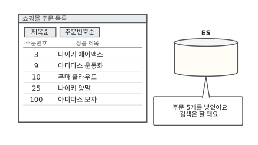

쇼핑몰 주문 목록 화면에 주문 다섯 개가 있어요. 화면 위에는 "제목순"과 "주문번호순" 정렬 버튼을 붙였어요. 상품 제목으로 검색하면 잘 나와요. 이제 제목순 버튼을 눌러 볼게요.

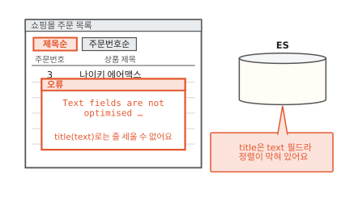

ES가 오류를 돌려줘요. 상품 제목은 `text` 필드 `title`에 담겨 있어요. 오류 내용은 "text 필드는 문서마다 값이 필요한 일(집계, 정렬)에 맞지 않아서 기본으로 막혀 있다"예요. 이번엔 주문번호순 버튼을 눌러 볼게요.

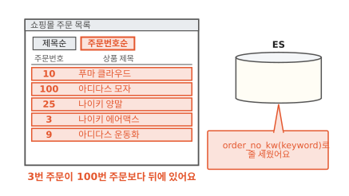

주문번호는 `keyword` 필드 `order_no_kw`에 담아 뒀어요. 주문이 "10", "100", "25", "3", "9" 순서로 나와요. 3번 주문이 100번 주문보다 뒤에 있어요.[^lab]

검색은 잘 되는 필드인데 정렬은 왜 안 될까요? 주문번호는 왜 이상한 순서로 나올까요? 둘 다 "문서에서 값으로" 가는 길이 역색인과 따로 있다는 데서 시작해요.

## 역색인은 방향이 반대예요

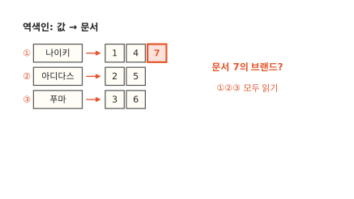

[1편](01-inverted-index.md)의 역색인은 "이 낱말이 든 문서는?"에 답하려고 만든 표예요. 값에서 문서로 가요. 그림에서 "나이키가 든 문서는?"에 답하려면 나이키 줄 하나만 읽으면 돼요. 검색은 이 방향의 질문이라 빨라요. 거꾸로 문서 하나의 브랜드를 물으면 어떻게 될까요?

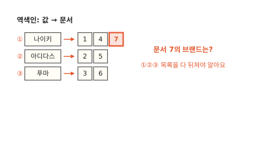

"문서 7의 브랜드는?"은 문서에서 값으로 가는 질문이에요. 역색인으로 답하려면 ①②③ 목록을 차례로 다 뒤져야 해요. 7은 나이키 목록에 있어요. 정렬과 집계는 이런 질문을 몇 번이나 할까요?

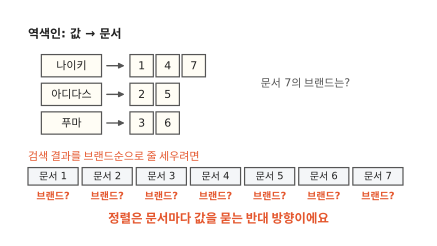

정렬과 집계는 이 질문을 문서마다 해요. 검색으로 문서 1만 개를 찾았다고 해 볼게요. "이 문서들을 브랜드 이름순으로 줄 세워라"를 하려면 1만 개 문서마다 브랜드를 물어야 해요. "브랜드별로 몇 개인지 세라"도 같아요. 그때마다 역색인을 다 뒤지면 너무 느려요. 미리 한 번 뒤집어 두면 어떨까요?

## 뒤집어 쓰기는 비싸요

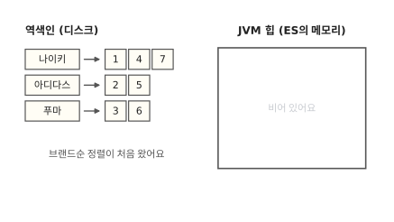

역색인을 한 번 통째로 뒤집어 "문서 → 값" 표를 만들어 두면 되지 않을까요? 실제로 예전 ES는 그렇게 했고 이 표를 fielddata라고 불렀어요. 표는 그림 오른쪽 JVM 힙에 둬요. JVM 힙은 ES가 객체를 담는 메모리예요. 처음에는 비어 있어요. 첫 정렬이 오면 무슨 일이 생길까요?

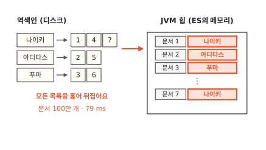

처음 정렬이 올 때 모든 낱말 목록을 훑어 표를 만들고 힙에 올려 둬요. 파이썬으로 문서 100만 개와 브랜드 1천 종을 만들어 재 봤어요.[^py] 검색 결과 1만 개를 브랜드순으로 정렬했어요. 역색인을 뒤집는 첫 정렬은 문서 100만 개를 전부 훑어야 해서 79 ms가 걸렸어요. fielddata는 한 번 만들면 힙에 두고 다시 써요. 그래도 세그먼트가 새로 생길 때마다 그 세그먼트 몫을 또 만들어야 해요. 문서가 아주 많아지면 이 표는 어떻게 될까요?

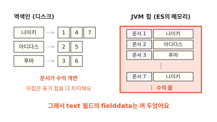

뒤집은 표는 힙에 올라가요. 문서가 수억 개면 힙이 감당하지 못해요. 힙이 차면 노드 전체가 멈추거나 느려져요. 그래서 ES는 `text` 필드의 fielddata를 기본으로 꺼 두었어요. 맨 처음의 오류가 그 표시예요. 표를 정렬 때 만들지 않고 미리 만들어 두면 어떨까요?

## 그래서 미리 열로 적어 둬요

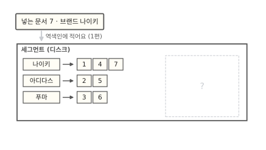

ES는 문서를 색인할 때 브랜드 "나이키"를 역색인에 적어요(1편). 세그먼트는 [4편](04-refresh.md)에서 본 작은 역색인 묶음이에요. 한 번 만들면 고치지 않아요. 그림 오른쪽 빈자리에는 무엇을 적을까요?

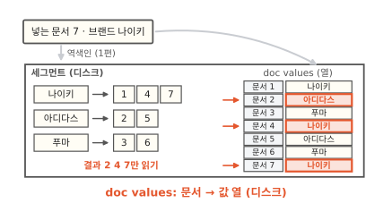

ES는 역색인과 함께 "문서 번호 순서대로 값을 한 줄로 적은 열"을 따로 만들어요. 이 열 저장소를 **doc values**라고 불러요. fielddata와 같은 "문서 → 값" 표예요. fielddata는 정렬이 처음 올 때 힙에 만들어요. doc values는 색인할 때 디스크에 만들어요. 데이터베이스의 열 지향 저장(column store)과 같은 생각이에요. 정렬은 이 열을 어떻게 읽을까요?

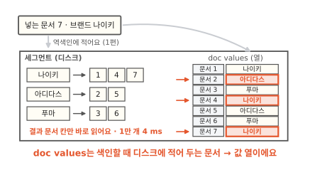

정렬은 열에서 결과 문서의 값을 바로 읽어요. 처음부터 열이 있으면 매번 결과 1만 개만 읽으면 돼요. 같은 실험에서 4 ms였어요. doc values는 세그먼트마다 디스크에 쓰여요. 그래서 [6편](06-terms-postings.md)의 용어 사전처럼 운영체제 파일 캐시로 읽고 힙을 거의 쓰지 않아요.

doc values는 `keyword`, 숫자, 날짜 같은 필드에서 기본으로 켜져 있어요. 정렬과 집계는 모두 이걸 읽어요. 집계는 조건에 맞는 문서를 묶어 세는 일이에요. 스크립트로 점수나 값을 계산할 때 필드 값을 읽는 일도 이걸 써요.

로컬에서 `keyword` 필드의 `doc_values`를 끄고 정렬해 봤어요. 두 버전 모두 "fielddata는 keyword에서 지원하지 않으니 doc values를 쓰라"는 오류가 났어요. 같은 필드로 `term` 검색은 1건이 잘 나왔어요. 역색인은 그대로 있고 doc values만 없는 상태예요. 그런데 제목이 든 `text` 필드에는 왜 doc values가 없을까요?

??? info "심화: doc values는 어떻게 줄여 담을까요?"
    doc values가 디스크를 얼마나 차지하는지 궁금할 때 보는 칸이에요. doc values는 색인 때 세그먼트마다 만들고 고치지 않아요(4편). 숫자 열은 몇 가지 방법으로 줄여 담아요. 값들의 최대공약수로 나누기, 최솟값을 뺀 차이만 적기, 값 종류가 적으면 표 번호로 적기 같은 방법이에요. 6편의 `_disk_usage`(7.15부터)로 재 봤어요. 23만 낱말짜리 `keyword` 필드의 doc values가 1.5~1.6 MB로 역색인과 비슷한 크기였어요.

    정렬·집계에 절대 쓰지 않는 `keyword` 필드라면 `"doc_values": false`로 디스크를 아낄 수 있어요. 열을 만들지 않으니 색인 시간도 줄어요. 역색인은 그대로라 `term` 검색은 돼요. 대신 그 필드로 정렬, 집계, 스크립트 값 읽기를 할 수 없어요. 나중에 켜려면 재색인해야 해요.

## 제목은 잘라 담아서 열이 없어요

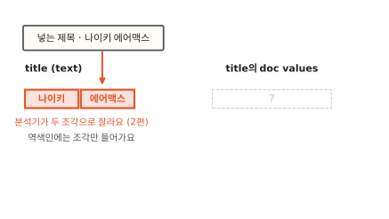

`text` 필드는 분석기([2편](02-analyzer.md))로 잘린 토큰 여러 개로 저장돼요. 제목 "나이키 에어맥스"는 "나이키"와 "에어맥스" 두 조각으로 잘려요. 역색인에는 이 조각만 들어가요. 그럼 `title`의 doc values 자리에는 무엇이 들어갈까요?

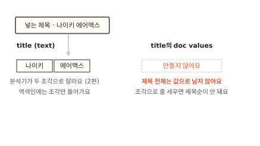

제목 전체 "나이키 에어맥스"는 어디에도 하나의 값으로 남지 않아요. 잘린 조각으로 줄 세우면 원하는 제목순이 나오지 않아요. 조각을 다 담으면 용량만 커요. 그래서 ES는 `text` 필드에 doc values를 만들지 않아요. 제목으로 정렬하려면 어떻게 할까요?

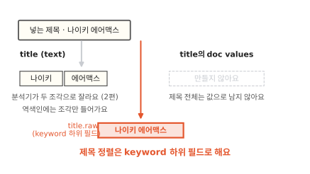

같은 글을 그림의 `title.raw`처럼 `keyword` 하위 필드로도 넣어요. `keyword`는 글을 자르지 않고 한 값으로 담아서 doc values도 생겨요. 제목순 정렬은 이 하위 필드로 해요.

매핑에 하위 필드를 더하는 건 돼요. 다만 이미 들어 있는 문서에는 값이 없어요. 재색인하거나 `_update_by_query`로 다시 넣어야 해요. 제목이 아주 길면 `keyword`의 `ignore_above`를 정해요. 이 길이를 넘는 값은 색인하지 않아요. 그런 제목이 정렬에서 어떻게 보일지도 함께 정해요. 대소문자나 공백 차이를 무시하려면 2편의 normalizer를 붙여요.

??? info "심화: fielddata를 다시 켜면"
    `text` 필드로 꼭 정렬해야 할 것 같을 때 보는 칸이에요. fielddata는 역색인을 뒤집은 표를 첫 사용 때 힙에 만들어요. 크기를 미리 알 수 없어서 회로 차단기 `indices.breaker.fielddata.limit`가 힙을 지켜요. 회로 차단기는 힙이 넘치기 전에 요청을 거절하는 안전장치예요.

    `text` 필드에 `"fielddata": true`를 주면 다시 켤 수 있어요. 그러면 분석된 토큰 하나하나가 값이 돼요. 로컬에서 켜고 정렬하니 "푸마 클라우드"가 토큰 중 가장 작은 "클라우드"로 줄 섰어요. "제목순 정렬"이 원하는 결과를 주지도 않고 힙만 커져요. 거의 언제나 `keyword` 하위 필드가 맞는 답이에요.

    fielddata 캐시는 기본으로 크기 상한이 없어요. 상한은 `indices.fielddata.cache.size`로 정해요. 캐시는 세그먼트가 닫힐 때만 비워져요. 차단기는 새로 올리는 걸 거부할 뿐 이미 올라간 걸 줄여 주지 않아요.

    지금도 fielddata를 쓰는 곳이 있어요. `_id`는 doc values가 없어서 `_id`로 정렬하면 fielddata를 써요. 로컬에서 `_id` 정렬이 7.17에서는 됐어요. 9.2에서는 `indices.id_field_data.enabled`를 켜라는 오류로 막혔어요. 이 기본값은 8.0에서 바뀌었어요. 얼마나 쓰는지는 `GET _cat/fielddata?v`로 봐요.

## 문자열은 순번으로 담아요

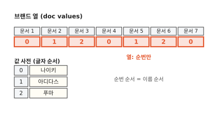

브랜드 열에 `keyword` 값을 글자 그대로 적으면 "나이키"가 문서 수만큼 반복돼요. 그림에서는 일곱 칸 중 세 칸이 나이키예요. 반복을 어떻게 줄일까요?

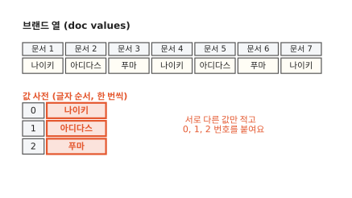

세그먼트 안의 서로 다른 값만 글자 순서로 한 번씩 사전에 적어요. 그리고 0, 1, 2… 번호를 붙여요. 이제 열에는 무엇을 적을까요?

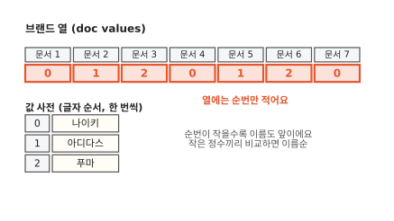

열에는 문서마다 그 번호만 적어요. 이 번호를 **순번**(ordinal)이라고 해요. 사전이 글자 순서라 순번의 크고 작음이 이름의 순서와 같아요. 그래서 한 세그먼트 안에서는 글자를 비교하지 않고 작은 정수끼리 비교하면 돼요. 집계는 순번으로 어떻게 셀까요?

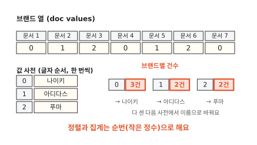

브랜드별 건수도 순번마다 칸 하나를 두고 세면 끝나요. 순번 0이 3번, 1과 2가 2번씩 나와요. 글자는 다 센 다음 칸 번호를 사전에서 찾아 바꾸기만 해요. 나이키 3, 아디다스 2, 푸마 2예요.

??? info "심화: 세그먼트별 순번과 global ordinals"
    세그먼트가 여럿일 때 순번을 어떻게 맞추는지 궁금할 때 보는 칸이에요. 값 사전의 순서는 정확히는 글자의 바이트(UTF-8) 순서예요. 완성형 한글은 이 순서가 우연히 가나다순과 같아요. 하지만 영어 대문자는 소문자보다 앞이고 한글은 영어 다음에 와요. 자모가 분리된 입력(NFD)이 섞이면 순서가 어긋나요. 사람이 기대하는 사전 순서가 필요하면 normalizer나 `analysis-icu`의 collation 필드를 따져 봐요.

    순번은 세그먼트 안에서만 뜻이 있어요. 세그먼트 A의 3번과 세그먼트 B의 3번은 다른 값일 수 있어요. 정렬은 세그먼트 안에서 순번으로 줄 세워요. 세그먼트 사이에서는 실제 값으로 비교해 합쳐요. 샤드끼리는 코디네이터가 정렬 값으로 비교해 합쳐요(12편).

    terms 집계는 보통 global ordinals를 만들어 써요. 샤드 전체의 값을 한 번호 체계로 다시 매긴 번호표예요. 대상 문서가 아주 적으면 값을 바로 쓰는 방식을 고르기도 해요. 이 번호표는 힙에 올라가요. 그래서 값 종류가 수백만 개인 필드는 힙도 꽤 써요. 세그먼트가 바뀌면(refresh, 병합) 번호표를 다시 만들어야 해요. 그래서 값 종류가 많은 필드에서는 refresh 다음 첫 집계가 느려요. 매핑의 `eager_global_ordinals: true`는 이 일을 refresh 때 미리 해요. 검색 쪽 지연을 색인 쪽으로 옮기는 거예요. 4편의 refresh 비용이 커지는 대가가 따라요.

## 숫자는 숫자 필드에 담아요

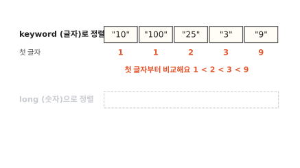

맨 처음의 주문번호 순서도 이제 설명이 돼요. `keyword` 필드의 doc values는 값을 글자로 담아요. 순번 사전도 글자 순서로 정렬돼요. 글자는 첫 글자부터 비교해요. "100"의 첫 글자 "1"이 "3"보다 작아서 앞에 와요. 숫자 크기대로 줄 세우려면 어디에 담아야 할까요?

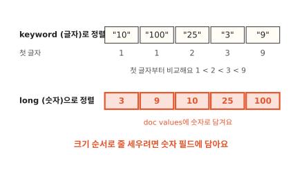

같은 값을 `long` 필드에 담으면 doc values도 숫자로 담겨요. 그래서 3, 9, 10, 25, 100 순서로 정렬돼요. 로컬에서 같은 다섯 값을 두 필드에 담아 정렬해 보니 두 버전 모두 그림 그대로였어요.

자릿수가 언젠가 바뀔 수 있는 번호가 있어요. 18자리에서 19자리로 넘어가는 ID 같은 번호예요. 이런 번호를 `keyword`로 담아 최신순으로 정렬하고 있었다면 위험해요. 자릿수가 바뀌는 날 최신 값이 갑자기 맨 뒤로 가요.

## 번호는 언제 숫자 필드에 담을까요?

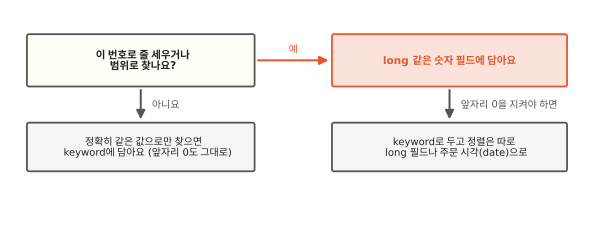

주문번호가 "202610240001"처럼 12자리 숫자라고 해 볼게요. 화면에서는 "최신 주문순"으로 정렬하고 검색은 주문번호 전체로만 해요. 정렬이 중요하니 `long`에 담는 쪽이 안전해요. 지금은 자릿수가 같아 `keyword`로도 순서가 맞아요. 그래도 자릿수가 바뀌는 날 정렬이 깨져요. 주문번호로 찾는 `term` 검색은 `long`에서도 돼요.

앞자리 0이 붙을 수 있는 번호라면 `keyword`로 둬요. 정렬용으로는 별도 `long` 필드나 주문 시각(`date`)을 써요. 둘 다 필요하면 같은 값을 두 필드로 넣어요.

날짜도 같아요. "2026-10-24"처럼 자릿수가 모두 같으면 글자 순서와 날짜 순서가 같아요. "2026-9-5"처럼 0을 빼고 담으면 "2026-10-…"의 "1"이 "9"보다 앞서요. 그러면 10월이 9월보다 먼저 나와요. 날짜는 `date` 필드에 담는 게 안전해요.

??? info "심화: 숫자 필드를 고를 때"
    번호가 아주 크거나 0으로 시작할 때 어떤 필드가 맞는지 궁금할 때 보는 칸이에요. 정렬이나 범위 검색에 쓸 번호는 `long`에 담아요. `long`은 9,223,372,036,854,775,807까지예요. 19자리 번호가 이보다 크면 넣을 때 오류가 나요(두 버전에서 확인). 그럴 땐 `unsigned_long`을 써요. 7.17에도 있어요. 숫자 필드는 doc values와 함께 범위 검색용 BKD 트리(11편)도 만들어요.

    숫자처럼 생겼지만 정확히 같은 값으로만 찾는 코드도 있어요. 우편번호나 앞자리 0이 있는 코드는 `keyword`가 맞아요. 로컬에서 "007"을 `long`에 넣어 봤어요. `_source`에는 "007"이 남고 색인값과 doc values는 7이 됐어요. 그래서 "7"로 찾아도 걸려요. Elastic의 검색 속도 안내도 범위 검색을 하지 않는 숫자 식별자는 `keyword`가 `term` 검색에 더 빠르다고 해요. 이미 `keyword`로 쌓인 필드를 숫자로 바꾸려면 재색인이 필요해요.

숫자 필드가 범위 검색을 어떻게 빨리 하는지는 11편에서 이어 가요.

## 다시 주문 목록을 정렬해 볼게요

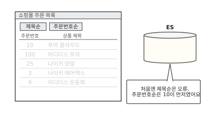

처음 장면의 주문 목록으로 돌아왔어요. 그때 제목순은 오류가 났어요. 주문번호순은 "10"이 "3"보다 먼저 나왔어요.

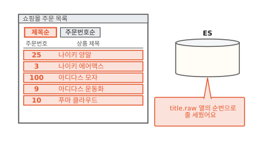

이번에는 제목을 `keyword` 하위 필드 `title.raw`에도 담았어요. ES는 이 열의 순번으로 줄 세워요. 나이키 양말, 나이키 에어맥스, 아디다스 모자 순서로 나와요.

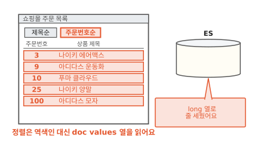

주문번호는 `long` 필드에도 담았어요. 숫자 열을 읽으니 3, 9, 10, 25, 100 순서로 나와요.

주문이 다섯 개든 수억 개든 정렬과 집계는 역색인을 뒤지지 않고 미리 적어 둔 doc values 열을 읽어요.

### 이 편에서 줄여 그린 것

그림을 쉽게 하려고 실제와 다르게 줄인 곳이 네 군데 있어요.

1. doc values 그림에서 브랜드 열에 글자를 한 칸씩 그대로 적었어요. 실제 `keyword` 열은 글자 대신 순번만 적어요. "문자열은 순번으로 담아요" 절에서 봐요. 숫자 열도 그대로 적지 않고 줄여 담아요. "doc values는 어떻게 줄여 담을까요?" 심화 칸에서 봐요.
2. 순번 사전을 하나만 그렸어요. 실제 순번은 세그먼트마다 따로 매겨요([4편](04-refresh.md)). 집계는 샤드 전체를 다시 매긴 global ordinals를 써요. "세그먼트별 순번과 global ordinals" 심화 칸에서 봐요.
3. fielddata 그림에서 역색인 세 줄만 뒤집었어요. 실험에서는 문서 100만 개를 전부 훑었어요. 실제 fielddata는 세그먼트마다 따로 만들어요.
4. 값 사전과 제목순을 가나다순으로 그렸어요. 정확히는 글자의 바이트(UTF-8) 순서예요. 완성형 한글에서는 둘이 같아요. 대문자 영어나 자모가 분리된 입력이 섞이면 달라져요.

### 이 편에서 새로 나온 말

[^lab]: 제 컴퓨터에 띄운 ES 7.17.26과 9.2.0에서 같은 결과를 확인했어요. text 정렬 오류 문구만 조금 달라요. 이 편의 다른 정렬·오류 실험도 이 두 버전으로 했어요.
[^py]: 파이썬 메모리 안의 비교라 실제 ES의 시간과는 달라요.
