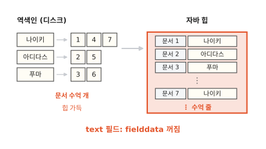
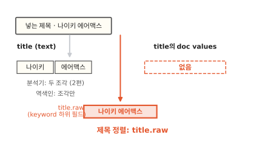
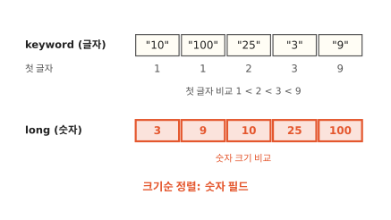

# doc values: 정렬과 집계가 읽는 문서별 값 열

쇼핑몰 주문 목록 화면에 "제목순"과 "주문번호순" 정렬 버튼을 붙였어요. 상품 제목으로 검색하면 잘 나오는데 제목순 버튼을 누르면 오류가 나요. 주문번호순 버튼을 누르면 주문이 10, 100, 25, 3, 9 순서로 서요. 이 글을 읽고 나면 Elasticsearch(ES)가 줄을 세울 때 무엇을 읽는지 알게 돼요. 그걸 알면 어떤 값을 어떤 필드에 담아야 줄이 제대로 서는지 보여요.

!!! abstract "이 글에서 알게 되는 것"
    1. 검색은 낱말에서 문서로 가고 정렬과 집계는 문서마다 값을 물어요. 역색인으로는 이 반대 방향 질문이 느려서 ES는 색인할 때 "문서 → 값" 열을 따로 적어 둬요. 이 열이 doc values예요.
    2. 제목처럼 잘라서 담는 `text` 필드에는 이 열이 없어서 정렬이 막혀요. 제목으로 줄 세우려면 자르지 않는 `keyword` 하위 필드에도 담아요.
    3. `keyword` 열은 값을 글자 순서로 번호 매겨 담아서 "100"이 "3"보다 앞에 서요. 크기순으로 세울 번호는 숫자 필드에 담아요.

## 1. 정렬은 문서마다 값을 물어요

[1편](01-inverted-index.md)에서 본 역색인은 낱말마다 그 낱말이 든 문서 번호를 적은 목록이에요. 이번에는 브랜드만 적힌 문서 일곱 개로 볼게요. 일곱 문서의 브랜드를 역색인에 적으면 나이키 → 1 4 7, 아디다스 → 2 5, 푸마 → 3 6이 돼요. "나이키가 든 문서는?"에 답하려면 나이키 줄 하나만 읽으면 돼요. 검색은 이렇게 값에서 문서로 가는 질문이라서 빨라요.

정렬은 질문의 방향이 반대예요. 검색 결과를 브랜드순으로 세우려면 먼저 "문서 7의 브랜드는?"을 알아야 해요. 아래 그림에서 문서 7을 찾으려고 몇 줄을 읽는지 보세요.

**그림 1.** 문서 7의 브랜드를 알려면 역색인의 ①②③ 줄을 차례로 다 읽어야 해요.
{ .fig-cap }

역색인에는 "문서 7" 줄이 없어요. 그래서 낱말 줄을 하나씩 열어 7이 있는지 봐야 해요. 이 예에서는 브랜드가 셋뿐이라 금방 끝나요. 브랜드가 천 종이면 많게는 천 줄을 열어요.

정렬은 이 질문을 결과 문서마다 해요. 아래 그림의 문서 칸마다 붙은 물음표를 보세요.

**그림 2.** 브랜드순으로 줄 세우려면 문서 일곱 개마다 브랜드를 물어야 해요.
{ .fig-cap }

검색 결과가 천 개면 천 번 물어요. 브랜드별로 몇 개인지 세는 일도 같아요. 조건에 맞는 문서를 이렇게 묶어서 세는 일을 집계라고 해요. 집계도 문서마다 "너는 어느 브랜드야?"를 물어야 셀 수 있어요. 그때마다 역색인을 다 열면 너무 느려요.

## 2. 역색인을 뒤집어 메모리에 두면 메모리가 모자라요

앞 절에서 막힌 곳은 역색인에 "문서 → 값" 줄이 없다는 점이었어요. 그럼 역색인을 한 번 통째로 뒤집어 두면 어떨까요? "문서 1 → 나이키, 문서 2 → 아디다스" 같은 표가 생겨요.

예전 ES가 실제로 그렇게 했어요. 정렬이 처음 올 때 모든 낱말 줄을 훑어 표를 뒤집고 그 표를 메모리에 올려 뒀어요. 이 표를 **fielddata**라고 해요. 표를 올려 두는 곳은 자바 힙이에요. 자바 힙은 ES가 자기 몫으로 받아서 쓰는 메모리예요([6편](06-terms-postings.md)). 한 번 만든 표는 힙에 두고 다음 정렬에서도 다시 써요.

문제는 표의 크기예요. 표에는 문서마다 한 줄이 생겨요. 아래 그림에서 힙 상자가 어떻게 됐는지 보세요.

**그림 3.** 문서가 수억 개면 뒤집은 표도 수억 줄이 돼서 힙을 다 차지해요.
{ .fig-cap }

힙이 차면 ES 노드 전체가 느려지거나 멈춰요. 정렬 하나 때문에 검색까지 못 하게 되는 거예요. 그래서 ES는 `text` 필드의 fielddata를 기본으로 꺼 두었어요. 제목순 버튼을 눌렀을 때 난 오류가 그 표시예요. 오류에는 `text` 필드는 문서마다 값이 필요한 일(정렬, 집계)에 맞지 않아서 기본으로 막혀 있다고 적혀 있어요.

## 3. ES는 색인할 때 "문서 → 값" 열을 디스크에 적어 둬요

뒤집은 표가 문제였던 건 정렬이 올 때 힙에 만들었기 때문이에요. 그럼 표를 미리 만들어서 디스크에 두면 돼요.

ES는 문서를 받을 때 브랜드 "나이키"를 역색인에 적어요. 그때 같은 값을 또 한 곳에 적어요. 문서 번호 순서대로 값을 한 줄로 늘어놓은 열이에요. 아래 그림에서 오른쪽에 새로 생긴 열을 보세요.

**그림 4.** 문서를 받을 때 역색인과 함께 "문서 → 값" 열에도 적어요.
{ .fig-cap }

이 열을 **doc values**라고 해요. fielddata와 똑같이 "문서 → 값" 표예요. 다른 점은 만드는 때와 두는 곳이에요. fielddata는 정렬이 처음 올 때 힙에 만들어요. doc values는 색인할 때 디스크에 만들어요. 열은 세그먼트마다 필드별로 하나씩 생겨요. 세그먼트는 [4편](04-refresh.md)에서 본 작은 역색인 묶음이에요. 한 번 만들면 고치지 않아요.

이제 정렬은 역색인을 뒤지지 않아요. 검색 결과가 문서 2, 4, 7이라고 해 볼게요. 아래 그림에서 화살표가 가리키는 칸을 보세요.

**그림 5.** 정렬은 결과 문서 2, 4, 7의 칸만 읽어서 브랜드를 알아내요.
{ .fig-cap }

결과 문서의 칸으로 가서 값을 읽으면 끝이에요. 문서 7의 값은 열의 일곱째 칸에 있으니 찾아다닐 필요도 없어요. 열은 디스크에 있지만 자주 읽는 부분은 운영체제가 페이지 캐시에 올려 둬요. [6편](06-terms-postings.md)의 용어 사전과 같은 방식이에요. 그래서 힙은 거의 쓰지 않아요.

doc values는 `keyword`, 숫자, 날짜 필드에서 기본으로 켜져 있어요. 정렬과 집계는 모두 이 열을 읽어요. 스크립트로 값을 계산할 때도 이 열에서 필드 값을 꺼내요.

정렬도 집계도 하지 않을 `keyword` 필드라면 매핑에 `"doc_values": false`를 줘서 열을 만들지 않을 수 있어요. 디스크가 덜 들고 색인도 조금 빨라져요. 역색인은 그대로라서 그 값으로 찾는 검색은 돼요. 대신 그 필드로는 정렬과 집계를 못 해요. 나중에 다시 켜려면 문서를 처음부터 다시 넣어야 해요.

## 4. text 필드는 글을 잘라 담아서 열이 없어요

`keyword`와 숫자에는 열이 있는데 제목이 든 `text` 필드에는 왜 없을까요? 제목을 담는 방식을 보면 알 수 있어요.

`text` 필드는 글을 분석기([2편](02-analyzer.md))로 잘라서 담아요. 제목 "나이키 에어맥스"는 "나이키"와 "에어맥스" 두 조각이 돼요. 역색인에는 이 조각만 들어가요. 제목 전체 "나이키 에어맥스"는 어디에도 값 하나로 남지 않아요.

그러면 열에 무엇을 적어야 할까요? 조각을 적으면 문서 하나에 값이 여러 개예요. 조각으로 줄 세우면 원하는 제목순이 나오지 않아요. fielddata를 다시 켜면 실제로 이렇게 돼요. 조각 하나하나가 값이 돼서 "푸마 클라우드"가 글자 순서로 더 앞서는 조각 "클라우드"로 줄 서요. 그래서 ES는 `text` 필드에 doc values를 만들지 않아요.

제목으로 줄 세우려면 같은 글을 한 번 더 담아요. 아래 그림에서 아래쪽 빨간 칸을 보세요.

**그림 6.** `title`은 두 조각으로 잘려서 열이 없고 `title.raw`는 제목 전체를 값 하나로 담아요.
{ .fig-cap }

`title.raw`처럼 한 필드 아래에 같은 글을 다른 방식으로 담는 필드를 하위 필드라고 해요. `keyword`는 글을 자르지 않고 값 하나로 담아요. 그래서 doc values 열도 생겨요. 검색은 `title`로 하고 제목순 정렬은 `title.raw`로 해요.

하위 필드는 매핑에 나중에 더할 수 있어요. 다만 이미 들어 있는 문서에는 그 값이 없어요. 문서를 다시 넣어야 채워져요.

## 5. 글자 값은 순번으로 바꿔 담아요

그림 4에서는 브랜드 열에 글자를 그대로 적었어요. 그러면 "나이키"가 문서 수만큼 되풀이돼요. 실제 `keyword` 열은 이렇게 적지 않아요.

ES는 세그먼트 안의 서로 다른 값만 글자 순서로 한 번씩 적은 값 사전을 만들어요. 나이키, 아디다스, 푸마에 차례로 0, 1, 2 번호를 붙여요. 열에는 문서마다 이 번호만 적어요. 아래 그림에서 열에 적힌 숫자를 보세요.

**그림 7.** 열에는 브랜드 이름 대신 값 사전의 번호 0, 1, 2만 적혀요.
{ .fig-cap }

이 번호를 **순번**(ordinal)이라고 해요. 값 사전이 글자 순서라서 순번이 작을수록 이름도 앞이에요. 그래서 브랜드순으로 줄 세울 때 글자를 하나하나 비교하지 않고 작은 정수끼리 비교해요.

집계도 순번으로 해요. 순번마다 칸을 하나씩 두고 열을 읽으면서 그 칸에 1을 더해요. 아래 그림에서 칸마다 센 수를 보세요.

**그림 8.** 순번 0이 3번, 1과 2가 2번씩 나와서 나이키 3건, 아디다스 2건, 푸마 2건이 돼요.
{ .fig-cap }

이름은 다 센 다음에 칸 번호를 사전에서 찾아 바꿔요. 이름을 꺼내는 일은 칸 세 개에서 한 번씩뿐이에요.

순번은 한 세그먼트 안에서만 뜻이 있어요. 다른 세그먼트에서는 같은 0번이 다른 브랜드일 수 있어요. 그래서 세그먼트끼리 결과를 합칠 때는 실제 이름으로 비교해요.

값 사전의 "글자 순서"는 정확히는 컴퓨터가 글자를 저장하는 바이트의 순서예요. 완성형 한글은 이 순서가 가나다순과 같아요. 영어는 대문자가 소문자보다 앞에 와요.

## 6. 크기순으로 세울 번호는 숫자 필드에 담아요

이제 주문번호가 10, 100, 25, 3, 9 순서로 선 까닭을 풀 수 있어요. 주문번호는 `keyword` 필드 `order_no_kw`에 담아 뒀어요. `keyword` 열은 값을 글자로 담고 글자 순서로 줄 세워요.

글자는 첫 글자부터 비교해요. "100"과 "3"을 비교하면 첫 글자 "1"과 "3"을 먼저 봐요. "1"이 작으니까 "100"이 앞이에요. 아래 그림에서 두 줄을 비교해 보세요.

**그림 9.** 글자로 담으면 첫 글자 순서로 서고 `long`에 담으면 크기 순서로 서요.
{ .fig-cap }

같은 값을 숫자 필드 `long`에 담으면 doc values에도 숫자로 담겨요. 그래서 3, 9, 10, 25, 100 순서로 서요. 주문번호로 찾는 검색은 `long` 필드에서도 돼요.

자릿수가 모두 같으면 `keyword`로 담아도 순서가 맞아요. "202610240001"처럼 12자리로 맞춘 주문번호가 그래요. 하지만 번호의 자릿수는 언젠가 바뀔 수 있어요. 18자리로 쓰던 번호가 19자리로 넘어가는 날 최신순으로 세우면 가장 최근 번호가 갑자기 맨 뒤로 갈 수 있어요. 그래서 줄 세우거나 범위로 찾을 번호는 처음부터 숫자 필드에 담는 게 안전해요.

우편번호처럼 앞자리 0을 지켜야 하는 번호는 다르게 해요. `long`에 "007"을 담으면 7이 돼요. 이런 번호는 `keyword`로 두고 줄 세울 값은 따로 숫자 필드나 날짜 필드에 담아요.

날짜도 같아요. "2026-9-5"처럼 0을 빼고 글자로 담으면 "2026-10-1"이 9월보다 앞에 서요. 두 값은 "2026-" 다음 글자에서 처음 갈리는데 "1"이 "9"보다 작아서예요. 날짜는 `date` 필드에 담아요.

## 정리

주문 목록으로 돌아가 볼게요. 제목은 `title.raw`에도 담았어요. 제목순을 누르면 ES는 이 열의 순번으로 제목을 줄 세워서 보여 줘요. 오류는 나지 않아요. 주문번호는 `long` 필드에도 담았어요. 주문번호순을 누르면 숫자 열을 읽어서 3, 9, 10, 25, 100 순서로 보여 줘요.

검색은 역색인으로 낱말에서 문서로 가요. 정렬과 집계는 문서마다 값을 물어서 방향이 반대예요. 역색인을 뒤집어 힙에 만드는 fielddata는 문서가 많으면 힙을 다 차지해요. 그래서 ES는 색인할 때 "문서 → 값" 열 doc values를 디스크에 적어 두고 정렬과 집계 때 그 열을 읽어요.

`text` 필드는 글을 조각으로 잘라 담아서 열이 없어요. 제목으로 줄 세우려면 `keyword` 하위 필드에도 담아요. `keyword` 열은 값을 글자 순서의 순번으로 담아서 숫자처럼 생긴 값도 첫 글자부터 비교해요. 크기순으로 세울 번호는 숫자 필드에 담아요.

숫자 필드는 doc values 말고도 범위로 빨리 찾기 위한 목록을 하나 더 만들어요. 그 목록은 [11편](11-bkd.md)에서 볼게요.

### 새로 나온 말

- **doc values**: 색인할 때 디스크에 적어 두는 "문서 → 값" 열. 브랜드 열에는 문서 1부터 7까지 차례로 값이 적혀 있어요.
- **fielddata**: 정렬이 처음 올 때 역색인을 뒤집어 힙에 만드는 "문서 → 값" 표. `text` 필드에서는 기본으로 꺼져 있어요.
- **집계**: 조건에 맞는 문서를 묶어 세는 일. 브랜드별로 나이키 3건, 아디다스 2건, 푸마 2건을 세는 것처럼요.
- **하위 필드**: 한 필드 아래에 같은 글을 다른 방식으로 담는 필드. 제목을 자르지 않고 담은 `title.raw`가 `keyword` 하위 필드예요.
- **순번**(ordinal): 값 사전에서 값마다 글자 순서로 붙인 번호. 브랜드 열에는 이름 대신 0, 1, 2만 적혀요.
