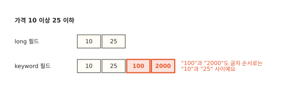
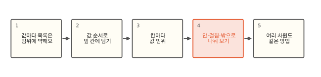
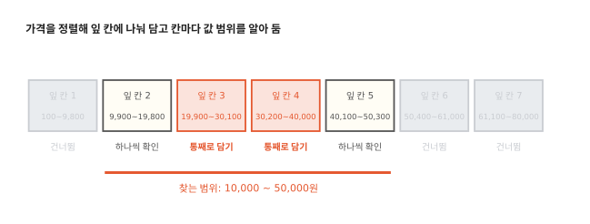
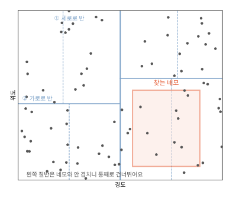

# 숫자·날짜 범위 검색은 왜 빠를까요?

## 가격 10~25원을 찾았는데 100원이 섞여요



가격 필드를 `keyword`로 만든 인덱스에서 "10원 이상 25원 이하" 범위 검색을 했더니 100원짜리와 2000원짜리가 같이 나와요. 같은 값을 `long` 필드에 넣고 찾으면 10원과 25원만 나와요. 로컬 7.17과 9.2에서 똑같았어요.[^lab]

[10편](10-doc-values.md)에서 본 글자 순서 문제가 범위 검색에도 그대로 있어요. "100"은 첫 글자 "1"이 같고 둘째 글자 "0"까지 같아서 글자 순서로 "10" 바로 뒤에 와요. "2000"은 첫 글자 "2"가 "25"와 같고 둘째 글자 "0"이 "5"보다 앞이라 "25" 앞에 와요. 그럼 숫자 필드는 범위를 어떻게 찾길래 순서가 맞고 빠르기까지 할까요? 숫자 필드는 1편의 역색인을 아예 쓰지 않아요.

## 값마다 목록에서 여러 차원까지



역색인으로 범위를 찾으면 왜 힘든지부터 봐요. 숫자를 값 순서로 칸에 나눠 담아 두면 범위가 왔을 때 칸을 세 가지로 나눠 처리할 수 있어요. 같은 방법이 위도·경도 같은 여러 차원에도 쓰여요.

## 값마다 목록은 범위에 약해요

1편의 역색인은 값 하나마다 문서 목록을 달아 둬요. "가격이 정확히 1만 원"은 목록 하나만 꺼내면 돼요. "1만 원 이상 5만 원 이하"는 그 사이의 서로 다른 값을 모두 찾아 목록을 하나하나 꺼내 합쳐야 해요.

값의 종류가 적으면 견딜 만해요. 파이썬으로 상품 100만 개에 100원 단위 가격을 주니 범위 안의 서로 다른 값이 401개였어요. 목록 401개를 합치면 돼요. 그런데 주문 시각처럼 값이 거의 다 다르면 범위 안의 서로 다른 값이 20만 개가 돼요. 목록 20만 개를 꺼내 합치는 건 [7편](07-intersection.md)의 OR를 20만 개 낱말로 하는 일과 같아요.

## 값 순서로 잎 칸에 나눠 담아요



숫자 필드는 색인할 때 (값, 문서 번호) 쌍을 값 순서로 정렬해서 512개씩 칸에 나눠 담아요. 이 칸을 **잎 칸**(leaf block)이라고 할게요. 칸과 칸 사이에 경계값을 적어 두니 칸마다 어느 범위의 값이 들었는지 알 수 있어요. 이 칸들을 둘씩 층층이 묶어 나무 모양으로 만들어요. 묶은 윗단 칸을 마디라고 불러요. [알고리즘 11편](../algorithms/11-btree.md)의 B-트리와 달리 마디 하나에 자식이 둘이에요. 윗마디의 범위는 아래 칸들의 범위를 합친 것이라 마디 하나로 칸 수백 개를 한꺼번에 건너뛰거나 담을 수 있어요. 이 구조를 **BKD 트리**라고 불러요.

범위가 오면 잎 칸을 칸의 값 범위만 보고 세 가지로 나눠요.

- 칸 전체가 범위 밖이면 건너뛰어요. 칸을 열지도 않아요.
- 칸 전체가 범위 안이면 칸을 열어 문서 번호를 비교 없이 통째로 담아요.
- 범위에 걸치는 칸만 열어서 값을 하나씩 확인해요.

값이 정렬돼 칸에 담겨 있어서 범위 중간에 있는 칸은 모두 통째로 안에 들어요. 걸치는 칸은 많아야 양 끝 두 개예요. 파이썬으로 같은 상품 100만 개(잎 칸 1,954개)에서 1만~5만 원을 찾으니 통째로 담은 칸이 391개, 하나씩 확인한 칸이 2개, 건너뛴 칸이 1,561개였어요. 값이 다 다른 시각 데이터에서도 비슷했어요. 역색인은 값 종류 수에 따라 목록 401개에서 20만 개로 일이 늘었는데 BKD의 일은 값 종류 수와 상관없이 걸치는 칸 둘과 안에 든 칸 수로 정해져요.

로컬 ES에서 `_disk_usage`로 보면 `long` 필드는 역색인 크기가 0이고 BKD 자리가 있어요(Lucene은 이 저장소를 points라고 불러요). `keyword` 필드는 반대로 BKD가 0이고 역색인이 있어요. 둘 다 10편의 doc values는 따로 있어요. 숫자 필드는 정확히 일치하는 `term` 검색도 역색인 목록 대신 BKD에서 "그 값 하나만 있는 범위"로 찾아요.

범위가 아주 넓을 때는 사정이 달라요. 맞는 문서가 수백만 개면 BKD로 그 문서 번호를 다 모으는 일 자체가 커요. 이럴 때 다른 조건이 드물다면(예: 특정 고객의 주문 30건) Lucene은 드문 조건을 앞장세우고 그 30건의 날짜만 10편의 doc values로 읽어 범위 안인지 확인하는 길을 골라요. 7편처럼 조건마다 문서 수를 어림해서 알아서 고르니 질의를 따로 바꿀 필요는 없어요.

??? info "심화: Lucene points"
    숫자, 날짜, IP, 위치 필드는 Lucene 6부터 points라는 저장소에 BKD 트리로 담겨요. 그 전에는 숫자를 여러 정밀도의 낱말로 쪼개 역색인에 넣는 방식(trie 인코딩)을 썼어요. 잎 칸 크기 기본값은 최대 512개이고 마지막 한 칸만 모자라요(Lucene에 100만 건을 넣어 보니 512개 칸 1,953개, 64개 칸 1개). 데이터는 16차원, 나누는 기준이 되는 색인 차원은 8차원까지예요(Lucene 8.11과 10.3의 `BKDConfig` 상수로 확인). 숫자는 1차원, `geo_point`는 2차원이에요. 파일은 Lucene 8.6부터(7.17 포함) `.kdd`(잎 칸 데이터), `.kdi`(안쪽 마디 색인), `.kdm`(메타)이에요. 그 전 Lucene은 `.dim`, `.dii`를 썼어요. 1차원에서는 잎 칸마다 실제 최소·최대를 따로 저장하지 않고 안쪽 마디의 가르는 값(split value)으로 칸 경계를 계산해요.

    범위 질의는 트리를 내려가며 마디마다 "밖, 안, 걸침"을 판정하는 `IntersectVisitor`로 돌아요. 통째로 안에 든 마디는 아래 잎 칸들의 문서 번호를 한꺼번에 비트셋에 넣어요. 맞는 문서가 수백만 개면 이 비트셋을 만드는 일이 비용의 대부분이에요. 본문의 "드문 조건 + doc values 확인" 길은 `IndexOrDocValuesQuery`예요. ES가 숫자·날짜 범위 질의를 이걸로 감싸고 어느 쪽으로 돌지는 Lucene이 다른 절의 cost와 BKD의 예상 개수를 비교해서 정해요. 필드에 `index`와 `doc_values`가 모두 켜져 있어야 이 선택이 생겨요. 범위 질의는 점수에 기여하지 않으니 `filter`에 두면 캐시도 받을 수 있어요. Lucene 9 이후(8.11에는 없어서 7.17에는 없어요)에는 건수만 세는 길도 있어요. 삭제 문서가 없는 세그먼트에서 세그먼트 전체가 범위 안이거나 1차원이고 문서마다 값이 하나면 잎 칸을 열지 않고 마디의 개수만 더해요.

## 여러 차원도 같은 방법이에요



숫자 하나라면 정렬해서 자르면 되지만 위도와 경도처럼 값이 둘이면 정렬 순서가 하나로 정해지지 않아요. BKD는 점들이 가장 넓게 퍼진 쪽부터 반으로 잘라요. 그림처럼 경도 쪽이 넓으면 경도로 반 나누고 나뉜 쪽을 각각 다시 가장 넓은 쪽으로 반 나눠요. 한 차원만 계속 자르지 않게 막는 규칙도 있어서 보통은 경도와 위도를 번갈아 자르는 모양이 나와요. 이렇게 잎 칸이 512개 안팎이 될 때까지 내려가요. 이런 나무를 k-d 트리라고 부르고 BKD의 "KD"가 여기서 나와요. 앞의 B는 이 나무를 디스크에서 덩어리째 읽기 좋게 묶었다는 뜻이에요.

찾는 네모가 오면 1차원과 똑같이 해요. 나뉜 칸의 경계 네모가 찾는 네모와 안 겹치면 건너뛰고 안에 들면 통째로 담고 걸치면 들어가 봐요. 그림에서 왼쪽 절반은 첫 번째 판정에서 통째로 빠져요. `geo_point`의 거리 검색, `ip` 대역 검색, 날짜 범위 검색이 모두 이 구조 위에서 돌아요.

??? info "심화: 색인 쪽 비용과 날짜 필드"
    BKD는 세그먼트를 만들 때 한 번에 지어요. 4편처럼 refresh마다 작은 세그먼트의 BKD가 생기고 5편의 병합 때 대체로 다시 지어요. 숫자 필드가 많은 인덱스는 이 때문에 병합이 무거워질 수 있어요. 범위 검색을 하지 않는 숫자 필드는 `"index": false`로 BKD를 만들지 않을 수 있어요(doc values는 남겨 정렬·집계는 해요). 이런 필드에 범위 검색을 보내면 7.17은 오류를 내고 9.2는 doc values로 느리게 찾아요.

    날짜 필드는 밀리초 정수(`date`) 또는 나노초(`date_nanos`, 7.0부터)로 BKD에 담겨요. 날짜 범위를 `now/d`처럼 반올림하면 같은 날 동안 질의가 같은 값으로 풀려서 노드 질의 캐시(query cache)가 다시 쓰여요. `now`가 든 질의는 반올림해도 샤드 요청 캐시에는 대개 들어가지 못해요(로컬에서 `now/d-2d`로 확인).

## 정리

- 숫자·날짜·IP·위치 필드는 역색인 대신 BKD 트리에 담겨요. 값 순서로 정렬해 잎 칸에 나누고 칸마다 값 범위를 알아 둬요.
- 잎 칸: 값 512개 안팎을 담은 칸이에요. 범위 검색은 칸을 "밖, 안, 걸침"으로 나눠 걸치는 칸만 하나씩 확인해요.
- 범위 검색의 일은 값 종류 수와 상관없이 걸치는 칸 둘과 안에 든 칸 수로 정해져요.
- 숫자를 `keyword`에 담으면 범위 검색도 글자 순서를 따라서 엉뚱한 값이 섞여요.

## 직접 해 보기

[lab/es/11_es.sh](https://github.com/oya150/bedrock/blob/main/lab/es/11_es.sh)는 같은 가격을 `long`과 `keyword`에 넣고 범위 검색 결과와 필드별 저장소 크기를 보여 줘요. [lab/es/11_bkd.py](https://github.com/oya150/bedrock/blob/main/lab/es/11_bkd.py)는 ES 없이 두 방식의 일을 세요.

```bash
curl 'localhost:9200/prices/_search' -H 'Content-Type: application/json' \
  -d '{"query":{"range":{"price_kw":{"gte":"10","lte":"25"}}}}'
```

`price_kw`를 `price`로 바꿔 다시 보내 보세요.

## 확인 문제

??? question "1. 칸 나누기"
    잎 칸 다섯 개의 값 범위가 0~9, 10~19, 20~29, 30~39, 40~49예요. 15 이상 33 이하를 찾을 때 각 칸은 어떻게 처리될까요?

    **풀이** 0~9는 밖이라 건너뛰어요. 10~19는 걸쳐서 하나씩 확인해요. 20~29는 통째로 안이라 그대로 담아요. 30~39는 걸쳐서 확인해요. 40~49는 밖이에요. 하나씩 확인하는 칸은 양 끝 둘뿐이에요.

??? question "2. 값이 다 다르면"
    주문 시각(밀리초)처럼 값이 거의 다 다른 필드를 `keyword`로 색인하고 하루치 범위를 찾으면 왜 느릴까요?

    **풀이** `keyword`는 역색인이라 범위 안의 서로 다른 값을 모두 찾아 목록을 하나하나 꺼내 합쳐야 해요. 하루에 주문이 수십만 건이면 목록도 수십만 개예요. 순서도 글자 순서라 자릿수가 다른 값이 섞이면 결과도 틀려요. `date` 필드라면 BKD 잎 칸 몇백 개만 보면 돼요.

??? question "3. 지도에서 네모 찾기"
    `geo_point` 필드로 "서울 강남구 근처 네모" 안의 가게를 찾아요. BKD는 전국의 가게를 다 볼까요?

    **풀이** 보지 않아요. 맨 위에서 가장 넓게 퍼진 쪽으로 반 나눈 칸 가운데 네모와 안 겹치는 쪽은 통째로 건너뛰고 겹치는 쪽만 또 나눠 내려가요. 결국 네모 근처의 잎 칸 몇 개만 열어 봐요.

## 판단 연습

??? question "상품 가격 필드 타입"
    상품 인덱스의 가격이 `keyword`로 되어 있어요. 지금은 가격으로 정확히 일치하는 검색만 하는데 "가격대 필터"를 붙이자는 요청이 왔어요. 어떻게 할까요?

    **풀이** 범위 검색은 숫자 필드가 맞아요. `keyword` 그대로 범위를 걸면 글자 순서라 결과가 틀려요. 가격을 `long`(원 단위 정수)이나 `scaled_float`(소수를 정해진 배수의 정수로 담는 타입)로 담은 새 필드를 더하고 재색인하거나 `_update_by_query`(인덱스 안 문서를 제자리에서 다시 색인하는 API)로 채워요. 정확 일치 검색도 숫자 필드로 바꿔도 되지만 지금 쓰는 곳이 많다면 두 필드를 함께 둬요.

??? question "넓은 범위와 드문 조건"
    "최근 1년 주문 중 고객 ID가 12345인 것"을 찾는 검색이 느려요. 최근 1년은 전체 주문의 절반이고 고객 ID 12345는 주문 30건이에요. ES는 어떻게 찾아야 빠를까요?

    **풀이** 드문 조건(고객 ID 30건)이 앞장서고 날짜는 그 30건의 값만 확인하면 돼요. 날짜 범위를 BKD로 먼저 다 찾으면 주문 절반의 문서 번호를 모아야 해서 느려요. ES는 이런 경우 날짜를 doc values로 확인하는 길을 cost로 골라요(심화 칸). 그래도 느리면 `"profile": true`로 단계별 시간을 보고(7.17에서는 range 절의 `match_count`가 0이 아니면 doc values로 확인한 길이에요) 고객 ID가 `keyword`이고 날짜가 `date` 타입인지부터 확인해요.

[^lab]: [lab/es/11_es.sh](https://github.com/oya150/bedrock/blob/main/lab/es/11_es.sh)로 ES 7.17.26과 9.2.0에서 같은 결과를 확인했어요. 파이썬 흉내는 [lab/es/11_bkd.py](https://github.com/oya150/bedrock/blob/main/lab/es/11_bkd.py)예요.
