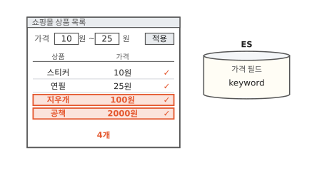
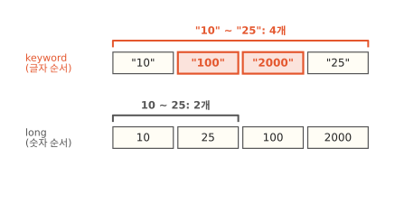
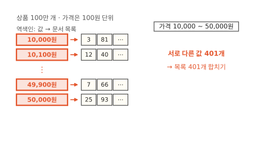
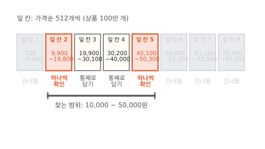
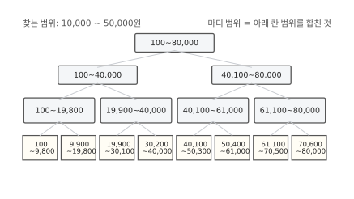
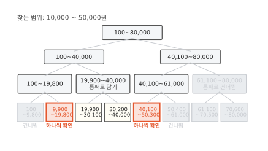
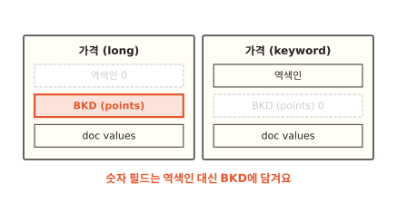
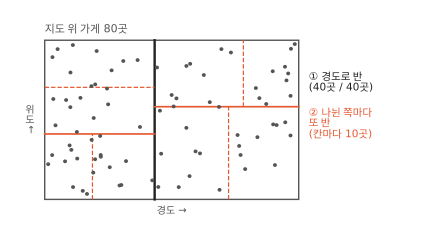
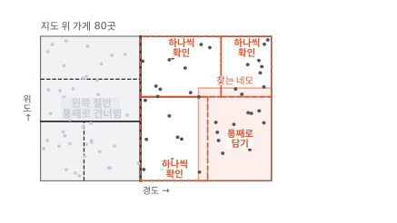
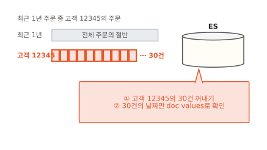

# BKD 트리: 숫자·날짜 범위를 찾는 나무

쇼핑몰 상품 목록에 가격 필터를 달고 10원부터 25원까지를 골랐어요. 그런데 100원짜리 지우개와 2000원짜리 공책까지 나와요. 이 글을 읽고 나면 ES가 숫자와 날짜를 어떻게 담아 두길래 범위를 틀리지 않고 빨리 찾는지 알게 돼요. 가격대나 기간 필터는 거의 모든 검색 화면에 있어서 필드 타입을 잘못 고르면 결과가 틀리거나 느려져요.

!!! abstract "이 글에서 알게 되는 것"
    1. 가격을 `keyword` 필드에 담으면 글자 순서로 줄을 서서 "100"이 "10"과 "25" 사이에 들어가요. 숫자 필드에 담아야 숫자 순서로 범위를 찾아요.
    2. 숫자 필드는 값을 순서대로 줄 세워 잎 칸에 나눠 담아요. 칸에 든 값의 범위만 보고 건너뛸 칸, 통째로 담을 칸, 하나씩 확인할 칸을 가려요.
    3. 잎 칸을 둘씩 묶어 올린 나무가 BKD 트리예요. 위도와 경도처럼 값이 둘이어도 넓게 퍼진 쪽부터 반씩 잘라서 같은 방법으로 찾아요.

## 1. 가격을 keyword에 담으면 글자 순서로 범위를 찾아요

상품은 스티커 10원, 연필 25원, 지우개 100원, 공책 2000원 넷이에요. ES에는 가격을 `keyword` 필드로 담았어요. `keyword`는 값을 글자 그대로 담는 필드예요. 가격 칸에 10원부터 25원까지를 넣고 적용을 눌러요. 아래 그림에서 빨간 줄 두 개를 보세요.

**그림 1.** 10~25원을 찾았는데 지우개 100원과 공책 2000원까지 4개가 나왔어요.
{ .fig-cap }

`keyword` 필드는 값을 글자로 보고 사전처럼 줄 세워요. 첫 글자부터 하나씩 비교하는 순서예요. [10편](10-doc-values.md)에서 정렬할 때 본 그 순서예요. 아래 그림 위 줄에서 "100"과 "2000"이 어디에 섰는지 보세요.

**그림 2.** 글자 순서에서는 "100"과 "2000"이 "10"과 "25" 사이에 서요.
{ .fig-cap }

"100"은 앞 두 글자가 "10"과 같고 더 길어서 "10" 다음에 와요. "2000"은 첫 글자가 "25"와 같은 "2"이고 둘째 글자 "0"이 "5"보다 앞이라 "25" 앞에 와요. 그래서 "10"부터 "25"까지에 넷이 다 들어가요. 숫자 순서로 줄 세운 아래 줄에서는 100과 2000이 25 다음에 서서 범위 밖이에요.

가격을 `long` 필드에 담으면 아래 줄처럼 찾아요. `long`은 정수를 담는 숫자 필드예요. 같은 범위로 찾으면 스티커와 연필만 나와요. 날짜를 담는 `date` 필드도 날짜를 밀리초 정수로 바꿔 담아서 숫자와 같은 방법으로 찾아요. 이미 `keyword`로 담아 둔 가격이라면 `long` 필드를 새로 더하고 다시 색인해요.

순서는 맞췄어요. 그럼 숫자 필드는 이 순서를 어떻게 담아 둘까요? [1편](01-inverted-index.md)의 역색인에 담으면 어떤 일이 생기는지부터 볼게요.

## 2. 역색인으로 범위를 찾으면 값마다 목록을 꺼내요

역색인은 낱말마다 그 낱말이 든 문서 번호 목록을 달아 둬요. 가격도 값 하나를 낱말 하나처럼 담을 수 있어요. 10,000원 줄에는 가격이 10,000원인 상품의 문서 번호가 달리는 식이에요.

이번에는 쇼핑몰이 커져서 상품이 100만 개라고 해 볼게요. 상품 넷으로는 일이 많은지 적은지 보이지 않아서 예시를 키웠어요. 가격은 100원 단위예요. "가격이 정확히 1만 원"이면 10,000원 줄의 목록 하나만 꺼내면 돼요. 가격대 1만~5만 원은 어떨까요? 아래 그림의 빨간 칸을 보세요.

**그림 3.** 1만~5만 원 사이의 값 401개마다 목록을 하나씩 꺼내서 합쳐야 해요.
{ .fig-cap }

10,000원부터 100원씩 올라가 50,000원까지 가면 값이 401개예요. 이 401줄을 모두 찾아 목록을 꺼내고 하나로 합쳐야 해요. [7편](07-intersection.md)에서 본 OR 검색을 낱말 401개로 하는 일과 같아요.

값 종류가 많아지면 일도 늘어요. 주문 시각처럼 밀리초까지 담은 값은 거의 다 달라요. 그러면 범위 안에 든 주문 수만큼 목록을 꺼내야 해요. 값 종류가 늘어도 일이 늘지 않게 담는 방법이 필요해요.

## 3. 값 순서로 잎 칸에 담으면 칸째로 건너뛰거나 담아요

숫자 필드는 역색인을 만들지 않아요. 색인할 때 (값, 문서 번호) 쌍을 값 순서로 줄 세운 다음 앞에서부터 512개씩 끊어서 칸에 담아요. 이 칸을 **잎 칸**(leaf block)이라고 할게요. 칸 안의 값이 순서대로 들어 있으니 칸마다 가장 작은 값과 가장 큰 값을 알 수 있어요. 상품 100만 개를 512개씩 끊으면 칸이 2천 개 가까이 생겨요.

범위가 오면 칸을 열기 전에 칸의 값 범위만 보고 셋으로 가려요.

- 범위와 하나도 안 겹치는 칸은 건너뛰어요. 칸을 열지도 않아요.
- 범위 안에 통째로 든 칸은 열어서 문서 번호를 비교 없이 다 담아요.
- 범위에 걸친 칸만 열어서 값을 하나씩 확인해요.

아래 그림은 칸을 여덟 개로 줄여 그렸어요. 1만~5만 원을 찾을 때 빨간 칸이 어디인지 보세요.

**그림 4.** 여덟 칸 가운데 하나씩 확인하는 칸은 범위 양 끝의 잎 칸 2와 5뿐이에요.
{ .fig-cap }

잎 칸 1과 6, 7, 8은 범위 밖이라 건너뛰어요. 잎 칸 3과 4는 범위 안에 통째로 들어서 다 담아요. 잎 칸 2는 9,900원부터 시작해서 1만 원 경계에 걸쳐요. 잎 칸 5는 50,300원까지 가서 5만 원 경계에 걸쳐요.

값을 순서대로 담았기 때문에 범위 가운데에 있는 칸은 모두 통째로 안에 들어요. 경계에 걸칠 수 있는 칸은 범위가 시작하는 칸과 끝나는 칸, 많아야 둘이에요. 그래서 범위 안의 값 종류가 401개든 수십만 개든 하나씩 확인하는 칸 수는 같아요.

그런데 칸이 2천 개 가까이 되면 칸마다 범위를 하나씩 다 봐야 할까요?

## 4. 잎 칸을 둘씩 묶은 나무가 BKD 트리예요

이웃한 잎 칸을 둘씩 묶어 윗단 칸을 만들어요. 이 윗단 칸을 마디라고 해요. 마디의 범위는 아래 두 칸의 범위를 합친 거예요. 마디를 다시 둘씩 묶기를 맨 위에 하나가 남을 때까지 되풀이해요. 아래 그림에서 맨 아래 잎 칸 여덟 개가 위로 묶여 올라가는 모양을 보세요.

**그림 5.** 잎 칸 여덟 개를 둘씩 세 번 묶으면 맨 위 마디 하나가 100~80,000을 맡아요.
{ .fig-cap }

찾을 때는 맨 위 마디에서 출발해 내려가요. 마디마다 잎 칸 때처럼 밖, 안, 걸침을 가려요. 밖이면 그 아래를 통째로 건너뛰어요. 안이면 그 아래 문서 번호를 통째로 담아요. 걸칠 때만 한 층 내려가요. 1만~5만 원을 찾으면 아래 그림처럼 돼요. 오른쪽 마디 61,100~80,000부터 보세요.

**그림 6.** 마디 하나로 잎 칸 둘을 한꺼번에 건너뛰거나 담아요. 하나씩 확인하는 칸은 여전히 양 끝 둘이에요.
{ .fig-cap }

마디 61,100~80,000은 범위 밖이라 그 아래 잎 칸 둘을 열지 않아요. 마디 19,900~40,000은 범위 안이라 아래 잎 칸 둘의 문서 번호를 한꺼번에 담아요. 범위에 걸친 마디 100~19,800과 40,100~61,000에서만 한 층 내려가 잎 칸을 하나씩 판정해요.

그림에서는 마디 하나가 잎 칸 둘을 맡아요. 층이 하나 올라갈 때마다 마디 하나가 맡는 잎 칸은 두 배로 늘어요. 그래서 잎 칸이 2천 개 가까이 되면 위쪽 마디 하나로 칸 수백 개를 한꺼번에 건너뛰거나 담아요.

이 나무를 **BKD 트리**라고 해요. [알고리즘 11편](../algorithms/11-btree.md)의 B-트리와 달리 마디 하나에 자식이 둘이에요.

ES 안에서 색인을 맡는 Lucene은 BKD 트리를 담는 저장소를 points라고 불러요. 아래 그림에서 두 필드가 저마다 무엇을 가졌는지 보세요.

**그림 7.** `long` 필드에는 역색인이 없고 BKD가 있어요. `keyword` 필드는 그 반대예요.
{ .fig-cap }

두 필드 모두 10편의 doc values는 따로 가져요. 숫자 필드는 정확히 같은 값을 찾는 `term` 검색도 역색인 목록 대신 BKD에서 "그 값 하나뿐인 범위"로 찾아요.

## 5. 위도와 경도는 넓게 퍼진 쪽부터 반씩 잘라요

이번에는 예시를 지도로 바꿀게요. 값이 둘일 때를 보려고요. 가격은 값이 하나라 줄 세울 순서도 하나예요. 지도 위 가게는 위도와 경도 두 값이 있어서 어느 값으로 줄 세울지가 하나로 정해지지 않아요.

BKD는 점들이 가장 넓게 퍼진 쪽을 골라 반으로 잘라요. 나뉜 양쪽에서도 저마다 가장 넓게 퍼진 쪽을 골라 또 반으로 잘라요. 이걸 칸마다 512개 안팎이 남을 때까지 되풀이해요. 아래 그림은 가게 80곳을 칸마다 10곳이 될 때까지 잘랐어요. 가운데 검정 굵은 세로선이 첫 칼질이에요.

**그림 8.** 경도로 한 번 반을 가르고 나뉜 쪽마다 또 반씩 잘라서 칸 여덟 개를 만들었어요.
{ .fig-cap }

지도가 가로로 길어서 첫 칼질은 경도로 갔어요. 양쪽에 40곳씩 들어가요. 그다음부터는 칸마다 넓게 퍼진 쪽이 달라서 위도로 자르기도 하고 경도로 자르기도 해요. 실제 BKD는 한 차원만 계속 자르지 않게 막는 규칙도 함께 써요. 그래서 보통은 경도와 위도를 번갈아 자르는 모양이 나와요.

이렇게 가장 넓게 퍼진 쪽을 골라 반씩 잘라 만든 나무를 **k-d 트리**라고 해요. BKD의 "KD"가 여기서 왔어요. 앞의 B는 이 나무를 디스크에서 덩어리째 읽기 좋게 묶었다는 뜻이에요.

가게를 찾을 네모가 오면 가격 때와 똑같이 해요. 칸마다 경계 네모를 찾는 네모와 맞대 보고 밖, 안, 걸침을 가려요. 아래 그림에서 회색 왼쪽 절반과 빨간 칸들을 보세요.

**그림 9.** 왼쪽 절반은 첫 판정에서 통째로 빠지고 걸친 칸 셋만 들어가서 점을 확인해요.
{ .fig-cap }

찾는 네모는 오른쪽 아래에 있어서 왼쪽 절반과 안 겹쳐요. 그래서 왼쪽 가게 40곳은 하나도 보지 않아요. 네모가 다 덮은 칸은 통째로 담고 걸친 칸 셋만 들어가서 점을 하나씩 확인해요. `geo_point`의 거리 검색, `ip` 대역 검색, 날짜 범위 검색이 모두 이 구조 위에서 돌아요.

## 6. 범위가 아주 넓으면 드문 조건부터 찾아요

BKD 트리로 찾으면 칸을 통째로 담을 수 있어서 빨라요. 그런데 범위에 맞는 문서가 수백만 개면 그 문서 번호를 다 모으는 일 자체가 커요.

이번 예시는 주문이에요. 범위가 아주 넓은 경우를 보려고요. "최근 1년 주문 가운데 고객 12345의 주문"을 찾는다고 해 볼게요. 최근 1년은 전체 주문의 절반이고 고객 12345의 주문은 30건이에요. 아래 그림에서 ES가 무엇을 먼저 꺼내는지 보세요.

**그림 10.** 고객 12345의 주문 30건을 먼저 꺼내고 그 30건의 날짜만 확인해요.
{ .fig-cap }

날짜 범위를 BKD로 먼저 찾으면 주문 절반의 문서 번호를 모두 모아야 해요. 그래서 Lucene은 드문 조건을 앞장세워요. 고객 12345의 주문 30건을 먼저 꺼내고 그 30건의 날짜만 10편의 doc values로 읽어서 범위 안인지 확인해요. 날짜는 30번만 읽으면 끝나요.

어느 길로 갈지는 Lucene이 골라요. [7편](07-intersection.md)에서처럼 조건마다 맞는 문서 수를 어림해서 BKD로 찾을지 doc values로 확인할지 정해요. ES는 숫자·날짜 범위 질의를 `IndexOrDocValuesQuery`로 감싸서 이 선택을 Lucene에 맡겨요. 그래서 질의를 따로 고칠 일은 없어요. 이 선택은 필드에 BKD(`index`)와 doc values(`doc_values`)가 둘 다 켜져 있을 때만 생겨요.

## 정리

가격을 `keyword` 필드에 담으면 "100"이 "10"과 "25" 사이에 서는 글자 순서로 범위를 찾아요. 그래서 10~25원에 100원과 2000원이 섞였어요. `long` 같은 숫자 필드나 `date` 필드에 담아야 숫자 순서로 찾아요.

숫자 필드는 역색인을 만들지 않고 값을 순서대로 줄 세워 잎 칸에 512개씩 담아요. 칸의 값 범위만 보고 건너뛸 칸, 통째로 담을 칸, 하나씩 확인할 칸을 가려요. 하나씩 확인하는 칸은 범위 양 끝의 많아야 둘이에요. 잎 칸을 둘씩 묶어 올린 BKD 트리를 위에서부터 내려가면 칸 여러 개를 마디 하나로 한꺼번에 처리해요. 지도처럼 값이 둘이면 가장 넓게 퍼진 쪽부터 반씩 잘라서 같은 방법으로 찾아요.

범위가 아주 넓고 다른 조건이 드물면 Lucene은 드문 조건부터 꺼내고 범위는 doc values로 확인해요.

[12편](12-distributed-search.md)에서는 샤드 여러 개가 낸 결과를 하나로 합치는 방법을 봐요.

### 새로 나온 말

- **잎 칸**(leaf block): 값을 순서대로 줄 세워 512개씩 끊어 담은 칸. 1만~5만 원을 찾을 때 잎 칸 3과 4는 통째로 담았어요.
- **마디**: 아래 칸 둘을 묶은 윗단 칸. 범위는 아래 두 칸의 범위를 합친 거예요. 마디 61,100~80,000은 아래 잎 칸 둘을 한꺼번에 건너뛰었어요.
- **BKD 트리**: 잎 칸을 둘씩 층층이 묶은 나무. 1만~5만 원을 맨 위 마디부터 내려가며 찾았어요.
- **points**: Lucene이 숫자·날짜·IP·위치 값을 BKD 트리로 담는 저장소. `long` 필드에는 있고 `keyword` 필드에는 없어요.
- **k-d 트리**: 점들이 가장 넓게 퍼진 쪽부터 반씩 잘라 만든 나무. 가게 80곳을 경도로 먼저 반 갈랐어요.
- **IndexOrDocValuesQuery**: BKD로 찾는 길과 doc values로 확인하는 길 가운데 하나를 Lucene이 고르게 하는 질의. 고객 12345의 30건을 먼저 꺼낸 길이 doc values 쪽이에요.
