# 숫자·날짜 범위 검색은 왜 빠를까요?

## 가격 10~25원을 찾았는데 100원이 섞여요

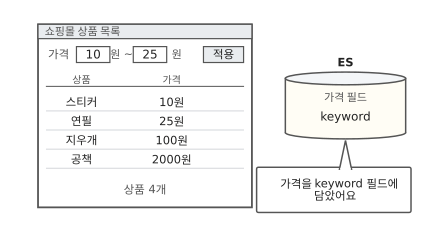

쇼핑몰 상품 목록에 가격 필터를 붙였어요. 상품은 스티커 10원, 연필 25원, 지우개 100원, 공책 2000원 넷이에요. ES에는 가격을 `keyword` 필드로 담았어요. 10원 이상 25원 이하를 찾으면 무엇이 나올까요?

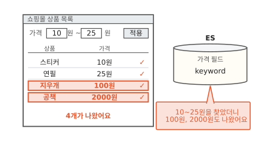

넷이 다 나왔어요. 100원짜리 지우개와 2000원짜리 공책이 섞였어요. 같은 가격을 `long` 필드에 담으면 어떨까요?

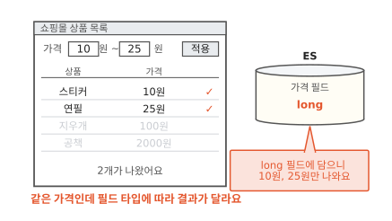

`long`은 정수를 담는 숫자 필드예요. 이번에는 10원과 25원만 나와요. 제 컴퓨터에 띄운 ES 7.17과 9.2에서 똑같았어요.[^lab] `keyword` 필드는 왜 100원까지 꺼냈을까요?

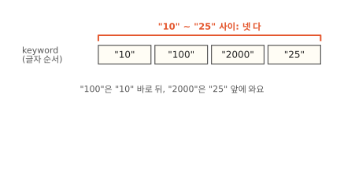

[10편](10-doc-values.md)에서 본 글자 순서 문제가 범위 검색에도 그대로 있어요. "100"은 첫 글자 "1"과 둘째 글자 "0"이 "10"과 같아서 "10" 바로 뒤에 와요. "2000"은 첫 글자 "2"가 "25"와 같고 둘째 글자 "0"이 "5"보다 앞이라 "25" 앞에 와요. 숫자 순서로 줄 세우면 어떻게 될까요?

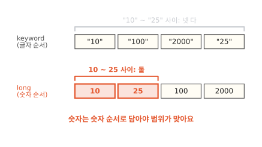

숫자 순서에서는 100과 2000이 25보다 뒤에 있어서 범위에 안 걸려요. 숫자 필드는 범위를 어떻게 찾길래 순서가 맞고 빠르기까지 할까요? 숫자 필드는 [1편](01-inverted-index.md)의 역색인을 아예 쓰지 않아요. 역색인으로 범위를 찾으면 뭐가 힘든지부터 볼게요.

## 값마다 목록은 범위에 약해요

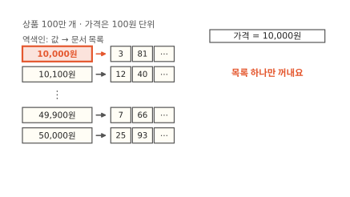

쇼핑몰이 커져서 상품이 100만 개가 됐다고 해 볼게요. 가격은 100원 단위예요. 역색인은 값 하나마다 문서 목록을 달아 둬요. "가격이 정확히 1만 원"은 목록 하나만 꺼내면 돼요. 가격대 필터로 1만~5만 원을 고르면 어떻게 될까요?

그 사이의 서로 다른 값을 모두 찾아 목록을 하나하나 꺼내 합쳐야 해요. 파이썬으로 상품 100만 개에 100원 단위 가격을 주니 범위 안의 서로 다른 값이 401개였어요. 값의 종류가 이 정도면 견딜 만해요. 값이 거의 다 다르면 어떨까요?

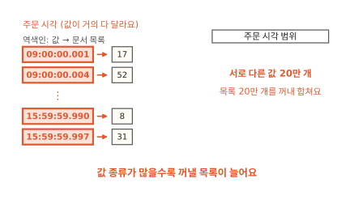

주문 시각처럼 값이 거의 다 다르면 범위 안의 서로 다른 값이 20만 개가 돼요. 목록 20만 개를 꺼내 합치는 건 [7편](07-intersection.md)의 OR를 낱말 20만 개로 하는 일과 같아요. 값 종류가 늘어도 일이 늘지 않으려면 어떻게 담아 둬야 할까요?

## 값 순서로 잎 칸에 나눠 담아요

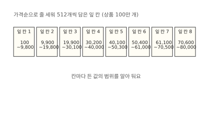

숫자 필드는 색인할 때 (값, 문서 번호) 쌍을 값 순서로 정렬해서 512개씩 칸에 나눠 담아요. 이 칸을 **잎 칸**(leaf block)이라고 할게요. 칸과 칸 사이에 경계값을 적어 두니 칸마다 어느 범위의 값이 들었는지 알 수 있어요. 1만~5만 원을 찾으면 어떻게 될까요?

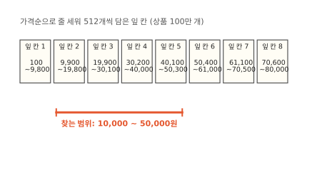

범위가 오면 칸을 열기 전에 칸의 값 범위만 보고 셋으로 나눠요. 범위와 아예 안 겹치는 칸은 어떻게 할까요?

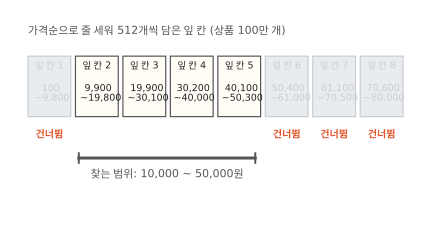

칸 전체가 범위 밖이면 건너뛰어요. 칸을 열지도 않아요. 범위 안에 쏙 들어간 칸은요?

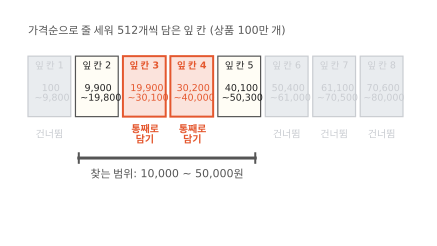

칸 전체가 범위 안이면 칸을 열어 문서 번호를 비교 없이 통째로 담아요. 남은 잎 칸 2와 5는 범위에 걸쳐 있어요.

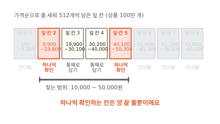

걸치는 칸만 열어서 값을 하나씩 확인해요. 값이 정렬돼 칸에 담겨 있어서 범위 중간에 있는 칸은 모두 통째로 안에 들어요. 걸치는 칸은 많아야 양 끝 두 개예요.

파이썬으로 같은 상품 100만 개를 담으니 잎 칸이 1,954개였어요. 1만~5만 원을 찾으니 통째로 담은 칸이 391개, 하나씩 확인한 칸이 2개였어요. 건너뛴 칸은 1,561개예요. 값이 다 다른 시각 데이터에서도 비슷했어요. 역색인은 값 종류 수에 따라 목록 401개에서 20만 개로 일이 늘었어요. 잎 칸으로 찾으면 일이 값 종류 수와 상관없이 걸치는 칸 둘과 안에 든 칸 수로 정해져요. 가격 예시만 보면 목록 401개와 칸 393개라 차이가 작아요. 이득이 큰 쪽은 시각 데이터예요. 역색인은 목록 20만 개를 합쳐야 했지만 잎 칸 쪽 일은 가격 때와 비슷했어요.

그런데 칸이 1,954개면 칸마다 범위를 하나씩 다 봐야 할까요?

## 칸을 둘씩 묶어 나무를 만들어요

잎 칸들을 둘씩 층층이 묶어 나무 모양으로 만들어요. 묶은 윗단 칸을 마디라고 불러요. 마디의 범위는 아래 칸들의 범위를 합친 거예요. 위에서부터 내려가며 찾으면 마디에서 무엇을 알 수 있을까요?

마디 61,100~80,000은 범위 밖이에요. 그 아래 잎 칸 둘은 열어 보지 않고 한꺼번에 건너뛰어요. 범위 안에 든 마디는요?

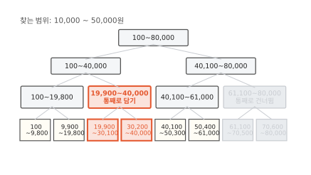

마디 19,900~40,000은 통째로 범위 안이에요. 아래 잎 칸들의 문서 번호를 한꺼번에 담아요. 그림에서는 마디 하나가 칸 둘을 맡았어요. 칸이 1,954개면 위쪽 마디 하나로 칸 수백 개를 한꺼번에 건너뛰거나 담아요. 범위에 걸친 마디 100~19,800과 40,100~61,000은 어떻게 할까요?

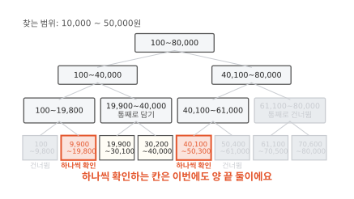

걸친 마디는 한 층 내려가 잎 칸을 하나씩 판정해요. 범위 밖 칸은 건너뛰고 걸친 칸만 열어 값을 확인해요. 나무로 찾아도 하나씩 확인하는 칸은 양 끝 둘이에요.

이 나무를 **BKD 트리**라고 불러요. [알고리즘 11편](../algorithms/11-btree.md)의 B-트리와 달리 마디 하나에 자식이 둘이에요. 이 나무는 ES 안에서 어디에 있을까요?

로컬 ES에서 `_disk_usage`로 필드마다 저장소 크기를 봤어요. `long` 필드는 역색인 크기가 0이고 BKD 자리가 있어요. ES 안에서 색인을 맡는 Lucene은 이 저장소를 points라고 불러요. `keyword` 필드는 반대로 BKD가 0이고 역색인이 있어요. 둘 다 10편의 doc values는 따로 있어요. 숫자 필드는 정확히 일치하는 `term` 검색도 역색인 목록 대신 BKD에서 "그 값 하나만 있는 범위"로 찾아요.

??? info "심화: 잎 칸과 나무는 Lucene 안에서 어떻게 생겼을까요?"
    잎 칸 크기나 파일 이름처럼 실제 구현의 숫자가 궁금할 때 보는 칸이에요. 숫자, 날짜, IP, 위치 필드는 Lucene 6부터 points라는 저장소에 BKD 트리로 담겨요. 그 전에는 숫자를 여러 정밀도의 낱말로 쪼개 역색인에 넣었어요. 이 방식을 trie 인코딩이라고 해요. 잎 칸 크기 기본값은 최대 512개이고 마지막 한 칸만 모자라요. Lucene에 100만 건을 넣어 보니 512개 칸 1,953개와 64개 칸 1개가 생겼어요.

    데이터는 16차원까지 담을 수 있어요. 나누는 기준이 되는 색인 차원은 8차원까지예요. 둘 다 Lucene 8.11과 10.3의 `BKDConfig` 상수로 확인했어요. 숫자는 1차원, `geo_point`는 2차원이에요. 파일은 Lucene 8.6부터(7.17 포함) 셋이에요. `.kdd`는 잎 칸 데이터, `.kdi`는 안쪽 마디 색인, `.kdm`은 메타예요. 그 전 Lucene은 `.dim`, `.dii`를 썼어요. 1차원에서는 잎 칸마다 실제 최소·최대를 따로 저장하지 않아요. 안쪽 마디의 가르는 값(split value)으로 칸 경계를 계산해요.

    범위 질의는 트리를 내려가며 마디마다 밖, 안, 걸침을 판정하는 `IntersectVisitor`로 돌아요. 통째로 안에 든 마디는 아래 잎 칸들의 문서 번호를 한꺼번에 비트셋(문서마다 한 비트씩 둔 표)에 넣어요. 맞는 문서가 수백만 개면 이 비트셋을 만드는 일이 비용의 대부분이에요. Lucene 9 이후에는 건수만 세는 길도 있어요. Lucene 8.11에는 없어서 7.17에는 없어요. 이 길은 삭제 문서가 없는 세그먼트에서만 타요. 세그먼트 전체가 범위 안이면 잎 칸을 열지 않고 마디의 개수만 더해요. 1차원이고 문서마다 값이 하나일 때도 그렇게 해요.

## 여러 차원도 같은 방법이에요

값이 숫자 하나뿐이면 정렬한 다음 자르면 돼요. 그런데 지도 위 가게처럼 위도와 경도 두 값이 있으면 정렬 순서가 하나로 정해지지 않아요. BKD는 어디부터 자를까요?

BKD는 점들이 가장 넓게 퍼진 쪽부터 반으로 잘라요. 그림에서는 경도 쪽이 넓어서 경도로 반을 나눴어요. 양쪽에 가게가 40곳씩 들어가요. 나뉜 쪽은 어떻게 할까요?

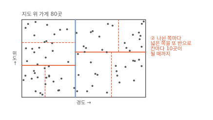

나뉜 쪽을 각각 다시 가장 넓은 쪽으로 반 나눠요. 한 차원만 계속 자르지 않게 막는 규칙도 있어서 보통은 경도와 위도를 번갈아 자르는 모양이 나와요. 실제로는 잎 칸이 512개 안팎이 될 때까지 내려가요. 그림에서는 칸마다 가게 10곳이 될 때까지 잘랐어요.

이런 나무를 k-d 트리라고 부르고 BKD의 "KD"가 여기서 나와요. 앞의 B는 이 나무를 디스크에서 덩어리째 읽기 좋게 묶었다는 뜻이에요. 가게를 찾을 네모가 오면 어떻게 할까요?

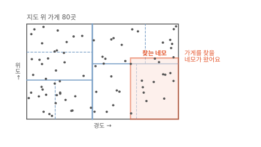

1차원과 똑같이 해요. 나뉜 칸마다 경계 네모를 찾는 네모와 맞대 봐요. 첫 칼질로 나뉜 왼쪽 절반은 어떨까요?

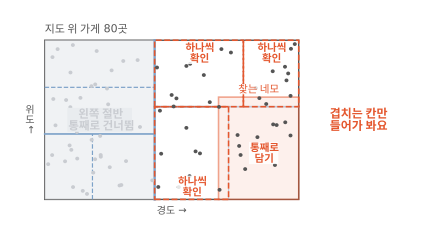

왼쪽 절반은 찾는 네모와 안 겹쳐서 첫 판정에서 통째로 빠져요. 네모가 다 덮은 칸은 통째로 담고 걸친 세 칸만 들어가 점을 하나씩 확인해요. `geo_point`의 거리 검색, `ip` 대역 검색, 날짜 범위 검색이 모두 이 구조 위에서 돌아요.

??? info "심화: 숫자 필드가 많으면 색인이 무거워질까요?"
    숫자 필드를 많이 둔 인덱스에서 글을 넣는 부담이 궁금할 때 보는 칸이에요. BKD는 세그먼트를 만들 때 한 번에 지어요. 4편처럼 refresh마다 작은 세그먼트의 BKD가 생기고 5편의 병합 때 대체로 다시 지어요. 숫자 필드가 많은 인덱스는 이 때문에 병합이 무거워질 수 있어요.

    범위 검색을 하지 않는 숫자 필드는 `"index": false`로 BKD를 만들지 않을 수 있어요. doc values는 남아서 정렬·집계는 해요. 이런 필드에 범위 검색을 보내면 7.17은 오류를 내고 9.2는 doc values로 느리게 찾아요.

## 숫자 필드는 언제 쓸모 있을까요?

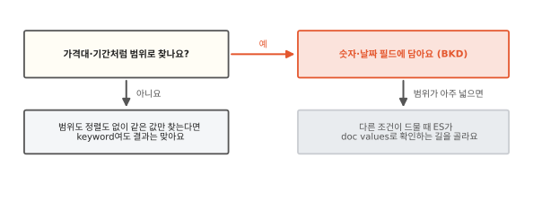

첫째 물음은 "가격대·기간처럼 범위로 찾나요?"예요. 처음 장면처럼 가격이 `keyword`인데 가격대 필터를 붙인다면 숫자 필드가 맞아요. `keyword` 그대로 범위를 걸면 글자 순서라 결과가 틀려요. 가격을 `long`으로 담은 새 필드를 더하고 다시 색인해요. 소수가 있는 값은 정해진 배수를 곱해 정수로 담는 `scaled_float`도 있어요. `_update_by_query`로 인덱스 안 문서를 제자리에서 다시 색인해 새 필드를 채워도 돼요. 범위로 찾지도 정렬하지도 않고 정확히 같은 값만 찾는다면 `keyword`여도 결과는 맞아요. 정렬하면 글자 순서라 "100"이 "25" 앞에 와요(10편). "010"과 "10"도 서로 다른 값이 돼요. 이미 여러 곳에서 정확히 같은 가격을 `keyword` 필드로 찾고 있다면 두 필드를 함께 둬요.

범위로 찾더라도 범위가 아주 넓으면 사정이 달라요. "최근 1년 주문 중 고객 ID가 12345인 것"을 찾는다고 해 볼게요. 최근 1년은 전체 주문의 절반이고 고객 12345의 주문은 30건이에요.

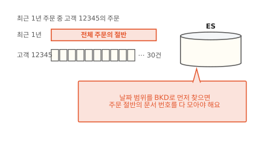

맞는 문서가 수백만 개면 BKD로 그 문서 번호를 다 모으는 일 자체가 커요. 더 가볍게 찾는 길은 없을까요?

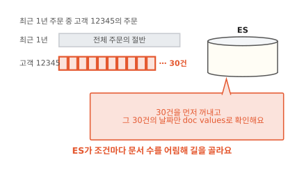

이럴 때 Lucene은 드문 조건을 앞장세워요. 고객 12345의 주문 30건을 먼저 꺼내고 그 30건의 날짜만 10편의 doc values로 읽어 범위 안인지 확인해요. [7편](07-intersection.md)처럼 조건마다 문서 수를 어림해서 고르니 질의를 따로 바꿀 필요는 없어요.

??? info "심화: 어느 길로 찾을지는 어떻게 정할까요?"
    넓은 범위 검색이 느려서 ES가 어느 길을 탔는지 보고 싶을 때 보는 칸이에요. 본문의 "드문 조건 + doc values 확인" 길은 `IndexOrDocValuesQuery`예요. ES가 숫자·날짜 범위 질의를 이걸로 감싸요. 어느 쪽으로 돌지는 Lucene이 다른 절의 cost와 BKD의 예상 개수를 비교해서 정해요. 필드에 `index`와 `doc_values`가 모두 켜져 있어야 이 선택이 생겨요.

    그래도 느리면 `"profile": true`로 단계별 시간을 봐요. 7.17에서는 range 절의 `match_count`가 0이 아니면 doc values로 확인한 길이에요. 고객 ID가 `keyword`이고 날짜가 `date` 타입인지부터 확인해요.

??? info "심화: 날짜 범위는 어떻게 담기고 언제 캐시를 받을까요?"
    같은 날짜 범위 검색을 자주 보낼 때 캐시를 받는지 궁금하면 보는 칸이에요. 날짜 필드 `date`는 밀리초 정수로 BKD에 담겨요. `date_nanos`(7.0부터)는 나노초로 담겨요. 범위 질의는 점수에 기여하지 않으니 `filter`에 두면 캐시도 받을 수 있어요.

    날짜 범위를 `now/d`처럼 반올림하면 같은 날 동안 질의가 같은 값으로 풀려요. 그래서 노드 질의 캐시(query cache)가 다시 쓰여요. `now`가 든 질의는 반올림해도 샤드 요청 캐시에는 대개 들어가지 못해요. 로컬에서 `now/d-2d`로 확인했어요.

## 다시 가격 10~25원을 찾아 볼게요

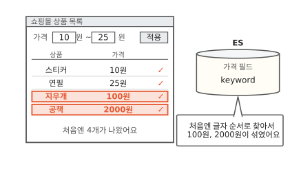

처음 장면의 상품 목록으로 돌아왔어요. 그때는 가격을 `keyword`에 담아 글자 순서로 찾았어요. 그래서 100원과 2000원이 섞였어요.

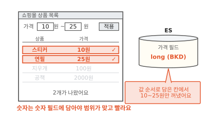

이번에는 가격을 `long`에 담았어요. 가격이 값 순서로 잎 칸에 담겨 있어서 10~25원이 든 칸만 열면 끝나요. 스티커와 연필만 나와요.

상품이 넷이든 100만 개든 하나씩 확인하는 칸은 많아야 범위 양 끝의 둘이에요.

### 이 편에서 줄여 그린 것

그림을 쉽게 하려고 실제와 다르게 줄인 곳이 세 군데 있어요.

1. 잎 칸을 여덟 개로 그리고 칸마다 값 범위를 어림해 적었어요. 상품 100만 개를 담으면 512개씩 든 칸이 1,954개 생기고 나무의 층도 훨씬 많아요. 그림에서는 찾는 범위가 여덟 칸 중 넷, 전체의 절반을 덮어요. 실측에서는 1,954칸 중 393칸(약 20%)만 걸렸어요. 칸마다 범위가 적혀 있는 것처럼 그렸지만 1차원에서는 칸마다 최소·최대를 따로 저장하지 않아요. 안쪽 마디의 가르는 값으로 칸 경계를 계산해요(첫 심화 칸).
2. 처음과 끝 장면에서는 "10~25원이 든 칸만 연다"고 했어요. 잎 칸 하나에 512개까지 들어가니 실제로는 상품 넷이 한 칸에 다 들어가요. 그 한 칸이 범위에 걸쳐서 넷을 하나씩 확인해요.
3. 지도 그림은 가게 80곳을 칸마다 10곳이 될 때까지 잘랐어요. 실제로는 잎 칸이 512개 안팎이 될 때까지 잘라요. 자를 쪽도 가장 넓게 퍼진 쪽만 보고 골랐어요. 실제 BKD는 한 차원만 계속 자르지 않게 막는 규칙도 함께 써요.

### 이 편에서 새로 나온 말

[^lab]: 같은 가격을 `long`과 `keyword` 필드에 넣고 범위 검색 결과와 필드별 저장소 크기(`_disk_usage`)를 ES 7.17.26과 9.2.0에서 확인했어요. 잎 칸 수와 역색인 목록 수는 ES 없이 파이썬으로 두 방식의 일을 센 값이에요.
