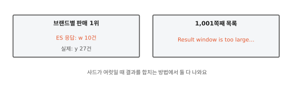
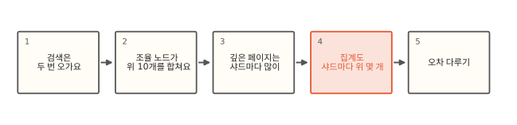
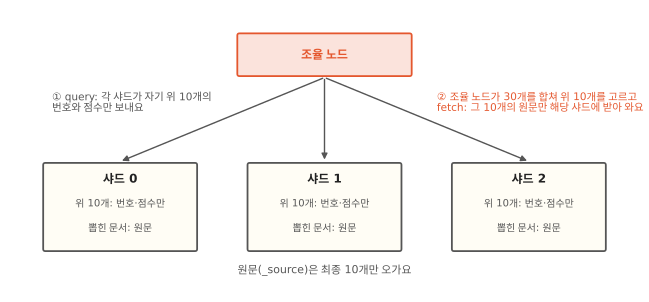
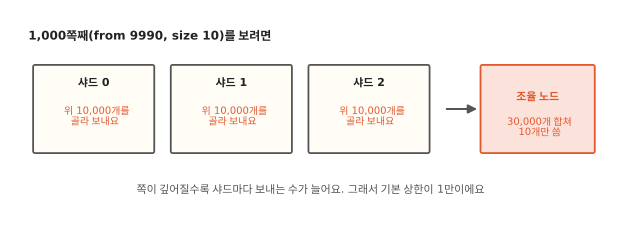
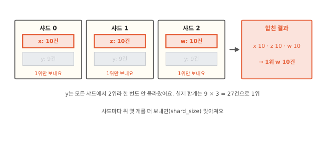

# 샤드 여러 개의 결과를 어떻게 합칠까요?

## 1위가 틀렸고 1,000쪽은 안 열려요



판매 기록에서 "가장 많이 팔린 브랜드 1위"를 terms 집계로 뽑았더니 w가 10건으로 1위래요. 직접 세어 보면 y가 27건이라 훨씬 많아요. 같은 인덱스에서 목록을 1,001쪽째(`from` 10000, `size` 10)로 넘기면 이번엔 "Result window is too large"라는 오류가 나요. `from`은 건너뛸 개수, `size`는 가져올 개수예요.

두 일 모두 인덱스가 [3편](03-routing.md)의 샤드 여러 개로 나뉘어 있어서 생겨요. 샤드는 각자 자기 몫만 알아요. 그 몫을 어떻게 모아 하나의 답으로 만드느냐에 따라 틀리기도 하고 막히기도 해요. 로컬에서 샤드 3개짜리 인덱스로 두 장면을 그대로 만들어 봤고 7.17과 9.2에서 같은 결과가 나왔어요.[^lab]

## 두 번 오가는 검색에서 오차 다루기까지



검색 요청 하나가 샤드들을 어떻게 돌고 오는지부터 봐요. 거기서 깊은 페이지가 왜 비싼지 나오고 같은 방식을 집계에 쓰면 왜 1위가 틀릴 수 있는지 나와요.

## 검색은 두 번 오가요



검색 요청을 받은 노드는 그 인덱스의 샤드마다(복사본 중 하나씩) 요청을 나눠 보내고 돌아온 답을 모아요. 이 역할을 하는 노드를 **조율 노드**(coordinating node)라고 해요. 어느 노드든 요청을 받으면 조율 노드가 돼요.

위 10개를 찾는 검색은 두 단계로 해요. 먼저 샤드마다 자기 문서 중 위 10개를 찾아 문서 번호와 점수(또는 정렬 값)만 보내요. 조율 노드는 샤드 셋에서 온 30개를 합쳐 전체 위 10개를 골라요. 그다음 그 10개의 원문(`_source`)을 그 문서를 가진 샤드에만 따로 받아 와요. 앞 단계를 query, 뒤 단계를 fetch라고 해서 이 방식을 **query then fetch**라고 불러요.

두 단계로 나누는 까닭은 원문이 크기 때문이에요. 샤드마다 원문까지 10개씩 보내면 30개 원문이 오가고 그중 20개는 버려요. 번호와 점수만 먼저 모으면 원문은 최종 10개만 오가요.

조율 노드가 30개를 합치는 일은 [7편](07-intersection.md)의 OR와 같은 모양이에요. 샤드마다 이미 점수순으로 정렬된 목록을 보내니 [알고리즘 10편](../algorithms/10-heap.md)의 힙으로 가장 높은 것부터 꺼내 10개를 채우면 돼요.

??? info "심화: 실제로는 단계가 더 있어요"
    조건에 따라 query 앞에 can_match 단계가 돌아요. 대상 샤드가 많거나(`pre_filter_shard_size`) 읽기 전용 인덱스를 칠 때 같은 경우에 샤드마다 "이 질의에 맞는 문서가 아예 없을 수 있나"를 싸게 먼저 확인해요. 날짜 범위가 샤드의 최소·최대 밖이면 그 샤드는 query를 건너뛰어요. 샤드가 아주 많으면 조율 노드는 결과를 다 받은 뒤 한꺼번에 합치지 않고 `batched_reduce_size`(기본 512)만큼씩 모아 중간 합치기를 해서 메모리를 아껴요. 복사본 중 어디로 보낼지는 노드별 응답 시간과 대기열 길이를 보고 고르는 adaptive replica selection(7.0부터 기본)이 정해요. 복사본마다 세그먼트 구성이 달라 같은 질의의 순서가 흔들릴 수 있어서 쪽을 넘기는 화면이라면 `preference`에 세션 ID를 줘 같은 복사본으로 보내요.

    9편의 `track_total_hits`와 8편의 점수 통계도 이 구조 위에 있어요. 건수는 샤드별로 센 뒤 조율 노드가 더하고 점수는 샤드별 통계로 매긴 뒤 조율 노드가 그대로 비교해요. 8편에서 문서가 적을 때 샤드마다 점수가 어긋나던 까닭이 이 단계에 있고 `dfs_query_then_fetch`는 query 앞에 샤드별 낱말 통계를 모으는 단계를 하나 더 넣어 이를 맞춰요. `size: 0`인 집계 전용 요청은 fetch를 건너뛰어 가벼워요. `_source` 필터, 하이라이트, `docvalue_fields`는 fetch 단계에서 처리해요.

## 깊은 페이지는 샤드마다 많이 보내야 해요



1,000쪽째를 보려면 어떻게 될까요? 전체에서 9,991번째부터 10개가 필요해요. 그런데 어떤 샤드의 문서가 그 자리에 들어갈지 미리 알 수 없어서 샤드마다 자기 위 10,000개(`from + size`)를 다 보내야 해요. 조율 노드는 샤드 셋에서 온 30,000개를 합쳐 정렬한 뒤 10개만 쓰고 나머지는 버려요. 샤드가 열 개면 10만 개예요.

그래서 ES는 `from + size`가 `index.max_result_window`(기본 10,000)를 넘으면 받지 않아요. 1,000쪽째(합 10,000)까지는 열리고 1,001쪽째부터 거절해요. 로컬에서 `from` 10000, `size` 10으로 보내자 "from + size must be less than or equal to: [10000] but was [10010]"라는 오류가 났어요.

더 깊이 읽어야 할 때는 `search_after`를 써요. 앞 쪽의 마지막 문서의 정렬 값을 넘겨주며 "이 값 다음부터 10개"를 달라고 해요. 샤드마다 그 값 다음의 10개만 보내면 되니 몇 쪽째든 일이 늘지 않아요. 로컬에서 정렬 값 20 다음을 요청하자 21부터 25까지 이어서 나왔어요. 대신 "1,000쪽으로 바로 가기"는 못 하고 앞에서부터 차례로 넘겨야 해요. 정렬 값이 같은 문서가 여럿이면 쪽 경계에서 빠지거나 겹칠 수 있어서 정렬 끝에 문서마다 다른 값(타이브레이커, 예: 상품 ID)을 하나 더 넣어요.

??? info "심화: search_after를 안전하게 쓰려면"
    `search_after`는 "이 값보다 뒤"를 요구해서 정렬 값이 같은 문서가 쪽 경계에 걸리면 뒤 쪽에서 빠져요. 그래서 정렬 끝에 문서마다 다른 값(타이브레이커)을 둬야 해요. `_id`로 타이브레이크하면 10편에서 본 것처럼 9.x에서는 막혀 있으니 doc values가 있는 ID 필드를 따로 두거나 아래 `_shard_doc`을 써요. 그리고 쪽을 넘기는 사이에 문서가 들어오고 지워지면(4편의 refresh) 같은 위치가 다른 문서를 가리킬 수 있어요. 7.10부터는 point in time(PIT)으로 검색 시점의 세그먼트들을 붙잡아 두고 그 위에서 `search_after`로 넘겨요. PIT로 검색하면 샤드 번호와 문서 번호로 만든 `_shard_doc` 타이브레이커가 붙어요(7.12부터, 정렬에 직접 적어도 돼요). PIT를 열어 둔 동안은 그 시점 세그먼트를 지울 수 없어 디스크를 더 쓰니 `keep_alive`를 짧게 주고 요청마다 늘려요. 예전의 `scroll`(검색 결과를 서버에 붙잡아 두고 차례로 받아 가는 방식)도 같은 일을 하지만 지금은 깊은 페이지에는 PIT와 `search_after`를 권해요. `index.max_result_window`를 크게 올려 버리는 건 위의 비용을 그대로 떠안는 일이에요.

## 집계도 샤드마다 위 몇 개만 보내요



집계(aggregation)는 맞는 문서들을 묶어 건수나 합계를 내는 기능이고 terms 집계는 필드 값별로 건수를 세요. terms 집계로 "판매 1위 브랜드"를 구할 때도 샤드는 각자 자기 몫을 세서 위 몇 개만 조율 노드에 보내요. 모든 브랜드의 건수를 다 보내면 브랜드가 수백만 종일 때 너무 크니까요.

처음 장면은 오차를 보여 주려고 일부러 샤드마다 1위 하나만 보내게 줄여서 만들었어요(기본값은 아래에서 봐요). 샤드마다 1위 브랜드가 따로 있고(x, z, w 각 10건) y는 모든 샤드에서 9건으로 2위예요. 샤드마다 위 1개만 보내게 하면(`shard_size: 1`) 조율 노드에는 x, z, w가 10건씩 올라오고 y는 한 번도 안 올라와요. 건수가 같으면 ES는 이름(키)의 글자 순서로 앞선 것을 먼저 놓아서 셋 중 w가 1위로 나왔어요. y의 실제 합계는 27건인데요.

ES는 이 틀릴 가능성을 숫자로 알려 줘요. 응답의 `doc_count_error_upper_bound`가 30이었어요. "보이지 않은 브랜드가 최대 30건까지 있을 수 있다"는 뜻이에요. 샤드 하나가 보내지 않고 숨긴 브랜드는 그 샤드가 보낸 꼴찌 건수(10)보다 많을 수 없어요. 샤드가 셋이니 그걸 셋 더한 30이 상한이에요. 이 값이 1위 건수보다 크면 1위를 믿을 수 없다는 신호예요. 보이지 않은 브랜드뿐 아니라 보인 브랜드도 몇몇 샤드에서 덜 세어졌을 수 있다는 점도 함께 봐요.

## 오차를 다루는 법

샤드마다 더 많이 보내게 하면 오차가 줄어요. `shard_size`를 10으로 주자 y가 27건으로 1위가 되고 오차 상한도 0이 됐어요. 사실 이 값을 따로 주지 않으면 ES는 `size`보다 넉넉하게 보내요(`size × 1.5 + 10`). 처음 장면처럼 `shard_size`를 1로 줄인 건 오차를 보여 주려고 일부러 한 일이에요. 실제로는 브랜드 종류가 아주 많고 샤드마다 순위가 크게 다를 때 기본값으로도 틀릴 수 있어요.

정확한 건수가 꼭 필요하면 다른 길이 있어요. 같은 브랜드의 문서를 3편의 라우팅 값으로 한 샤드에 모으면 샤드마다 센 건수가 곧 전체 건수라 실제 오차가 없어요. 다만 ES는 그런 배치를 모르니 응답의 오차 상한은 여전히 0보다 크게 나올 수 있어요. 모든 브랜드를 빠짐없이 세야 하면 composite 집계(버킷을 정해진 순서로 쪽마다 나눠 끝까지 받아 오는 집계)를 써요.

??? info "심화: terms 집계 오차 읽기"
    `show_term_doc_count_error: true`를 주면 버킷마다 `doc_count_error_upper_bound`가 붙어요. 이 실험에서 w 버킷의 오차는 20이었어요. w를 보내지 않은 두 샤드에 실제로는 w가 최대 각 10건(그 샤드가 보낸 마지막 건수)까지 있었을 수 있다는 뜻이에요. `sum_other_doc_count`는 응답에 없는 버킷들의 건수 합이에요. 정렬 기준에 따라 오차 칸이 달라져요. 같은 실험에서 이름순(`_key`)은 0, 건수 오름차순은 -1(계산할 수 없음)이 나왔어요(두 버전 같음). 하위 집계 값으로 정렬해도 오차를 계산할 수 없어요. 샤드가 하나면 오차는 늘 0이에요.

## 정리

- 조율 노드: 검색 요청을 받아 샤드들에 나눠 보내고 답을 합치는 노드예요. 어느 노드든 이 일을 해요.
- query then fetch: 샤드마다 위 몇 개의 번호와 점수만 먼저 모으고 최종으로 뽑힌 문서의 원문만 따로 받아 오는 두 단계 검색이에요.
- 깊은 페이지는 샤드마다 `from + size`개를 보내야 해서 비싸요. 기본 상한은 1만이고 그 너머는 `search_after`로 넘겨요.
- terms 집계도 샤드마다 위 몇 개만 보내서 1위가 틀릴 수 있어요. `doc_count_error_upper_bound`로 오차를 보고 `shard_size`나 라우팅으로 줄여요.

## 직접 해 보기

[lab/es/12_es.py](https://github.com/oya150/bedrock/blob/main/lab/es/12_es.py)는 샤드 3개짜리 인덱스에 처음 장면의 판매 기록을 넣고 `shard_size`를 1과 10으로 바꿔 집계하고 깊은 페이지 오류와 `search_after`를 보여 줘요. 집계만 다시 보려면 이렇게 해요.

```bash
curl 'localhost:9200/sales/_search' -H 'Content-Type: application/json' -d '{
  "size": 0, "aggs": {"top": {"terms": {"field": "brand", "size": 1, "shard_size": 1,
  "show_term_doc_count_error": true}}}}'
```

`shard_size`를 지우고 다시 보내 보세요.

## 확인 문제

??? question "1. 샤드 다섯 개의 5쪽"
    샤드 5개짜리 인덱스에서 한 쪽에 20개씩, 5쪽(`from` 80, `size` 20)을 보여 줘요. 조율 노드가 받는 문서 번호는 모두 몇 개일까요?

    **풀이** 샤드마다 `from + size` = 100개를 보내니 5 × 100 = 500개예요. 그중 20개만 써요. 원문은 그 20개만 fetch로 받아 와요.

??? question "2. 오차 상한 읽기"
    terms 집계 응답에서 1위 버킷이 120건이고 `doc_count_error_upper_bound`가 5예요. 1위를 믿어도 될까요? 오차 상한이 150이라면요?

    **풀이** 5라면 보이지 않은 브랜드가 많아야 5건이라 120건을 넘을 수 없어요. 보인 2위가 몇몇 샤드에서 덜 세어졌을 가능성까지 따지면 "1위 건수가 2위 건수 + 오차 상한보다 크면" 확실해요. 2위가 100건이라면 105보다 120이 크니 1위는 확실해요. 150이라면 보이지 않은 브랜드가 최대 150건일 수 있어서 120건을 넘는 진짜 1위가 숨어 있을 가능성이 있어요. `shard_size`를 늘려 다시 확인해요.

??? question "3. 1쪽은 빠른데"
    같은 검색이 1쪽은 20 ms인데 500쪽은 800 ms예요. 검색 조건은 똑같아요. 왜일까요?

    **풀이** 500쪽(`from` 9980 근처)은 샤드마다 1만 개 가까이를 골라 보내야 하고 조율 노드는 그걸 다 합쳐 정렬해요. 1쪽은 샤드마다 20개만 보내면 돼요. 일의 양이 쪽 번호에 비례해서 늘어요.

## 판단 연습

??? question "무한 스크롤 목록"
    앱에서 상품 목록을 끝없이 내려 보는 화면을 만들어요. 사용자가 수백 쪽까지 내려가기도 해요. 어떻게 요청할까요?

    **풀이** `from`을 늘려 가는 방식은 깊어질수록 느려지고 1만에서 막혀요. 마지막으로 받은 상품의 정렬 값으로 `search_after`를 써서 다음 묶음을 받아요. 정렬에는 상품 ID 같은 타이브레이커를 붙여 같은 값끼리 순서가 정해지게 해요. 내려가는 사이 상품이 바뀌어 중복·누락이 생기면 곤란한 화면이라면 PIT를 열어 같은 시점으로 넘겨요.

??? question "판매 순위 대시보드"
    매일 아침 "판매 상위 10개 브랜드" 대시보드를 그려요. 인덱스는 샤드 10개이고 브랜드는 수만 종이에요. 가끔 순위가 미묘하게 틀린다는 말이 있어요. 무엇을 확인할까요?

    **풀이** 응답의 `doc_count_error_upper_bound`와 버킷별 오차를 켜서 10위 언저리 건수와 비교해 봐요. 오차가 순위를 뒤집을 만큼 크면 `shard_size`를 늘려요(응답이 조금 무거워져요). 하루 한 번 그리는 대시보드라면 정확함을 우선해 `shard_size`를 넉넉히 주거나, 브랜드별로 미리 집계해 둔 요약 인덱스를 따로 두는 방법도 따져 봐요.

[^lab]: [lab/es/12_es.py](https://github.com/oya150/bedrock/blob/main/lab/es/12_es.py). 브랜드별 문서를 샤드 셋에 하나씩 보내려고 라우팅 값을 3편의 계산으로 골랐어요. ES 7.17.26과 9.2.0에서 같은 결과를 확인했어요.
