# 샤드 여러 개의 결과를 어떻게 합칠까요?

## 1위가 틀렸고 1,001쪽은 안 열려요

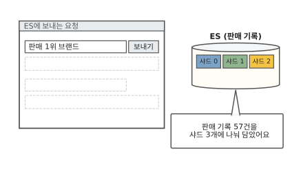

쇼핑몰의 판매 기록 57건을 ES에 담았어요. 기록마다 팔린 상품의 브랜드가 적혀 있어요. ES는 이 기록을 [3편](03-routing.md)의 샤드 세 개에 나눠 담았어요. 여기에 가장 많이 팔린 브랜드를 물어봐요.

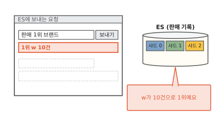

ES는 w가 10건으로 1위래요. 브랜드별 건수는 terms 집계라는 기능으로 셌어요. 정말 w가 가장 많이 팔렸을까요?

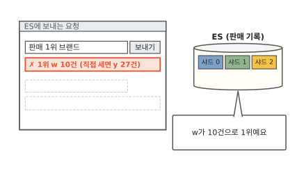

기록을 직접 세어 보면 y가 27건이라 훨씬 많아요. 이번엔 같은 인덱스에서 판매 기록 목록을 한 쪽에 10개씩 넘겨 1,001쪽째를 열어 봐요.

1,001쪽째는 `from` 10000, `size` 10으로 보내요. `from`은 건너뛸 개수, `size`는 가져올 개수예요. ES는 "Result window is too large"라는 오류로 거절해요. 기록이 57건뿐이라 그 쪽은 어차피 비어 있지만 ES는 찾아보기도 전에 요청부터 막아요.

두 일 모두 인덱스가 샤드 여러 개로 나뉘어 있어서 생겨요. 샤드는 각자 자기 몫만 알아요. 그 몫을 어떻게 모아 하나의 답으로 만드느냐에 따라 틀리기도 하고 막히기도 해요. 제 컴퓨터에서 샤드 3개짜리 인덱스로 두 장면을 그대로 만들었고 7.17과 9.2에서 같은 결과가 나왔어요.[^lab] 검색 요청 하나가 샤드들을 어떻게 돌고 오는지부터 봐요.

## 검색은 두 번 오가요

판매 기록 목록 1쪽을 판매 번호 순서로 보여 달라고 해 봐요. 그림은 한 쪽 10개를 3개로 줄여 그렸어요. 요청을 받은 노드는 그 인덱스의 샤드마다 같은 요청을 나눠 보내요. 샤드에 복사본이 있으면 그중 하나에만 보내요. 이 일을 하는 노드를 **조율 노드**(`coordinating node`)라고 해요. 어느 노드든 요청을 받으면 조율 노드가 돼요. 샤드들은 무엇을 돌려보낼까요?

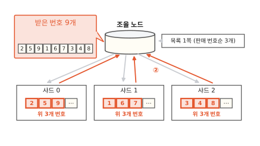

샤드마다 자기 문서 중 번호순 위 3개를 골라 문서 번호만 보내요. 점수로 줄을 세우는 검색이라면 번호와 점수를 보내요. 조율 노드에는 9개가 모여요.

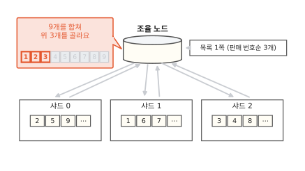

조율 노드는 9개를 합쳐 전체 위 3개를 골라요. 그림에서 1은 샤드 1, 2는 샤드 0, 3은 샤드 2에서 왔어요. 나머지 6개는 버려요. 고른 3개의 내용은 어디서 가져올까요?

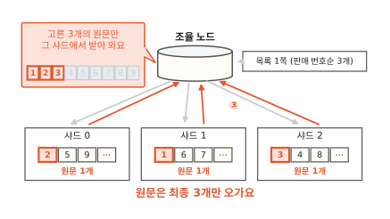

그 3개의 원문(`_source`)을 그 문서를 가진 샤드에만 따로 받아 와요. 앞 단계를 query, 뒤 단계를 fetch라고 해서 이 방식을 **query then fetch**라고 불러요.

두 단계로 나누는 까닭은 원문이 크기 때문이에요. 샤드마다 원문까지 보내면 그림에서는 원문 9개가 오가고 그중 6개는 버려요. 실제 한 쪽 10개라면 원문 30개가 오가고 20개를 버려요. 번호만 먼저 모으면 원문은 최종으로 고른 문서만 오가요.

조율 노드가 샤드 셋의 목록을 합치는 일은 [7편](07-intersection.md)의 OR와 같은 모양이에요. 샤드마다 이미 순서대로 정렬된 목록을 보내요. 그래서 [알고리즘 10편](../algorithms/10-heap.md)의 힙으로 가장 앞선 것부터 꺼내 한 쪽을 채우면 돼요. 힙은 가장 작은(또는 큰) 값을 바로 꺼낼 수 있게 정리해 둔 자료 구조예요.

샤드마다 위 몇 개만 받아 합치면 일이 가볍고 원문도 적게 오가요. 그런데 쪽이 아주 깊어지거나 브랜드별 건수를 셀 때도 이 방식이 잘 맞을까요?

??? info "심화: 실제로는 단계가 더 있어요"
    샤드가 수백 개인 인덱스를 검색하거나 같은 검색의 순서가 가끔 바뀌어 보일 때 보는 칸이에요.

    조건에 따라 query 앞에 can_match 단계가 돌아요. 대상 샤드가 많거나(`pre_filter_shard_size`) 읽기 전용 인덱스를 칠 때 같은 경우예요. 샤드마다 "이 질의에 맞는 문서가 아예 없을 수 있나"를 싸게 먼저 확인해요. 날짜 범위가 샤드의 최소·최대 밖이면 그 샤드는 query를 건너뛰어요. 샤드가 아주 많으면 조율 노드는 결과를 다 받은 뒤 한꺼번에 합치지 않아요. `batched_reduce_size`(기본 512)만큼씩 모아 중간 합치기를 해서 메모리를 아껴요.

    복사본 중 어디로 보낼지는 adaptive replica selection(7.0부터 기본)이 정해요. 노드별 응답 시간과 대기열 길이를 보고 골라요. 복사본마다 세그먼트 구성이 달라 같은 질의의 순서가 흔들릴 수 있어요. 그래서 쪽을 넘기는 화면이라면 `preference`에 세션 ID를 줘 같은 복사본으로 보내요.

    9편의 `track_total_hits`와 8편의 점수 통계도 이 구조 위에 있어요. 건수는 샤드별로 센 뒤 조율 노드가 더해요. 점수는 샤드별 통계로 매긴 뒤 조율 노드가 그대로 비교해요. 8편에서 문서가 적을 때 샤드마다 점수가 어긋나던 일이 이 단계에서 생겨요. `dfs_query_then_fetch`는 query 앞에 샤드별 낱말 통계를 모으는 단계를 하나 더 넣어 이를 맞춰요. `size: 0`인 집계 전용 요청은 fetch를 건너뛰어 가벼워요. `_source` 필터, 하이라이트, `docvalue_fields`는 fetch 단계에서 처리해요.

## 나눠 찾고 합치는 데 따라오는 것

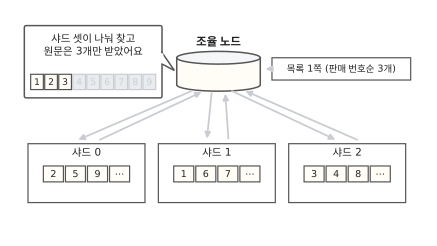

지금까지 본 방식은 찾는 일을 샤드 셋에 나누고 큰 원문은 적게 옮겨요.

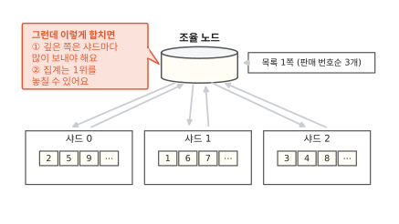

그런데 샤드마다 위 몇 개만 받아 합치는 방식에는 따라오는 것이 있어요. 그림에 적은 두 가지예요. 첫째부터 볼게요.

### 첫째, 깊은 쪽은 샤드마다 많이 보내야 해요

1,000쪽째를 보려면 `from` 9990, `size` 10으로 보내요. 전체에서 9,991번째부터 10개가 필요해요. 샤드마다 몇 개를 보내야 할까요?

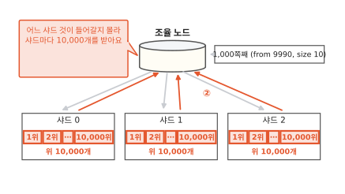

어떤 샤드의 문서가 9,991번째 자리에 들어갈지 미리 알 수 없어요. 그래서 샤드마다 자기 순서로 1위부터 10,000위(`from + size`)까지 다 보내야 해요.

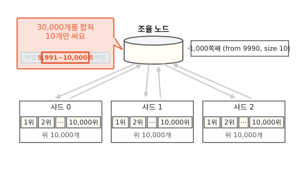

조율 노드는 샤드 셋에서 온 30,000개를 합쳐 정렬한 뒤 10개만 쓰고 나머지는 버려요. 샤드가 열 개면 10만 개예요. 1,001쪽째를 보내면 어떻게 될까요?

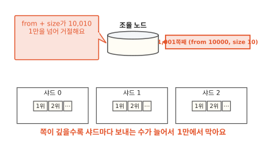

ES는 `from + size`가 `index.max_result_window`(기본 10,000)를 넘으면 받지 않아요. 1,000쪽째(합 10,000)까지는 열리고 1,001쪽째부터 거절해요. 처음 장면의 오류 전문은 `from + size must be less than or equal to: [10000] but was [10010]`였어요. 더 깊이 읽어야 할 때는 어떻게 할까요?

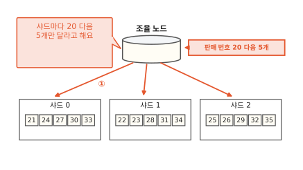

`search_after`를 써요. 앞 쪽의 마지막 문서의 정렬 값을 넘겨주며 "이 값 다음부터 몇 개"를 달라고 해요. 그림은 판매 번호 20까지 본 다음 5개를 달라는 요청이에요.

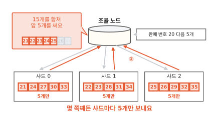

샤드마다 그 값 다음의 5개만 보내면 되니 몇 쪽째든 일이 늘지 않아요. 제 컴퓨터에서도 정렬 값 20 다음을 요청하자 21부터 25까지 이어서 나왔어요. 대신 "1,000쪽으로 바로 가기"는 못 하고 앞에서부터 차례로 넘겨야 해요.

정렬 값이 같은 문서가 여럿이면 쪽 경계에서 빠지거나 겹칠 수 있어요. 그래서 정렬 끝에 문서마다 다른 값을 하나 더 넣어요. 이런 값을 타이브레이커라고 하고 상품 ID 같은 값을 써요.

??? info "심화: search_after를 안전하게 쓰려면"
    목록을 아주 깊이 넘기는 화면을 만들 때 보는 칸이에요.

    `search_after`는 "이 값보다 뒤"를 요구해요. 그래서 정렬 값이 같은 문서가 쪽 경계에 걸리면 다음 쪽에서 빠져요. 정렬 끝에 문서마다 다른 값(타이브레이커)을 두는 것도 이 때문이에요. `_id`로 타이브레이크하는 길은 10편에서 본 것처럼 9.x에서 막혀 있어요. doc values가 있는 ID 필드를 따로 두거나 아래 `_shard_doc`을 써요.

    쪽을 넘기는 사이에 문서가 들어오고 지워지면(4편의 refresh) 같은 위치가 다른 문서를 가리킬 수 있어요. 7.10부터는 point in time(PIT)으로 검색 시점의 세그먼트들을 붙잡아 둬요. 그 위에서 `search_after`로 넘겨요. PIT로 검색하면 샤드 번호와 문서 번호로 만든 `_shard_doc` 타이브레이커가 붙어요. 7.12부터이고 정렬에 직접 적어도 돼요. PIT를 열어 둔 동안은 그 시점 세그먼트를 지울 수 없어 디스크를 더 써요. 그래서 `keep_alive`를 짧게 주고 요청마다 늘려요.

    예전의 `scroll`도 같은 일을 해요. 검색 결과를 서버에 붙잡아 두고 차례로 받아 가는 방식이에요. 지금은 깊은 쪽에는 PIT와 `search_after`를 권해요. `index.max_result_window`를 크게 올려 버리는 건 위의 비용을 그대로 떠안는 일이에요.

### 둘째, 집계는 1위를 놓칠 수 있어요

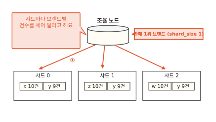

처음 장면의 판매 1위 브랜드로 돌아와요. 집계(aggregation)는 맞는 문서들을 묶어 건수나 합계를 내는 기능이에요. terms 집계는 필드 값별로 건수를 세요. 이때도 샤드는 각자 자기 몫을 세서 위 몇 개만 조율 노드에 보내요. 브랜드가 수백만 종일 때 모든 브랜드의 건수를 다 보내면 너무 크니까요.

처음 장면은 오차를 보여 주려고 일부러 줄여서 만들었어요. 샤드마다 1위 하나만 보내게 했어요(`shard_size: 1`). 샤드 0의 1위는 x 10건, 샤드 1은 z 10건, 샤드 2는 w 10건이에요. y는 세 샤드 모두에서 9건으로 2위예요. 샤드들은 무엇을 보낼까요?

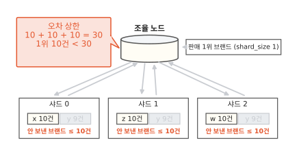

조율 노드에는 x, z, w가 10건씩 올라오고 y는 한 번도 안 올라와요.

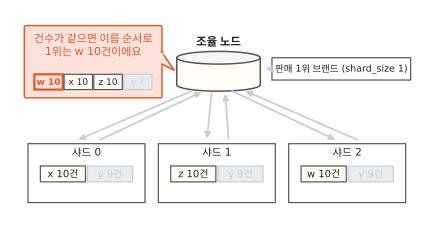

건수가 같으면 ES는 이름(키)의 글자 순서로 앞선 것을 먼저 놓아요. 그래서 셋 중 w가 1위로 나왔어요. y의 실제 합계는 27건인데요. ES는 이 답이 틀렸을 수 있다는 걸 알려 줄까요?

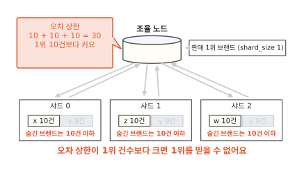

ES는 이 틀릴 가능성을 숫자로 알려 줘요. 응답의 `doc_count_error_upper_bound`가 30이었어요. 보이지 않은 브랜드가 최대 30건까지 있을 수 있다는 뜻이라서 이 편에서는 **오차 상한**이라고 불러요. 샤드 하나가 보내지 않고 숨긴 브랜드는 그 샤드가 보낸 꼴찌 건수(10)보다 많을 수 없어요. 샤드가 셋이니 그걸 셋 더한 30이 상한이에요.

이 값이 1위 건수보다 크면 1위를 믿을 수 없다는 신호예요. 보인 브랜드도 몇몇 샤드에서 덜 세어졌을 수 있어요. 이 실험에서 w 칸에는 오차 20이 따로 붙었어요. w를 보내지 않은 두 샤드에 w가 각 10건까지 숨어 있을 수 있다는 뜻이에요. 오차는 어떻게 줄일까요?

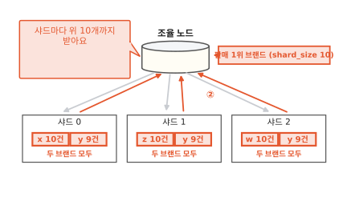

샤드마다 더 많이 보내게 하면 오차가 줄어요. `shard_size`를 10으로 주면 샤드마다 브랜드 두 개를 모두 보내요.

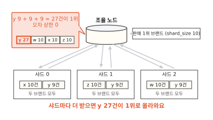

y가 27건으로 1위가 되고 오차 상한도 0이 됐어요. 사실 이 값을 따로 주지 않으면 ES는 `size`보다 넉넉하게 보내요(`size × 1.5 + 10`). 처음 장면처럼 `shard_size`를 1로 줄인 건 오차를 보여 주려고 일부러 한 일이에요. 실제로는 브랜드 종류가 아주 많고 샤드마다 순위가 크게 다를 때 기본값으로도 틀릴 수 있어요.

정확한 건수가 꼭 필요하면 다른 길이 있어요. 같은 브랜드의 문서를 3편의 라우팅 값으로 한 샤드에 모으면 샤드마다 센 건수가 곧 전체 건수예요. 그래서 실제 오차가 없어요. 다만 ES는 그런 배치를 모르니 응답의 오차 상한은 여전히 0보다 크게 나올 수 있어요. 모든 브랜드를 빠짐없이 세야 하면 composite 집계를 써요. 브랜드별 묶음을 정해진 순서로 쪽마다 나눠 끝까지 받아 오는 집계예요.

??? info "심화: terms 집계 오차 읽기"
    순위 화면의 순위가 맞는지 따져 봐야 할 때 보는 칸이에요.

    `show_term_doc_count_error: true`를 주면 버킷마다 `doc_count_error_upper_bound`가 붙어요. 버킷은 terms 집계가 값별로 만든 묶음이에요. 이 실험에서 w 버킷의 오차는 20이었어요. w를 보내지 않은 두 샤드에 실제로는 w가 최대 각 10건까지 있었을 수 있다는 뜻이에요. 10건은 그 샤드가 보낸 마지막 건수예요. `sum_other_doc_count`는 응답에 없는 버킷들의 건수 합이에요.

    정렬 기준에 따라 오차 칸이 달라져요. 같은 실험에서 이름순(`_key`)은 0, 건수 오름차순은 -1이 나왔어요. -1은 계산할 수 없다는 뜻이고 두 버전 모두 같았어요. 하위 집계 값으로 정렬해도 오차를 계산할 수 없어요. 샤드가 하나면 오차는 늘 0이에요.

## search_after와 shard_size는 언제 쓸모 있을까요

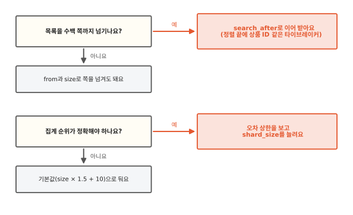

앱에서 상품 목록을 끝없이 내려 보는 화면이라면 사용자가 수백 쪽까지 내려가기도 해요. `from`을 늘려 가는 방식은 깊어질수록 느려지고 1만에서 막혀요. 마지막으로 받은 상품의 정렬 값으로 `search_after`를 써서 다음 묶음을 받아요. 정렬 끝에는 상품 ID 같은 타이브레이커를 붙여요. 내려가는 사이 상품이 바뀌어 중복이나 누락이 생기면 곤란한 화면이라면 PIT를 열어 같은 시점으로 넘겨요.

매일 아침 판매 상위 10개 브랜드를 그리는 순위 화면이라면 집계 쪽을 봐요. 샤드가 10개이고 브랜드가 수만 종이면 순위가 가끔 틀릴 수 있어요. 응답의 오차 상한과 브랜드별 오차를 켜서 10위 언저리 건수와 비교해 봐요. 오차가 순위를 뒤집을 만큼 크면 `shard_size`를 늘려요. 응답은 조금 무거워져요. 브랜드별로 미리 집계해 둔 요약 인덱스를 따로 두는 방법도 있어요.

## 다시 판매 1위 브랜드를 물어볼게요

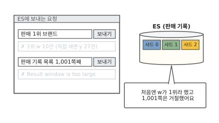

처음 장면의 요청 창으로 돌아왔어요. 그때 ES는 w가 1위라고 답했고 1,001쪽째는 거절했어요. 이번에는 이 편에서 본 방법으로 두 요청을 다시 보내요.

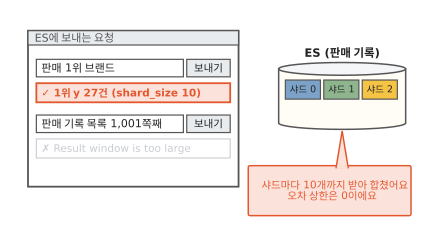

`shard_size`를 10으로 주자 샤드마다 두 브랜드를 다 보냈어요. y가 27건으로 1위가 됐고 오차 상한은 0이에요. 1,001쪽째는 어떻게 열까요?

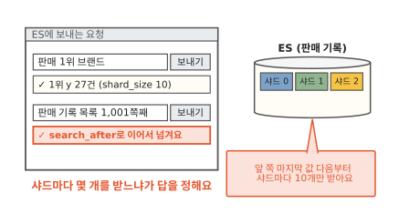

기록이 57건뿐이면 1,001쪽째는 비어 있어요. 기록이 1만 건 넘게 쌓였다고 쳐 봐요. 1,000쪽째의 마지막 정렬 값을 넘겨 `search_after`로 다음 10개를 받아요. 샤드마다 10개만 보내니 1만에 걸리지 않아요.

샤드가 셋이든 백 개든 조율 노드가 샤드마다 몇 개를 받아 합치느냐가 답의 정확함과 비용을 함께 정해요.

### 이 편에서 줄여 그린 것

그림을 쉽게 하려고 실제와 다르게 줄인 곳이 네 군데 있어요.

1. 검색 그림에서 한 쪽을 10개 대신 3개로 그렸어요. 그래서 조율 노드가 합친 것도 30개 대신 9개예요.
2. 판매 번호가 샤드마다 고루 섞여 들어간 모습으로 그렸어요. 실험에서는 기록을 샤드별로 묶어 차례로 넣었어요. 그래서 샤드 0에 1번부터 19번, 샤드 1에 20번부터 38번, 샤드 2에 39번부터 57번이 들어갔어요. 문서가 샤드에 어떻게 나뉘는지는 [3편](03-routing.md)에서 봐요.
3. 조율 노드를 샤드와 떨어진 원통 하나로 그렸어요. 실제로는 샤드를 가진 노드가 요청을 받으면 그 노드가 조율 노드 일도 함께 해요. 샤드마다 있는 복사본 가운데 어디로 보내는지도 뺐어요. 복사본은 [14편](14-replication.md)에서 봐요.
4. 검색을 query와 fetch 두 단계로만 그렸어요. 실제로는 조건에 따라 can_match 단계나 중간 합치기가 더 붙어요. 검색은 두 번 오가요 절의 심화 칸에 있어요.

### 이 편에서 새로 나온 말

![낱말 카드 여덟 장, 두 장씩 네 줄. 조율 노드: 빨간 원통에서 빨간 화살표 셋이 샤드 0, 1, 2로, 요청을 샤드에 나눠 보내고 답을 합치는 노드. query then fetch: 칸 1 2 3에서 빨간 화살표로 빨간 원문 3개, 아래 ① 번호 ② 원문, 번호만 먼저 모으고 고른 문서의 원문만 받기. max_result_window: 빨간 from + size ≤ 10,000, from + size의 상한 (기본 10,000). search_after: 흐린 20에서 빨간 화살표로 빨간 21 22 23과 점 세 개, 앞 쪽 마지막 정렬 값 다음부터 받기. 타이브레이커: 흐린 정렬 값 20 두 칸 아래 빨간 + 상품 ID 두 칸, 정렬 값이 같을 때 순서를 정하는 값. terms 집계: 빨간 y 27과 w 10, x 10, z 10, 필드 값별로 건수를 세는 집계. shard_size: 빨간 x 10건과 흐린 y 9건, 빨간 글씨 shard_size 1이면 1위만, 샤드마다 조율 노드에 보내는 묶음 수. 오차 상한: 빨간 10 + 10 + 10 = 30, 보이지 않은 브랜드가 가질 수 있는 최대 건수.](img/12/es12-cards.svg)

[^lab]: 제 컴퓨터에 띄운 ES 7.17.26과 9.2.0에서 샤드 3개, 복제본 0개인 인덱스로 확인했어요. 브랜드별 문서를 샤드 셋에 하나씩 보내려고 라우팅 값을 3편의 계산으로 골랐어요. 목록은 판매 번호 순서로 정렬했어요. 두 버전에서 같은 결과가 나왔어요.
