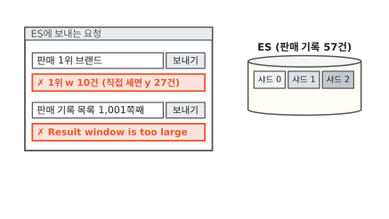
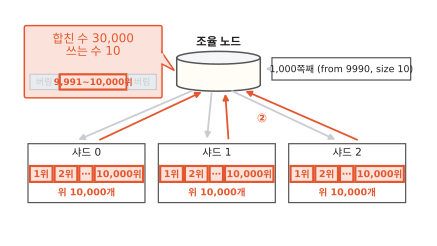
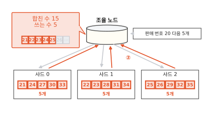
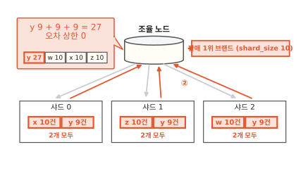

# 분산 검색: 샤드 여러 개의 결과를 하나로 합치는 법

쇼핑몰 판매 기록 57건을 ES에 담고 가장 많이 팔린 브랜드를 물었더니 w가 10건으로 1위래요. 기록을 하나씩 세어 보면 y가 27건으로 훨씬 많은데요. 목록을 한 쪽에 10개씩 넘겨 1,001쪽째를 열면 오류까지 나요. 이 글을 읽고 나면 ES가 샤드 여러 개의 결과를 어떻게 합치는지 알게 돼요. 1위가 틀리고 깊은 쪽이 막히는 것도 이 합치는 방식 때문이에요. 이걸 알면 순위 화면이나 끝없이 넘기는 목록을 만들 때 무엇을 바꿔야 할지 보여요.

!!! abstract "이 글에서 알게 되는 것"
    1. 검색 요청을 받은 노드는 샤드마다 위 몇 개의 번호만 받아 합쳐요. 원문은 최종으로 고른 문서만 따로 받아 와요. 이렇게 두 번 오가는 방식을 query then fetch라고 해요.
    2. 쪽이 깊을수록 샤드마다 보내야 하는 수가 늘어서 ES는 `from + size`가 1만을 넘으면 거절해요. 더 깊이 가려면 앞 쪽 마지막 값 다음부터 받는 `search_after`를 써요.
    3. 브랜드별 건수를 세는 terms 집계도 샤드마다 위 몇 개만 보내서 진짜 1위를 놓칠 수 있어요. 응답의 오차 상한이 1위 건수보다 크면 `shard_size`를 늘려요.

## 1. 요청을 받은 노드가 샤드마다 나눠 물어요

처음 장면을 그림으로 옮겼어요. 빨간 답 칸 두 개를 보세요.

**그림 1.** 판매 1위는 틀리게 나오고 1,001쪽째는 오류로 막혀요.
{ .fig-cap }

ES는 판매 기록 57건을 샤드 세 개에 나눠 담았어요([3편](03-routing.md)). 샤드는 인덱스를 나눈 조각이고 저마다 자기 몫의 문서만 알아요. 그래서 판매 1위도 목록 1쪽도 샤드 하나만 보고는 답할 수 없어요. 샤드 셋에 물어서 받은 답을 합쳐야 해요. 두 오류는 모두 이 합치는 방식에서 생겨요.

먼저 오류가 나지 않는 쉬운 요청으로 합치는 길을 따라가 볼게요. 목록 1쪽을 판매 번호 순서로 보여 달라고 해요. 그림을 작게 그리려고 한 쪽을 10개 대신 3개로 줄였어요. 판매 번호도 샤드마다 고루 섞인 모습으로 그렸어요. 아래 그림에서 가운데 원통에서 나가는 빨간 화살표를 보세요.

**그림 2.** 요청을 받은 노드가 같은 요청을 샤드 셋에 하나씩 보내요.
{ .fig-cap }

요청을 받은 노드는 그 인덱스의 샤드마다 같은 요청을 보내요. 샤드에 복사본이 있으면 그중 한 곳에만 보내요. 이렇게 요청을 나눠 보내고 답을 모으는 노드를 **조율 노드**(`coordinating node`)라고 해요. 어느 노드든 요청을 받으면 그 요청의 조율 노드가 돼요.

## 2. 번호를 먼저 모으고 원문은 고른 것만 받아요

앞에서 조율 노드가 샤드 셋에 요청을 보냈어요. 이번에는 샤드들이 무엇을 돌려보내는지 볼게요. 아래 그림에서 샤드마다 빨갛게 칠한 칸을 보세요.

**그림 3.** 샤드마다 번호순 위 3개의 번호만 보내서 조율 노드에 9개가 모여요.
{ .fig-cap }

샤드는 자기 문서 가운데 번호순으로 위 3개를 골라요. 보낼 때는 문서 번호만 보내요. 문서 내용은 아직 보내지 않아요. 점수 순서로 줄을 세우는 검색이라면 번호와 점수를 함께 보내요.

조율 노드는 모인 9개를 합쳐 전체 위 3개를 골라요. 1, 2, 3이에요. 1은 샤드 1, 2는 샤드 0, 3은 샤드 2에서 왔어요. 나머지 6개는 버려요. 샤드마다 이미 순서대로 줄 세운 목록을 보내요. 그래서 세 목록의 맨 앞끼리 비교해 가장 앞선 것을 꺼내기만 되풀이하면 돼요. 이때 [알고리즘 10편](../algorithms/10-heap.md)의 힙을 써요. 힙은 가장 작은 값을 바로 꺼낼 수 있게 정리해 둔 자료 구조예요.

이제 화면에 보여 줄 판매 기록 내용이 필요해요. 아래 그림에서 샤드마다 빨간 칸 하나를 보세요.

**그림 4.** 고른 3개의 원문만 그 문서를 가진 샤드에서 하나씩 받아 와요.
{ .fig-cap }

조율 노드는 고른 3개의 원문(`_source`)을 그 문서를 가진 샤드에 따로 달라고 해요. 샤드 0에서는 2번, 샤드 1에서는 1번, 샤드 2에서는 3번만 와요. 번호를 모으는 앞 단계를 query, 원문을 받는 다음 단계를 fetch라고 해요. 그래서 이 방식을 **query then fetch**라고 불러요.

두 번 오가는 까닭은 원문이 크기 때문이에요. 샤드마다 처음부터 원문까지 보내면 그림에서는 원문 9개가 오가고 그중 6개를 버려요. 한 쪽이 10개면 원문 30개가 오가고 20개를 버리고요. 번호만 먼저 모으면 원문은 화면에 나갈 문서만 오가요.

## 3. 깊은 쪽은 샤드마다 많이 보내야 해서 1만에서 막아요

샤드마다 위 몇 개만 받아 합치는 방식은 1쪽에서는 가벼워요. 쪽이 깊어지면 어떨까요? 1,000쪽째를 열어 볼게요.

목록 요청은 `from`과 `size`로 쪽을 정해요. `from`은 앞에서 건너뛸 개수이고 `size`는 가져올 개수예요. 1,000쪽째는 앞의 999쪽에 든 9,990개를 건너뛰고 10개를 가져와요. 그래서 `from` 9990, `size` 10으로 보내요. 전체 순서로 9,991번째부터 10,000번째까지가 필요해요.

샤드는 몇 개를 보내야 할까요? 어느 샤드의 문서가 9,991번째 자리에 들어갈지 미리 알 수 없어요. 1위부터 10,000위가 모두 샤드 0에 있을 수도 있어요. 그래서 샤드마다 자기 순서로 1위부터 10,000위까지 다 보내야 해요. 아래 그림에서 샤드마다 보내는 개수와 조율 노드가 쓰는 개수를 보세요.

**그림 5.** 1,000쪽째를 열면 샤드마다 10,000개를 보내고 조율 노드는 30,000개를 합쳐 10개만 써요.
{ .fig-cap }

조율 노드는 30,000개를 합쳐 줄 세운 다음 10개만 남기고 모두 버려요. 샤드가 열 개면 10만 개를 합쳐요. 쪽이 깊어질수록 샤드마다 보내는 수와 조율 노드가 합치는 수가 함께 늘어요.

그래서 ES는 상한을 둬요. `from`과 `size`를 더한 값이 `index.max_result_window`보다 크면 요청을 받지 않아요. 기본값은 10,000이에요. 1,000쪽째는 9,990 + 10 = 10,000이라서 열려요. 1,001쪽째는 10,000 + 10 = 10,010이라서 거절해요. 처음 장면의 "Result window is too large"가 이 오류예요. 판매 기록이 57건뿐이라 1,001쪽째는 어차피 비어 있지만 ES는 문서를 찾아보기 전에 요청부터 막아요.

상한을 크게 올리면 깊은 쪽이 열리기는 해요. 그만큼 그림 5에서 오가는 수도 늘어요.

## 4. search_after는 앞 쪽 마지막 값 다음부터 받아요

앞에서 쪽이 깊으면 샤드마다 1위부터 다 보내야 했어요. 요청이 "몇 번째 자리부터"만 알려 줬기 때문이에요. 자리 대신 "어떤 값 다음부터"라고 알려 주면 달라져요.

판매 번호 20까지 봤다고 해 볼게요. 이번에는 "판매 번호 20 다음 5개"를 달라고 해요. 아래 그림에서 샤드마다 보내는 개수를 보세요.

**그림 6.** 샤드마다 20 다음 5개씩만 보내고 조율 노드는 15개 가운데 앞 5개를 써요.
{ .fig-cap }

샤드는 자기 문서에서 판매 번호가 20보다 큰 것 가운데 앞 5개만 보내요. 조율 노드는 15개를 합쳐 21부터 25까지 써요. 몇 쪽째를 보든 샤드마다 5개만 보내니까 일이 늘지 않아요. 이렇게 앞 쪽 마지막 문서의 정렬 값을 넘겨 그다음부터 받는 방법이 `search_after`예요.

대신 1,000쪽으로 곧장 건너뛰지는 못해요. 999쪽의 마지막 값을 알아야 하니까 앞에서부터 차례로 넘겨야 해요. 끝없이 내려 보는 상품 목록처럼 차례로 넘기는 화면에 맞아요.

조심할 곳이 하나 있어요. 판매 번호는 기록마다 달라서 "20 다음"이 어디부터인지 분명해요. 가격처럼 같은 값이 많은 순서로 넘기면 같은 가격의 상품이 쪽 경계에 걸려요. 그러면 다음 쪽에서 빠지거나 두 번 나올 수 있어요. 그래서 정렬 끝에 상품 ID처럼 문서마다 다른 값을 하나 더 붙여요. 이런 값을 타이브레이커라고 해요.

## 5. 집계는 샤드마다 1위만 받으면 진짜 1위를 놓쳐요

이제 처음 장면의 판매 1위 브랜드로 돌아와요. 브랜드마다 판매 기록이 몇 건인지 세는 일은 ES의 terms 집계가 맡아요. 집계는 문서를 값마다 묶어 건수나 합계를 내는 기능이에요. terms 집계도 검색과 같은 길을 따라요. 샤드가 저마다 자기 몫을 세서 위 몇 개만 조율 노드에 보내요. 브랜드가 수백만 종이면 모든 브랜드의 건수를 다 보내기엔 너무 크니까요.

샤드마다 몇 개를 보낼지는 `shard_size`로 정해요. 처음 장면은 틀리는 모습을 잘 보이려고 `shard_size`를 1로 줬어요. 샤드마다 1위 하나만 보내라는 뜻이에요. 샤드 0에는 x 10건과 y 9건, 샤드 1에는 z 10건과 y 9건, 샤드 2에는 w 10건과 y 9건이 있어요. 아래 그림에서 샤드마다 빨간 칸과 흐린 칸을 보세요.

**그림 7.** 샤드마다 1위만 보내서 y는 한 번도 조율 노드에 오지 못해요.
{ .fig-cap }

샤드마다 1위는 x, z, w예요. y는 세 샤드 모두에서 9건으로 2위라서 한 번도 올라오지 못해요. 조율 노드에는 x, z, w가 10건씩 모여요. 건수가 같으면 ES는 이름의 알파벳 순서로 줄 세워요. w가 x와 z보다 앞서서 1위가 돼요. y의 진짜 합계 9 + 9 + 9 = 27건은 어디에도 없어요.

ES는 이 답이 틀렸을 수 있다는 걸 알려 줄까요? 알려 줘요. 샤드가 보내지 않은 브랜드는 그 샤드가 보낸 마지막 브랜드보다 건수가 많을 수 없어요. 샤드 0은 x 10건을 보냈으니 샤드 0에 남은 브랜드는 많아야 10건이에요. 아래 그림에서 말풍선의 더하기를 보세요.

**그림 8.** 샤드마다 안 보낸 브랜드가 10건까지 있을 수 있어서 오차 상한은 30이에요.
{ .fig-cap }

세 샤드에서 10건씩이니 조율 노드가 보지 못한 브랜드는 많으면 30건까지 가질 수 있어요. ES는 이 값을 응답의 `doc_count_error_upper_bound`에 담아 줘요. 이 값을 **오차 상한**이라고 불러요. 오차 상한 30이 1위 건수 10보다 크면 1위보다 많이 팔린 브랜드가 어딘가에 숨어 있을 수 있어요. 그래서 이 1위는 믿을 수 없어요.

## 6. shard_size를 늘리면 진짜 1위가 올라와요

앞에서 샤드마다 1위만 받아서 y를 놓쳤어요. 그러면 샤드마다 더 많이 받으면 돼요. `shard_size`를 10으로 줘 볼게요. 아래 그림에서 말풍선의 더하기를 보세요.

**그림 9.** 샤드마다 브랜드 두 개를 모두 보내자 y가 27건으로 1위가 되고 오차 상한은 0이 돼요.
{ .fig-cap }

샤드마다 브랜드가 둘뿐이라서 둘 다 보내요. 조율 노드는 y의 9건을 세 번 더해 27건을 얻어요. 샤드마다 빠진 브랜드가 없으니 오차 상한도 0이에요.

`shard_size`를 따로 주지 않으면 ES는 `size`보다 넉넉하게 보내요. 기본값은 `size × 1.5 + 10`이에요. 처음 장면에서 1로 줄인 건 틀리는 모습을 보이려고 일부러 한 일이에요. 그래도 브랜드가 수만 종이고 샤드마다 순위가 크게 다르면 기본값으로도 틀릴 수 있어요. 모든 브랜드를 빠짐없이 정확히 세야 하면 composite 집계를 써요. 브랜드별 묶음을 정해진 순서로 쪽마다 나눠 끝까지 받아 오는 집계예요.

두 방법을 쓸 화면을 하나씩 떠올려 볼게요. 끝없이 내려 보는 상품 목록에서는 사용자가 수백 쪽까지 내려가기도 해요. `from`을 늘려 가면 깊어질수록 무거워지다가 1만에서 막혀요. 마지막으로 받은 상품의 정렬 값으로 `search_after`를 써서 다음 묶음을 받고 정렬 끝에는 상품 ID를 붙여요. 내려가는 사이에 새 상품이 들어와 순서가 흔들리면 곤란할 때도 있어요. 그때는 point in time(PIT)으로 검색하는 시점을 붙잡아 두고 그 위에서 넘겨요.

매일 아침 판매 상위 10개 브랜드를 보여 주는 순위 화면이라면 응답의 오차 상한을 봐요. 오차가 10위 언저리의 건수 차이보다 커서 순위가 뒤집힐 수 있으면 `shard_size`를 늘려요. 샤드마다 보내는 양이 늘어서 응답은 조금 무거워져요.

## 정리

검색 요청을 받은 노드는 조율 노드가 되어 샤드마다 같은 요청을 보내요. 샤드는 자기 몫에서 위 몇 개의 번호만 보내고 조율 노드는 그걸 합쳐 전체 순서를 정해요. 원문은 최종으로 고른 문서만 따로 받아 와요. 이렇게 두 번 오가는 방식이 query then fetch예요.

샤드마다 위 몇 개만 받아 합치는 데서 두 가지 일이 생겨요. 1,000쪽째처럼 깊은 쪽은 샤드마다 10,000개를 보내야 해요. 그래서 ES는 `from + size`가 1만을 넘으면 거절하고 더 깊이 가려면 `search_after`로 앞 쪽 마지막 값 다음부터 받아요. 판매 1위 브랜드를 세는 terms 집계는 샤드마다 1위만 받으면 y 27건을 놓치고 w를 1위로 내놓아요. 응답의 오차 상한이 1위 건수보다 크면 `shard_size`를 늘려요.

[13편](13-cardinality.md)에서는 고유 사용자 수처럼 샤드마다 센 숫자를 그냥 더하면 틀리는 집계를 봐요.

### 새로 나온 말

- **조율 노드**: 검색 요청을 받아 샤드마다 나눠 보내고 답을 합치는 노드. 그림 2의 가운데 원통이에요.
- **query then fetch**: 번호만 먼저 모아 전체 순서를 정하고 고른 문서의 원문만 받아 오는 방식. 목록 1쪽에서는 원문 3개만 오갔어요.
- **max_result_window**: `from + size`의 상한. 기본 10,000이라서 1,001쪽째가 막혔어요.
- **search_after**: 앞 쪽 마지막 정렬 값 다음부터 받는 방법. 판매 번호 20 다음 5개를 받았어요.
- **타이브레이커**: 정렬 값이 같을 때 순서를 정하려고 덧붙이는 값. 상품 ID를 써요.
- **terms 집계**: 필드 값마다 건수를 세는 집계. 브랜드별 판매 건수를 셌어요.
- **shard_size**: 샤드마다 조율 노드에 보내는 묶음 수. 1이면 샤드마다 1위만 보내요.
- **오차 상한**: 조율 노드가 보지 못한 값이 가질 수 있는 가장 큰 건수. 처음 장면에서는 10 + 10 + 10 = 30이었어요.
