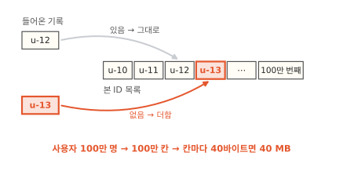
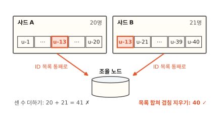
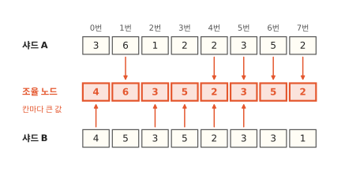
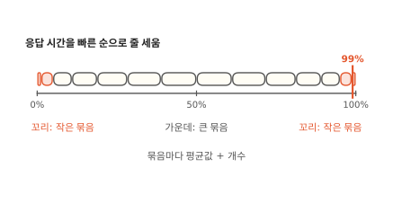

# 고유 사용자 수 어림하기: cardinality 집계와 HyperLogLog

쇼핑몰 방문 대시보드에 "오늘 방문자" 카드를 만들었어요. 그날 방문 기록을 ES에 넣고 서로 다른 사용자 ID가 몇 개인지 세게 했죠. 그런데 방문자가 수만 명인 날 로그 파일을 직접 세어 보면 카드 숫자와 끝자리가 조금 달라요. 이 글을 읽고 나면 ES가 일부러 근삿값을 내는 까닭과 그 근삿값을 만드는 방법을 알게 돼요. 이걸 알면 근삿값을 써도 되는 곳과 쓰면 안 되는 곳을 가를 수 있어요.

!!! abstract "이 글에서 알게 되는 것"
    1. 서로 다른 사용자를 정확히 세려면 본 ID를 모두 기억해야 해요. 샤드가 여럿이면 ID 목록을 통째로 모아 겹침을 지워야 해서 메모리가 많이 들어요.
    2. HyperLogLog는 ID를 해시해서 통마다 가장 긴 앞 0 줄 하나만 적어 사용자 수를 어림해요. 통 배열은 사용자가 늘어도 크기가 그대로이고 샤드끼리는 칸마다 큰 값을 골라 합쳐요.
    3. ES의 cardinality 집계와 percentiles 집계는 이렇게 어림한 값을 내요. 돈 계산처럼 한 명도 틀리면 안 되는 곳에는 정확히 센 값을 따로 써요.

## 1. 정확히 세려면 본 ID를 모두 들고 다녀야 해요

카드는 ES의 **cardinality 집계**로 만들었어요. cardinality 집계는 어떤 칸에 서로 다른 값이 몇 개 있는지 세는 기능이에요. 방문 기록에 u-10이 두 번 있어도 한 명으로 세요. ES 문서도 이 집계가 근삿값이라고 처음부터 밝혀요.

틀리는 줄 알면서 왜 이렇게 만들었을까요? 정확히 세 보면 까닭이 보여요. 서로 다른 사용자를 정확히 세려면 지금까지 본 ID를 모두 적어 둬야 해요. 기록이 하나 들어올 때마다 목록에서 찾아보고 없으면 더해요. 아래 그림에서 u-12와 u-13이 들어올 때 목록이 어떻게 되는지 보세요.

**그림 1.** u-12는 목록에 있어서 그대로 두고 처음 온 u-13은 목록 끝에 더해요.
{ .fig-cap }

목록은 사용자 수만큼 길어져요. 사용자가 100만 명이면 ID 하나를 40바이트로만 잡아도 40 MB예요. 바이트는 컴퓨터 메모리를 세는 단위이고 MB는 바이트 100만 개쯤이에요.

ES에서는 일이 하나 더 있어요. [12편](12-distributed-search.md)에서 본 것처럼 ES는 기록을 샤드 여러 개에 나눠 담아요. 샤드는 인덱스를 나눈 조각이고 저마다 자기 몫만 알아요. 샤드들의 답을 모아 하나로 합치는 노드가 조율 노드예요.

샤드마다 사용자를 세어 그 수만 보내면 가볍겠죠. 그런데 한 사용자의 방문 기록이 여러 샤드에 흩어질 수 있어요. 아래 그림에서 u-13을 찾아보세요.

**그림 2.** u-13이 두 샤드에 다 있어서 센 수를 더하면 41명이에요. ID 목록을 모아 겹침을 지워야 40명이 나와요.
{ .fig-cap }

샤드 A는 20명, 샤드 B는 21명이라고 답해요. 더하면 41명인데 u-13을 두 번 센 거예요. 정확한 40명을 얻으려면 샤드마다 ID 목록을 통째로 보내고 조율 노드가 겹치는 ID를 지워야 해요. 사용자 100만 명이 샤드 10개에 흩어져 있으면 10만 칸이 넘는 목록 열 개가 오가요.

## 2. 해시 앞의 0 줄 길이로 사용자 수를 어림해요

목록을 들고 다니지 않고 세는 방법이 있어요. 정확한 수는 내려놓고 어림만 해요.

먼저 ID를 [알고리즘 9편](../algorithms/09-hash.md)의 해시 함수에 넣어요. 해시 함수는 값을 받아서 정해진 길이의 숫자로 바꿔 주는 함수예요. 그 숫자를 0과 1, 곧 비트로 적으면 동전을 여러 번 던진 것처럼 0과 1이 고르게 섞여 나와요. 동전과 다른 점은 같은 ID를 넣으면 언제나 같은 비트가 나온다는 거예요.

이 비트가 맨 앞부터 0으로 몇 개 이어지는지 봐요. 이 길이를 앞 0 줄이라고 부를게요. 아래 그림에서 빨간 칸을 세어 보세요.

**그림 3.** 네 사용자 가운데 u-13의 해시가 맨 앞에 0이 3개 이어져서 가장 길어요.
{ .fig-cap }

맨 앞이 0일 확률은 2분의 1이에요. 0이 두 개 이어질 확률은 4분의 1, 세 개는 8분의 1이에요. 그러니 앞 0 줄이 3인 해시를 봤다면 서로 다른 ID를 8개쯤은 봤다고 어림할 수 있어요. 기억할 것은 지금까지 본 가장 긴 앞 0 줄, 숫자 하나뿐이에요.

이미 본 사용자가 다시 오면 어떨까요? 같은 ID는 해시도 같아서 앞 0 줄도 같아요. 가장 긴 줄은 바뀌지 않아요. 목록 없이도 중복이 저절로 걸러져요.

그런데 숫자 하나에 기대면 운이 크게 끼어요. 아래 그림에서 u-12가 다시 오고 u-21이 새로 왔을 때 메모를 보세요.

**그림 4.** u-21의 해시가 우연히 0으로 6칸 이어져서 실제 5명을 64명쯤으로 어림해요.
{ .fig-cap }

u-12는 비트가 같아서 아무것도 바꾸지 않았어요. 문제는 u-21이에요. 해시가 0으로 여섯 칸 이어져서 64명쯤이라고 어림하게 됐어요. 실제 사용자는 u-10, u-11, u-12, u-13, u-21 다섯 명이에요. 긴 줄이 우연히 한 번만 나와도 어림이 몇 배로 튀어요. 답도 2, 4, 8, 64처럼 2를 거듭 곱한 수로만 나와요.

## 3. 통 여러 개에 나눠 적으면 운이 덜 껴요

운을 줄이려면 여러 번 재서 평균을 내면 돼요. 해시를 두 부분으로 나눠 써요. 앞 몇 비트로 통 번호를 고르고 나머지 비트에서 앞 0 줄을 세요. 아래 그림에서 u-34의 해시가 어느 통으로 가는지 보세요.

**그림 5.** u-34는 앞 3비트 011로 3번 통을 고르고 나머지의 앞 0 줄 4에 1을 더한 5를 3번 통에 적어요.
{ .fig-cap }

앞 3비트로는 000부터 111까지 여덟 가지 번호를 만들 수 있어서 통이 8개예요. 통마다 자기에게 온 ID 가운데 가장 긴 앞 0 줄을 찾아 1을 더해 적어 둬요. 1을 더하면 앞 0 줄이 0인 ID만 온 통에도 1이 적혀서 아무것도 오지 않은 빈 통(0)과 구별돼요. 이번에는 u-1부터 u-40까지 40명을 모두 넣어 볼게요.

**그림 6.** 40명을 넣으니 통 8개가 4, 6, 3, 5, 2, 3, 5, 2로 채워지고 이걸 모아 대략 46명으로 어림해요.
{ .fig-cap }

해시가 고르게 섞여 나오니 ID들도 통 8개에 고르게 나뉘어요. 통마다 따로 어림해요. 적힌 수만큼 2를 곱하면 그 통의 어림이에요. 0번 통은 4라서 2를 네 번 곱한 16이고 1번 통은 6이라서 64예요. 여덟 통의 어림은 16, 64, 8, 32, 4, 8, 32, 4예요.

이 값들은 조화평균으로 모아요. 조화평균은 값마다 역수를 내서 평균을 낸 다음 다시 역수로 돌리는 평균이에요. 유난히 큰 값 하나에 덜 끌려가서 통 하나가 우연히 큰 값을 받아도 전체 어림이 크게 튀지 않아요. 여덟 값의 조화평균은 9쯤이에요. 통 하나는 전체 사용자의 8분의 1쯤을 맡았으니 9에 통 수 8을 곱해 72가 돼요. 이 계산은 늘 조금 크게 나와서 마지막에 바로잡는 수를 곱해요. 통이 8개면 이 수가 0.64쯤이라서 72에 0.64를 곱하면 대략 46명이에요. 실제는 40명이에요.

이렇게 통 여러 개에 가장 긴 앞 0 줄을 적어 어림하는 방법을 **HyperLogLog**라고 해요. 줄여서 HLL이라고도 써요.[^paper]

통이 8개뿐이라 아직 거칠어요. 통을 늘리면 오차가 줄어요. 오차는 대략 1.04를 통 수의 제곱근으로 나눈 만큼이에요. 통을 4배로 늘리면 제곱근이 2배가 되니 오차는 절반이 돼요. 통이 16,384개면 제곱근이 128이라서 오차가 1퍼센트가 안 돼요.

통 하나에는 작은 수 하나만 적어서 1바이트면 넉넉해요. 통 16,384개면 16 KB예요. 사용자가 늘어도 통 수는 그대로라서 메모리도 그대로예요. 1절의 ID 목록은 사용자 100만 명에 40 MB였어요.

## 4. 샤드마다 만든 통 배열은 칸마다 큰 값으로 합쳐요

HLL이 ES에 잘 맞는 까닭은 합치기 쉬워서예요. 1절의 샤드 두 개로 돌아가 볼게요. 샤드 A는 u-1부터 u-20까지, 샤드 B는 u-13과 u-21부터 u-40까지로 통 배열을 만들어요. 조율 노드는 ID 목록 대신 이 통 배열만 받아요. 아래 그림에서 가운데 줄의 칸마다 화살표가 어디서 오는지 보세요.

**그림 7.** 조율 노드는 두 샤드의 같은 칸끼리 큰 값을 골라 통 배열 하나로 합쳐요.
{ .fig-cap }

결과는 4, 6, 3, 5, 2, 3, 5, 2예요. 40명을 한꺼번에 넣은 그림 6의 통 배열과 똑같아요. 같은 사용자는 해시가 같아서 언제나 같은 통에 같은 값을 남겨요. 그래서 두 샤드에 다 있는 u-13도 두 번 세지 않아요. 큰 값을 고르기만 하면 되니 샤드 수나 합치는 순서와 상관없이 답이 같아요.

ES의 cardinality 집계는 HLL을 고친 HyperLogLog++를 써요. 고친 곳 가운데 하나가 값이 적을 때예요. 고유한 값이 적으면 통을 쓰지 않아요. 해시값을 모아 두었다가 세서 거의 정확해요. 값이 많아지면 통 배열로 바꿔요.

이 경계와 통 수는 `precision_threshold` 하나로 정해요. 기본값은 3,000이고 이때 통을 16,384개 써요. 최댓값인 40,000으로 주면 통이 262,144개로 늘어서 더 정확해지는 대신 메모리를 더 써요. ES 문서는 고유한 값이 이 값보다 적으면 거의 정확하다고 설명해요. 처음 장면의 카드는 방문자가 3,000명보다 훨씬 많아서 통 배열로 어림한 값이었어요.

## 5. 백분위도 값을 묶음으로 줄여 어림해요

ES에서 어림하는 집계가 하나 더 있어요. 응답 시간의 99번째 백분위, 줄여서 p99예요. p99는 응답 시간을 빠른 순으로 줄 세웠을 때 99퍼센트 자리에 있는 값이에요. 요청 100개를 줄 세우면 99번째 값이에요.

정확히 구하려면 값을 모두 들고 줄 세워야 해요. 샤드끼리 합칠 때도 값을 다 보내야 해요. 1절의 ID 목록과 같은 문제예요. ES의 percentiles 집계는 **t-digest**라는 방법으로 값을 묶음 여러 개로 줄여요. 묶음마다 평균값과 개수만 남겨요. 아래 그림에서 묶음의 길이를 보세요.

**그림 8.** 가운데는 큰 묶음으로 대충 남기고 양 끝 꼬리는 작은 묶음으로 촘촘히 남겨요.
{ .fig-cap }

99퍼센트 자리는 꼬리의 작은 묶음 안에 있어요. 작은 묶음에는 값이 몇 개 없어서 그 안에서 어림해도 크게 빗나가지 않아요. 사람들이 궁금해하는 건 대개 p99 같은 꼬리라서 꼬리를 촘촘히 남기는 거예요. 샤드끼리 합칠 때도 묶음 목록만 모아 다시 줄이면 돼요.

HLL과 다른 점도 있어요. t-digest는 묶음을 합치는 순서에 따라 결과가 조금 달라져요. 그래서 같은 데이터에 같은 요청을 보내도 p99 끝자리가 조금씩 다를 수 있어요. ES 문서도 이 점을 밝혀요.

## 6. 한 명도 틀리면 안 되는 곳에는 정확히 센 값을 써요

이제 근삿값을 어디에 써도 되는지 가를 수 있어요. 아래 그림의 갈림길을 따라가 보세요.

**그림 9.** 한 명 차이가 돈 계산에 걸리면 정확히 세고 그렇지 않으면 cardinality 근삿값을 써요.
{ .fig-cap }

방문 대시보드처럼 흐름을 보는 화면은 1퍼센트 안팎의 오차가 괜찮아요. 어제보다 늘었는지 줄었는지 보는 화면이거든요. 광고 정산은 달라요. 광고를 본 고유 사용자 수에 단가를 곱해 돈을 계산해서 한 명 차이도 문제가 돼요. 이런 곳에는 [12편](12-distributed-search.md)의 composite 집계로 사용자 ID를 끝까지 받아 세거나 원본 로그를 따로 세는 작업을 둬요. 어디에 근삿값을 쓰는지 화면에 밝혀 두면 처음 장면 같은 오해도 줄어요.

percentiles로 "p99가 500 ms를 넘으면 경보"를 걸 때도 조심해요. 값이 조금씩 흔들려서 경보가 켜졌다 꺼졌다 할 수 있어요. 몇 분 이어서 넘을 때만 울리게 해요.

## 정리

서로 다른 사용자를 정확히 세려면 본 ID를 모두 기억하고 샤드마다 그 목록을 모아야 해요. HyperLogLog는 그 대신 ID를 해시해서 앞 비트로 통을 고르고 통마다 가장 긴 앞 0 줄에 1을 더해 적어요. 같은 사용자는 같은 통에 같은 값을 남겨서 중복이 저절로 걸러지고 샤드끼리는 칸마다 큰 값을 골라 합쳐요. ES의 cardinality 집계는 이걸 고친 HyperLogLog++로, percentiles 집계는 t-digest로 어림한 값을 내요. 그래서 흐름을 보는 화면에는 근삿값을 쓰고 한 명도 틀리면 안 되는 곳에는 정확히 센 값을 써요.

[14편](14-replication.md)에서는 노드 하나가 꺼져도 데이터가 남도록 샤드를 복사해 두는 이야기를 해요.

### 새로 나온 말

- **cardinality 집계**: 서로 다른 값이 몇 개인지 세는 ES 집계. 방문 기록에 u-10이 두 번 있어도 한 명으로 세요.
- **앞 0 줄**: 해시 비트가 맨 앞부터 0으로 이어진 길이. u-13의 해시는 앞 0 줄이 3이었어요.
- **통**: 해시 앞 비트로 고르는 칸. u-34는 앞 3비트 011로 3번 통에 들어갔어요.
- **HyperLogLog(HLL)**: 통마다 가장 긴 앞 0 줄에 1을 더해 적고 조화평균으로 모아 고유한 수를 어림하는 방법. u-1부터 u-40까지 40명을 대략 46명으로 어림했어요.
- **precision_threshold**: 통 수를 정하는 값. 기본값 3,000이면 통 16,384개를 써요.
- **t-digest**: 값을 묶음으로 줄여 백분위를 어림하는 방법. 꼬리는 작은 묶음으로 촘촘히 남겨요.

[^paper]: HyperLogLog는 Flajolet 외(2007), HyperLogLog++는 Heule 외(2013), t-digest는 Dunning·Ertl(2019)의 논문에서 나왔어요.
