# 고유 사용자 수는 왜 근삿값일까요?

## 방문자 수가 로그와 355명 달라요

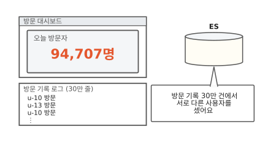

방문 대시보드에 "오늘 방문자" 숫자 카드를 cardinality 집계로 만들었어요. cardinality는 방문 기록에서 서로 다른 사용자 ID가 몇 개인지 세는 집계예요. 그림의 로그처럼 u-10이 두 번 와도 한 명으로 세요. 카드에는 94,707명이 떴어요. 로그를 직접 세면 몇 명일까요?

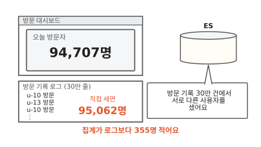

같은 날 로그 파일을 직접 세 보니 95,062명이었어요. 집계가 355명 적어요. 로컬에서 방문 기록 30만 건으로 해 봐도 ES는 94,707명이라고 답했어요. 7.17과 9.2 모두 같은 숫자였어요.[^lab]

ES 문서도 cardinality가 근삿값이라고 처음부터 밝혀요. 틀리는 줄 알면서 왜 이렇게 만들었을까요? 정확히 세는 일이 생각보다 비싸서예요. 적은 메모리로 고유한 수를 어림하는 방법이 있어요. 백분위도 값을 다 들고 있지 않고 작게 줄여 어림해요. 먼저 정확히 세면 무엇이 드는지 볼게요.

## 정확히 세면 메모리가 커요

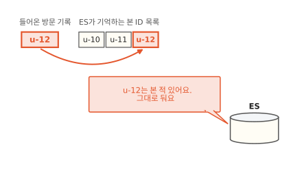

서로 다른 사용자 수를 정확히 세려면 지금까지 본 ID를 모두 기억해 둬야 해요. 그림에서 u-12가 들어오자 ES는 목록에서 본 적 있는 ID인 걸 확인하고 그대로 둬요. 처음 보는 ID가 오면 어떻게 될까요?

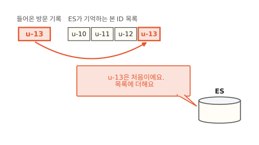

u-13은 목록에 없어서 더해요. 파이썬의 `set`이 하는 일이에요. 사용자가 늘면 이 목록은 얼마나 길어질까요?

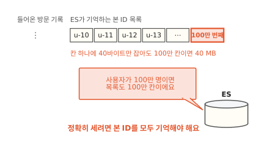

사용자 100만 명이면 ID 100만 개를 들고 있어야 해요. ID 하나에 40바이트만 잡아도 40 MB예요.

ES에서는 이 일이 [12편](12-distributed-search.md)의 샤드 구조 때문에 더 무거워져요. 샤드마다 자기 문서의 고유 ID 목록을 만들어 조율 노드에 보내야 해요. 조율 노드는 샤드들의 결과를 모아 합치는 노드예요. 샤드마다 센 숫자만 보내면 안 될까요?

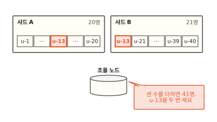

같은 사용자가 여러 샤드에 있을 수 있어요. 그림에서 u-13은 샤드 A와 B에 모두 방문 기록이 있어요. 샤드마다 센 숫자를 더하면 20 + 21 = 41명이 돼서 u-13을 두 번 세요. 조율 노드는 무엇을 받아야 할까요?

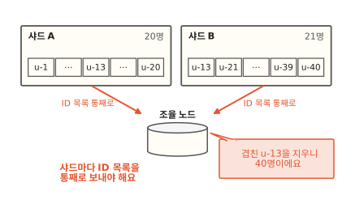

목록 자체를 모아 겹치는 ID를 지워야 해요. 그림에서는 u-13 하나를 지워 40명이 됐어요. 사용자 100만 명이 샤드 10개에 흩어져 있으면 샤드마다 ID 10만 개가 넘어요. ID 하나에 40바이트면 4 MB 안팎인 목록 열 개가 오가요. 일별·국가별로 나눠 세면 이 일이 나눈 갈래 수만큼 늘어요. 목록을 들고 다니지 않고 셀 수는 없을까요?

## 해시 앞의 0 줄 길이로 어림해요

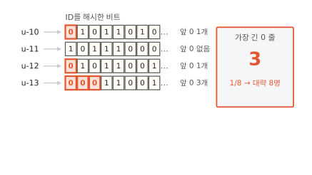

ID를 다 기억하는 대신 이상한 것 하나만 기억해요. ID를 [알고리즘 9편](../algorithms/09-hash.md)의 해시 함수에 넣으면 그림처럼 0과 1이 고르게 섞인 비트가 나와요. 동전을 여러 번 던진 결과처럼요. 다만 동전과 달리 같은 ID는 언제나 같은 비트가 나와요. 이 비트가 맨 앞부터 0으로 몇 개 이어지는지 봐요.

맨 앞이 0일 확률은 2분의 1, 0이 두 개 이어질 확률은 4분의 1, 세 개는 8분의 1이에요. 그림에서 u-13의 해시는 앞에 0이 세 개 이어져요. 이런 해시를 봤다면 서로 다른 ID를 대략 8개쯤은 봤을 거라고 어림할 수 있어요. 지금까지 본 해시 중 "가장 긴 0 줄"만 기억하면 돼요. 숫자 하나예요. 이미 본 사용자가 다시 오면 어떻게 될까요?

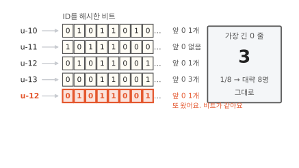

같은 사용자는 해시도 같아서 몇 번을 다시 와도 이 숫자를 바꾸지 않아요. 그래서 중복을 따로 거를 필요가 없어요. 정말 숫자 하나로 될까요?

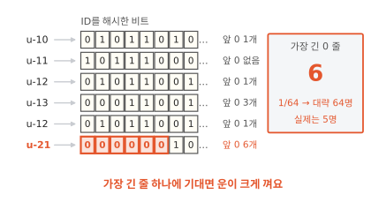

운이 크게 끼어요. 가장 긴 줄 하나에 기대니 우연히 긴 줄이 한 번 나오면 어림이 몇 배로 튀어요. 그림에서 u-21의 해시는 0이 여섯 개 이어져요. 사용자는 다섯 명인데 64명쯤으로 어림해요. 파이썬으로 해 보니 실제 10만 명을 약 210만 명으로 어림했어요. 답도 2의 거듭제곱으로만 나와요. 운을 줄이려면 어떻게 할까요?

## 통 여러 개로 평균을 내요

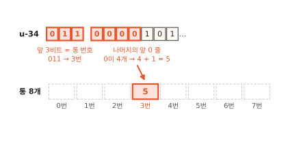

여러 번 재서 평균을 내요. 해시를 두 부분으로 나눠 써요. 앞 몇 비트는 통 번호로 쓰고 나머지 비트에서 0 줄 길이를 세요. 그림의 u-34는 해시가 `011 0000101…`이에요. 앞 3비트 `011`로 3번 통을 고르고 뒤쪽 `0000101…`의 앞 0 네 개를 3번 통에 적어요. 다른 사용자도 넣으면 통은 어떻게 될까요?

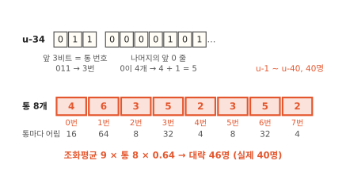

앞 3비트를 쓰면 통이 8개예요. 그림은 u-1부터 u-40까지 40명을 넣은 모습이에요. ID들이 통에 고르게 나뉘고 통마다 자기에게 온 ID 중 가장 긴 0 줄만 적어요. 통 여덟 개의 숫자는 어떻게 모을까요?

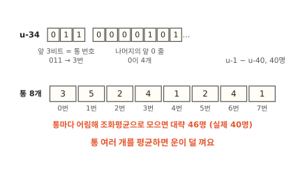

통마다 따로 어림한 값을 모아 전체를 어림해요. 모을 때는 조화평균을 써요. 값마다 역수를 내 평균한 다음 다시 역수로 돌리는 평균이라 유난히 큰 값 하나에 덜 끌려가요. 그림에서는 40명을 대략 46명으로 어림했어요. 통이 8개뿐이라 아직 거칠어요. 이 방법을 **HyperLogLog**(HLL)라고 해요. 2007년 Flajolet 외의 논문에서 나왔어요.

ES는 통 하나에 1바이트를 써요. 앞 14비트를 쓰면 통이 16,384개이고 16 KB예요. 파이썬으로 같은 크기를 만들어 보니 10만 명을 0.9퍼센트, 100만 명을 0.5퍼센트 차이로 어림했어요. 사용자가 10배 늘어도 통 배열은 16 KB 그대로예요. 오차는 대략 `1.04 / √(통 수)`를 따라가요. 통이 16,384개면 0.8퍼센트 안팎이에요. 통을 4배로 늘리면 오차가 절반으로 줄어요. 샤드마다 만든 통 배열은 어떻게 합칠까요?

## 샤드끼리 합치기 쉬워요

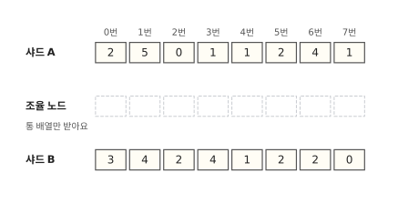

HLL이 ES에 잘 맞는 이유는 합치기에 있어요. 그림에서 샤드 A는 u-1~u-20, 샤드 B는 u-13과 u-21~u-40으로 통 배열을 만들었어요. 조율 노드는 샤드마다 이 배열만 받아요. 두 배열을 어떻게 합칠까요?

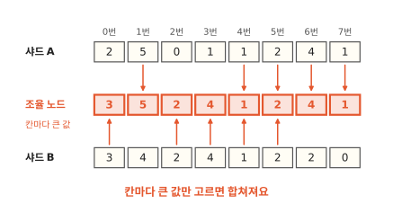

같은 칸끼리 큰 값을 고르기만 하면 두 샤드를 합친 배열이 돼요. 그림의 결과는 40명을 한꺼번에 넣은 앞 그림의 배열과 똑같아요. 같은 사용자는 같은 통의 같은 해시라서 두 번 세어지지 않아요. 두 샤드에 다 있는 u-13도 그래요. 12편의 조율 노드는 샤드마다 수십 KB 안쪽의 배열만 받아서 칸마다 최댓값을 고르면 돼요.

ES의 cardinality 집계는 HLL을 고친 HyperLogLog++를 써요. 고유한 값이 적을 때는 해시값을 그대로 모아 두어 거의 정확하게 세고 많아지면 통 배열로 바꿔요. 그 경계와 통 수를 `precision_threshold` 하나로 정해요. 기본값 3,000이면 통 16,384개(16 KB)를 써요. 위 파이썬 실험과 같은 크기예요. 로컬에서 고유 사용자 95,062명을 세어 보니 아래처럼 나왔어요.

| `precision_threshold` | 통 수 | ES 답 | 차이 |
|---|---|---|---|
| 100 | 1,024 | 96,241 | 1.24% |
| 3,000(기본값) | 16,384 | 94,707 | 0.37% |
| 40,000(최댓값) | 262,144 | 95,086 | 0.03% |

한 번 잰 값이라 데이터가 바뀌면 차이도 달라져요. 처음 장면의 355명이 이번 데이터에서 기본값이 낸 0.37퍼센트예요.

??? info "심화: HyperLogLog++와 precision_threshold"
    `precision_threshold`가 통 수를 어떻게 정하는지 궁금할 때 보는 칸이에요.

    HyperLogLog++는 Google의 Heule 외가 2013년에 낸 방법이에요. HLL에 세 가지를 더했어요. 64비트 해시로 큰 수에서의 충돌을 줄여요. 개수가 애매할 때 생기는 치우침을 실측 보정표로 고쳐요. 개수가 적을 때는 해시를 그대로 모아 두는 작은 모드로 시작해요. ES 구현에도 보정표 상수(`BIAS_DATA`)가 있어요. 작은 모드도 있는데 선형 계수로 세고 해시를 32비트로 줄여 저장해요.

    통 수는 `precisionFromThreshold`가 정해요. `ceil(threshold / 0.75) × 4`를 담는 데 필요한 비트 수를 p로 삼고 4~18 사이로 잘라 통 2^p개를 써요(9.2 jar에서 확인). 그래서 100은 p=10, 3,000은 p=14, 40,000은 p=18이에요. 40,000보다 크게 줘도 p가 18에서 멈춰서 100,000을 줘도 답이 같았어요. ES 문서가 말하는 메모리 어림 `threshold × 8` 바이트는 작은 모드의 해시 표 크기에 가까워요.

    합치기가 칸마다 최댓값이라 손실이 없어요. 같은 데이터면 샤드 배치나 세그먼트 병합과 상관없이 답이 같아요. 해시도 결정적이라 7.17과 9.2의 답이 끝자리까지 같았어요.

    해시 계산 비용은 필드에 따라 달라요. `keyword`는 세그먼트 안에서 같은 값을 순번(10편의 ordinal)으로 모아 서로 다른 값마다 한 번만 해시하는 경로가 있어요. 숫자나 스크립트 값은 문서마다 해시해요. 문서상 어느 경로를 고를지 정하는 기본 규칙이 8.4에서 시간을 아끼는 쪽(`save_time_heuristic`)으로 바뀌었어요. 해시가 병목으로 확인되면 색인할 때 해시를 미리 계산해 두는 `murmur3` 매퍼 플러그인을 써요. 날짜별 × 국가별처럼 갈래가 많은 집계 안에서 쓰면 갈래마다 작은 모드로 시작하니 값이 적은 갈래는 가벼워요. 갈래도 많고 갈래마다 고유한 값도 많으면 `precision_threshold`를 낮춰야 메모리가 버텨요.

## 백분위도 어림해요

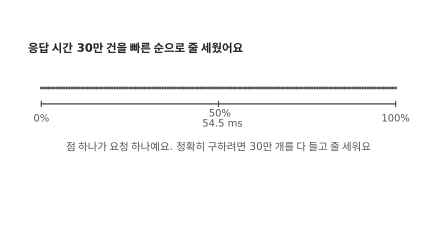

고유한 수를 세는 일 말고 "응답 시간 99번째 백분위(p99)"도 같은 문제를 겪어요. p99는 응답 시간을 빠른 순으로 줄 세웠을 때 99퍼센트 지점의 값이에요. 정확히 구하려면 그림처럼 값을 모두 들고 정렬해야 해요. 샤드끼리 합칠 때도 값을 다 보내야 해요. ES의 percentiles 집계는 t-digest로 어림해요. 값 30만 개를 어떻게 줄일까요?

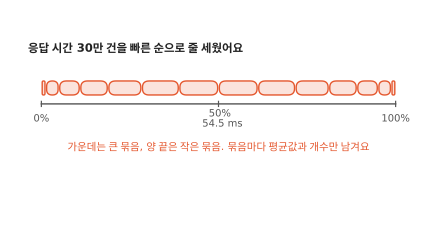

t-digest는 값들을 묶음 수백~수천 개로 줄여서 기억해요. 묶음마다 평균값과 개수만 남겨요. 묶음 크기는 자리마다 달라요. 그림처럼 분포 가운데(p50 근처)는 큰 묶음 몇 개로 대충 기억해요. 양 끝 꼬리로 갈수록 묶음을 작게 해서 촘촘히 기억해요. p99는 이 묶음들에서 어떻게 읽을까요?

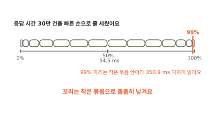

99퍼센트 자리는 꼬리의 작은 묶음 안에 들어요. 작은 묶음에는 값이 몇 개 없어서 그 안에서 어림해도 크게 빗나가지 않아요. 사람들이 궁금해하는 건 대개 꼬리라서 꼬리를 정확하게 남겨요. 샤드끼리 합칠 때도 묶음 목록만 모아 다시 줄이면 돼요.

로컬에서 응답 시간 30만 건의 실제 백분위와 ES 값을 비교했어요. ES 값은 두 버전에서 여러 번 돌린 범위예요.

| 백분위 | 실제 | ES(7.17·9.2, 여러 번 실행) |
|---|---|---|
| 50% | 54.5 ms | 54.5 ~ 55.1 ms |
| 99% | 350.9 ms | 350.4 ~ 353.4 ms |
| 99.9% | 657.7 ms | 657.1 ~ 659.3 ms |

모두 1퍼센트 안쪽으로 맞았어요. cardinality와 달리 실행할 때마다 끝자리가 조금씩 달라졌어요.

??? info "심화: t-digest와 버전 차이"
    묶음 크기가 어떻게 정해지고 왜 실행마다 값이 흔들리는지 궁금할 때 보는 칸이에요.

    t-digest는 Dunning과 Ertl이 2019년에 정리한 방법이에요. 분위수 q 근처 묶음의 최대 크기를 `q(1-q)`에 비례하게 정해서 꼬리일수록 묶음이 작아요. 분위수는 0~1 사이로 나타낸 위치예요. `compression`(기본 100)이 묶음 수를 정해요. 묶음은 대략 `20 × compression`개까지 늘 수 있고 크게 줄수록 정확해지고 메모리를 더 써요. 고유한 값 수가 `compression`보다 적으면 거의 정확해요.

    HLL과 달리 t-digest는 합치는 순서에 따라 결과가 조금 달라져요. 샤드 배치나 세그먼트 구성이 바뀌면 같은 데이터도 값이 달라지고 ES 문서도 percentiles가 비결정적이라고 밝혀요. 로컬에서 7.17은 실행마다 거의 같았고 9.2가 더 흔들렸어요. ES 8.x 어느 시점에 기본 구현이 속도 쪽으로 바뀐 것으로 보여요. 정확한 버전은 확인하지 못했어요. 지금 문서는 기본 방식이 성능에 맞춰져 있고 `execution_hint: high_accuracy`로 정확도 쪽을 고를 수 있다고 해요.

    값이 양수라면 HDR Histogram 방식(`"hdr": {"number_of_significant_value_digits": 3}`)을 고를 수도 있어요. 자릿수 정밀도를 정해 두는 방식이라 빠르지만 메모리를 더 써요. 음수가 들어오면 오류가 나요.

    백분위는 나눠 구한 뒤 다시 합칠 수 없어요. 날짜별 p99를 평균 내거나 그중 최댓값을 고르면 전체 p99가 나오지 않아요. 전체 p99는 원래 기간 전체에 percentiles를 따로 걸어 구해요.

## cardinality와 percentiles는 언제 쓸모 있을까요?

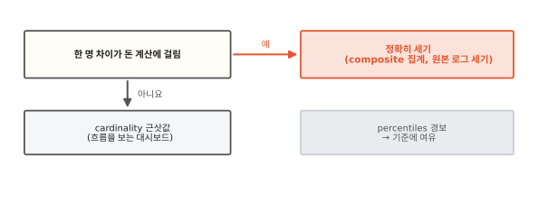

cardinality는 1퍼센트 안팎 오차가 괜찮은 곳에 써요. 방문 대시보드처럼 흐름을 보는 화면이 그래요. 광고 정산처럼 "광고를 본 고유 사용자 수"에 단가를 곱해 돈을 계산하는 곳은 달라요. 한 명 차이도 문제가 되니 정확히 센 값을 써요. [12편](12-distributed-search.md)의 composite 집계로 사용자 ID를 끝까지 받아 세거나 배치 작업으로 원본 로그를 세는 길을 따로 둬요. 어디에 근삿값을 쓰는지 화면이나 문서에 밝혀 두면 오해가 줄어요.

percentiles로 경보를 걸 때도 근삿값이라는 걸 챙겨요. "p99 응답 시간이 500 ms를 넘으면 경보"를 걸었다고 해 봐요. 같은 데이터에서도 값이 실행마다 조금씩 흔들리니 499 ms와 501 ms 사이를 오가며 경보가 켜졌다 꺼졌다 할 수 있어요. 몇 분 연속으로 넘을 때만 울리게 하거나 켜지는 기준과 꺼지는 기준을 따로 둬요. 정밀도가 더 필요하면 `compression`을 키우거나 HDR Histogram 방식을 써요. 둘 다 메모리를 더 써요.

## 다시 오늘 방문자 수를 볼게요

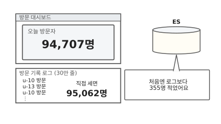

처음 장면의 대시보드로 돌아왔어요. 카드는 94,707명이었고 로그를 직접 세면 95,062명이었어요.

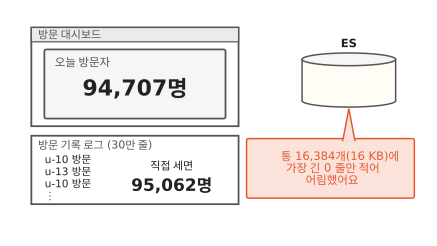

ES는 사용자 ID를 모두 들고 있지 않았어요. 해시 앞 14비트로 통 16,384개를 고르고 통마다 가장 긴 0 줄만 적었어요. 샤드마다 만든 16 KB 배열을 칸마다 큰 값으로 합쳐 조화평균으로 어림했어요. 355명은 그 어림이 낸 0.37퍼센트 차이였어요.

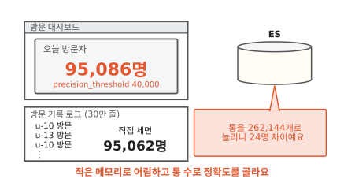

`precision_threshold`를 40,000으로 주자 통 262,144개로 세서 95,086명이 나왔어요. 로그와 24명 차이예요.

사용자가 10만 명이든 1,000만 명이든 통 배열은 16 KB 그대로예요.

### 이 편에서 줄여 그린 것

그림을 쉽게 하려고 실제와 다르게 줄인 곳이 여섯 군데 있어요.

1. 그림의 해시 비트는 파이썬 실험과 같은 해시 함수(blake2b)로 계산했어요. ES는 MurmurHash3라는 다른 해시 함수를 써서 같은 ID라도 비트가 달라요.
2. 통에 가장 긴 0 줄의 길이를 적었어요. HLL 논문과 ES는 그 길이에 1을 더한 값을 적어요. 맨 앞에서 처음 1이 나오는 자리예요. 그림의 46명은 이 방식으로 계산했어요.
3. 통을 8개로 그렸어요. ES 기본값은 통 16,384개예요. 고유한 값이 적을 때는 통 대신 해시를 그대로 모아 둬요. 그래서 사용자 40명이면 ES는 거의 정확하게 세요.
4. 해시 비트를 앞 8칸만 그렸어요. 실제 해시는 64비트예요.
5. t-digest 묶음을 14개로 그렸어요. 실제로는 `compression`(기본 100)에 따라 수백~수천 개예요.
6. 줄 세운 응답 시간을 점 141개로 그렸어요. 실제로는 30만 건이에요.

### 이 편에서 새로 나온 말

![낱말 카드 여덟 장, 두 장씩 네 줄. cardinality 집계: u-10, u-13, u-10 칸에서 빨간 화살표로 빨간 2, 서로 다른 값이 몇 개인지 세는 집계. 앞 0 줄: 비트 0 0 0 1 1 0 0 가운데 앞 세 칸 빨강, 해시 비트가 맨 앞부터 0으로 이어진 길이. 통: 3 5 2 4 1 2 4 1 칸 가운데 넷째 4가 빨강, 앞 비트로 고른 칸. 가장 긴 0 줄만 적어요. HyperLogLog: 3 5 2 4 점 세 개에서 빨간 화살표로 빨간 ≈46명, 통마다 어림해 조화평균으로 모으는 방법. HyperLogLog++: 해시 해시 칸에서 빨간 화살표로 빨간 빈 칸 넷, 값이 적으면 해시를 그대로, 많아지면 통 배열로. precision_threshold: 100에 칸 둘, 빨간 3,000에 칸 넷, 40,000에 칸 여덟, 통 수를 정하는 값, 기본 3,000이면 통 16,384개. p99 (백분위): 점이 늘어선 줄 오른쪽 끝 가까이 빨간 막대와 99%, 빠른 순으로 줄 세운 99퍼센트 자리의 값. t-digest: 양 끝이 짧고 가운데가 긴 빨간 묶음 넷, 값을 묶음으로 줄여 어림해요. 꼬리는 촘촘히.](img/13/es13-cards.svg)

[^lab]: 파이썬 숫자는 ES 없이 HLL을 흉내 낸 실험에서 나왔어요. ES 숫자는 ES 7.17.26과 9.2.0에서 샤드 3개 인덱스에 방문 기록 30만 건을 넣어 쟀어요. 방문 기록 30만 건의 실제 고유 사용자는 95,062명이었어요. 논문: Flajolet 외, "HyperLogLog: the analysis of a near-optimal cardinality estimation algorithm"(2007), Heule 외, "HyperLogLog in Practice"(2013), Dunning·Ertl, "Computing extremely accurate quantiles using t-digests"(2019).
