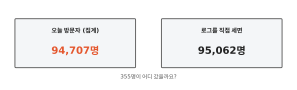
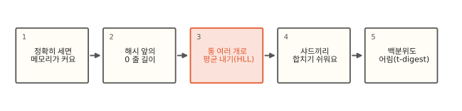
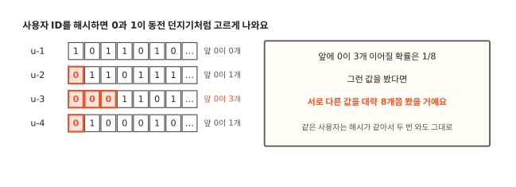
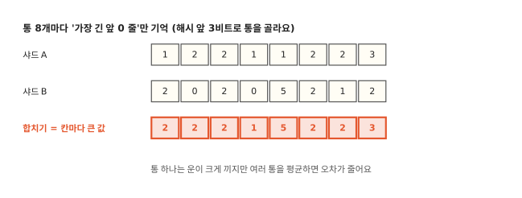
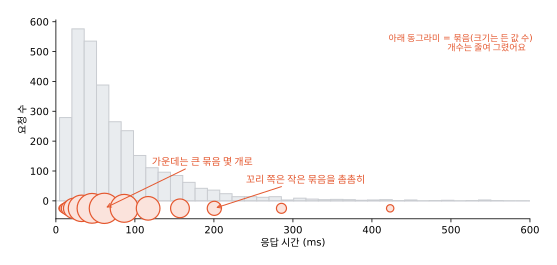

# 고유 사용자 수는 왜 근삿값일까요?

## 방문자 수가 로그와 355명 달라요



대시보드에 "오늘 방문자 수"를 cardinality 집계로 그렸어요. cardinality는 방문 기록에서 서로 다른 사용자 ID가 몇 개인지 세는 집계예요. 그런데 같은 날 로그 파일을 직접 세 보니 355명이 더 많아요. 로컬에서 방문 기록 30만 건(실제 고유 사용자 95,062명)으로 해 봐도 ES는 94,707명이라고 답했어요. 7.17과 9.2 모두 같은 숫자였어요.[^lab]

ES 문서도 cardinality가 근삿값이라고 처음부터 밝혀요. 틀리는 줄 알면서 왜 이렇게 만들었을까요? 정확히 세는 일이 생각보다 비싸서예요. 적은 메모리로 고유한 수를 어림하는 방법이 있고 같은 생각으로 백분위도 어림해요.

## 정확한 세기에서 백분위까지



## 정확히 세면 메모리가 커요

서로 다른 사용자 수를 정확히 세려면 지금까지 본 ID를 모두 기억해 둬야 해요. 새 ID가 오면 본 적 있는지 확인하고 없으면 더해요. 파이썬의 `set`이 하는 일이에요. 사용자 100만 명이면 ID 100만 개를 들고 있어야 하고 ID 하나에 40바이트만 잡아도 40 MB예요.

ES에서는 이 일이 [12편](12-distributed-search.md)의 샤드 구조 때문에 더 무거워져요. 샤드마다 자기 문서의 고유 ID 목록을 만든 다음 조율 노드(샤드들의 결과를 모아 합치는 노드)에 보내야 해요. 같은 사용자가 여러 샤드에 있을 수 있으니 샤드마다 센 숫자를 더하면 그 사용자를 두 번 세요. 그래서 목록 자체를 모아 겹치는 ID를 지워야 해요. 사용자 100만 명이 샤드 10개에 흩어져 있으면 수십 MB짜리 목록 열 개가 오가요. 일별·국가별로 나눠 세면 이 일이 나눈 갈래 수만큼 늘어요.

## 해시 앞의 0 줄 길이로 어림해요



ID를 다 기억하는 대신 이상한 것 하나만 기억해요. ID를 [알고리즘 9편](../algorithms/09-hash.md)의 해시 함수에 넣으면 0과 1이 고르게 섞인 비트가 나와요. 동전을 여러 번 던진 결과처럼요. 다만 동전과 달리 같은 ID는 언제나 같은 비트가 나와요. 이 비트가 맨 앞부터 0으로 몇 개 이어지는지 봐요.

맨 앞이 0일 확률은 2분의 1, 0이 두 개 이어질 확률은 4분의 1, 세 개는 8분의 1이에요. 그래서 앞에 0이 세 개 이어진 해시를 봤다면 서로 다른 ID를 대략 8개쯤은 봤을 거라고 어림할 수 있어요. 지금까지 본 해시 중 "가장 긴 0 줄"만 기억하면 돼요. 숫자 하나예요. 같은 사용자는 해시도 같아서 몇 번을 다시 와도 이 숫자를 바꾸지 않으니 중복을 따로 거를 필요가 없어요.

정말 숫자 하나로 될까요? 운이 크게 끼어요. 가장 긴 줄 하나에 기대니 우연히 긴 줄이 한 번 나오면 어림이 몇 배로 튀어요. 파이썬으로 해 보니 실제 10만 명을 약 210만 명으로 어림했어요. 답도 2의 거듭제곱으로만 나와요.

## 통 여러 개로 평균을 내요



운을 줄이려면 여러 번 재서 평균을 내요. 해시를 두 부분으로 나눠 써요. 앞 몇 비트는 통 번호로 쓰고 나머지 비트에서 0 줄 길이를 세요. 해시가 `011 0001101…`이면 앞 3비트 `011`로 3번 통을 고르고 뒤쪽 `0001101…`의 앞 0 세 개를 3번 통에 적어요. 앞 3비트를 쓰면 통이 8개, 앞 14비트를 쓰면 통이 16,384개예요. ID들이 통에 고르게 나뉘고 통마다 따로 어림한 값을 모아 전체를 어림해요.

모을 때는 조화평균을 써요. 값마다 역수를 내서 평균한 다음 다시 역수로 돌리는 평균이라 유난히 큰 값 하나에 덜 끌려가요. 이 방법을 **HyperLogLog**(HLL)라고 해요. 2007년 Flajolet 외의 논문에서 나왔어요.

ES는 통 하나에 1바이트를 써요. 통 16,384개면 16 KB예요. 파이썬으로 같은 크기를 만들어 보니 10만 명을 0.9퍼센트, 100만 명을 0.5퍼센트 차이로 어림했어요. 사용자가 100배 늘어도 통 배열은 16 KB 그대로예요. 오차는 대략 `1.04 / √(통 수)`를 따라가요. 통이 16,384개면 0.8퍼센트 안팎이고 통을 4배로 늘리면 오차가 절반으로 줄어요.

## 샤드끼리 합치기 쉬워요

HLL이 ES에 잘 맞는 이유는 합치기에 있어요. 샤드 A와 B가 각자 통 배열을 만들었다면 같은 칸끼리 큰 값을 고르기만 하면 두 샤드를 합친 배열이 돼요. 같은 사용자는 같은 통의 같은 해시라서 두 번 세어지지 않아요. 12편의 조율 노드는 샤드마다 수십 KB 안쪽의 배열만 받아서 칸마다 최댓값을 고르면 돼요.

ES의 cardinality 집계는 HLL을 고친 HyperLogLog++를 써요. 고유한 값이 적을 때는 해시값을 그대로 모아 두어 거의 정확하게 세고 많아지면 통 배열로 바꿔요. 그 경계와 통 수를 `precision_threshold` 하나로 정해요. 기본값 3,000이면 통 16,384개(16 KB)를 써요. 위 파이썬 실험과 같은 크기예요. 로컬에서 고유 사용자 95,062명을 세어 보니 아래처럼 나왔어요.

| `precision_threshold` | 통 수 | ES 답 | 차이 |
|---|---|---|---|
| 100 | 1,024 | 96,241 | 1.24% |
| 3,000(기본값) | 16,384 | 94,707 | 0.37% |
| 40,000(최댓값) | 262,144 | 95,086 | 0.03% |

한 번 잰 값이라 데이터가 바뀌면 차이도 달라져요. 처음 장면의 355명이 이번 데이터에서 기본값이 낸 0.37퍼센트예요.

??? info "심화: HyperLogLog++와 precision_threshold"
    HyperLogLog++(Heule 외, Google, 2013)는 HLL에 세 가지를 더했어요. 64비트 해시로 큰 수에서의 충돌을 줄여요. 개수가 애매할 때 생기는 치우침을 실측 보정표로 고쳐요. 개수가 적을 때는 해시를 그대로 모아 두는 작은 모드로 시작해요. ES 구현에도 보정표 상수(`BIAS_DATA`)와 작은 모드(선형 계수, 해시를 32비트로 줄여 저장)가 있어요.

    통 수는 `precisionFromThreshold`가 정해요. `ceil(threshold / 0.75) × 4`를 담는 데 필요한 비트 수를 p로 삼고 4~18 사이로 잘라 통 2^p개를 써요(9.2 jar에서 확인). 그래서 100은 p=10, 3,000은 p=14, 40,000은 p=18이에요. 40,000보다 크게 줘도 p가 18에서 멈춰서 100,000을 줘도 답이 같았어요. ES 문서가 말하는 메모리 어림 `threshold × 8` 바이트는 작은 모드의 해시 표 크기에 가까워요.

    합치기가 칸마다 최댓값이라 손실이 없어요. 같은 데이터면 샤드 배치나 세그먼트 병합과 상관없이 답이 같고 해시도 결정적이라 7.17과 9.2의 답이 끝자리까지 같았어요.

    해시 계산 비용은 필드에 따라 달라요. `keyword`는 세그먼트 안에서 같은 값을 순번(10편의 ordinal)으로 모아 서로 다른 값마다 한 번만 해시하는 경로가 있어요. 숫자나 스크립트 값은 문서마다 해시해요. 문서상 어느 경로를 고를지 정하는 기본 규칙이 8.4에서 시간을 아끼는 쪽(`save_time_heuristic`)으로 바뀌었어요. 해시가 병목으로 확인되면 색인할 때 해시를 미리 계산해 두는 `murmur3` 매퍼 플러그인을 써요. 날짜별 × 국가별처럼 갈래가 많은 집계 안에서 쓰면 갈래마다 작은 모드로 시작하니 값이 적은 갈래는 가벼워요. 갈래도 많고 갈래마다 고유한 값도 많으면 `precision_threshold`를 낮춰야 메모리가 버텨요.

## 백분위도 어림해요



"응답 시간 99번째 백분위(p99)"도 같은 문제를 겪어요. p99는 응답 시간을 빠른 순으로 줄 세웠을 때 99퍼센트 지점의 값이에요. 정확히 구하려면 값을 모두 정렬해야 하고 샤드끼리 합칠 때도 값을 다 보내야 해요. ES의 percentiles 집계는 t-digest로 어림해요.

t-digest는 값들을 묶음 수백~수천 개로 줄여서 기억해요. 묶음마다 평균값과 개수만 남겨요. 묶음 크기는 자리마다 달라요. 분포 가운데(p50 근처)는 큰 묶음 몇 개로 대충 기억하고 양 끝 꼬리(p99, p99.9)로 갈수록 묶음을 작게 해서 촘촘히 기억해요. 사람들이 궁금해하는 건 대개 꼬리라서 꼬리를 정확하게 남겨요. 샤드끼리 합칠 때도 묶음 목록만 모아 다시 줄이면 돼요.

로컬에서 응답 시간 30만 건의 실제 백분위와 ES 값을 비교했어요. ES 값은 두 버전에서 여러 번 돌린 범위예요.

| 백분위 | 실제 | ES(7.17·9.2, 여러 번 실행) |
|---|---|---|
| 50% | 54.5 ms | 54.5 ~ 55.1 ms |
| 99% | 350.9 ms | 350.4 ~ 353.4 ms |
| 99.9% | 657.7 ms | 657.1 ~ 659.3 ms |

모두 1퍼센트 안쪽으로 맞았어요. cardinality와 달리 실행할 때마다 끝자리가 조금씩 달라졌어요.

??? info "심화: t-digest와 버전 차이"
    t-digest(Dunning·Ertl, 2019)는 분위수(0~1 사이의 위치) q 근처 묶음의 최대 크기를 `q(1-q)`에 비례하게 정해서 꼬리일수록 묶음이 작아요. `compression`(기본 100)이 묶음 수를 정해요. 묶음은 대략 `20 × compression`개까지 늘 수 있고 크게 줄수록 정확해지고 메모리를 더 써요. 고유한 값 수가 `compression`보다 적으면 거의 정확해요.

    HLL과 달리 t-digest는 합치는 순서에 따라 결과가 조금 달라져요. 샤드 배치나 세그먼트 구성이 바뀌면 같은 데이터도 값이 달라지고 ES 문서도 percentiles가 비결정적이라고 밝혀요. 로컬에서 7.17은 실행마다 거의 같았고 9.2가 더 흔들렸어요. ES 8.x 어느 시점에 기본 구현이 속도 쪽으로 바뀐 것으로 보여요(정확한 버전은 확인하지 못했어요). 지금 문서는 기본 방식이 성능에 맞춰져 있고 `execution_hint: high_accuracy`로 정확도 쪽을 고를 수 있다고 해요.

    값이 양수라면 HDR Histogram 방식(`"hdr": {"number_of_significant_value_digits": 3}`)을 고를 수도 있어요. 자릿수 정밀도를 정해 두는 방식이라 빠르지만 메모리를 더 써요. 음수가 들어오면 오류가 나요.

    백분위는 나눠 구한 뒤 다시 합칠 수 없어요. 날짜별 p99를 평균 내거나 그중 최댓값을 고르면 전체 p99가 나오지 않아요. 전체 p99는 원래 기간 전체에 percentiles를 따로 걸어 구해요.

## 정리

- 고유한 수를 정확히 세려면 본 값을 다 기억해야 해서 메모리가 값 수만큼 들고 샤드끼리 합치려면 그 목록을 다 보내야 해요.
- 해시의 맨 앞 0 줄 길이로 "얼마나 많이 봤나"를 어림할 수 있어요. 같은 값은 같은 해시라 중복이 저절로 빠져요.
- HyperLogLog는 해시 앞 비트로 통을 나눠 통마다 가장 긴 0 줄만 기억하고 조화평균으로 모아요. 16 KB로 1퍼센트 안팎 오차를 내고 샤드끼리는 칸마다 큰 값만 고르면 합쳐져요.
- percentiles는 t-digest로 값을 묶음으로 줄여 어림해요. 꼬리를 촘촘히 남겨요.

## 직접 해 보기

[lab/es/13_hll.py](https://github.com/oya150/bedrock/blob/main/lab/es/13_hll.py)는 ES 없이 HLL을 직접 만들어 통 1,024개와 16,384개로 어림해 봐요. [lab/es/13_es.py](https://github.com/oya150/bedrock/blob/main/lab/es/13_es.py)는 샤드 3개 인덱스에 방문 기록을 넣고 cardinality와 percentiles를 실제 값과 비교해요.

```bash
curl 'localhost:9200/visits/_search' -H 'Content-Type: application/json' -d '{
  "size": 0, "aggs": {"u": {"cardinality": {"field": "user", "precision_threshold": 40000}}}}'
```

`precision_threshold`를 100, 3000, 40000으로 바꿔 보세요.

## 확인 문제

??? question "1. 앞 0 줄로 어림하기"
    지금까지 본 해시 중 맨 앞 0이 가장 길게 이어진 게 5개였어요. 서로 다른 값을 대략 몇 개 봤다고 어림할까요?

    **풀이** 앞에 0이 다섯 개 이어질 확률은 2를 다섯 번 곱한 32분의 1이에요. 그래서 대략 32개쯤 봤다고 어림해요. 통 하나로는 운이 크게 끼니 실제로는 통 여러 개의 값을 평균해요.

??? question "2. 두 샤드 합치기"
    통 4개짜리 HLL에서 샤드 A가 [3, 1, 4, 2], 샤드 B가 [2, 5, 1, 2]예요. 합친 배열은 무엇일까요? 왜 더하지 않을까요?

    **풀이** 칸마다 큰 값을 골라 [3, 5, 4, 2]예요. 통에는 "가장 긴 0 줄"을 기록하니 두 샤드를 합친 집합의 가장 긴 줄은 둘 중 긴 쪽이에요. 같은 사용자가 두 샤드에 다 있어도 같은 통의 같은 줄이라 두 번 세지 않아요. 더하면 그런 사용자를 두 번 세게 돼요.

??? question "3. 작은 숫자는 정확해요"
    `precision_threshold`가 기본 3,000인데 고유 사용자가 500명인 날의 cardinality는 얼마나 정확할까요?

    **풀이** 거의 정확해요. HyperLogLog++는 고유한 값이 적을 때 해시값을 그대로 모아 두는 모드로 세니까요. 오차가 눈에 띄는 건 문턱을 넘어 통 배열로 바뀐 뒤예요.

## 판단 연습

??? question "정산에 쓸 고유 고객 수"
    광고 정산에서 "광고를 본 고유 사용자 수"에 단가를 곱해 돈을 계산해요. 지금은 ES cardinality 값을 그대로 쓰고 있어요. 괜찮을까요?

    **풀이** 한 명 차이도 문제가 되는 정산에는 정확히 센 값을 써요. [12편](12-distributed-search.md)의 composite 집계로 사용자 ID를 끝까지 받아 세거나 배치 작업으로 원본 로그를 세는 길을 따로 둬요. ES cardinality는 대시보드처럼 1퍼센트 안팎 오차가 괜찮은 곳에 써요. 어디에 근삿값을 쓰는지 화면이나 문서에 밝혀 두면 오해가 줄어요.

??? question "p99 경보"
    "p99 응답 시간이 500 ms를 넘으면 경보"를 ES percentiles로 만들었는데 499 ms와 501 ms 사이를 오가며 경보가 켜졌다 꺼졌다 해요. 어떻게 다룰까요?

    **풀이** percentiles 값은 근삿값이고 같은 데이터에서도 실행마다 조금씩 흔들려요. 경보 기준에 여유를 두거나(몇 분 연속으로 넘을 때만), 켜지는 기준과 꺼지는 기준을 따로 둬요. 정밀도가 더 필요하면 `compression`을 키우거나 HDR Histogram 방식을 쓰는데 메모리를 더 써요(심화 칸).

[^lab]: [lab/es/13_hll.py](https://github.com/oya150/bedrock/blob/main/lab/es/13_hll.py)는 파이썬 흉내이고, ES 숫자는 [lab/es/13_es.py](https://github.com/oya150/bedrock/blob/main/lab/es/13_es.py)로 ES 7.17.26과 9.2.0에서 쟀어요. 논문: Flajolet 외, "HyperLogLog: the analysis of a near-optimal cardinality estimation algorithm"(2007), Heule 외, "HyperLogLog in Practice"(2013), Dunning·Ertl, "Computing extremely accurate quantiles using t-digests"(2019).
