# 노드가 죽어도 왜 데이터가 안 사라질까요?

## 주 샤드가 있던 노드를 꺼 봤어요

쇼핑몰 주문 기록을 ES에 담았어요. 이번에는 샤드를 하나만 두고 같은 샤드를 노드 세 곳에 한 벌씩 뒀어요. 그림 오른쪽 원통 셋이 노드 es01, es02, es03이에요. 주문 152건을 넣었고 그 샤드의 원본은 es03이 맡았어요. 그림에는 ES가 부르는 이름대로 주 샤드라고 적었어요. es03은 클러스터를 지휘하는 마스터 노드이기도 했어요. 이제 es03을 꺼 볼게요.

es03을 `kill -9`로 강제로 껐어요. 그 노드의 디스크도 같이 못 쓰게 됐어요. 화면의 검색과 저장은 어떻게 됐을까요?

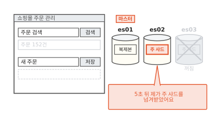

먼저 노드 쪽부터 봤어요. 5초 뒤에 보니 es02가 주 샤드 역할을 넘겨받았고 es01이 새 마스터가 돼 있었어요. 그사이 화면에서는 무슨 일이 있었을까요?

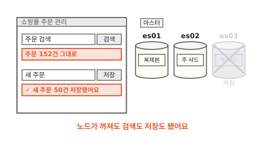

검색은 152건을 그대로 답했고 새 주문 50건도 저장됐어요. es03을 다시 켜니 파일을 통째로 다시 받지 않고 작업 기록을 받아 다른 노드와 같아졌어요. 로컬 7.17과 9.2에서 같은 흐름이었어요.[^lab] 원본이 있던 노드가 꺼졌는데 어떻게 아무 일도 없었을까요?

## 같은 샤드를 여러 노드에 둬요

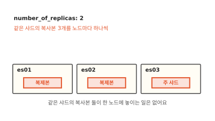

답부터 말하면 같은 데이터가 다른 노드에도 있어서예요. [3편](03-routing.md)에서 문서는 샤드에 나눠 담긴다고 했어요. ES는 샤드마다 복사본을 여러 개 만들어 서로 다른 노드에 둬요. 쓰기를 먼저 받는 복사본이 **주 샤드**예요. 영어로는 primary라고 해요. 나머지는 복제본(replica)이에요.

`number_of_replicas: 2`면 주 샤드 하나에 복제본 둘, 복사본이 셋이에요. 같은 샤드의 복사본 둘은 언제나 서로 다른 노드에 놓여요. 새 주문을 저장하면 어느 복사본이 먼저 받을까요?

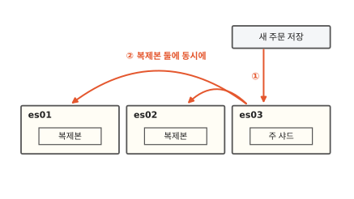

쓰기는 언제나 주 샤드가 먼저 받아요. 주 샤드는 자기 쪽에 쓴 다음 같은 작업을 복제본 둘에 동시에 보내요. 성공 응답은 언제 돌아올까요?

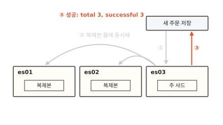

복제본들이 모두 썼다고 답하면 그때 성공을 알려요. 실험에서 쓰기 응답의 `_shards`가 `total 3, successful 3`이었어요. es03이 꺼진 동안에는 `total 3, successful 2`로 바뀌었어요. 살아 있는 두 복사본에 쓴 거예요. 그럼 검색은 어느 복사본에 물을까요?

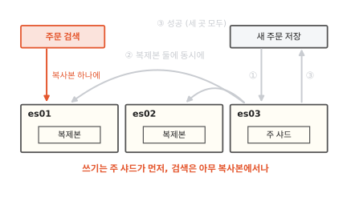

검색은 복사본 아무 곳에서나 해요. 주 샤드든 복제본이든 같은 문서를 들고 있어요. 그래서 [12편](12-distributed-search.md)의 조율 노드는 샤드마다 복사본 하나를 골라 물어봐요. 그런데 복사본 셋이 정말 같은지는 어떻게 알까요?

## 쓰기마다 시퀀스 번호를 매겨요

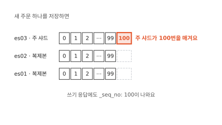

주 샤드는 쓰기마다 0부터 하나씩 커지는 번호를 붙여요. 이 번호가 시퀀스 번호(`_seq_no`)예요. 쓰기 응답에도 `_seq_no`가 나와요. 실험 클러스터에는 먼저 문서 100건을 넣었어요. 번호는 0~99가 붙었고 다음 쓰기의 `_seq_no`는 100이었어요. 여는 장면의 152건은 그 뒤에 더 넣은 주문까지 센 수예요. 복제본은 이 번호를 어떻게 다룰까요?

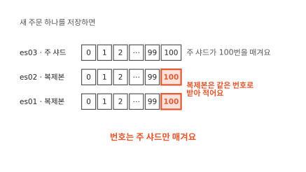

복제본은 주 샤드가 매긴 번호를 그대로 받아 적어요. 번호를 매기는 쪽은 주 샤드 하나뿐이에요. 그런데 이 번호가 복제본에 언제나 차례대로 닿을까요?

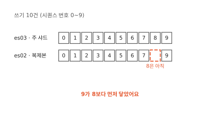

네트워크는 순서를 지켜 주지 않아요. 복제본에 7번이 6번보다 먼저 닿을 수도 있어요. 이 모습은 작은 예로 볼게요. 그림은 0번부터 쓰기 10건만 보낸 직후를 따로 꾸민 장면이에요. es02에는 9번이 닿았는데 8번은 아직 안 닿았어요. es02는 어디까지 받았다고 적어야 할까요?

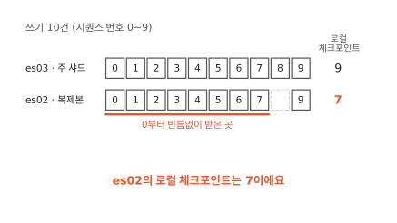

복사본마다 "0번부터 빈틈없이 받은 마지막 번호"를 따로 적어 둬요. 이걸 로컬 체크포인트라고 불러요. es02는 8이 비어 있으니 로컬 체크포인트가 7이에요. 주 샤드 es03은 0~9를 다 받아서 9예요.

## 체크포인트로 어디까지 같은지 알아요

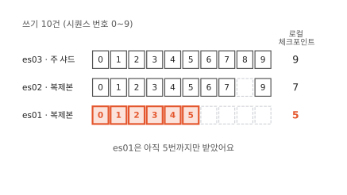

세 번째 복사본 es01은 아직 5번까지만 받았어요. 로컬 체크포인트가 5예요. 세 복사본이 함께 가진 번호는 어디까지일까요?

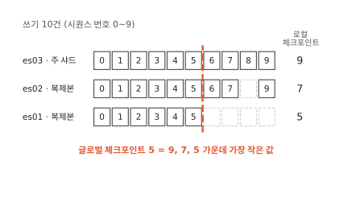

주 샤드는 복사본들의 로컬 체크포인트를 모아 가장 작은 값을 따로 적어요. 자기 것도 함께 모아요. 이게 **글로벌 체크포인트**예요. 9, 7, 5 가운데 가장 작은 5예요. 이 선은 무엇을 알려 줄까요?

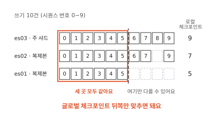

0~5번은 세 복사본 모두에 있다고 확신할 수 있어요. 6번부터는 복사본마다 다를 수 있어요. 이 선 하나 덕분에 복사본을 맞출 때 일이 확 줄어요. 문서 수백만 건을 하나하나 비교할 필요 없이 글로벌 체크포인트 뒤쪽만 보면 돼요.

실제 실험 클러스터에서는 처음 100건을 넣은 직후 세 복사본의 최대 번호와 두 체크포인트가 모두 99로 같았어요. 이 선이 실제로 쓰이는 때는 주 샤드가 사라졌을 때예요. 그때는 누가 주 샤드 자리를 맡을까요?

## 주 샤드가 죽으면 복제본이 넘겨받아요

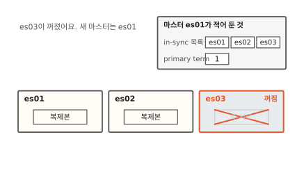

여는 장면으로 돌아가 볼게요. es03이 꺼지자 es01이 새 마스터가 됐어요. 마스터를 뽑는 법은 "마스터는 과반이 뽑아요" 절에서 봐요. 마스터는 샤드마다 "지금까지 쓰기를 빠짐없이 받은 복사본 목록"을 들고 있어요. 이게 in-sync 목록이에요. 그림 오른쪽 위 상자가 마스터가 적어 둔 것이에요. 마스터는 누구를 새 주 샤드로 올릴까요?

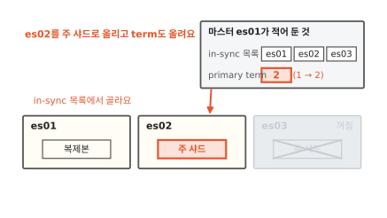

마스터는 남은 복제본 가운데 in-sync 목록에 든 것을 골라 주 샤드로 올려요. 이번에는 es02였어요. 성공을 알린 쓰기는 이 목록의 복사본 모두에 있어요. 그러니 누가 올라가도 그 쓰기는 남아요.

주 샤드를 올리면서 **primary term**이라는 번호도 하나 올려요. 주 샤드가 바뀔 때마다 하나씩 커지는 번호예요. 실험에서 1이 2가 됐어요. 꺼진 es03은 in-sync 목록에서 언제 빠질까요?

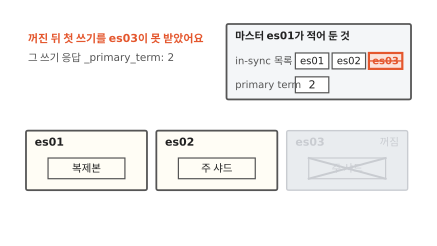

es03이 꺼진 뒤 첫 쓰기를 하자 in-sync 목록이 3개에서 2개로 줄었어요. 꺼진 복사본이 그 쓰기를 못 받아서 목록에서 빠졌어요. 그 쓰기 응답의 `_primary_term`은 2로 나왔어요. 이 번호는 무엇을 막아 줄까요?

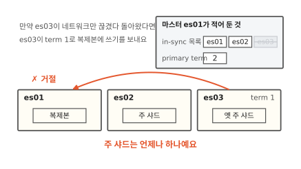

es03이 네트워크만 잠깐 끊겼다가 돌아왔다고 해 봐요. es03은 자기가 아직 주 샤드인 줄 알고 복제본 es01에 쓰기를 보내요. term 2를 이미 받은 es01은 "term 1에서 온 쓰기"를 거절해요. 주 샤드가 동시에 둘이 되는 일을 이 번호가 막아 줘요.

## 새 주 샤드가 번호를 맞춰요

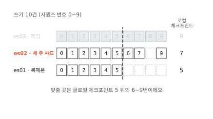

체크포인트 그림으로 돌아가요. 주 샤드 es03이 꺼지고 es02가 새 주 샤드가 됐어요. 글로벌 체크포인트가 5이니 0~5번은 이미 셋 다 같아요. 맞출 곳은 6~9번이에요. es02에는 8이 비어 있고 es01에는 6~9가 다 비어 있어요. 빈 8번 자리는 어떻게 할까요?

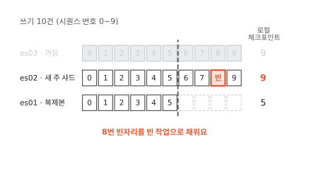

새 주 샤드는 비어 있는 8번 자리를 아무 일도 하지 않는 작업으로 채워요. 이걸 빈 작업(no-op)이라고 해요. 그래서 번호가 빈틈없이 이어져요. 8번 쓰기는 es02와 es01에 닿지 못했으니 클라이언트도 성공 응답을 받지 못한 쓰기예요. 그런 쓰기는 버려도 약속을 어기지 않아요. es01은 어떻게 맞출까요?

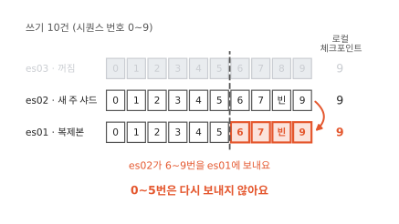

그다음 6~9번을 es01에 보내요. 0~5번은 다시 보내지 않아요. 이제 es02와 es01 모두 로컬 체크포인트가 9예요. 꺼졌던 es03이 돌아오면 어떻게 될까요?

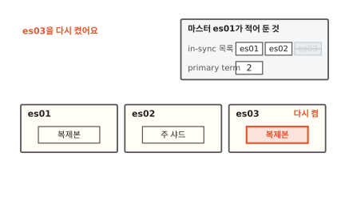

꺼졌던 노드가 돌아올 때도 같은 생각을 써요. 다시 켠 es03은 복제본으로 돌아와요. 주 샤드 es02는 es03이 몇 번까지 갖고 있는지 봐요. 그다음에는 무엇을 보낼까요?

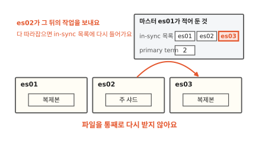

주 샤드는 그 번호 뒤의 작업을 보내요. 그러려면 주 샤드에 그 작업 기록이 남아 있어야 해요. [5편](05-merge.md)에서 본 지운 문서 기록과 보존 표시(retention lease)가 그 기록을 남겨 둬요. 실험에서도 돌아온 복사본은 세그먼트 파일을 다시 받지 않고 작업 기록만 받았어요. 다 따라잡으면 in-sync 목록에 다시 들어가요.

??? info "심화: 쓰기 성공의 뜻과 복사본 맞추기"
    쓰기 성공 응답이 정확히 언제 오고 돌아온 복사본은 어떤 순서로 맞추는지 궁금할 때 보는 칸이에요. 쓰기 응답은 in-sync 목록의 복사본 모두에 쓰인 뒤에 와요. 기본값 `index.translog.durability: request`라면 그 복사본들의 translog가 모두 fsync된 뒤예요([4편](04-refresh.md)). 복제본 하나가 쓰기에 실패하면 주 샤드는 마스터에게 그 복사본을 in-sync 목록에서 빼 달라고 해요. 그게 끝나야 성공을 답해요. `wait_for_active_shards`(기본 1)는 쓰기를 시작하기 전에 살아 있는 복사본 수를 확인하는 문턱이에요. 클러스터 상태에서는 `metadata.indices.<인덱스>.in_sync_allocations`와 `primary_terms`로 볼 수 있어요. 두 버전이 같아요.

    글로벌 체크포인트는 in-sync 복사본(주 샤드 포함)의 로컬 체크포인트 최솟값이에요. 주 샤드가 쓰기 요청에 실어 복제본에 알려요. 쓰기가 없으면 백그라운드로 30초마다(`index.global_checkpoint_sync.interval`) 알려요. 보존 표시도 30초마다 동기화해요. 9.2 jar의 기본값으로 확인했어요.

    돌아온 복사본을 맞추는 일은 peer recovery예요. 소스를 보면 돌아온 복사본은 먼저 자기 translog를 자기가 알던 글로벌 체크포인트까지 스스로 다시 실행해요. 그 뒤를 주 샤드에서 받아요. 보존 표시가 12시간(`index.soft_deletes.retention_lease.period`) 안에 돌아오지 않은 복사본을 놓아주면 그 뒤에는 세그먼트 파일을 통째로 복사해요. `_cat/recovery`의 `files`와 `translog_ops`로 어느 쪽이었는지 보여요. 로컬에서 두 버전 모두 `kill -9`로 끈 노드를 다시 켰는데 9.2는 놓친 52건만 받았고 7.17은 202건 전부를 받았어요. 7.17에서 `_flush` 뒤에 끈 노드는 놓친 50건만 받았어요. 7.17에서 전부를 받은 원인은 확인하지 못했어요.

    마스터는 꺼진 노드의 복제본을 바로 주 샤드로 올려요. 잃은 복사본을 다른 노드에 새로 만드는 일만 1분(`index.unassigned.node_left.delayed_timeout`) 기다려요. 잠깐 재시작한 노드가 돌아와 작업 기록만 받는 편이 복사본 전체를 다른 노드로 복사하는 것보다 싸서예요. 실험에서도 es03이 1분 안에 돌아와 자기 복사본을 다시 맡았어요. 복제본이 0이라 올릴 복사본이 없으면 이 기다림과 상관없이 그 샤드는 빨간색이에요.

그런데 주 샤드를 올리고 in-sync 목록을 고치는 마스터가 꺼지면 새 마스터는 누가 정할까요?

## 마스터는 과반이 뽑아요

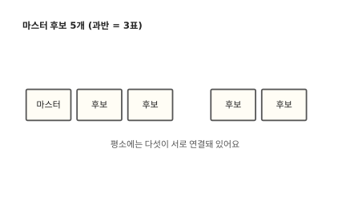

주 샤드를 올리고 in-sync 목록을 고치는 일은 마스터 노드가 해요. 마스터가 꺼지면 마스터가 될 수 있게 설정한 노드들이 투표해서 새 마스터를 정해요. 이 노드들을 마스터 후보라고 해요. 투표에 참여하는 후보의 과반을 얻어야 마스터가 돼요. 후보가 5개면 3표가 필요해요. 네트워크가 갈라지면 어떻게 될까요?

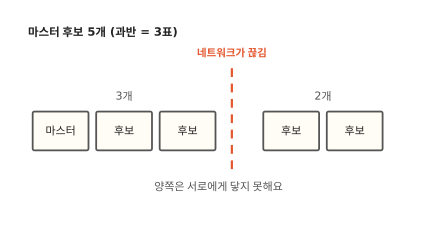

후보 5개가 네트워크로 3 대 2로 나뉘었어요. 양쪽은 서로에게 닿지 못해요. 양쪽이 각자 마스터를 뽑으면 어떻게 될까요?

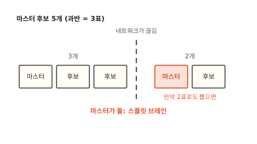

두 마스터가 서로 다른 주 샤드를 정하고 같은 문서를 따로 고치게 돼요. 이 사고를 스플릿 브레인이라고 불러요. 과반을 요구하면 어떻게 될까요?

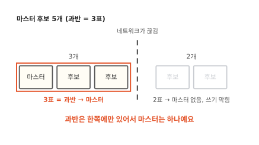

3개 쪽만 과반이라 마스터를 뽑고 2개 쪽은 기다려요. 과반은 어느 순간에도 한쪽에만 있을 수 있으니 마스터는 하나뿐이에요.

그래서 후보 수가 버틸 수 있는 고장 수를 정해요. 후보 3개면 1개, 5개면 2개가 한꺼번에 꺼져도 마스터를 뽑아요. 후보가 2개면 ES는 그중 하나만 투표에 넣어요. 그 하나가 꺼지면 마스터를 뽑지 못해요. 어느 쪽이 꺼질지는 고를 수 없으니 1개일 때와 같아요. 실험 클러스터에서 노드 3개 중 둘을 꺼 봤어요.

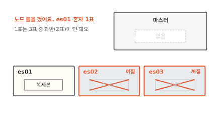

남은 노드는 1표뿐이라 마스터를 찾지 못했어요. 검색과 저장은 어떻게 됐을까요?

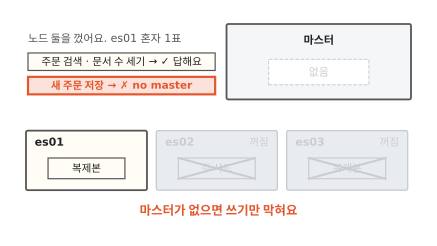

검색과 문서 수 세기는 답했고 쓰기만 `no master`로 막혔어요. 기본 설정 `cluster.no_master_block: write`가 마스터 없이는 쓰기만 막아요.

??? info "심화: 7.0 이후의 마스터 선출"
    옛 ES에서는 마스터 후보 수를 사람이 맞춰 넣었다는데 지금은 어떤지 궁금할 때 보는 칸이에요. 7.0부터 ES는 새 선출 방식을 써요. 흔히 Zen2라고 불러요. 6.x까지는 `discovery.zen.minimum_master_nodes`를 사람이 후보 수의 과반으로 맞춰 넣어야 했어요. 노드를 늘리고 이 값을 안 고치면 스플릿 브레인이 날 수 있었어요. 7.0부터는 ES가 투표 구성을 스스로 관리해요. 영어 이름은 voting configuration이에요. `cluster.initial_master_nodes`는 클러스터를 처음 만들 때 한 번만 쓰고 그 뒤에는 지워요.

    투표 구성은 후보 노드가 늘고 줄 때 자동으로 바뀌어요. 노드를 하나씩 정상적으로 빼면 그때마다 투표 구성도 줄어서 한꺼번에 꺼질 때보다 많이 빼도 버텨요. `cluster.auto_shrink_voting_configuration`(기본 true)이 켜져 있으면 후보가 짝수일 때 하나를 투표에서 빼서 홀수로 맞춰요. 후보 2개면 투표 구성은 1개예요. 투표에서 빠진 쪽이 꺼지면 괜찮아요. 투표에 든 쪽이 꺼지면 막혀요. 마스터를 맡지 않고 투표만 하는 `voting_only` 역할을 작은 노드에 주면 노드 2대에 표 하나를 더해 3표를 만들 수 있어요.

    마스터와 노드들은 1초마다 서로를 확인해요(`cluster.fault_detection.*.interval`). 응답 없는 확인이 3번 이어지면 끊긴 것으로 봐요(`retry_count`). 프로세스가 죽어 연결이 닫히면 첫 확인에서 바로 끊긴 것으로 봐요. 실험에서 몇 초 만에 새 마스터가 선 건 이쪽이에요. 선출에는 마스터용 term(클러스터 term)이 따로 있어서 옛 마스터가 돌아와도 더 큰 term을 가진 마스터의 결정을 따라요. 샤드의 primary term과는 다른 번호예요. 마스터가 없을 때 답하는 검색은 노드가 마지막으로 알던 클러스터 구성에 기대니 오래된 결과일 수 있어요. 위 설정 값들은 7.17과 9.2가 같았어요.

복사본이 노드 고장을 막아 준다는 것을 봤어요. 그러면 디스크를 아끼려고 복제본을 줄여도 될까요?

## 복제본 0은 언제 괜찮을까요?

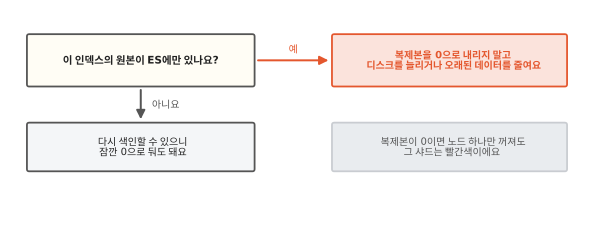

복제본이 0이면 노드 하나가 꺼질 때 그 노드의 샤드는 복사본이 없어요. 그래서 클러스터가 빨간색이 되고 그 샤드의 문서는 검색도 쓰기도 안 돼요. 디스크가 망가지면 데이터도 잃어요.

원본 데이터를 다른 곳에서 다시 색인할 수 있는 인덱스라면 잠깐 0으로 두는 건 고려할 만해요. 매일 새로 만드는 검색용 인덱스가 그런 예예요. 원본이 ES에만 있다면 디스크를 늘리거나 오래된 데이터를 줄이는 쪽을 먼저 봐요.

마스터 후보 수도 같은 눈으로 봐요. 노드 2대로 꾸린 클러스터는 투표에 든 쪽을 재시작하면 쓰기가 멈춰요. 작은 노드 하나를 `voting_only` 마스터 후보로 더해 후보를 3개로 만들어요. 그러면 어느 한 대가 꺼져도 마스터를 뽑아요.

## 다시 es03이 꺼진 장면을 볼게요

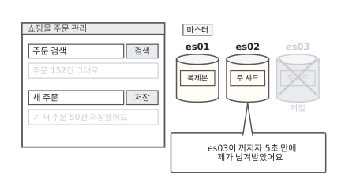

처음 장면으로 돌아왔어요. es03을 끄자 5초 만에 es02가 주 샤드를 넘겨받았고 검색도 저장도 그대로였어요. 이번에는 es02가 어떻게 넘겨받을 수 있었는지 따라가 볼게요.

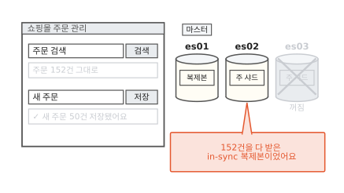

es02는 주문 152건을 모두 받은 in-sync 복제본이었어요. 마스터 es01은 es02를 주 샤드로 올리고 primary term을 2로 올렸어요. 그 뒤 새 주문 50건은 es02와 es01 두 곳에 쓰였어요. 다시 켠 es03은 어떻게 됐을까요?

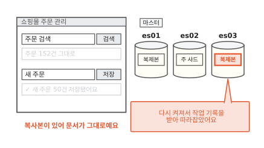

es03은 세그먼트 파일을 통째로 다시 받지 않고 작업 기록을 받아 다시 같아졌어요.

노드가 셋이든 서른이든 샤드마다 복사본을 다른 노드에 두고 번호로 맞추는 방식은 같아요.

### 이 편에서 줄여 그린 것

그림을 쉽게 하려고 실제와 다르게 줄인 곳이 세 군데 있어요.

1. 시퀀스 번호 0~9가 복사본마다 엇갈린 그림은 설명하려고 꾸민 장면이에요. 실험 클러스터에서는 처음 100건을 넣은 직후 세 복사본의 체크포인트가 모두 99로 같았어요.
2. 노드마다 주문 샤드의 복사본 하나만 그렸어요. 실제 노드에는 여러 인덱스의 샤드가 함께 들어 있어요([3편](03-routing.md)). 노드 하나가 꺼지면 그 노드에 있던 주 샤드마다 이 편의 교체가 따로 일어나요.
3. 돌아온 es03이 놓친 번호 뒤의 작업만 받는 것처럼 그렸어요. 실험에서 9.2는 놓친 52건만 받았지만 7.17은 작업 기록 202건을 전부 받았어요. 두 버전 모두 세그먼트 파일은 다시 받지 않았어요. 작업 기록을 붙들어 두는 보존 표시는 [5편](05-merge.md)에서 봐요.

### 이 편에서 새로 나온 말

![낱말 카드 열 장, 두 장씩 다섯 줄. 주 샤드: 쓰기에서 빨간 화살표로 빨간 주 샤드, 쓰기를 먼저 받는 복사본. 복제본: 주 샤드에서 빨간 화살표로 빨간 복제본, 주 샤드를 그대로 받아 적는 복사본. 시퀀스 번호: 빨간 0, 1, 2, 점 세 개, 빨간 100, 쓰기마다 0부터 하나씩 매기는 번호. 로컬 체크포인트: 5, 6, 빨간 7, 빈칸, 9, 0부터 빈틈없이 받은 마지막 번호. 글로벌 체크포인트: 길이가 다른 칸 줄 셋을 가장 짧은 줄 끝에서 가르는 빨간 점선, 세 복사본 로컬 체크포인트 가운데 가장 작은 값. in-sync 목록: 빨간 es01, es02와 회색 줄 그은 es03, 쓰기를 빠짐없이 받은 복사본 목록. primary term: 1에서 빨간 화살표로 빨간 2, 주 샤드가 바뀔 때마다 하나씩 커지는 번호. 마스터 후보: 빨간 마스터와 후보 둘, 투표해서 마스터를 뽑는 노드들. 빈 작업 (no-op): 7, 빨간 빈, 9, 빈 번호를 채우는 아무 일도 안 하는 작업. 스플릿 브레인: 점선 양쪽의 빨간 마스터 둘, 마스터가 둘 생기는 사고.](img/14/es14-cards.svg)

[^lab]: 제 컴퓨터에 띄운 ES 7.17.26 노드 3개와 9.2.0 노드 3개에서 쟀어요. 7.17.26은 docker로 띄웠고 9.2.0은 배포판을 같은 설정으로 직접 실행했어요. 노드는 두 버전 모두 `kill -9`로 껐어요. 본문의 노드 이름과 건수는 7.17 실험을 따랐어요. 시퀀스 번호 0~9로 번호를 맞추는 과정은 파이썬으로 흉내 내 확인했어요.
