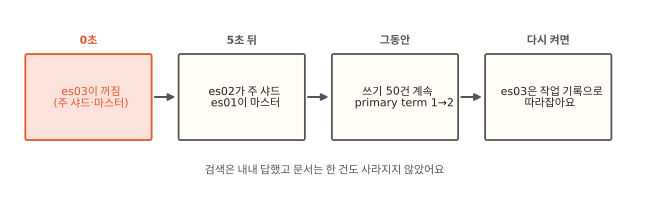
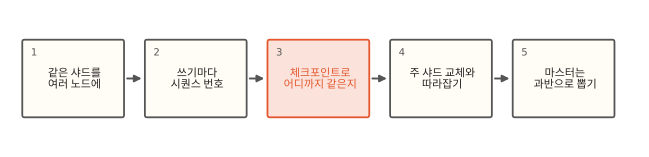
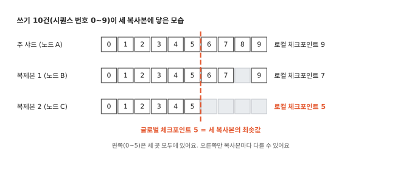

# 노드가 죽어도 왜 데이터가 안 사라질까요?

## 주 샤드가 있던 노드를 꺼 봤어요



노드 3개짜리 클러스터에 주문 인덱스를 만들었어요. 샤드는 하나이고 같은 샤드를 노드 세 곳에 하나씩 뒀어요. 주문 152건을 넣은 뒤 그 샤드의 원본이 있던 노드 es03을 강제로 껐어요. es03은 클러스터를 지휘하는 마스터 노드이기도 했어요.

5초 뒤에 보니 es02가 원본 역할을 넘겨받았고 es01이 새 마스터가 돼 있었어요. 그사이에도 검색은 152건을 그대로 답했고 쓰기 50건도 받았어요. es03을 다시 켜니 파일을 통째로 다시 받지 않고 작업 기록을 받아 다른 노드와 같아졌어요. 로컬 7.17과 9.2에서 같은 흐름이었어요.[^lab] 노드가 꺼지면 그 노드의 디스크도 같이 못 쓰게 되는데 어떻게 아무 일도 없었을까요?

## 이 편의 지도: 복사본에서 마스터 선출까지



## 같은 샤드를 여러 노드에 둬요

답부터 말하면 같은 데이터가 다른 노드에도 있어서예요. [3편](03-routing.md)에서 문서는 샤드에 나눠 담긴다고 했어요. ES는 샤드마다 복사본을 여러 개 만들어 서로 다른 노드에 둬요. 쓰기를 먼저 받는 복사본이 **주 샤드**(primary)이고 나머지는 복제본(replica)이에요. `number_of_replicas: 2`면 주 샤드 하나에 복제본 둘, 복사본이 셋이에요. 같은 샤드의 복사본 둘은 언제나 서로 다른 노드에 놓여요.

쓰기는 언제나 주 샤드가 먼저 받아요. 주 샤드는 자기 쪽에 쓴 다음 같은 작업을 복제본들에 동시에 보내고 모두 썼다는 답이 오면 그때 클라이언트에 성공을 알려요. 실험에서 쓰기 응답의 `_shards`가 `total 3, successful 3`이었어요. es03이 꺼진 동안에는 `total 3, successful 2`로 바뀌었어요. 살아 있는 두 복사본에 쓴 거예요.

검색은 복사본 아무 곳에서나 해요. 주 샤드든 복제본이든 같은 문서를 들고 있으니 [12편](12-distributed-search.md)의 조율 노드는 샤드마다 복사본 하나를 골라 물어봐요. 그런데 복사본 셋이 정말 같은지는 어떻게 알까요?

## 쓰기마다 시퀀스 번호를 매겨요

주 샤드는 쓰기마다 0부터 하나씩 커지는 번호를 붙여요. 이 번호가 시퀀스 번호(`_seq_no`)예요. 복제본은 이 번호를 그대로 받아 적어요. 쓰기 응답에도 `_seq_no`가 나와요. lab에서 문서 0~99를 넣은 뒤 다음 쓰기의 `_seq_no`는 100이었어요.

네트워크는 순서를 지켜 주지 않아요. 복제본에 7번이 6번보다 먼저 닿을 수도 있고 8번이 아직 안 닿았는데 9번이 닿을 수도 있어요. 그래서 복사본마다 "0번부터 빈틈없이 받은 마지막 번호"를 따로 적어 두고 이걸 로컬 체크포인트라고 불러요. 0~7과 9를 받은 복사본은 8이 비어 있으니 로컬 체크포인트가 7이에요.

## 체크포인트로 어디까지 같은지 알아요



주 샤드는 자기를 포함한 복사본들의 로컬 체크포인트를 모아 가장 작은 값을 따로 적어요. 이게 **글로벌 체크포인트**예요. 그림에서는 주 샤드 9, 복제본 1이 7, 복제본 2가 5라서 글로벌 체크포인트가 5예요. 0~5번은 세 복사본 모두에 있다고 확신할 수 있어요. 6번부터는 복사본마다 다를 수 있어요.

이 선 하나 덕분에 복사본을 맞출 때 일이 확 줄어요. 문서 수백만 건을 하나하나 비교할 필요 없이 글로벌 체크포인트 뒤쪽만 보면 돼요. lab의 `setup` 뒤에 보면 세 복사본의 최대 번호, 로컬 체크포인트, 글로벌 체크포인트가 모두 99로 같아요. 이 선이 실제로 쓰이는 때는 주 샤드가 사라졌을 때예요.

## 주 샤드가 죽으면 복제본이 넘겨받아요

주 샤드가 있던 노드가 꺼지면 마스터가 남은 복제본 하나를 주 샤드로 올려요. 마스터는 샤드마다 "지금까지 쓰기를 빠짐없이 받은 복사본 목록"(in-sync 목록)을 들고 있고 그 목록에 든 복사본 중에서 골라요. 성공을 알린 쓰기는 이 목록의 복사본 모두에 있으니 누가 올라가도 그 쓰기는 남아요. 실험에서 es03이 꺼진 뒤 첫 쓰기를 하자 in-sync 목록이 3개에서 2개로 줄었어요. 꺼진 복사본이 그 쓰기를 못 받아서 목록에서 빠졌어요.

주 샤드가 바뀔 때마다 **primary term**이라는 번호도 하나 커져요. 실험에서 1이 2가 됐고 그 뒤 쓰기 응답의 `_primary_term`이 2로 나왔어요. 옛 주 샤드가 네트워크만 잠깐 끊겼다가 돌아와 쓰기를 보내도 복제본은 "term 1에서 온 쓰기"를 거절해요. 주 샤드가 동시에 둘이 되는 일을 이 번호가 막아 줘요.

## 새 주 샤드가 번호를 맞춰요

체크포인트 그림에서 노드 A의 주 샤드가 꺼지고 노드 B의 복제본 1이 새 주 샤드가 됐다고 해 봐요. 글로벌 체크포인트가 5이니 0~5번은 이미 셋 다 같아요. 맞출 곳은 6~9번이에요. 노드 B에는 6, 7, 9가 있고 8이 비어 있어요. 노드 C에는 6~9가 다 비어 있어요.

새 주 샤드는 비어 있는 8번 자리를 아무 일도 하지 않는 작업(no-op)으로 채워 번호를 빈틈없이 이어요. 8번 쓰기는 노드 B와 C에 닿지 못했으니 클라이언트도 성공 응답을 받지 못한 쓰기예요. 그런 쓰기는 버려도 약속을 어기지 않아요. 그다음 6~9번을 노드 C에 보내요. 0~5번은 다시 보내지 않아요. [lab/es/14_replication.py](https://github.com/oya150/bedrock/blob/main/lab/es/14_replication.py)가 이 숫자 그대로 흉내 내요.

꺼졌던 노드가 돌아올 때도 같은 생각을 써요. 주 샤드는 돌아온 복사본이 몇 번까지 갖고 있는지 보고 그 뒤의 작업을 보내요. 그러려면 주 샤드가 그 작업 기록을 지우지 않고 갖고 있어야 해요. [5편](05-merge.md)에서 본 지운 문서 기록과 보존 표시(retention lease)가 그 기록을 남겨 둬요. 실험에서도 돌아온 복사본은 세그먼트 파일을 다시 받지 않고 작업 기록만 받았어요.

??? info "심화: 쓰기 성공의 뜻과 복사본 맞추기"
    쓰기 응답은 in-sync 목록의 복사본 모두에 쓰인 뒤에 와요. 기본값 `index.translog.durability: request`라면 그 복사본들의 translog가 모두 fsync된 뒤예요([4편](04-refresh.md)). 복제본 하나가 쓰기에 실패하면 주 샤드는 마스터에게 그 복사본을 in-sync 목록에서 빼 달라고 하고 그게 끝나야 성공을 답해요. `wait_for_active_shards`(기본 1)는 쓰기를 시작하기 전에 살아 있는 복사본 수를 확인하는 문턱이에요. 클러스터 상태에서는 `metadata.indices.<인덱스>.in_sync_allocations`와 `primary_terms`로 볼 수 있어요(두 버전 같음).

    글로벌 체크포인트는 in-sync 복사본(주 샤드 포함)의 로컬 체크포인트 최솟값이에요. 주 샤드가 쓰기 요청에 실어 복제본에 알리고 쓰기가 없으면 백그라운드로 30초마다(`index.global_checkpoint_sync.interval`) 알려요. 보존 표시도 30초마다 동기화해요(9.2 jar의 기본값으로 확인).

    돌아온 복사본을 맞추는 일은 peer recovery예요. 소스를 보면 돌아온 복사본은 먼저 자기 translog를 자기가 알던 글로벌 체크포인트까지 스스로 다시 실행하고 그 뒤를 주 샤드에서 받아요. 보존 표시가 12시간(`index.soft_deletes.retention_lease.period`) 안에 돌아오지 않은 복사본을 놓아주면 그 뒤에는 세그먼트 파일을 통째로 복사해요. `_cat/recovery`의 `files`와 `translog_ops`로 어느 쪽이었는지 보여요. 로컬에서 두 버전 모두 `kill -9`로 끈 노드를 다시 켰는데 9.2는 놓친 52건만 받았고 7.17은 202건 전부를 받았어요. 7.17에서 `_flush` 뒤에 끈 노드는 놓친 50건만 받았어요. 7.17에서 전부를 받은 원인은 확인하지 못했어요.

    마스터는 꺼진 노드의 복제본을 바로 주 샤드로 올려요. 잃은 복사본을 다른 노드에 새로 만드는 일만 1분(`index.unassigned.node_left.delayed_timeout`) 기다려요. 잠깐 재시작한 노드가 돌아와 작업 기록만 받는 편이 복사본 전체를 다른 노드로 복사하는 것보다 싸서예요. 실험에서도 es03이 1분 안에 돌아와 자기 복사본을 다시 맡았어요. 복제본이 0이라 올릴 복사본이 없으면 이 기다림과 상관없이 그 샤드는 빨간색이에요.

## 마스터는 과반이 뽑아요


주 샤드를 올리고 in-sync 목록을 고치는 일은 마스터 노드가 해요. 마스터가 꺼지면 마스터가 될 수 있게 설정한 노드들(마스터 후보)이 투표해서 새 마스터를 정해요. 투표에 참여하는 후보의 과반을 얻어야 마스터가 돼요.

과반을 요구하는 이유는 네트워크가 갈라질 때 드러나요. 후보 5개가 3 대 2로 나뉘면 3개 쪽만 과반이라 마스터를 뽑고 2개 쪽은 기다려요. 양쪽이 각자 마스터를 뽑으면 두 마스터가 서로 다른 주 샤드를 정하고 같은 문서를 따로 고치게 돼요. 이 사고를 스플릿 브레인이라고 불러요. 과반은 어느 순간에도 한쪽에만 있을 수 있어서 마스터는 하나뿐이에요.

그래서 후보 수가 버틸 수 있는 고장 수를 정해요. 후보 3개면 1개, 5개면 2개가 한꺼번에 꺼져도 마스터를 뽑아요. 후보가 2개면 한 대도 못 꺼져서 1개일 때와 같아요(왜 그런지는 아래 심화 칸에 있어요). 실험 클러스터에서 노드 3개 중 둘을 끄자 남은 노드는 마스터를 찾지 못했어요. 그래도 검색과 문서 수 세기는 답했고 쓰기만 `no master`로 막혔어요. 기본 설정 `cluster.no_master_block: write`가 마스터 없이는 쓰기만 막아요.

??? info "심화: 7.0 이후의 마스터 선출"
    7.0부터 ES는 새 선출 방식(흔히 Zen2라고 불러요)을 써요. 6.x까지는 `discovery.zen.minimum_master_nodes`를 사람이 후보 수의 과반으로 맞춰 넣어야 했고 노드를 늘리고 이 값을 안 고치면 스플릿 브레인이 날 수 있었어요. 7.0부터는 ES가 투표 구성(voting configuration)을 스스로 관리해요. `cluster.initial_master_nodes`는 클러스터를 처음 만들 때 한 번만 쓰고 그 뒤에는 지워요.

    투표 구성은 후보 노드가 늘고 줄 때 자동으로 바뀌어요. 노드를 하나씩 정상적으로 빼면 그때마다 투표 구성도 줄어서 한꺼번에 꺼질 때보다 많이 빼도 버텨요. `cluster.auto_shrink_voting_configuration`(기본 true)이 켜져 있으면 후보가 짝수일 때 하나를 투표에서 빼서 홀수로 맞춰요. 후보 2개면 투표 구성은 1개라서 투표에서 빠진 쪽이 꺼지면 괜찮고 투표에 든 쪽이 꺼지면 막혀요. 마스터를 맡지 않고 투표만 하는 `voting_only` 역할을 작은 노드에 주면 노드 2대에 표 하나를 더해 3표를 만들 수 있어요.

    마스터와 노드들은 1초마다(`cluster.fault_detection.*.interval`) 서로를 확인하고 응답 없는 확인이 3번(`retry_count`) 이어지면 끊긴 것으로 봐요. 프로세스가 죽어 연결이 닫히면 첫 확인에서 바로 끊긴 것으로 봐요. 실험에서 몇 초 만에 새 마스터가 선 건 이쪽이에요. 선출에는 마스터용 term(클러스터 term)이 따로 있어서 옛 마스터가 돌아와도 더 큰 term을 가진 마스터의 결정을 따라요. 샤드의 primary term과는 다른 번호예요. 마스터가 없을 때 답하는 검색은 노드가 마지막으로 알던 클러스터 구성에 기대니 오래된 결과일 수 있어요. 위 설정 값들은 7.17과 9.2가 같았어요.

## 정리

- 샤드마다 주 샤드와 복제본을 서로 다른 노드에 둬요. 쓰기는 주 샤드가 먼저 받고 in-sync 복사본 모두에 쓴 뒤 성공을 알려요.
- 쓰기마다 시퀀스 번호를 매기고 복사본마다 빈틈없이 받은 마지막 번호(로컬 체크포인트)를 적어요. 그 최솟값이 글로벌 체크포인트예요.
- 주 샤드가 죽으면 마스터가 in-sync 복제본을 올리고 primary term을 하나 올려요. 새 주 샤드는 글로벌 체크포인트 뒤쪽만 맞추고 돌아온 노드는 작업 기록으로 따라잡아요.
- 마스터는 투표에 참여하는 후보의 과반이 뽑아요. 후보 3개면 1개까지 꺼져도 버텨요.

## 직접 해 보기

[lab/es/14_compose.yml](https://github.com/oya150/bedrock/blob/main/lab/es/14_compose.yml)로 노드 3개를 띄우고 [lab/es/14_es.py](https://github.com/oya150/bedrock/blob/main/lab/es/14_es.py)로 복사본 위치와 체크포인트를 봐요.

```bash
docker compose -f lab/es/14_compose.yml up -d
python lab/es/14_es.py setup
docker compose -f lab/es/14_compose.yml kill es03
python lab/es/14_es.py show
```

주 샤드가 있는 노드를 꺼야 교체가 보여요. `show`가 알려 준 노드 이름으로 바꿔 끄고 `write 10`으로 `_primary_term`을 확인해 보세요. 끈 노드는 `start`로 다시 켜요.

## 확인 문제

??? question "1. 글로벌 체크포인트"
    복사본 셋의 로컬 체크포인트가 120, 118, 125예요. 글로벌 체크포인트는 몇이고 어떤 뜻일까요?

    **풀이** 가장 작은 118이에요. 0~118번 작업은 세 복사본 모두에 있다는 뜻이에요. 복사본을 맞출 때는 119번부터만 보면 돼요.

??? question "2. 후보 다섯 중 셋이 꺼지면"
    마스터 후보 노드 5개 중 3개가 한꺼번에 꺼졌어요. 남은 2개로 검색과 쓰기가 될까요?

    **풀이** 2표는 5의 과반(3표)이 안 돼서 마스터를 뽑지 못해요. 기본 설정에서는 검색은 남은 노드의 복사본으로 답하고 쓰기는 막혀요. 노드가 하나라도 돌아와 3표가 되면 마스터를 뽑고 쓰기도 다시 돼요.

??? question "3. 돌아온 옛 주 샤드"
    네트워크가 끊겨 따로 떨어진 옛 주 샤드에 클라이언트 하나가 계속 쓰기를 보냈어요. 이 쓰기는 왜 성공하지 못할까요?

    **풀이** 마스터가 이미 다른 복제본을 주 샤드로 올리고 primary term을 올렸어요. 옛 주 샤드가 복제본에 보내는 쓰기는 옛 term이라 거절돼요. 복제본에 닿지 못하니 in-sync 복사본 모두에 쓰이지 못하고 성공 응답도 나가지 않아요.

## 판단 연습

??? question "복제본 0으로 디스크 아끼기"
    운영 인덱스의 디스크가 모자라 `number_of_replicas`를 1에서 0으로 내리자는 의견이 나왔어요. 어떻게 판단할까요?

    **풀이** 복제본이 0이면 노드 하나가 꺼질 때 그 노드의 샤드는 복사본이 없어서 클러스터가 빨간색이 되고 그 샤드의 문서는 검색도 쓰기도 안 돼요. 디스크가 망가지면 데이터도 잃어요. 원본 데이터를 다른 곳에서 다시 색인할 수 있는 인덱스(예: 매일 새로 만드는 검색용 인덱스)라면 잠깐 0으로 두는 건 고려할 만해요. 원본이 ES에만 있다면 디스크를 늘리거나 오래된 데이터를 줄이는 쪽을 먼저 봐요.

??? question "노드 2대 클러스터"
    비용 때문에 노드 2대로 클러스터를 꾸렸어요. 한 대를 재시작하면 쓰기가 멈춘다는 보고가 왔어요. 왜 그렇고 어떻게 할까요?

    **풀이** 마스터 후보가 둘이면 투표 구성은 홀수로 맞추느라 한 대만 남겨요. 투표에 든 쪽을 재시작하면 과반이 없어 마스터를 못 뽑아요. 작은 노드 하나를 `voting_only` 마스터 후보로 더해 후보를 3개로 만들면 어느 한 대가 꺼져도 마스터를 뽑아요(심화 칸).

[^lab]: [lab/es/14_compose.yml](https://github.com/oya150/bedrock/blob/main/lab/es/14_compose.yml)과 [lab/es/14_es.py](https://github.com/oya150/bedrock/blob/main/lab/es/14_es.py)로 ES 7.17.26 노드 3개(docker)와 9.2.0 노드 3개(배포판을 같은 설정으로 직접 실행)에서 쟀어요. 노드는 두 버전 모두 `kill -9`로 껐어요. 파이썬 흉내는 [lab/es/14_replication.py](https://github.com/oya150/bedrock/blob/main/lab/es/14_replication.py)예요. 본문의 노드 이름과 건수는 7.17 실험을 따랐어요.
