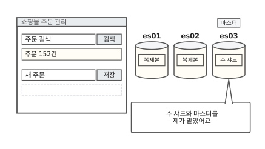
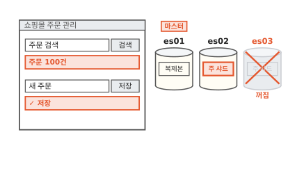
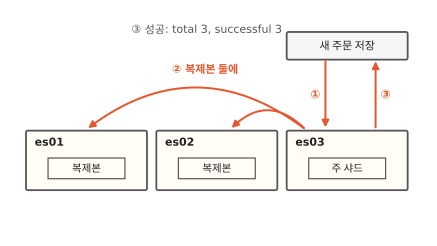
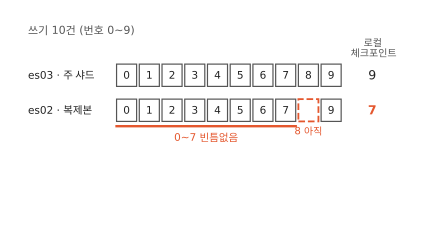
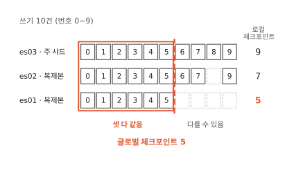
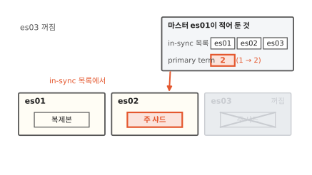
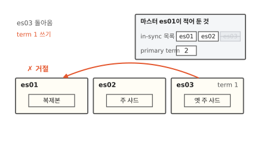
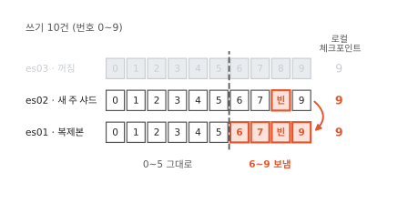
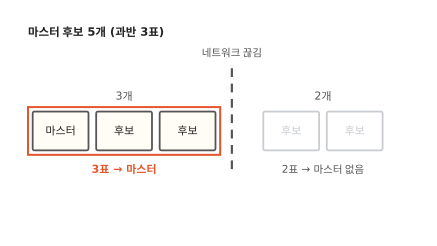

# 노드가 꺼져도 데이터가 남는 까닭: 복제본과 체크포인트

쇼핑몰 주문 기록을 노드 세 대로 꾸린 ES에 담았어요. 그런데 원본을 맡은 노드 하나가 갑자기 꺼졌어요. 이 글을 읽고 나면 ES가 같은 데이터를 여러 노드에 나눠 두는 방법과 노드가 꺼진 뒤 남은 노드끼리 다시 맞추는 방법을 알게 돼요. 이걸 알면 복제본 수와 마스터 후보 수를 몇으로 둘지 스스로 정할 수 있어요.

!!! abstract "이 글에서 알게 되는 것"
    1. ES는 같은 샤드의 복사본을 서로 다른 노드에 둬요. 쓰기는 주 샤드가 먼저 받아 복제본에 보내고 검색은 아무 복사본에서나 해요.
    2. 주 샤드는 쓰기마다 번호를 매겨요. 모든 복사본이 받은 번호가 어디까지인지 알아서 복사본을 맞출 때 그 뒤만 보면 돼요.
    3. 주 샤드가 꺼지면 마스터가 쓰기를 빠짐없이 받은 복제본을 새 주 샤드로 올려요. 마스터는 마스터 후보의 과반이 뽑아서 언제나 하나뿐이에요.

## 1. 같은 샤드를 여러 노드에 둬서 하나가 꺼져도 남아요

주문 인덱스에는 샤드가 하나 있어요. [3편](03-routing.md)에서 본 대로 문서는 샤드에 담기고 샤드는 노드에 놓여요. 이번에는 이 샤드를 노드 세 곳에 한 벌씩 뒀어요. 노드 이름은 es01, es02, es03이에요. 주문은 100건 넣었어요.

아래 그림에서 노드 원통 안의 이름표를 보세요.

**그림 1.** 같은 샤드가 세 노드에 한 벌씩 있고 es03이 주 샤드와 마스터를 맡았어요.
{ .fig-cap }

세 벌은 모두 같은 문서를 들고 있어요. 다만 하는 일이 달라요. 쓰기를 먼저 받는 한 벌을 **주 샤드**(primary)라고 해요. 나머지는 주 샤드가 받은 것을 그대로 받아 적는 **복제본**(replica)이에요. 인덱스 설정에 `number_of_replicas: 2`라고 쓰면 주 샤드 하나에 복제본이 둘 붙어요. 같은 샤드의 복사본 둘이 한 노드에 놓이는 일은 없어요. 그래서 노드 하나가 꺼져도 다른 노드에 같은 샤드가 남아요.

es03은 클러스터를 지휘하는 마스터 노드이기도 해요. 마스터는 어느 노드에 어느 샤드를 둘지, 누가 주 샤드인지 정해요. 이제 es03을 강제로 꺼 볼게요. 아래 그림에서 빨갛게 바뀐 곳을 보세요.

**그림 2.** es03이 꺼지자 es02가 주 샤드를, es01이 마스터를 넘겨받았고 검색과 저장이 모두 돼요.
{ .fig-cap }

검색은 주문 100건을 그대로 찾아 주고 새 주문도 저장돼요. es02가 주 샤드 자리를, es01이 마스터 자리를 넘겨받았거든요. 어떻게 이렇게 넘겨받는지가 이 글의 줄기예요.

여기서 복제본을 0으로 두면 어떨까 싶을 거예요. 디스크를 세 배나 쓰니까요. 복제본이 0이면 노드 하나가 꺼지는 순간 그 노드의 샤드는 복사본이 하나도 없어요. 클러스터는 빨간색이 되고 그 샤드의 문서는 검색도 쓰기도 안 돼요. 그래서 원본을 다른 곳에서 다시 색인할 수 있는 인덱스만 잠깐 0으로 둬요.

## 2. 쓰기는 주 샤드가 먼저 받고 검색은 아무 복사본에서 해요

세 벌이 늘 같은 문서를 들고 있으려면 쓰기 순서가 정해져 있어야 해요. 새 주문 하나를 저장할 때 무슨 일이 일어나는지 볼게요.

아래 그림에서 빨간 화살표를 ①, ②, ③ 차례로 따라가 보세요.

**그림 3.** 쓰기는 주 샤드가 먼저 받아 복제본 둘에 보내고 셋 다 쓴 다음에 성공을 알려요.
{ .fig-cap }

① 쓰기는 언제나 주 샤드가 먼저 받아요. ② 주 샤드는 자기 쪽에 쓴 다음 같은 작업을 복제본 둘에 한꺼번에 보내요. ③ 복제본이 모두 썼다고 답하면 그때 성공을 알려요.

쓰기 응답의 `_shards` 칸에 이 과정이 적혀 나와요. 평소에는 `total 3, successful 3`이에요. 복사본 셋 가운데 셋에 썼다는 뜻이에요. es03이 꺼져 있는 동안에는 `successful`이 2가 돼요. 살아 있는 두 벌에만 썼으니까요.

검색은 달라요. 세 벌이 같은 문서를 들고 있어서 아무 데나 물어도 돼요. 그래서 [12편](12-distributed-search.md)의 조율 노드는 샤드마다 복사본 하나를 골라 물어봐요.

그런데 정말 세 벌이 늘 같을까요? 복제본 하나가 잠깐 늦게 받거나 하나를 놓치면 어떻게 될까요?

## 3. 쓰기마다 번호를 매겨 셋 다 가진 곳까지 알아요

세 벌이 같은지 문서를 하나하나 비교하면 너무 오래 걸려요. ES는 쓰기마다 번호를 붙여서 이 일을 줄여요.

주 샤드는 쓰기를 받을 때마다 0부터 하나씩 커지는 번호를 붙여요. 이 번호를 **시퀀스 번호**라고 하고 쓰기 응답에 `_seq_no`로 나와요. 주문 100건에는 0~99가 붙었으니 다음 주문은 100번이에요. 복제본은 주 샤드가 매긴 번호를 그대로 받아 적어요.

그런데 네트워크는 순서를 지켜 주지 않아요. 복제본에 9번이 8번보다 먼저 닿을 수도 있어요. 그림을 작게 하려고 쓰기 10건, 번호 0~9만 보낸 장면으로 볼게요. 아래 그림에서 es02 줄의 빈칸을 보세요.

**그림 4.** es02는 8번이 비어 있어서 0부터 빈틈없이 받은 마지막 번호가 7이에요.
{ .fig-cap }

es02는 9번을 받았지만 8번이 아직 안 왔어요. 이럴 때 "9번까지 받았다"고 하면 틀려요. 그래서 복사본마다 0부터 빈틈없이 받은 마지막 번호를 따로 적어 둬요. 이걸 **로컬 체크포인트**라고 해요. es02는 7이고 다 받은 주 샤드 es03은 9예요.

이제 세 번째 복사본 es01도 넣어 볼게요. es01은 0~5번까지만 받았어요. 세 벌이 모두 가진 번호는 어디까지일까요? 아래 그림에서 빨간 점선을 보세요.

**그림 5.** 로컬 체크포인트 9, 7, 5 가운데 가장 작은 5가 글로벌 체크포인트이고 그 앞은 세 벌이 같아요.
{ .fig-cap }

주 샤드는 복사본들의 로컬 체크포인트를 모아요. 자기 것도 함께 모아서 가장 작은 값을 따로 적어요. 이 값이 **글로벌 체크포인트**예요. 9, 7, 5 가운데 가장 작은 5예요.

이 값 하나로 0~5번은 세 벌 모두에 있다고 확신할 수 있어요. 6번부터는 복사본마다 다를 수 있고요. 그래서 세 벌을 맞출 때 글로벌 체크포인트 뒤쪽만 보면 돼요. 이 선을 실제로 쓰는 때는 주 샤드가 사라졌을 때예요.

## 4. 주 샤드가 꺼지면 쓰기를 빠짐없이 받은 복제본이 넘겨받아요

1절의 장면으로 돌아가요. es03이 꺼지자 es01이 새 마스터가 됐어요. 마스터를 어떻게 뽑는지는 6절에서 봐요. 새 마스터가 할 일은 주 샤드를 새로 정하는 거예요. 아무 복제본이나 올리면 될까요?

마스터는 샤드마다 지금까지 쓰기를 빠짐없이 받은 복사본 목록을 들고 있어요. 이걸 **in-sync 목록**이라고 해요. 2절에서 쓰기는 이 목록에 든 복사본이 모두 쓴 다음에야 성공을 알렸어요. 그러니 성공을 알린 쓰기는 이 목록의 어느 복사본에나 있어요. 목록에서 누구를 올려도 성공한 쓰기는 사라지지 않아요.

아래 그림에서 마스터가 적어 둔 상자와 es02를 보세요.

**그림 6.** 마스터는 in-sync 목록에서 es02를 골라 주 샤드로 올리고 primary term을 1에서 2로 올려요.
{ .fig-cap }

마스터는 in-sync 목록에서 살아 있는 es02를 골라 주 샤드로 올렸어요. 이때 **primary term**이라는 번호도 하나 올려요. 주 샤드가 바뀔 때마다 하나씩 커지는 번호예요. 1이던 것이 2가 됐어요. 그 뒤 쓰기 응답에는 `_primary_term: 2`가 나와요.

es03은 꺼진 뒤 첫 쓰기가 들어올 때 목록에서 빠져요. 그 쓰기를 받지 못했으니까요. 목록에서 빠진 복사본은 주 샤드 후보가 되지 못해요.

primary term은 왜 필요할까요? es03이 꺼지지 않고 네트워크만 잠깐 끊겼다가 돌아왔다고 해 봐요. es03은 자기가 아직 주 샤드인 줄 알고 복제본 es01에 쓰기를 보내요. 아래 그림에서 그 쓰기가 어떻게 되는지 보세요.

**그림 7.** term 2를 이미 받은 es01은 term 1에서 온 옛 주 샤드의 쓰기를 거절해요.
{ .fig-cap }

es01은 이미 term 2를 알고 있어요. 그래서 term 1을 달고 온 쓰기는 옛 주 샤드가 보낸 것으로 보고 거절해요. 이 번호 덕분에 주 샤드가 동시에 둘이 되는 일이 없어요.

## 5. 새 주 샤드는 글로벌 체크포인트 뒤만 맞춰요

주 샤드가 바뀌었으니 남은 두 벌을 다시 맞춰야 해요. 3절의 번호 칸에서 es03이 꺼지고 es02가 새 주 샤드가 됐다고 해 볼게요.

글로벌 체크포인트가 5였으니 0~5번은 이미 셋 다 같아요. 맞출 곳은 6~9번뿐이에요. es02는 8번이 비어 있고 es01은 6~9번이 비어 있어요.

먼저 es02의 빈 8번 자리를 봐요. 8번 쓰기는 es02와 es01 어느 쪽에도 닿지 못했어요. 그러니 클라이언트도 성공 응답을 받지 못한 쓰기예요. 성공을 알리지 않은 쓰기는 버려도 약속을 어기지 않아요. 새 주 샤드는 8번 자리를 아무 일도 하지 않는 작업으로 채워요. 이걸 **빈 작업**(no-op)이라고 해요. 이렇게 하면 번호가 빈틈없이 이어져요.

그다음 es02가 6~9번을 es01에 보내요. 아래 그림에서 빨간 칸을 보세요.

**그림 8.** 8번은 빈 작업으로 채우고 6~9번만 es01에 보내서 두 벌의 로컬 체크포인트가 모두 9가 돼요.
{ .fig-cap }

0~5번은 다시 보내지 않아요. 이제 es02와 es01 모두 로컬 체크포인트가 9예요.

꺼졌던 es03이 다시 켜질 때도 같은 방법을 써요. es03은 복제본으로 돌아와요. 주 샤드 es02는 es03이 몇 번까지 갖고 있는지 보고 그 뒤의 작업만 보내요. 그러려면 es02에 그 작업 기록이 남아 있어야 해요. [5편](05-merge.md)에서 본 대로 ES는 복제본에 보낼 기록을 병합한 뒤에도 한동안 남겨 둬요. 그래서 es03은 세그먼트 파일을 통째로 다시 받지 않아요. 다 따라잡으면 in-sync 목록에 다시 들어가요. 너무 오래 꺼져 있어서 기록이 지워진 다음에 돌아오면 그때는 파일을 통째로 복사해요.

## 6. 마스터는 과반이 뽑아서 하나뿐이에요

지금까지 주 샤드를 올리고 in-sync 목록을 고치는 일은 모두 마스터가 했어요. 그럼 마스터가 꺼지면 새 마스터는 누가 정할까요?

마스터가 될 수 있게 설정한 노드들이 투표해서 정해요. 이 노드들을 **마스터 후보**라고 해요. 후보 전체의 과반을 얻어야 마스터가 돼요. 후보가 5개면 3표가 필요해요.

과반을 요구하는 까닭은 네트워크가 갈라질 때 보여요. 후보 5개가 3개와 2개로 나뉘어 서로 닿지 못한다고 해 봐요. 양쪽이 각자 마스터를 뽑으면 마스터가 둘이 돼요. 두 마스터가 서로 다른 주 샤드를 정하고 같은 문서를 따로 고치게 돼요. 이 사고를 **스플릿 브레인**이라고 해요.

아래 그림에서 빨간 테두리가 어느 쪽에 있는지 보세요.

**그림 9.** 3개 쪽만 과반이라 마스터를 뽑고 2개 쪽은 마스터 없이 기다려요.
{ .fig-cap }

3표는 과반이라 3개 쪽은 마스터를 뽑아요. 2개 쪽은 과반이 안 돼서 기다려요. 과반은 어느 순간에도 한쪽에만 있을 수 있어요. 그래서 마스터는 언제나 하나예요.

후보 수에 따라 버틸 수 있는 고장 수가 정해져요. 후보 3개면 1개, 5개면 2개가 한꺼번에 꺼져도 마스터를 뽑아요. 이 글의 노드 세 대에서 둘이 꺼지면 남은 1표로는 마스터를 뽑지 못해요. 마스터가 없으면 기본 설정 `cluster.no_master_block: write`에 따라 쓰기만 막혀요. 검색은 답하지만 새 주문 저장은 `no master` 오류가 나요.

후보가 2개면 ES는 그중 하나만 투표에 넣어요. 투표에 든 쪽이 꺼지면 막히니 후보가 하나일 때와 다르지 않아요. 노드 두 대로 꾸린 클러스터라면 투표만 하는 작은 노드(`voting_only` 마스터 후보)를 하나 더해 후보를 3개로 만들어요. 그러면 어느 한 대가 꺼져도 마스터를 뽑아요.

ES 6.x까지는 이 과반 값을 사람이 설정에 맞춰 넣어야 했어요. 노드를 늘리고 값을 안 고치면 스플릿 브레인이 날 수 있었어요. 7.0부터는 투표에 드는 노드를 ES가 스스로 관리해요.

## 정리

ES는 같은 샤드의 복사본을 서로 다른 노드에 둬요. 주 샤드가 쓰기를 먼저 받아 복제본에 보내고 in-sync 목록의 복사본이 모두 쓴 다음에 성공을 알려요. 검색은 아무 복사본에서나 해요.

주 샤드는 쓰기마다 번호를 매겨요. 복사본들의 로컬 체크포인트 가운데 가장 작은 값이 글로벌 체크포인트이고 그 앞은 모든 복사본이 같아요. 그래서 es03이 꺼졌을 때 새 주 샤드 es02는 글로벌 체크포인트 뒤만 맞췄어요. 마스터는 후보의 과반이 뽑아서 언제나 하나뿐이에요.

다음 [15편](15-hnsw.md)에서는 낱말이 달라도 뜻이 비슷한 문서를 찾는 벡터 검색을 봐요.

### 새로 나온 말

- **주 샤드**(primary): 같은 샤드의 복사본 가운데 쓰기를 먼저 받는 한 벌.
- **복제본**(replica): 주 샤드가 받은 쓰기를 그대로 받아 적는 복사본.
- **시퀀스 번호**: 주 샤드가 쓰기마다 0부터 하나씩 매기는 번호.
- **로컬 체크포인트**: 복사본 하나가 0부터 빈틈없이 받은 마지막 번호. 8번이 빈 es02는 7이었어요.
- **글로벌 체크포인트**: 복사본들의 로컬 체크포인트 가운데 가장 작은 값. 9, 7, 5 가운데 5였어요.
- **in-sync 목록**: 마스터가 샤드마다 적어 둔 목록으로, 쓰기를 빠짐없이 받은 복사본이 들어 있어요.
- **primary term**: 주 샤드가 바뀔 때마다 하나씩 커지는 번호. es02가 주 샤드가 되면서 1에서 2가 됐어요.
- **빈 작업**(no-op): 비어 있는 번호 자리를 채우는 작업으로, 아무 일도 하지 않아요. es02의 8번 자리를 채웠어요.
- **마스터 후보**: 투표해서 마스터를 뽑는 노드들.
- **스플릿 브레인**: 네트워크가 갈라져 마스터가 둘 생기는 사고.
