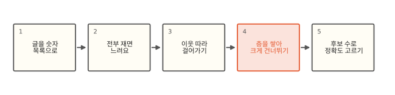
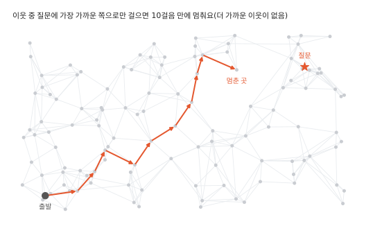
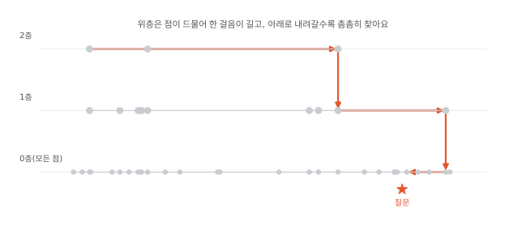
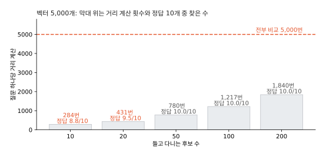

# 벡터 검색은 어떻게 비슷한 걸 찾을까요?

!!! note "버전 안내"
    이 편의 근사 벡터 검색은 ES 8.0부터 있어요. 8.0~8.3에는 따로 떨어진 `_knn_search` API였고 본문 예시처럼 `_search` 요청에 `knn`을 넣는 방식은 8.4부터예요. 7.17에도 `dense_vector` 필드는 있지만 모든 문서와 거리를 재는 정확한 검색(`script_score`)만 돼요. 로컬 7.17.26에 `knn`을 보내면 `parsing_exception`이 났어요. 본문의 HNSW 원리는 8.x와 9.x에 같아요.

## 글자가 하나도 안 겹치는 질문을 찾아야 해요

![세 상자가 화살표로 이어져 있다. 질문 "비밀번호를 잊어버렸어요" [0.12, -0.80, 0.33, …], 저장된 질문 20,000개 "암호 재설정은 어디서 하나요" 글자는 하나도 안 겹쳐요, 빨간 상자 숫자 목록끼리 가장 가까운 10개. 아래에 20,000개와 모두 거리를 재야 할까요?](img/15/es15-open.svg)

고객센터 검색에 "비밀번호를 잊어버렸어요"가 들어왔어요. 저장된 질문 중 가장 비슷한 건 "암호 재설정은 어디서 하나요"인데 겹치는 낱말이 하나도 없어요. [1편](01-inverted-index.md)의 역색인은 낱말이 겹쳐야 찾으니 이 질문을 찾지 못해요.

요즘은 이런 글을 숫자 목록으로 바꿔 둬요. 문장을 받아 뜻이 비슷하면 가까운 숫자 목록을 내주는 모델(임베딩 모델)이 있어요. 이 숫자 목록을 **벡터**라고 불러요. 목록에 든 숫자 개수가 차원이에요. 모델이 정하고 보통 수백~수천 개예요. 두 벡터 사이의 거리가 가까우면 뜻이 비슷한 글이에요. 이제 남은 일은 질문 벡터와 가장 가까운 벡터 10개를 찾는 거예요. 저장된 벡터가 20,000개면 20,000개와 모두 거리를 재야 할까요?[^lab]

## 숫자 목록에서 후보 수 고르기까지



## 전부 재면 정확하지만 느려요

가장 쉬운 방법은 모든 벡터와 거리를 재고 가까운 10개를 고르는 거예요. 7.17에서도 되는 `script_score` 검색(문서마다 스크립트로 점수를 계산하는 검색)이 이렇게 해요. 답은 언제나 정확해요. 대신 일이 문서 수에 그대로 비례해요. 벡터가 20,000개면 질문 하나에 거리를 20,000번 재고 1,000만 개면 1,000만 번 재요. 벡터 하나가 수백 개의 숫자라서 한 번 재는 일도 가볍지 않아요.

[11편](11-bkd.md)의 BKD 트리로 줄일 수는 없을까요? Lucene의 BKD는 나누는 기준이 되는 차원을 8개까지만 받아서 수백 차원 벡터는 담지 못해요. 담을 수 있다 해도 차원이 많아지면 질문 근처의 칸이 거의 모든 칸과 가까워져서 버릴 칸이 남지 않아요. 그래서 정확한 답을 조금 내주는 대신 훨씬 적게 재는 방법을 써요.

## 이웃을 따라 걸어가요



벡터마다 가까운 벡터 몇 개를 이웃으로 미리 이어 둬요. 그러면 점들이 길로 이어진 그물이 돼요. 질문이 오면 아무 점에서 출발해서 이웃 중 질문에 가장 가까운 점으로 옮겨 가요. 더 가까운 이웃이 없을 때까지 반복해요. 한 걸음마다 지금 점의 이웃 몇 개만 재면 되니 전체를 재는 것보다 훨씬 적게 재요.

그런데 그림처럼 길이 질문까지 이어지지 않으면 엉뚱한 곳에서 멈춰요. 이웃 중에 더 가까운 점이 없을 뿐 진짜 가까운 점은 저 멀리 있어요. 첫 번째 요령은 후보를 여러 개 들고 다니는 거예요. 가까운 점을 예컨대 50개까지 기억해 두고 그 후보들의 이웃을 차례로 둘러봐요. 한 길이 막혀도 다른 후보에서 이어지는 길로 빠져나갈 수 있어요. 두 번째 요령은 층이에요.

## 층을 쌓아 크게 건너뛰어요



맨 아래층에는 모든 점이 있고 위로 갈수록 점을 드문드문 뽑아 따로 이어 둬요. 점마다 몇 층까지 올라갈지는 무작위로 정해요. 한 층 오를 확률이 이웃 수(아래 `m`)분의 1쯤이라서 파이썬으로 벡터 5,000개를 넣으니 층별 점 수가 5,000, 291, 17, 1이었어요. 위층은 점이 적어서 이웃끼리 거리가 멀고 한 걸음에 멀리 가요.

질문이 오면 맨 위층에서 질문 쪽으로 크게 몇 걸음 간 다음 한 층 내려가 그 자리에서 다시 걸어요. 맨 아래층에 닿았을 때는 이미 질문 근처라서 짧게 둘러보면 돼요. 고속도로로 근처까지 가서 골목으로 들어가는 모습과 닮았어요. 다만 고속도로와 달리 위층의 점은 아래층에도 모두 있어서 내려갈 때 같은 점에서 그대로 이어 걸어요.

이렇게 층(Hierarchical)을 쌓은, 가까운 점끼리 이은 그물(Navigable Small World)을 **HNSW**라고 불러요. Malkov와 Yashunin이 2016년에 공개한 방법이에요. 파이썬으로 5,000개에서 후보 50개를 들고 찾으면 질문 하나에 거리를 평균 780번 쟀고 정답 10개를 모두 찾았어요. 전부 비교하면 5,000번이에요. 벡터를 1,000개, 5,000개, 20,000개로 늘려 보니 거리 계산은 515번, 780번, 953번이었어요. 벡터가 20배 늘어도 일은 2배도 안 늘었어요.

## 후보 수로 정확도를 골라요



HNSW는 정답을 놓칠 수 있어요. 들고 다니는 후보가 적으면 빨리 끝나지만 놓치는 게 늘어요. 파이썬에서 후보 10개면 정답 10개 중 평균 8.8개를 찾았고 후보 50개부터는 10개를 다 찾았어요. 후보를 늘린 만큼 거리를 재는 일도 늘었어요.

ES에서는 이 후보 수가 `num_candidates`예요. `k`는 돌려받을 개수예요. `k: 10, num_candidates: 50`이면 후보 50개를 들고 그래프를 걸은 다음 그중 가까운 10개를 돌려줘요. 후보 모으기는 샤드마다 따로 해요. 필드는 `dense_vector`로 만들어요.

```json
PUT faq
{"mappings": {"properties": {"v": {"type": "dense_vector", "dims": 16, "index": true,
  "similarity": "l2_norm", "index_options": {"type": "hnsw"}}}}}

POST faq/_search
{"knn": {"field": "v", "query_vector": [0.12, -0.8, 0.33, 0.5, -0.1, 0.9, 0.0, -0.4,
         0.2, 0.7, -0.6, 0.1, 0.3, -0.2, 0.8, -0.5], "k": 10, "num_candidates": 50}}
```

로컬 9.2에서 16차원 벡터 20,000개를 이렇게 넣고 정확한 답과 비교하니 `num_candidates` 10은 정답 10개 중 7.9개, 50은 9.9개, 100은 10.0개를 찾았어요. `index_options`를 빼면 ES가 벡터를 압축해서 넣는데 그때는 숫자가 달라져요(아래 심화 칸).

벡터 필드는 색인도 무거워요. 그래프는 문서를 넣을 때 짓고 세그먼트를 합칠 때 다시 이어야 해요. 검색을 빠르게 하려면 벡터가 파일 캐시에 들어갈 만큼 메모리도 있어야 해요. 압축하지 않은 벡터의 크기는 벡터 수 × 차원 × 4바이트로 어림해요. 768차원 벡터 1,000만 개면 약 30 GB예요.

??? info "심화: Lucene HNSW와 ES의 구현"
    HNSW는 Lucene 9.0(ES 8.0)에 들어왔어요. 그래프는 세그먼트마다 따로 만들어요. 검색은 세그먼트마다 그래프를 걸어 후보를 모으고 합쳐서 위를 골라요. 세그먼트 수만큼 일이 곱으로 늘어서 더 쓰지 않는 인덱스는 `forcemerge`로 세그먼트를 줄이면 knn이 빨라져요. [5편](05-merge.md)의 병합 때는 그래프를 다시 이어요. Elastic 블로그에 따르면 8.8 무렵부터 삭제 문서가 없는 가장 큰 세그먼트의 그래프를 그대로 가져오고 나머지 벡터만 넣어요. 그래도 병합 비용이 벡터 수에 따라 커요. 벡터와 그래프 파일은 힙 밖에서 운영체제 파일 캐시로 읽어서 힙을 키워도 빨라지지 않아요. 노드 메모리에서 힙을 뺀 몫이 캐시예요.

    그래프 모양은 `index_options`의 `m`(점마다 이웃 수, 기본 16)과 `ef_construction`(지을 때 들고 다니는 후보 수, 기본 100)이 정해요(9.2 매핑에서 확인, 7.17에는 이 옵션이 없어요). 크게 줄수록 정답을 덜 놓치지만 색인이 느려지고 메모리를 더 써요. `knn` 안에 `filter`를 주면 그래프를 걷는 동안 조건에 맞는 문서만 결과로 모아서 `k`개를 채워요. 조건에 맞는 문서가 아주 적으면 Lucene이 그래프 걷기를 그만두고 맞는 문서를 모두 재요. 바깥 `post_filter`로 거르면 `k`개를 찾은 뒤에 빼서 결과가 `k`개보다 적어질 수 있어요.

??? info "심화: 압축(양자화)과 다시 재기"
    9.2에서 `index_options`를 주지 않으면 16차원 필드는 `int8_hnsw`, 384차원 이상 필드는 `bbq_hnsw`(기본 `rescore_vector` oversample 3)가 됐어요(로컬 매핑으로 확인). 기본값은 버전마다 바뀌어 왔으니 쓰는 버전에서 `GET <인덱스>/_mapping`으로 꼭 확인하세요.

    `int8_hnsw`는 숫자를 4바이트 실수에서 1바이트 정수로 줄인 사본을 따로 두고 그래프를 이 값으로 걸어요. 검색 때 읽는 양이 4분의 1로 줄어요. 원래 실수 값도 디스크에 남겨 두니 디스크는 조금 늘어요. 거리가 조금씩 틀려서 순위가 흔들려요. 로컬의 16차원 무작위 벡터에서는 `num_candidates`를 100으로 올려도 정답 10개 중 8.3~8.4개에 머물렀어요. 압축 없는 `hnsw`는 10.0개였어요. 무작위 저차원 벡터라 많이 틀린 편이고 수백 차원의 실제 임베딩에서는 덜 틀려요.

    `rescore_vector: {"oversample": 3}`을 주면 압축된 값으로 `k`의 3배를 찾은 다음 디스크의 원래 실수 값으로 다시 재서 순위를 고쳐요. 같은 인덱스에서 `num_candidates` 50이면 10.0개를 찾았어요. 9.2에서 확인한 옵션이고 8.x에서는 쓸 수 없는 버전이 있어요. 이 편의 lab처럼 정확한 답과 비교해 보고 정하세요.

## 정리

- 글을 임베딩 모델로 벡터(숫자 목록)로 바꾸면 낱말이 안 겹쳐도 뜻이 비슷한 글을 거리로 찾을 수 있어요.
- 모든 벡터와 거리를 재면 정확하지만 문서 수만큼 일이 들어요.
- HNSW는 가까운 점끼리 이은 그물을 층으로 쌓아 위층에서 크게 건너뛰고 아래층에서 촘촘히 찾아요. 벡터가 늘어도 일이 조금만 늘어요.
- 정답을 놓칠 수 있어서 `num_candidates`로 속도와 정확도 사이를 골라요.

## 직접 해 보기

[lab/es/15_hnsw.py](https://github.com/oya150/bedrock/blob/main/lab/es/15_hnsw.py)는 ES 없이 HNSW를 직접 만들어 후보 수마다 거리 계산 횟수와 찾은 정답 수를 세요(`sizes`를 붙이면 벡터 수별로). [lab/es/15_es.py](https://github.com/oya150/bedrock/blob/main/lab/es/15_es.py)는 벡터 20,000개를 넣고 `script_score`의 정확한 답과 `knn`의 답을 비교해요. 7.17에 보내면 정확한 검색만 되는 것도 볼 수 있어요.

```bash
ES=http://localhost:9200 python lab/es/15_es.py
```

## 확인 문제

??? question "1. 막다른 곳"
    이웃 중 질문에 가장 가까운 점 하나만 따라 걸었더니 질문과 먼 곳에서 멈췄어요. HNSW는 이걸 어떻게 줄일까요?

    **풀이** 후보를 여러 개 들고 다녀서 한 길이 막히면 다른 후보의 이웃으로 이어 가요. 위층에서 크게 건너뛰어 질문 근처에서 맨 아래층 걷기를 시작하는 것도 도움이 돼요. 그래도 놓칠 수 있어서 ES에서는 `num_candidates`를 키워 확인해요.

??? question "2. k와 num_candidates"
    `k: 10, num_candidates: 10`과 `k: 10, num_candidates: 100`은 무엇이 다를까요?

    **풀이** 둘 다 10개를 돌려줘요. 앞쪽은 후보를 10개만 들고 걸어서 빠르지만 정답을 더 많이 놓쳐요. 뒤쪽은 후보 100개를 들고 걸으니 더 많이 재요. 로컬 9.2의 압축 없는 인덱스에서 정답 10개 중 7.9개와 10.0개를 찾았어요.

??? question "3. 7.17에서 벡터 검색"
    7.17 클러스터에 `dense_vector` 필드가 있어요. 문서 수백만 개에서 비슷한 벡터를 빠르게 찾을 수 있을까요?

    **풀이** 7.17에는 HNSW가 없어서 `script_score`로 모든 문서와 거리를 재야 해요. 문서 수백만 개면 질문마다 수백만 번 재요. `script_score`의 `query`에 다른 조건(카테고리, 기간 등)을 걸면 그 조건에 맞는 문서만 재니 일을 줄일 수 있어요. 근본적으로는 8.x 이후로 올려 `knn`을 써요.

## 판단 연습

??? question "벡터 검색만으로 충분할까"
    상품 검색을 벡터 검색으로 모두 바꾸자는 의견이 나왔어요. "아이폰 15 프로 256GB"처럼 모델명을 정확히 치는 손님도 많아요. 어떻게 판단할까요?

    **풀이** 벡터는 뜻이 비슷한 걸 잘 찾지만 모델명, 숫자, 코드처럼 글자가 정확히 맞아야 하는 질의에는 약해요. "256GB"와 "512GB"는 뜻이 비슷한 말이라 벡터로는 가까울 수 있어요. 1편의 역색인과 [8편](08-bm25.md)의 BM25 검색을 그대로 두고 벡터 검색 결과를 함께 섞는 방식을 먼저 검토해요. 바꾸기 전에 실제 검색어 표본으로 두 방식의 결과를 나란히 놓고 비교해요.

??? question "색인이 갑자기 느려졌어요"
    상품 인덱스에 768차원 `dense_vector` 필드를 더한 뒤 색인 속도가 몇 배 느려지고 메모리 경고가 났어요. 무엇을 볼까요?

    **풀이** 문서를 넣을 때와 세그먼트를 합칠 때 HNSW 그래프를 잇느라 색인이 무거워져요. 벡터 크기를 벡터 수 × 768 × 4바이트로 어림해서 노드 메모리(힙을 뺀 몫)와 비교해요. 그다음 매핑의 압축 방식(`index_options`)과 refresh 간격을 확인해요(심화 칸).

[^lab]: [lab/es/15_hnsw.py](https://github.com/oya150/bedrock/blob/main/lab/es/15_hnsw.py)는 파이썬 흉내이고, ES 숫자는 [lab/es/15_es.py](https://github.com/oya150/bedrock/blob/main/lab/es/15_es.py)로 ES 9.2.0에서 쟀어요. 7.17.26에서는 `knn`이 없는 것을 확인했어요. 논문: Malkov·Yashunin, "Efficient and robust approximate nearest neighbor search using Hierarchical Navigable Small World graphs"(arXiv:1603.09320, 2016, IEEE TPAMI 2020).
