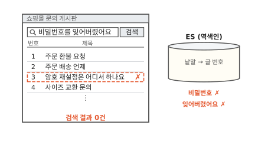
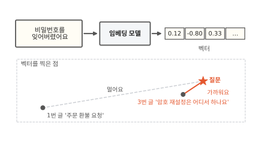
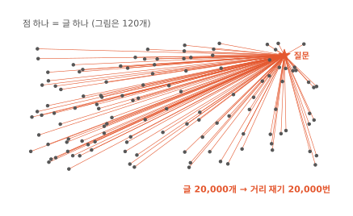
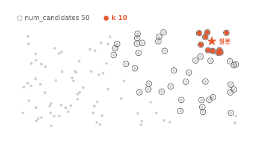
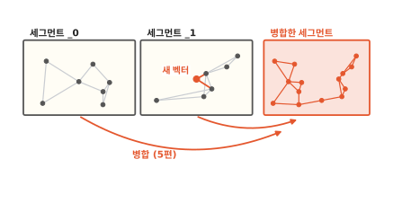
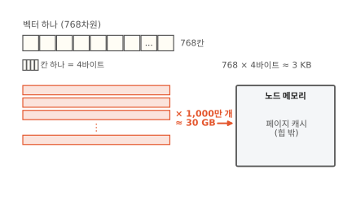

# HNSW: 벡터 검색이 뜻이 비슷한 글을 빨리 찾는 길

손님이 쇼핑몰 문의 게시판에서 "비밀번호를 잊어버렸어요"를 검색했는데 결과가 0건이에요. 게시판에는 "암호 재설정은 어디서 하나요"라는 딱 맞는 글이 있는데도요. 이 글을 읽고 나면 낱말이 하나도 안 겹치는 글을 뜻으로 찾는 벡터 검색과 그 검색을 빠르게 만드는 HNSW를 알게 돼요. 이 방법이 무엇을 내주고 빨라지는지 알아야 벡터 검색을 언제 쓸지 고를 수 있어요. HNSW로 찾는 벡터 검색은 ES 8.0부터 쓸 수 있어요.[^ver]

!!! abstract "이 글에서 알게 되는 것"
    1. 글을 숫자 목록(벡터)으로 바꾸면 낱말이 안 겹쳐도 거리로 뜻이 가까운 글을 찾아요. 모든 벡터와 거리를 재면 정확하지만 벡터 수만큼 재야 해요.
    2. HNSW는 가까운 벡터끼리 이어 둔 그물을 층으로 쌓아요. 위층에서 크게 건너뛰고 아래층에서 촘촘히 둘러봐서 몇 개만 재고 가까운 글에 닿아요.
    3. 대신 정답을 놓칠 수 있고 색인이 무거워지고 벡터가 메모리에 들어가야 빨라요.

## 1. 글을 벡터로 바꾸면 낱말이 안 겹쳐도 거리로 찾아요

쇼핑몰 문의 게시판에 글이 20,000개 쌓였어요. 손님이 "비밀번호를 잊어버렸어요"를 쳤어요. ES는 역색인에서 "비밀번호"나 "잊어버렸어요"가 든 글을 찾아요. 아래 그림에서 3번 글을 보세요.


**그림 1.** 3번 글이 딱 맞는 답인데 두 낱말 중 어느 것도 들어 있지 않아서 결과가 0건이에요.
{ .fig-cap }

역색인은 낱말이 겹쳐야 찾아요. "비밀번호"와 "암호"는 뜻이 같은데 글자가 달라요. 그래서 3번 글은 영영 안 나와요.

여기서 이런 생각이 들 거예요. 뜻이 비슷한지는 사람이 보면 아는데 프로그램은 그걸 어떻게 알까요? 요즘은 문장을 받아 숫자 목록을 내주는 모델을 써요. 뜻이 비슷한 문장일수록 비슷한 숫자 목록을 내주도록 미리 학습시킨 모델이에요. 이 모델을 임베딩 모델이라고 불러요. 그리고 이 숫자 목록을 **벡터**라고 해요. 목록에 든 숫자 개수는 차원이라고 하는데 모델이 정해요. 보통 수백에서 수천 개예요.

숫자 목록은 점으로 찍을 수 있어요. 숫자가 두 개면 종이 위의 점 하나예요. 아래 그림에서 질문의 점이 어느 글 가까이에 찍혔는지 보세요.


**그림 2.** 질문은 3번 글 바로 옆에 찍히고 1번 글 "주문 환불 요청"과는 멀리 떨어져요.
{ .fig-cap }

두 점 사이의 거리가 가까우면 뜻이 비슷한 글이에요. 그러니 글 20,000개를 모두 벡터로 바꿔 넣어 두고 질문 벡터와 가장 가까운 벡터 몇 개를 찾으면 돼요. 이렇게 찾는 검색을 벡터 검색이라고 해요. 실제 벡터는 숫자가 수백 개라서 이 글의 그림은 숫자 두 개짜리 점으로 줄여 그렸어요.

## 2. 모든 벡터와 거리를 재면 정확하지만 벡터 수만큼 재요

가장 가까운 벡터를 찾는 가장 쉬운 방법은 모든 벡터와 거리를 재는 거예요. 아래 그림에서 질문에서 뻗은 선을 보세요.


**그림 3.** 질문에서 모든 점으로 선을 그어 거리를 재요. 글이 20,000개면 20,000번 재요.
{ .fig-cap }

다 잰 다음 가장 가까운 10개를 고르니 답은 언제나 정확해요. 대신 글이 1,000만 개면 질문 하나에 1,000만 번 재요. 벡터 하나가 숫자 수백 개라서 한 번 재는 일도 가볍지 않아요. ES에서는 `script_score` 검색이 이렇게 해요. 문서마다 스크립트로 점수를 계산하는 검색이에요.

그래서 벡터 검색은 다른 길을 골라요. 정답을 아주 조금 놓칠 수 있는 대신 훨씬 적게 재는 길이에요.[^bkd]

## 3. 이웃을 따라 걸으면 몇 개만 재고 가까이 가요

모든 점을 재지 않으려면 어디부터 볼지 알아야 해요. 그래서 벡터를 넣을 때 가까운 벡터 몇 개를 이웃으로 미리 이어 둬요. 점과 점이 선으로 이어진 그물이 생겨요. 이런 그물을 **그래프**라고 해요.

질문이 오면 한 점에서 출발해요. 지금 점의 이웃들과 거리를 재서 질문에 가장 가까운 이웃으로 옮겨요. 한 걸음에 이웃 몇 개만 재면 되니까 모든 점을 재는 것보다 훨씬 적게 재요. 더 가까운 이웃이 없으면 멈춰요. 아래 그림에서 1번 글의 점에서 출발한 화살표가 어디서 멈추는지 보세요.


**그림 4.** 열 걸음을 걸었는데 질문과 먼 곳에서 멈췄어요.
{ .fig-cap }

멈춘 곳의 이웃은 모두 지금 점보다 질문에서 멀었어요. 그래서 더 갈 데가 없어요. 진짜 가까운 점은 오른쪽에 따로 있는데 거기로 가는 길을 못 찾은 거예요.

이 막힘을 푸는 요령은 후보를 여러 개 들고 다니는 거예요. 지금까지 본 점 가운데 가까운 것 몇 개를 기억해 두고 그 후보들의 이웃을 차례로 둘러봐요. 아래 그림은 후보 2개를 들고 같은 길을 걸은 모습이에요. 멈춘 곳 위의 동그라미를 보세요.


**그림 5.** 둘째 후보로 남겨 둔 이웃에서 길이 이어져 3번 글에 닿았어요.
{ .fig-cap }

멈춘 곳 바로 위의 이웃이 둘째 후보로 남아 있었어요. 그 점의 이웃 가운데 질문 바로 옆 점이 있었고요. 한 길이 막혀도 다른 후보에서 이어지는 길로 빠져나간 거예요. 후보를 많이 들수록 덜 막히지만 둘러볼 이웃도 늘어서 많이 재요.

## 4. 층을 쌓으면 위에서 크게 건너뛰고 아래에서 촘촘히 찾아요

그림 4에서는 출발점이 질문과 멀어서 열 걸음이나 걸었어요. 이웃은 가까운 점끼리만 이어서 한 걸음이 짧거든요. 글이 수백만 개면 걸음도 훨씬 늘어요. 그래서 한 걸음에 멀리 가는 길을 따로 만들어 둬요.

맨 아래층에는 모든 점을 두고 그 위층에는 몇 개만 뽑아 따로 이어요. 그 위층에는 더 적게 뽑아요. 점마다 몇 층까지 올라갈지는 제비뽑기처럼 무작위로 정하는데 위층일수록 점이 드물어요. 아래 그림에서 층마다 점이 몇 개인지 보세요.


**그림 6.** 위층으로 갈수록 점이 드물어요. 맨 위층 왼쪽 끝 점이 입구예요.
{ .fig-cap }

위층은 점이 드무니 이웃끼리도 멀리 떨어져 있어요. 한 걸음이 길어요. 찾을 때는 맨 위층의 입구에서 출발해요. 그 층에서 더 가까운 이웃이 없으면 한 층 내려가 그 자리에서 다시 걸어요. 위층의 점은 아래층에도 다 있어서 같은 점에서 이어 걸을 수 있어요. 아래 그림에서 화살표가 층을 내려오는 길을 따라가 보세요.


**그림 7.** 2층에서 크게 두 번 건너뛰고 1층에서 두 걸음, 0층에서 짧게 둘러보고 3번 글에 닿아요.
{ .fig-cap }

맨 아래층에 닿았을 때는 이미 질문 근처라서 조금만 둘러보면 돼요. 고속도로로 근처까지 간 다음 골목으로 들어가는 길과 닮았어요. 다만 고속도로는 사람이 놓는데 이 그물의 층은 무작위로 뽑은 점으로 저절로 생겨요.

이렇게 가까운 점끼리 이은 그래프를 층으로 쌓아 찾는 방법을 **HNSW**라고 해요. Hierarchical Navigable Small World의 머리글자예요. 층을 쌓은, 따라 걸을 수 있는 이웃 그물이라는 뜻이에요. Malkov와 Yashunin이 2016년에 발표했어요.[^paper] 글이 많아져도 층은 조금씩만 늘어요. 그래서 재는 횟수는 글 수보다 훨씬 천천히 늘어요.

## 5. 빨라진 대신 치르는 값이 셋 있어요

HNSW는 몇 개만 재고 3번 글에 닿았어요. 빨라진 데는 값이 따라요.

### 정답을 놓칠 수 있어요

그래프를 따라 걷는 길은 모든 점을 보지 않아요. 그래서 진짜 가까운 점이 길 밖에 있으면 놓쳐요. 들고 다니는 후보가 많을수록 덜 놓치지만 더 많이 재요.

ES에서는 이 후보 수를 `num_candidates`로 정해요. 돌려받을 개수는 `k`예요. `k: 10, num_candidates: 50`이면 ES는 후보 50개를 들고 그래프를 걸어 모은 다음 그중 가까운 10개를 돌려줘요. 아래 그림에서 동그라미와 빨간 점을 보세요.


**그림 8.** 동그라미 50개가 모은 후보이고 그중 가장 가까운 빨간 10개를 돌려줘요.
{ .fig-cap }

필드는 `dense_vector`로 만들고 검색은 `_search`에 `knn`을 넣어요. 아래 예시는 벡터를 숫자 네 개로 줄여 적었어요.

```json
PUT faq
{"mappings": {"properties": {"v": {"type": "dense_vector", "dims": 4, "index": true,
  "similarity": "l2_norm"}}}}

POST faq/_search
{"knn": {"field": "v", "query_vector": [0.12, -0.8, 0.33, 0.5], "k": 10, "num_candidates": 50}}
```

`num_candidates`를 `k`보다 넉넉히 주면 정답을 덜 놓치는 대신 느려져요. 얼마가 알맞은지는 데이터마다 달라서 정확한 검색(`script_score`) 결과와 비교해 보고 정해요.[^quant]

### 색인이 무거워져요

그래프는 문서를 넣을 때 지어요. 새 벡터가 들어오면 그래프에서 가까운 점을 찾아 이웃으로 이어요. 넣을 때마다 검색을 한 번씩 하는 것과 같아서 벡터 필드가 없을 때보다 색인이 느려요.

[4편](04-refresh.md)에서 ES는 새 문서를 모아 세그먼트라는 작은 역색인으로 만든다고 했어요. 그래프도 세그먼트마다 따로 있어요. 아래 그림에서 세그먼트 둘이 병합될 때 그래프가 어떻게 되는지 보세요.


**그림 9.** 새 벡터는 들어올 때 이웃과 이어지고 세그먼트를 병합할 때는 그래프를 다시 이어요.
{ .fig-cap }

세그먼트를 합치는 병합([5편](05-merge.md)) 때는 두 그래프를 그냥 붙일 수 없어요. 서로 다른 세그먼트의 가까운 점끼리는 이어진 적이 없거든요. 그래서 벡터를 다시 넣어 이어요.[^merge] 검색할 때도 세그먼트마다 그래프를 따로 걸어 후보를 모은 다음 합쳐요. 세그먼트가 많으면 그만큼 일이 늘어요. 더는 문서를 넣지 않는 인덱스는 `forcemerge`로 세그먼트 수를 줄이면 `knn` 검색이 빨라져요.

### 벡터가 메모리에 들어가야 빨라요

그래프를 걸을 때마다 벡터를 읽어 거리를 재요. 벡터가 디스크에만 있으면 걸음마다 디스크를 읽느라 느려요. 아래 그림에서 벡터가 얼마나 큰지 보세요.


**그림 10.** 768차원 벡터 1,000만 개는 약 30 GB예요. 이만큼이 페이지 캐시에 들어가야 빨라요.
{ .fig-cap }

768차원 벡터 하나는 숫자 768개이고 숫자 하나가 4바이트예요. 크기는 벡터 수와 차원과 4바이트를 곱해서 어림하면 돼요.

페이지 캐시는 운영체제가 디스크 파일을 메모리에 올려 두는 자리예요([6편](06-terms-postings.md)). ES는 자바 프로그램이라 자바가 관리하는 전용 메모리인 자바 힙을 따로 잡아요. 노드 메모리에서 힙을 뺀 나머지가 페이지 캐시로 쓰여요. 벡터와 그래프는 힙 밖에서 읽기 때문에 힙을 키워도 빨라지지 않아요. 오히려 페이지 캐시 자리가 줄어요.

## 6. 뜻으로 찾아야 할 때 벡터 검색을 써요

먼저 "낱말이 달라도 뜻으로 찾아야 하나요?"를 물어요. "환불"이 든 문의 글을 찾는 정도라면 1편의 역색인과 [8편](08-bm25.md)의 BM25 점수로 충분해요. "비밀번호를 잊어버렸어요"로 "암호 재설정은 어디서 하나요"를 찾아야 한다면 벡터 검색이 필요해요.

다음으로 "글자가 꼭 맞아야 하는 검색어도 많나요?"를 물어요. 상품 검색에는 "아이폰 15 프로 256GB"처럼 모델명을 정확히 치는 손님이 많아요. 벡터는 뜻이 비슷한 걸 잘 찾지만 글자가 정확히 맞아야 하는 검색어에는 약해요. "256GB"와 "512GB"는 둘 다 저장 용량을 말하는 낱말이라서 벡터로는 가까이 찍힐 수 있거든요. 이럴 때는 역색인 검색을 그대로 두고 벡터 검색 결과를 함께 섞어요. 섞기 전에 실제 검색어 몇 개로 두 방식의 결과를 나란히 놓고 비교해 봐요.

## 정리

역색인으로는 "비밀번호를 잊어버렸어요"로 "암호 재설정은 어디서 하나요"를 못 찾았어요. 글을 벡터로 바꾸면 뜻이 가까운 글이 가까이 찍혀서 거리로 찾을 수 있어요. 모든 벡터와 재면 정확하지만 글 수만큼 재요.

HNSW는 가까운 벡터끼리 이은 그래프를 층으로 쌓아요. 맨 위층 입구에서 크게 건너뛰고 내려와 맨 아래층에서 촘촘히 둘러봐요. 후보를 여러 개 들고 다녀서 막힌 길도 빠져나가요.

대신 길 밖의 정답을 놓칠 수 있어서 `num_candidates`를 `k`보다 넉넉히 줘요. 그래프를 짓느라 색인과 병합이 무거워지고 벡터가 페이지 캐시에 들어가야 빨라요. 벡터 검색은 뜻으로 찾아야 할 때 쓰고 글자가 꼭 맞아야 하는 검색어가 많으면 역색인 검색과 섞어요.

### 새로 나온 말

- **임베딩 모델**: 문장을 받아 숫자 목록을 내주는 모델. 뜻이 비슷한 문장이면 비슷한 숫자 목록을 내줘요.
- **벡터**: 글을 바꾼 숫자 목록. 질문 벡터는 3번 글 벡터 바로 옆에 찍혔어요.
- **차원**: 벡터에 든 숫자 개수. 768차원 벡터는 숫자가 768개예요.
- **그래프**: 점과 점을 선으로 이은 그물. 여기서는 가까운 벡터끼리 이웃으로 이어 뒀어요.
- **HNSW**: 그래프를 층으로 쌓아 위층에서 크게 건너뛰고 아래층에서 촘촘히 찾는 방법.
- **num_candidates**: 그래프를 걸을 때 들고 다니는 후보 수.
- **k**: 후보 가운데 돌려받을 가까운 벡터 수.

[^ver]: 버전마다 쓰는 법이 달라요. 7.17에도 `dense_vector` 필드가 있지만 모든 문서와 거리를 재는 `script_score` 검색만 돼요. 8.0~8.3에는 따로 떨어진 `_knn_search` API로 HNSW 검색을 했고 본문처럼 `_search`에 `knn`을 넣는 방식은 8.4부터예요. HNSW 원리는 8.x와 9.x에서 같아요.
[^paper]: Malkov·Yashunin, "Efficient and robust approximate nearest neighbor search using Hierarchical Navigable Small World graphs"(arXiv:1603.09320, 2016). 그림 6·7은 층마다 점을 한 줄에 늘어놓았는데 실제로는 층마다 맨 아래층처럼 그물로 이어요.
[^quant]: 그래프 모양은 `index_options`의 `m`(점마다 이웃 수, 기본 16)과 `ef_construction`(지을 때 들고 다니는 후보 수, 기본 100)이 정해요. 버전에 따라 `index_options`를 주지 않으면 ES가 벡터를 압축해서 넣기도 해요(`int8_hnsw`, `bbq_hnsw`). 기본값은 버전마다 바뀌어 왔으니 `GET <인덱스>/_mapping`으로 확인하세요.
[^bkd]: [11편](11-bkd.md)의 BKD 트리처럼 공간을 칸으로 나누는 방법은 차원이 수백 개면 거의 모든 칸이 질문과 가까워져서 버릴 칸이 남지 않아요. Lucene의 BKD는 나누는 기준 차원도 8개까지만 받아요.
[^merge]: Elastic 블로그에 따르면 8.8 무렵부터는 지운 문서가 없는 가장 큰 세그먼트의 그래프를 그대로 가져오고 나머지 벡터만 넣어요. 그래도 병합 비용은 벡터 수에 따라 커져요.
