# 벡터 검색은 어떻게 비슷한 걸 찾을까요?

!!! note "버전 안내"
    이 편의 근사 벡터 검색은 ES 8.0부터 있어요. 8.0~8.3에는 따로 떨어진 `_knn_search` API였고 본문 예시처럼 `_search` 요청에 `knn`을 넣는 방식은 8.4부터예요. 7.17에도 `dense_vector` 필드는 있지만 모든 문서와 거리를 재는 정확한 검색(`script_score`)만 돼요. 로컬 7.17.26에 `knn`을 보내면 `parsing_exception`이 났어요. 본문의 HNSW 원리는 8.x와 9.x에 같아요.

## 글자가 하나도 안 겹치는 질문을 찾아야 해요

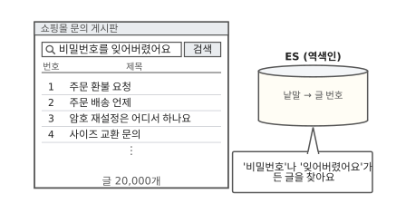

1편의 쇼핑몰 문의 게시판에 글이 20,000개 쌓였어요. 손님이 검색창에 "비밀번호를 잊어버렸어요"를 쳤어요. ES는 역색인에서 두 낱말 중 하나라도 든 글을 찾아요.

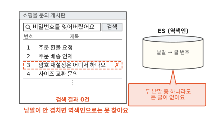

결과는 0건이에요. 두 낱말 중 어느 것도 든 글이 없었어요. 3번 글 "암호 재설정은 어디서 하나요"가 딱 맞는 글인데 겹치는 낱말이 하나도 없어요. [1편](01-inverted-index.md)의 역색인은 낱말이 겹쳐야 찾으니 이 글을 찾지 못해요. 뜻이 비슷한 글은 어떻게 찾을까요?

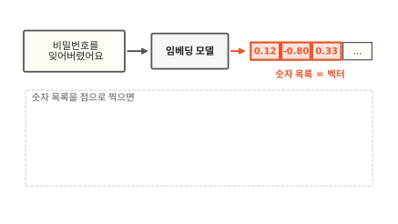

요즘은 글을 숫자 목록으로 바꿔 둬요. 문장을 받아 뜻이 비슷하면 가까운 숫자 목록을 내주는 모델이 있거든요. 이 모델이 임베딩 모델이에요.

이 숫자 목록을 **벡터**라고 불러요. 목록에 든 숫자 개수가 차원이에요. 차원은 모델이 정하고 보통 수백~수천 개예요. 숫자 목록끼리 가깝다는 건 무슨 뜻일까요?

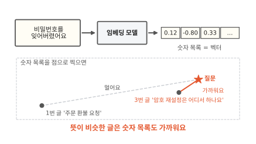

숫자 목록을 점으로 찍으면 두 벡터 사이의 거리를 잴 수 있어요. 거리가 가까우면 뜻이 비슷한 글이에요. 그림에서 질문은 3번 글 바로 옆에 찍히고 1번 글 "주문 환불 요청"과는 멀어요.

이제 남은 일은 질문 벡터와 가장 가까운 벡터 10개를 찾는 거예요. 저장된 벡터가 20,000개면 20,000개와 모두 거리를 재야 할까요?[^lab]

## 전부 재면 정확하지만 느려요

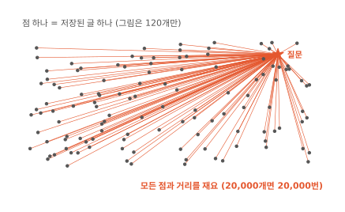

가장 쉬운 방법은 모든 벡터와 거리를 재는 거예요. 그림은 점을 120개만 찍었지만 실제로는 20,000개 모두와 재요. 7.17에서도 되는 `script_score` 검색이 이렇게 해요. 문서마다 스크립트로 점수를 계산하는 검색이에요. 다 잰 다음에는 무엇을 할까요?

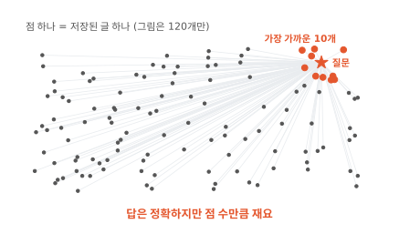

거리가 가장 가까운 10개를 골라요. 답은 언제나 정확해요. 대신 일이 문서 수에 그대로 비례해요. 벡터가 20,000개면 질문 하나에 거리를 20,000번 재요. 1,000만 개면 1,000만 번이에요. 벡터 하나가 수백 개의 숫자라서 한 번 재는 일도 가볍지 않아요.

`script_score`에 카테고리나 기간 같은 조건을 함께 걸면 그 조건에 맞는 문서만 재요. 일이 줄지만 조건에 맞는 문서가 많으면 여전히 무거워요.

[11편](11-bkd.md)의 BKD 트리로 줄일 수는 없을까요? Lucene의 BKD는 나누는 기준이 되는 차원을 8개까지만 받아서 수백 차원 벡터는 담지 못해요. 담을 수 있다 해도 차원이 많아지면 질문 근처의 칸이 거의 모든 칸과 가까워져요. 그러면 버릴 칸이 남지 않아요. 그래서 정확한 답을 조금 내주는 대신 훨씬 적게 재는 방법을 써요.

## 이웃을 따라 걸어가요

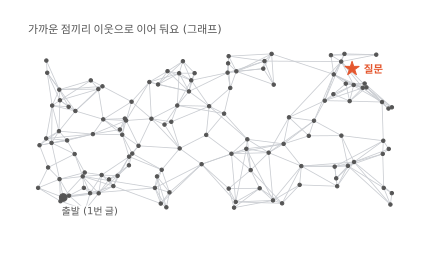

벡터마다 가까운 벡터 몇 개를 이웃으로 미리 이어 둬요. 그러면 점들이 길로 이어진 그물이 돼요. 이렇게 점과 점을 선으로 이은 그물을 **그래프**라고 해요. 질문이 오면 어디로 걸어갈까요?

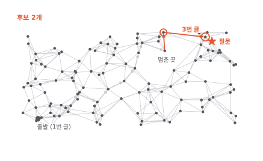

출발한 점에서 이웃 중 질문에 가장 가까운 점으로 옮겨 가요. 실제 HNSW는 정해진 입구 점에서 출발하는데 입구는 다음 절에서 볼게요. 여기서는 1번 글의 점에서 출발했어요. 한 걸음마다 지금 점의 이웃 몇 개만 재면 되니 전체를 재는 것보다 훨씬 적게 재요. 언제까지 걸을까요?

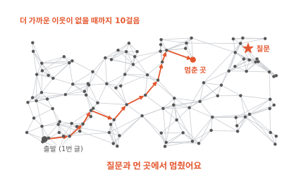

더 가까운 이웃이 없을 때까지 걸어요. 그림에서는 10걸음 만에 멈췄는데 멈춘 곳이 질문과 멀어요. 이웃 중에 더 가까운 점이 없을 뿐 진짜 가까운 점은 저 멀리 있어요. 어떻게 빠져나갈까요?

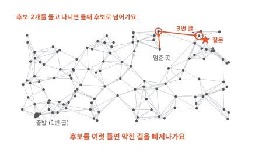

첫 번째 요령은 후보를 여러 개 들고 다니는 거예요. 가까운 점을 몇 개까지 기억해 두고 그 후보들의 이웃을 차례로 둘러봐요. 그림은 후보 2개를 들었어요.

멈춘 곳의 이웃 하나가 둘째 후보로 남아 있었어요. 그 점의 이웃에 질문 바로 옆 점이 있었어요. 한 길이 막혀도 다른 후보에서 이어지는 길로 빠져나가는 거예요. 두 번째 요령은 층이에요.

## 층을 쌓아 크게 건너뛰어요

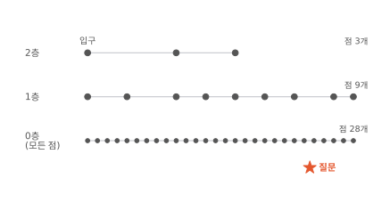

맨 아래층에는 모든 점이 있고 위로 갈수록 점을 드문드문 뽑아 따로 이어 둬요. 점마다 몇 층까지 올라갈지는 무작위로 정해요. 한 층 오를 확률은 이웃 수(아래 `m`)분의 1쯤이에요. 파이썬으로 벡터 5,000개를 넣으니 층별 점 수가 5,000, 291, 17, 1이었어요. 질문이 오면 어느 층부터 걸을까요?

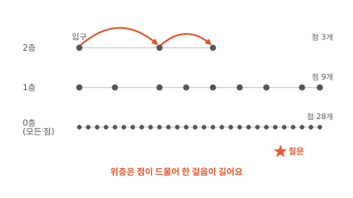

맨 위층의 입구에서 출발해요. 위층은 점이 적어서 이웃끼리 거리가 멀고 한 걸음에 멀리 가요. 위층에서 더 갈 곳이 없으면 어떻게 할까요?

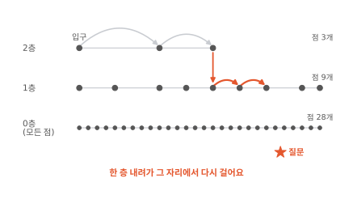

한 층 내려가 그 자리에서 다시 걸어요. 위층의 점은 아래층에도 모두 있어서 같은 점에서 그대로 이어 걸을 수 있어요. 맨 아래층에서는 어떻게 될까요?

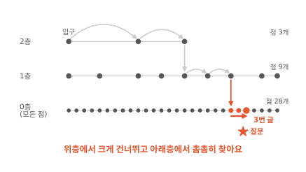

맨 아래층에 닿았을 때는 이미 질문 근처라서 짧게 둘러보면 돼요. 고속도로로 근처까지 가서 골목으로 들어가는 모습과 닮았어요.

이렇게 가까운 점끼리 이은 그물을 층으로 쌓은 방법을 **HNSW**라고 불러요. Hierarchical Navigable Small World의 머리글자로 층을 쌓은 가까운 이웃 그물이라는 뜻이에요. Malkov와 Yashunin이 2016년에 공개한 방법이에요. 파이썬으로 5,000개에서 후보 50개를 들고 찾아 봤어요. 질문 하나에 거리를 평균 780번 쟀고 정답 10개를 모두 찾았어요. 전부 비교하면 5,000번이에요. 벡터 수를 늘리면 어떻게 될까요?

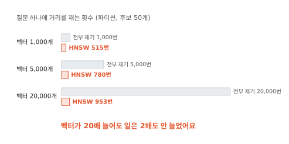

벡터를 1,000개, 5,000개, 20,000개로 늘려 보니 거리 계산은 515번, 780번, 953번이었어요. 벡터가 20배 늘어도 일은 2배도 안 늘었어요. 이렇게 적게 재는 데 따르는 값은 없을까요?

## 빨라진 대신 치르는 값

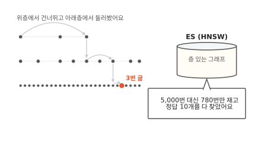

여기까지 HNSW는 위층에서 건너뛰고 아래층에서 둘러보며 질문 근처의 3번 글에 닿았어요. 파이썬 실험에서는 5,000번 대신 780번만 재고 정답 10개를 다 찾았어요.

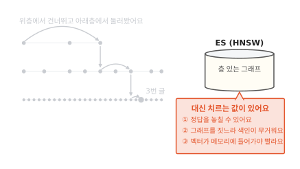

이렇게 빠른 데는 값이 따라요. 정답을 놓칠 수 있고 그래프를 짓느라 색인이 무거워요. 벡터가 메모리에 들어가야 빠르다는 점도 있어요. 첫째 값부터 볼게요.

### 첫째, 정답을 놓칠 수 있어요

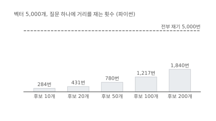

들고 다니는 후보가 적으면 빨리 끝나요. 그림처럼 후보를 늘린 만큼 거리를 재는 일도 늘었어요. 후보를 적게 들면 무엇을 잃을까요?

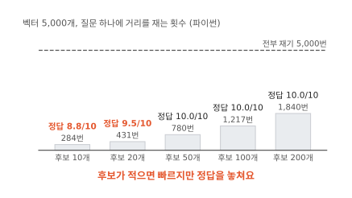

정답을 놓쳐요. 파이썬에서 후보 10개면 정답 10개 중 평균 8.8개를 찾았고 후보 50개부터는 10개를 다 찾았어요.

ES에서는 이 후보 수가 `num_candidates`예요. `k`는 돌려받을 개수예요. `k: 10, num_candidates: 50`이면 ES는 어떻게 찾을까요?

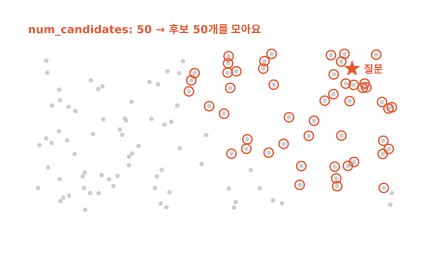

후보 50개를 들고 그래프를 걸어요. 그림은 같은 점 지도에서 후보 50개를 모은 모습이에요. 50개를 다 돌려줄까요?

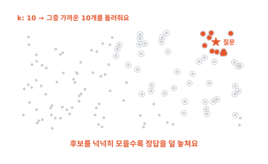

그중 가까운 10개만 돌려줘요. 후보 모으기는 샤드마다 따로 해요. 필드는 `dense_vector`로 만들어요.

```json
PUT faq
{"mappings": {"properties": {"v": {"type": "dense_vector", "dims": 16, "index": true,
  "similarity": "l2_norm", "index_options": {"type": "hnsw"}}}}}

POST faq/_search
{"knn": {"field": "v", "query_vector": [0.12, -0.8, 0.33, 0.5, -0.1, 0.9, 0.0, -0.4,
         0.2, 0.7, -0.6, 0.1, 0.3, -0.2, 0.8, -0.5], "k": 10, "num_candidates": 50}}
```

로컬 9.2에서 16차원 벡터 20,000개를 이렇게 넣고 정확한 답과 비교했어요. `num_candidates` 10은 정답 10개 중 7.9개, 50은 9.9개, 100은 10.0개를 찾았어요. `index_options`를 빼면 ES가 벡터를 압축해서 넣어요. 그때는 숫자가 달라져요(셋째 값의 심화 칸).

### 둘째, 그래프를 짓느라 색인이 무거워요

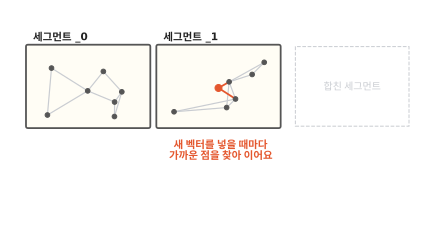

그래프는 문서를 넣을 때 지어요. 새 벡터가 들어오면 그래프에서 가까운 점을 찾아 이웃으로 이어요. 넣을 때마다 검색을 한 번씩 하는 것과 같아요. 세그먼트를 합칠 때는 어떻게 될까요?

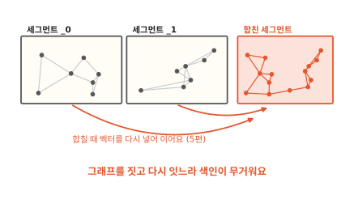

세그먼트는 ES가 모아 둔 문서로 만든 작은 역색인이에요([4편](04-refresh.md)). 그래프도 세그먼트마다 따로 있어요. 세그먼트를 합치는 병합([5편](05-merge.md)) 때는 그래프를 다시 이어야 해서 벡터 필드가 있으면 색인과 병합이 무거워져요.

### 셋째, 벡터가 메모리에 들어가야 빨라요

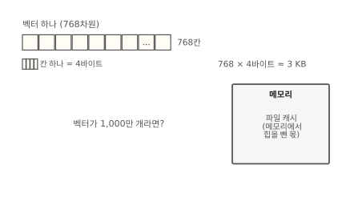

그래프를 걸을 때마다 벡터를 읽어 거리를 재요. 768차원 벡터 하나는 숫자 768개이고 숫자 하나가 4바이트라서 약 3 KB예요. 벡터가 아주 많으면 어떻게 될까요?

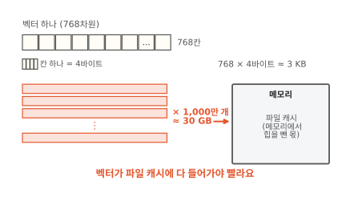

압축하지 않은 벡터의 크기는 벡터 수 × 차원 × 4바이트로 어림해요. 768차원 벡터 1,000만 개면 약 30 GB예요. 검색을 빠르게 하려면 이만큼이 파일 캐시에 들어가야 해요.

파일 캐시는 운영체제가 디스크 파일을 메모리에 올려 두는 곳이에요. ES는 자바로 만든 프로그램이라 자바가 직접 관리하는 메모리(힙)를 따로 잡아요. 노드 메모리에서 힙을 뺀 나머지가 파일 캐시로 쓰여요.

??? info "심화: 그래프는 세그먼트마다 어떻게 지을까요?"
    세그먼트가 많거나 병합이 잦은 인덱스에서 벡터 검색과 색인이 왜 느려지는지 궁금할 때 보는 칸이에요.

    HNSW는 Lucene 9.0(ES 8.0)에 들어왔어요. 그래프는 세그먼트마다 따로 만들어요. 검색은 세그먼트마다 그래프를 걸어 후보를 모으고 합쳐서 위를 골라요. 세그먼트 수만큼 일이 곱으로 늘어요. 그래서 더 쓰지 않는 인덱스는 `forcemerge`로 세그먼트를 줄이면 knn이 빨라져요.

    [5편](05-merge.md)의 병합 때는 그래프를 다시 이어요. Elastic 블로그에 따르면 8.8 무렵부터 삭제 문서가 없는 가장 큰 세그먼트의 그래프를 그대로 가져오고 나머지 벡터만 넣어요. 그래도 병합 비용이 벡터 수에 따라 커요. 벡터와 그래프 파일은 힙 밖에서 운영체제 파일 캐시로 읽어요. 그래서 힙을 키워도 빨라지지 않아요.

??? info "심화: 그래프 모양과 거르기 조건은 어떻게 정할까요?"
    정답을 덜 놓치게 그래프를 촘촘히 짓고 싶을 때나 조건을 건 벡터 검색의 결과 수가 궁금할 때 보는 칸이에요.

    그래프 모양은 `index_options`의 `m`과 `ef_construction`이 정해요. `m`은 점마다 이웃 수로 기본 16이에요. `ef_construction`은 지을 때 들고 다니는 후보 수로 기본 100이에요. 9.2 매핑에서 확인했고 7.17에는 이 옵션이 없어요. 크게 줄수록 정답을 덜 놓치지만 색인이 느려지고 메모리를 더 써요.

    `knn` 안에 `filter`를 주면 그래프를 걷는 동안 조건에 맞는 문서만 결과로 모아서 `k`개를 채워요. 조건에 맞는 문서가 아주 적으면 Lucene이 그래프 걷기를 그만두고 맞는 문서를 모두 재요. 바깥 `post_filter`로 거르면 `k`개를 찾은 다음에 빼요. 그래서 결과가 `k`개보다 적어질 수 있어요.

??? info "심화: 압축(양자화)과 다시 재기"
    벡터가 메모리에 다 안 들어갈 때 크기를 줄이는 방법이 궁금할 때 보는 칸이에요.

    9.2에서 `index_options`를 주지 않으면 16차원 필드는 `int8_hnsw`가 됐어요. 384차원 이상 필드는 `bbq_hnsw`가 됐고 기본 `rescore_vector` oversample은 3이었어요. 로컬 매핑으로 확인했어요. 기본값은 버전마다 바뀌어 왔으니 쓰는 버전에서 `GET <인덱스>/_mapping`으로 꼭 확인하세요.

    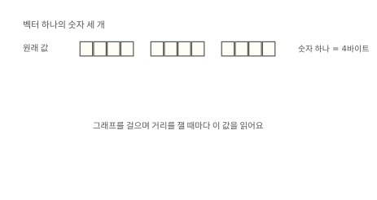

    압축하지 않은 `hnsw`는 숫자 하나를 4바이트 실수로 두고 그래프를 걸을 때마다 이 값을 읽어요. `int8_hnsw`는 숫자를 1바이트 정수로 줄인 사본을 따로 두고 그래프를 이 값으로 걸어요.

    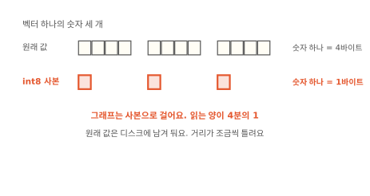

    검색 때 읽는 양이 4분의 1로 줄어요. 원래 실수 값도 디스크에 남겨 두니 디스크는 조금 늘어요. 거리가 조금씩 틀려서 순위가 흔들려요.

    로컬의 16차원 무작위 벡터에서는 `num_candidates`를 100으로 올려도 정답 10개 중 8.3~8.4개에 머물렀어요. 압축 없는 `hnsw`는 10.0개였어요. 무작위 저차원 벡터라 많이 틀린 편이고 수백 차원의 실제 임베딩에서는 덜 틀려요. 흔들린 순위는 어떻게 바로잡을까요?

    `rescore_vector: {"oversample": 3}`을 주면 압축된 값으로 `k`의 3배를 찾아요. 그다음 디스크의 원래 실수 값으로 다시 재서 순위를 고쳐요.

    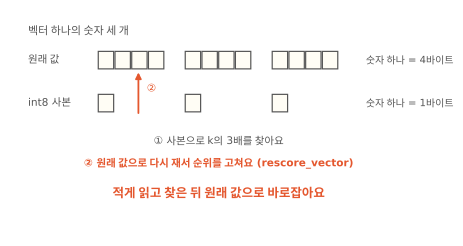

    같은 인덱스에서 `num_candidates` 50이면 10.0개를 찾았어요. 9.2에서 확인한 옵션이고 8.x에서는 쓸 수 없는 버전이 있어요. 정확한 답과 비교해 보고 정하세요.

## 벡터 검색은 언제 쓸모 있을까요

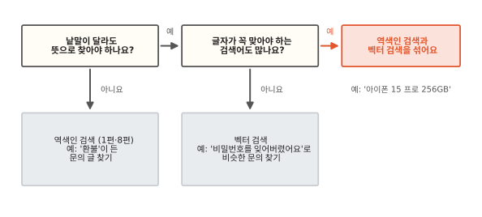

두 가지를 물어보면 대부분 정해져요. 첫째 물음은 "낱말이 달라도 뜻으로 찾아야 하나요?"예요. "환불"이 든 문의 글을 찾는 정도라면 1편의 역색인과 [8편](08-bm25.md)의 BM25 점수로 충분해요. "비밀번호를 잊어버렸어요"로 "암호 재설정은 어디서 하나요"를 찾아야 한다면 벡터 검색이 필요해요.

둘째 물음은 "글자가 꼭 맞아야 하는 검색어도 많나요?"예요. 상품 검색에는 "아이폰 15 프로 256GB"처럼 모델명을 정확히 치는 손님도 많아요. 벡터는 뜻이 비슷한 걸 잘 찾지만 모델명이나 숫자처럼 글자가 정확히 맞아야 하는 검색어에는 약해요. "256GB"와 "512GB"는 뜻이 비슷한 말이라 벡터로는 가까울 수 있거든요.

이럴 때는 역색인 검색을 그대로 두고 벡터 검색 결과를 함께 섞는 방식을 먼저 검토해요. 바꾸기 전에 실제 검색어 표본으로 두 방식의 결과를 나란히 놓고 비교해요.

## 다시 "비밀번호를 잊어버렸어요"를 찾아 볼게요

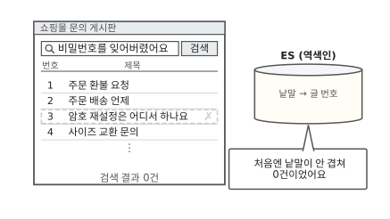

처음 장면의 게시판으로 돌아왔어요. 그때 역색인은 겹치는 낱말을 찾지 못해 0건을 돌려줬어요.

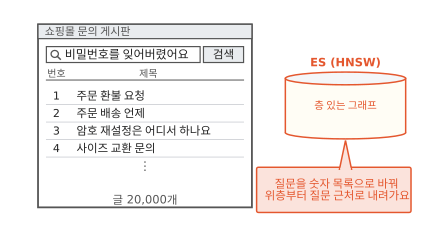

이번에는 같은 글을 벡터로 바꿔 HNSW 그래프에 넣어 두고 찾아요. 질문도 숫자 목록으로 바꾸고 맨 위층에서 질문 근처까지 크게 건너뛰어요.

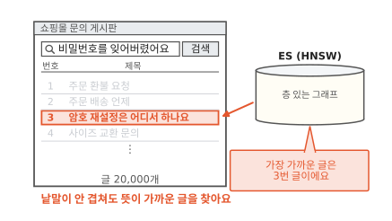

맨 아래층에서 질문 근처를 둘러보니 가장 가까운 글은 3번 글 "암호 재설정은 어디서 하나요"였어요. 겹치는 낱말이 하나도 없는데도 찾았어요.

글이 2만 개든 1,000만 개든 위층에서 크게 건너뛰고 아래층에서 둘러보는 길은 같아요.

### 이 편에서 줄여 그린 것

그림을 쉽게 하려고 실제와 다르게 줄인 곳이 네 군데 있어요.

1. 벡터를 종이 위의 점으로 그렸어요. 종이 위의 점은 숫자 두 개로 자리가 정해지지만 실제 벡터는 숫자가 수백~수천 개예요. 이 편의 파이썬 실험과 ES 실험은 16차원이었어요. 점 지도에는 점을 120개만 찍었어요.
2. 층 그림은 점을 한 줄에 늘어놓고 옆 점끼리만 이었어요. 실제로는 층마다 0층처럼 그물로 잇고 위층으로 갈수록 점이 훨씬 빨리 줄어요. 파이썬 실험에서 5,000개가 291개, 17개, 1개로 줄었어요.
3. 그래프가 인덱스에 하나만 있는 것처럼 그렸어요. 실제로는 세그먼트마다 그래프가 따로 있어서 세그먼트마다 후보를 모아 합쳐요. 샤드가 여럿이면 샤드마다 따로 모아요([12편](12-distributed-search.md)).
4. 병합 그림에서 그래프를 처음부터 다시 이었어요. 8.8 무렵부터는 지운 문서가 없는 가장 큰 세그먼트의 그래프를 그대로 가져오고 나머지 벡터만 넣어요. 셋째 값의 첫 심화 칸에서 다뤄요.

### 이 편에서 새로 나온 말

![낱말 카드 여덟 장, 두 장씩 네 줄. 임베딩 모델: 문장 상자에서 빨간 화살표로 빨간 0.12와 점 세 개 칸, 문장을 받아 숫자 목록을 내주는 모델. 벡터: 빨간 0.12, -0.80, 0.33과 점 세 개 칸, 글을 바꾼 숫자 목록. 차원: 빨간 1, 2, 3, 점 세 개, 빨간 768 칸, 벡터에 든 숫자 개수(보통 수백~수천). 정확한 검색: 빨간 별에서 둘레의 점 여덟 개로 빨간 선이 뻗는다, 모든 벡터와 거리를 재기(script_score). 그래프: 점 다섯 개가 빨간 선으로 이어진 그물, 가까운 점끼리 이웃으로 이어 둔 그물. HNSW: 점 2개, 4개, 8개인 줄 세 개 위로 빨간 화살표가 크게 건너뛰고 아래로 내려간다, 그래프를 층으로 쌓아 위에서 크게, 아래에서 촘촘히. num_candidates: 빨간 빈 동그라미 여섯 개와 점 세 개, 그래프를 걸을 때 들고 다니는 후보 수. k: 빨갛게 칠한 동그라미 셋과 회색 빈 동그라미 셋, 후보 중 돌려받을 가까운 개수.](img/15/es15-cards.svg)

[^lab]: 파이썬 숫자는 HNSW를 파이썬으로 직접 만들어 흉내 내며 잰 값이에요. ES 숫자는 제 컴퓨터에 띄운 ES 9.2.0에서 쟀어요. 7.17.26에서는 `knn`이 없는 것을 확인했어요. 논문: Malkov·Yashunin, "Efficient and robust approximate nearest neighbor search using Hierarchical Navigable Small World graphs"(arXiv:1603.09320, 2016, IEEE TPAMI 2020).
