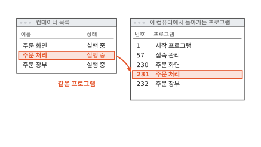
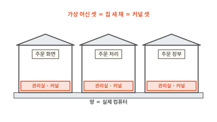
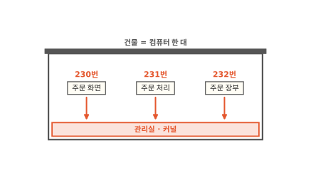
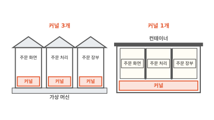

# 컨테이너: 칸막이와 한도를 씌운 프로그램

컨테이너를 처음 찾아보면 "작은 가상 머신"이라는 설명을 자주 만나요. 그런데 컨테이너 셋을 띄우고 컴퓨터의 프로그램 목록을 열면 컨테이너 안 프로그램이 다른 프로그램과 나란히 보여요. 이 글을 읽고 나면 컨테이너가 실제로 무엇이고 가상 머신과 어디가 다른지 알게 돼요. 쿠버네티스는 컨테이너를 모아 돌리는 도구라서 컨테이너를 알아야 다음 편들이 읽혀요.

!!! abstract "이 글에서 알게 되는 것"
    1. 컨테이너 안에서 도는 프로그램은 이 컴퓨터의 보통 프로세스예요. 이 컴퓨터의 커널 하나를 다른 프로그램과 같이 써요.
    2. 커널은 칸막이(리눅스 네임스페이스)로 보이는 것을 나누고 사용량 한도(cgroup)로 쓰는 양을 나눠요. 이 둘을 씌운 프로세스가 컨테이너예요.
    3. 가상 머신은 커널을 따로 켜서 무겁지만 서로 떨어져 있어요. 컨테이너는 커널 하나를 같이 써서 가볍지만 그 커널에 구멍이 나면 함께 위험해요.

## 1. 컨테이너 안 프로그램이 밖 목록에도 보여요

동네 빵집에 주문 앱이 있어요. 손님은 휴대폰으로 빵을 골라 주문해요. 앱은 부품 셋으로 돌아가요. 손님이 보는 주문 화면, 주문을 받아 계산하는 주문 처리, 주문을 적어 두는 주문 장부예요. 이 셋을 컴퓨터 한 대에 컨테이너 셋으로 띄웠어요.

이번에는 컨테이너 밖에서 이 컴퓨터에 돌아가는 프로그램 목록을 열어요. 아래 그림에서 오른쪽 목록의 231번 줄을 보세요.

**그림 1.** 컨테이너 목록의 주문 처리가 이 컴퓨터의 프로그램 목록에서는 231번으로 보여요.
{ .fig-cap }

목록에 주문 화면, 주문 처리, 주문 장부가 다른 프로그램과 나란히 있어요. 230, 231, 232라는 번호까지 붙어 있어요. 컨테이너 안의 주문 처리와 밖 목록의 231번은 같은 프로그램이에요.

여기서 고개를 갸웃하게 돼요. 컨테이너가 작은 가상 머신이라면 안에서 도는 프로그램이 밖에서 이렇게 보일까요? 가상 머신부터 보면 답이 나와요.

## 2. 가상 머신은 집마다 커널을 따로 켜요

먼저 프로그램이 컴퓨터를 어떻게 쓰는지 알아야 해요. 프로그램은 메모리나 디스크를 직접 만지지 않아요. 메모리는 컴퓨터가 지금 하는 일을 올려 두는 빠른 작업 공간이고 디스크는 꺼져도 내용이 남는 저장 장치예요([컴퓨터 5편](../computer/05-where-computers-remember.md)). 프로그램은 운영체제에 "이 파일 좀 읽어 줘"처럼 부탁해요. 운영체제는 컴퓨터 부품을 관리하는 바탕 프로그램이에요.

운영체제 가운데서 이런 부탁을 받아 메모리, 디스크, 네트워크를 여러 프로그램에 나눠 주는 중심을 **커널**이라고 해요. 컴퓨터 한 대를 건물 한 채로 치면 커널은 맨 아래층 관리실이에요. 실행 중인 프로그램 하나하나는 **프로세스**라고 불러요. 처음에 본 230, 231, 232는 프로세스에 붙은 번호였어요.

**가상 머신**(VM)은 프로그램으로 컴퓨터 한 대를 통째로 흉내 내는 방법이에요. 건물로 치면 땅 위에 작은 집을 따로 짓는 일이에요. 집마다 운영체제를 통째로 설치해서 집마다 관리실이 따로 있어요. 가상 머신을 켜면 진짜 컴퓨터처럼 그 안의 커널부터 켜요.[^vm] 아래 그림에서 집마다 아래쪽에 있는 빨간 띠를 보세요.

**그림 2.** 가상 머신 셋은 따로 지은 집 세 채이고 집마다 커널이 하나씩 있어요.
{ .fig-cap }

집 안의 프로그램은 집 안의 커널에 부탁해요. 바깥 컴퓨터의 커널은 집 안에서 어떤 프로그램이 도는지 몰라요. 그래서 밖에서 프로그램 목록을 열면 가상 머신 셋만 보이고 그 안의 주문 처리는 안 보여요. 그런데 처음 장면에서는 보였어요. 컨테이너는 가상 머신과 다르게 돌아간다는 뜻이에요.

## 3. 컨테이너 안 프로그램은 이 컴퓨터의 커널에 부탁해요

컨테이너는 집을 따로 짓지 않아요. 세 부품이 모두 건물 한 채 안에 있고 맨 아래층 관리실도 하나예요. 컨테이너 안의 주문 처리도 파일을 읽을 때 이 관리실에 부탁해요. 아래 그림에서 세 화살표가 어디로 내려가는지 보세요.

**그림 3.** 230, 231, 232번 프로그램이 모두 이 건물의 관리실(커널) 하나에 부탁해요.
{ .fig-cap }

관리실은 자기에게 부탁하는 프로세스를 모두 알아요. 그래서 밖에서 연 목록에 230, 231, 232가 보였어요. 컨테이너 안 프로그램도 이 컴퓨터의 보통 프로세스예요.

그런데 셋이 한 층에 섞여 있으면 곤란한 일이 생겨요.

## 4. 칸막이를 치면 자기 칸만 보여요

한 층에 섞여 있으면 주문 처리는 옆 프로그램을 다 봐요. 아래 그림에서 주문 처리에서 뻗은 빨간 점선을 보세요.

**그림 4.** 칸막이가 없으면 주문 처리가 다른 프로그램의 목록과 파일과 네트워크 문까지 봐요.
{ .fig-cap }

주문 처리가 프로그램 목록을 열면 주문 장부가 보이고 주문 장부의 파일도 보여요. 네트워크로 손님을 받는 문(포트)도 셋이 하나를 같이 써요. 주문 화면과 주문 처리가 같은 문 번호를 쓰려 하면 부딪혀요.

그래서 관리실이 칸막이를 쳐 줘요. 칸 안의 프로그램은 자기 칸의 프로그램 목록, 자기 칸의 파일, 자기 칸의 네트워크 문만 봐요. 이 칸막이를 **리눅스 네임스페이스**(Linux namespace)라고 해요.[^ns] 실제로는 프로세스 번호, 파일, 네트워크, 사용자 번호처럼 나누는 대상마다 칸막이 종류가 따로 있어요. 컨테이너는 여러 종류를 한꺼번에 씌워요. 그림에서는 벽 하나로 그렸어요.

칸을 친 다음 주문 처리 칸 안에서 프로그램 목록을 열면 어떻게 보일까요? 아래 그림에서 오른쪽 창의 번호를 보세요.

**그림 5.** 칸막이를 치면 주문 처리 칸 안의 목록에는 주문 처리 하나만 1번으로 보여요.
{ .fig-cap }

주문 처리 하나만 보이고 번호는 1번이에요. 밖에서 231번인 프로세스가 칸 안에서는 1번이에요. 관리실이 칸마다 번호를 따로 매겨 주기 때문이에요.[^pid] 바깥 목록에서는 칸 안 프로세스가 그대로 보이지만 칸 안 목록에는 바깥 프로세스가 안 보여요. 처음 장면에서 밖에서 세 부품을 다 볼 수 있었던 까닭이에요.

칸막이는 보이는 것만 나눠요. 관리실은 여전히 하나예요.

## 5. 사용량 한도를 정하면 한 칸이 메모리를 다 쓰지 못해요

칸막이를 쳐도 메모리는 건물 하나를 같이 써요. 그림에서는 건물 메모리를 12칸으로 그렸어요. 주문이 쌓이면 주문 장부가 메모리를 점점 더 써요. 아래 그림에서 위쪽 메모리 줄을 보세요.

**그림 6.** 주문 장부가 8칸을 차지해서 메모리 12칸이 꽉 찼어요.
{ .fig-cap }

남은 칸이 없어서 주문 화면과 주문 처리가 메모리를 더 달라고 해도 받을 수 없어요. 장부 하나 때문에 손님이 보는 화면까지 멈춰요.

그래서 관리실은 칸마다 쓸 수 있는 양에 한도를 정해 둬요. 아래 그림에서 메모리 줄의 빨간 세로선을 보세요.

**그림 7.** 화면 2칸, 처리 2칸, 장부 4칸으로 한도를 정하면 메모리가 4칸 남아요.
{ .fig-cap }

장부는 4칸까지만 써요. 이 사용량 한도를 **cgroup**(control group)이라고 해요.[^cg] CPU를 얼마나 쓸지도 같은 방법으로 정해요.

한도를 넘으면 관리실은 CPU와 메모리를 다르게 다뤄요. CPU는 한도만큼만 받아서 프로그램이 느려져요. 메모리는 어디서 빌려 올 수가 없어요. 그래서 관리실이 한도를 넘은 칸의 프로세스를 끝낼 수 있어요.[^limit] 이 차이는 [10편](10-requests-limits.md)에서 자세히 봐요.

이제 컨테이너가 무엇인지 말할 수 있어요. 커널을 같이 쓰는 보통 프로세스에 리눅스 네임스페이스라는 칸막이와 cgroup이라는 한도를 씌운 것을 **컨테이너**라고 해요. 건물 안 칸막이 사무실이에요.

## 6. 컨테이너는 가볍지만 커널을 같이 써요

가상 머신과 컨테이너를 나란히 놓아 볼게요. 아래 그림에서 두 쪽의 커널 수를 세어 보세요.

**그림 8.** 가상 머신 셋은 커널이 셋이고 컨테이너 셋은 커널 하나를 같이 써요.
{ .fig-cap }

가상 머신은 켤 때 집마다 커널부터 켜요. 컨테이너는 이미 켜져 있는 관리실에 칸만 새로 쳐서 프로그램만 켜면 돼요. 운영체제를 통째로 담지 않으니 차지하는 공간도 작아요. 쿠버네티스 문서도 이 때문에 컨테이너를 가볍다고 해요.[^vm]

가벼운 데는 대가가 있어요. 칸막이와 한도는 모두 관리실이 지켜 줘요. 관리실에 구멍이 나면 칸막이 전체가 뚫릴 수 있어요. 가상 머신은 집마다 관리실이 따로라서 이런 일이 한 집 안에서 끝나요. 이 이야기는 [4편](04-shared-kernel.md)에서 이어 가요.

커널이 하나라서 다른 커널이 필요한 프로그램도 못 돌려요. 리눅스 커널 위 컨테이너에서는 리눅스용 프로그램만 돌아가고 윈도용 프로그램은 안 돌아요.

그래서 컨테이너를 쓸지는 두 가지를 물어보면 대부분 정해져요. 아래 그림을 위에서부터 따라가 보세요.

**그림 9.** 프로그램 여럿을 떼어 돌리고 커널을 같이 써도 괜찮으면 컨테이너를 써요.
{ .fig-cap }

빵집 앱의 세 부품은 서로의 파일과 문 번호를 건드리면 안 되고 하나가 메모리를 다 써도 안 돼요. 그래서 칸막이와 한도가 필요해요. 세 부품은 모두 내가 만든 리눅스용 프로그램이라 관리실 하나를 같이 써도 괜찮아요. 그러니 컨테이너가 맞아요. 누가 올렸는지 모르는 코드를 돌려 주는 서비스라면 관리실을 같이 쓰는 것이 걱정이에요. 왜 위험한지는 [4편](04-shared-kernel.md)에서 보고 커널을 따로 주는 방법은 [5편](05-microvm.md)과 [6편](06-sandbox-runtimes.md)에서 봐요.

## 정리

컨테이너 셋을 띄우고 밖에서 프로그램 목록을 열면 세 부품이 230, 231, 232번으로 보여요. 컨테이너 안 프로그램이 이 컴퓨터의 커널에 부탁하는 보통 프로세스라서 그래요. 집마다 커널을 따로 켜는 가상 머신이었다면 밖에서 안 보였을 거예요.

보통 프로세스를 컨테이너로 만드는 건 커널이 씌워 주는 두 가지예요. 칸막이(리눅스 네임스페이스)를 치면 주문 처리는 자기 칸만 보고 칸 안에서 1번이 돼요. 사용량 한도(cgroup)를 정하면 주문 장부가 메모리를 다 차지하지 못해요.

컨테이너는 커널을 새로 켜지 않아서 가벼워요. 대신 커널 하나를 같이 쓰니까 커널에 구멍이 나면 함께 위험하고 다른 커널이 필요한 프로그램은 못 돌려요.

칸 안에 보이는 파일은 컨테이너를 만드는 틀인 이미지에서 와요. [2편](02-image-layers.md)에서는 이 이미지가 왜 층층이 쌓여 있는지 봐요.

### 새로 나온 말

- **커널**: 운영체제의 중심. 메모리, 디스크, 네트워크를 프로그램들에 나눠 줘요. 건물의 관리실이에요.
- **프로세스**: 실행 중인 프로그램 하나. 주문 처리는 이 컴퓨터의 231번 프로세스예요.
- **가상 머신(VM)**: 커널까지 갖춘 컴퓨터 한 대를 프로그램으로 통째로 흉내 낸 것. 땅 위에 따로 지은 집이에요.
- **리눅스 네임스페이스**: 칸 안의 프로그램에게 자기 칸의 프로그램 목록, 파일, 네트워크만 보이게 하는 칸막이. 주문 처리는 칸 안에서 1번이에요.
- **cgroup**: 칸마다 메모리와 CPU를 얼마까지 쓸지 정한 한도. 주문 장부는 4칸까지만 써요.
- **컨테이너**: 커널을 같이 쓰는 보통 프로세스에 칸막이와 한도를 씌운 것. 건물 안 칸막이 사무실이에요.

[^vm]: 쿠버네티스 문서는 가상 머신을 자기 운영체제까지 가상 하드웨어 위에서 돌리는 완전한 컴퓨터로, 컨테이너를 운영체제를 앱끼리 같이 쓰는 가벼운 방식으로 설명해요. <https://kubernetes.io/docs/concepts/overview/>
[^ns]: 리눅스 설명서 namespaces(7). 네임스페이스는 시스템 자원 하나를 감싸서 그 안의 프로세스에게 자기만의 사본처럼 보이게 해요. <https://man7.org/linux/man-pages/man7/namespaces.7.html>
[^pid]: 리눅스 설명서 pid_namespaces(7). 프로세스는 자기가 보이는 칸막이 층마다 번호를 하나씩 가져요. <https://man7.org/linux/man-pages/man7/pid_namespaces.7.html>
[^cg]: 리눅스 설명서 cgroups(7). 프로세스를 묶어서 묶음마다 자원 사용을 제한하고 재는 커널 기능이에요. <https://man7.org/linux/man-pages/man7/cgroups.7.html>
[^limit]: 쿠버네티스 문서 "Resource Management for Pods and Containers". CPU 한도는 CPU를 덜 주는 방식으로 지켜요. 메모리 한도를 넘으면 커널이 그 컨테이너의 프로세스를 끝낼 수 있어요. <https://kubernetes.io/docs/concepts/configuration/manage-resources-containers/>
