# 컨테이너는 작은 가상 머신일까요?

## 빵집 주문 앱을 컨테이너 셋으로 띄웠어요

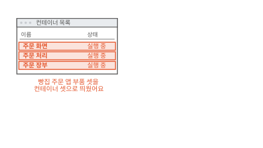

동네 빵집에 주문 앱이 있어요. 손님은 휴대폰으로 빵을 골라 주문해요. 이 앱은 부품 셋으로 돌아가요. 손님이 보는 주문 화면, 주문을 받아 계산하는 주문 처리, 주문을 적어 두는 주문 장부예요. 세 부품을 컴퓨터 한 대에 컨테이너 셋으로 띄웠어요.

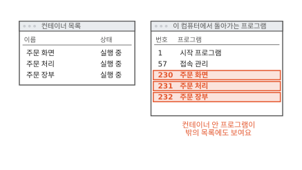

이번에는 컨테이너 밖에서 이 컴퓨터에 돌아가는 프로그램 목록을 열었어요. 목록에 주문 화면, 주문 처리, 주문 장부가 다른 프로그램과 나란히 있어요. 230, 231, 232라는 번호까지 붙어 있어요.

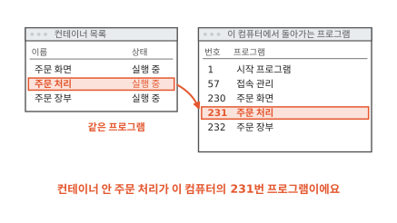

컨테이너 안의 주문 처리와 밖 목록의 231번은 같은 프로그램이에요. 컨테이너를 "작은 가상 머신"이라고 설명하는 글이 많아요. 가상 머신이라면 안에서 도는 프로그램이 밖에서 이렇게 보일까요? 가상 머신부터 볼게요.

## 가상 머신은 컴퓨터를 통째로 흉내 내요

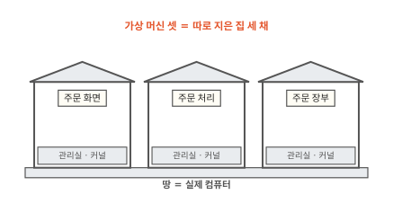

프로그램은 메모리나 디스크를 직접 만지지 않아요. 메모리는 컴퓨터가 지금 하는 일을 올려 두는 빠른 작업 공간이고 디스크는 꺼져도 내용이 남는 저장 장치예요([컴퓨터 5편](../computer/05-where-computers-remember.md)). 프로그램은 운영체제에 "이 파일 좀 읽어 줘"처럼 부탁해요. 운영체제는 컴퓨터의 부품을 관리하는 바탕 프로그램이에요.

그 부탁을 받아 메모리·디스크·네트워크를 프로그램들에 나눠 주는 운영체제의 중심을 커널이라고 해요. 건물로 치면 맨 아래층의 관리실이에요.

실행 중인 프로그램 하나하나는 프로세스라고 불러요. 처음 장면의 230, 231, 232는 프로세스에 붙은 번호였어요.

가상 머신은 프로그램이 컴퓨터 한 대를 통째로 흉내 내는 방법이에요. 그림처럼 땅 위에 집을 따로 지어요. 그러면 집 안에서 무엇이 돌아갈까요?

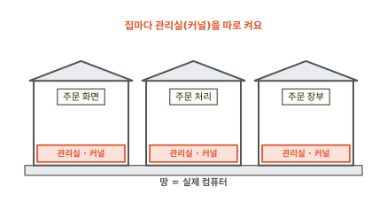

집마다 운영체제를 통째로 설치해요. 그래서 그림의 빨간 띠처럼 집마다 커널이 따로 있어요. 가상 머신을 켜면 진짜 컴퓨터처럼 그 안의 커널부터 켜요.[^vm]

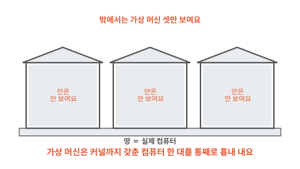

집 안의 프로그램은 집 안의 커널에 부탁해요. 바깥 컴퓨터의 커널은 집 안에 어떤 프로그램이 도는지 몰라요. 그래서 밖에서 프로그램 목록을 열어도 주문 처리는 안 보여요. 그런데 처음 장면에서는 보였어요. 컨테이너 안의 프로그램은 누구에게 부탁하는 걸까요?

## 컨테이너 안 프로그램은 이 컴퓨터의 커널에 부탁해요

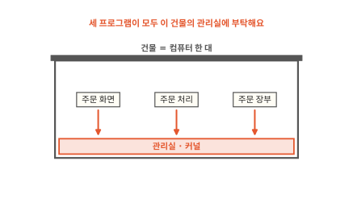

이번에는 컴퓨터 한 대를 건물 한 채로 그려 볼게요. 맨 아래층에 관리실이 하나 있어요. 컨테이너 안의 주문 처리도 파일을 읽을 때 이 관리실에 부탁해요. 집을 따로 짓지 않았으니 따로 켠 커널도 없어요.

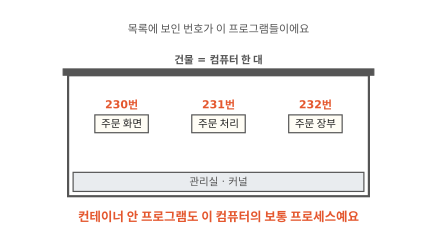

관리실은 자기에게 부탁하는 프로세스를 모두 알아요. 그래서 밖 목록에 230, 231, 232가 보였어요. 컨테이너 안의 프로그램은 이 컴퓨터의 보통 프로세스예요.

그런데 셋이 한 층에 섞여 있으면 문제가 생겨요. 주문 처리에서 무엇이 보일까요?

## 칸막이를 치면 자기 칸만 보여요

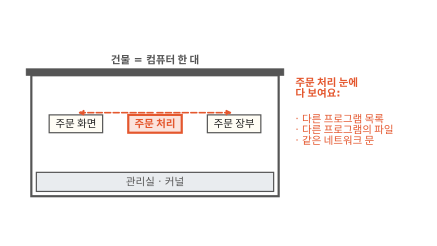

한 층에 섞여 있으면 주문 처리는 옆 프로그램을 다 봐요. 프로그램 목록을 열면 주문 장부가 보이고 주문 장부의 파일도 보여요. 네트워크로 손님을 받는 문(포트)도 셋이 하나를 같이 써요. 주문 화면과 주문 처리가 같은 문 번호를 쓰려 하면 부딪혀요.

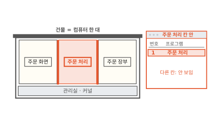

그래서 관리실이 칸막이를 쳐 줘요. 칸 안의 프로그램은 자기 칸의 프로그램 목록, 자기 칸의 파일, 자기 칸의 네트워크 문만 봐요. 이 칸막이를 **리눅스 네임스페이스**(Linux namespace)라고 해요.[^ns]

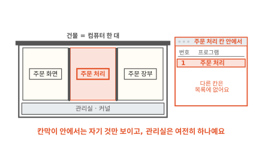

주문 처리 칸 안에서 프로그램 목록을 열면 주문 처리 하나만 보여요. 번호도 1번이에요. 밖에서는 231번인 같은 프로세스가 칸 안에서는 다른 번호로 보여요. 관리실이 칸마다 번호를 따로 매겨 주기 때문이에요.

칸막이는 보이는 것을 나눌 뿐이에요. 관리실은 그대로 하나예요. 보이는 것을 나눴으니 이제 서로 괜찮을까요?

??? info "심화: 리눅스 네임스페이스는 몇 가지일까요?"
    칸막이가 정확히 무엇을 나누는지 궁금할 때 보는 칸이에요.

    본문에서는 칸막이를 하나로 그렸어요. 실제로는 나누는 대상마다 종류가 따로 있고 컨테이너는 여러 종류를 한꺼번에 씌워요. 리눅스 설명서가 꼽는 종류는 여덟 가지예요.[^ns]

    | 종류 | 칸마다 따로 보이는 것 |
    |---|---|
    | PID | 프로세스 번호 |
    | Mount | 파일이 붙어 있는 자리(파일 나무) |
    | Network | 네트워크 장치와 문 번호 |
    | UTS | 컴퓨터 이름 |
    | IPC | 프로그램끼리 주고받는 통로 일부 |
    | User | 사용자 번호와 그룹 번호 |
    | Cgroup | 사용량 한도 묶음의 뿌리 |
    | Time | 일부 시계 |

    User 칸막이는 [3편](03-user-and-permissions.md)에서 다시 나와요.

??? info "심화: 칸 안의 1번은 밖에서 몇 번일까요?"
    칸 안과 밖에서 번호가 왜 다른지 궁금할 때 보는 칸이에요.

    새 PID 칸막이를 만들면 그 안에서 처음 뜬 프로세스가 1번이 돼요. 칸막이는 겹겹이 만들 수 있어요. 프로세스는 자기가 보이는 칸막이 층마다 번호를 하나씩 가져요.[^pid] 그래서 주문 처리는 칸 안에서 1번, 맨 바깥에서 231번이에요.

    거꾸로는 안 돼요. 바깥 목록에는 칸 안의 프로세스가 보이지만 칸 안 목록에는 바깥 프로세스가 안 보여요. 처음 장면이 밖에서 세 부품을 다 볼 수 있었던 것도 이 때문이에요.

## 한도가 없으면 한 칸이 건물을 다 써요

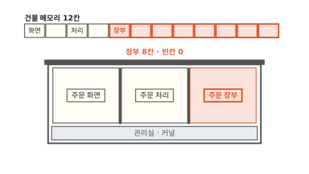

칸막이는 보이는 것만 나눠요. 메모리는 여전히 건물 하나를 같이 써요. 그림에서는 건물 메모리를 12칸으로 그렸어요. 주문이 쌓이면 주문 장부가 메모리를 점점 더 써요.

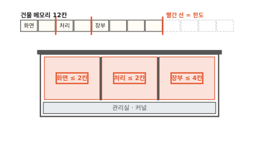

장부가 8칸까지 차지하자 남은 칸이 없어요. 주문 화면과 주문 처리가 메모리를 더 달라고 해도 받을 수가 없어요. 장부 하나 때문에 손님 화면까지 멈춰요.

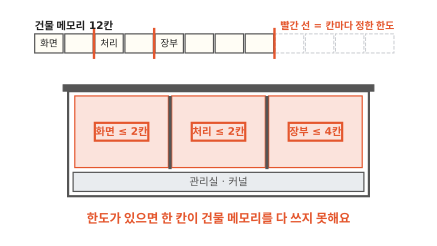

그래서 관리실은 칸마다 쓸 수 있는 양에 한도를 정해 둬요. 장부는 4칸까지만 써요. 이 사용량 한도를 **cgroup**(control group)이라고 해요.[^cg] CPU를 얼마나 쓸지도 같은 방법으로 정해요.

한도를 넘으면 메모리와 CPU는 다르게 다뤄져요. CPU는 한도만큼만 받아서 느려져요. 메모리는 남는 데서 빌려 줄 수가 없어요. 그래서 메모리가 모자라면 관리실이 한도를 넘은 칸의 프로세스를 끝낼 수 있어요. 이 차이는 [10편](10-requests-limits.md)에서 자세히 봐요.[^limit]

이제 컨테이너가 무엇인지 말할 수 있어요. 커널을 같이 쓰는 보통 프로세스에 리눅스 네임스페이스라는 칸막이와 cgroup이라는 한도를 씌운 것을 **컨테이너**라고 해요. 칸막이 사무실이에요.

## 컨테이너는 가볍지만 관리실을 같이 써요

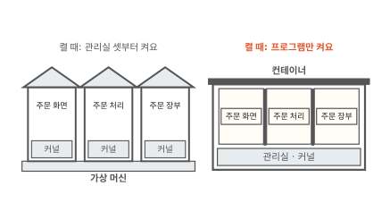

두 방법을 나란히 놓아 볼게요. 가상 머신은 켤 때 집마다 커널부터 켜요. 컨테이너는 이미 켜져 있는 관리실에 칸만 새로 쳐요. 그래서 프로그램만 켜면 돼요. 운영체제를 통째로 담지 않으니 차지하는 공간도 작아요.[^k8s]

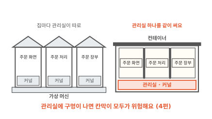

가벼운 데는 대가가 있어요. 칸막이와 한도는 모두 관리실이 지켜 줘요. 관리실에 구멍이 나면 칸막이 전체가 뚫릴 수 있어요. 가상 머신은 집마다 관리실이 따로라서 이런 일이 한 집 안에서 끝나요. 이 이야기는 [4편](04-shared-kernel.md)에서 이어 가요.

같은 커널을 쓰니 다른 커널이 필요한 프로그램도 못 돌려요. 리눅스 커널 위의 컨테이너에서는 리눅스용 프로그램만 돌아가요.

??? info "심화: 컨테이너 안은 다른 리눅스여도 될까요?"
    이 컴퓨터는 어떤 리눅스인데 컨테이너 안은 다른 리눅스라고 적혀 있을 때 헷갈리면 보는 칸이에요.

    리눅스는 커널 하나에 여러 회사·단체가 만든 도구와 파일 묶음을 얹어 나눠 줘요. 이 묶음을 배포판이라고 해요. 컨테이너가 같이 쓰는 것은 커널뿐이에요. 칸 안에 보이는 파일은 칸마다 따로라서 칸 안의 도구·파일 묶음은 바깥과 다른 배포판이어도 돼요. 칸 안의 파일이 어디서 오는지는 [2편](02-image-layers.md)에서 봐요.

    커널은 바꿀 수 없어요. 칸 안 프로그램이 바깥 커널에 없는 기능을 부르면 동작하지 않아요. 윈도용 프로그램처럼 다른 커널을 전제한 프로그램도 리눅스 커널 위 컨테이너에서는 안 돌아요.

## 컨테이너는 언제 쓸모 있을까요

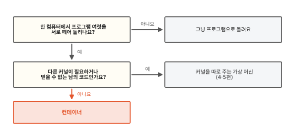

두 가지를 물어보면 대부분 정해져요. 첫째 물음은 "한 컴퓨터에서 프로그램 여럿을 서로 떼어 돌리나요?"예요. 빵집 앱의 부품 셋은 서로의 파일과 문 번호를 건드리면 안 돼요. 하나가 메모리를 다 써도 안 돼요. 그러려면 칸막이와 한도가 필요해요. 프로그램 하나만 돌리는 컴퓨터라면 그대로 돌려도 돼요.

둘째 물음은 "다른 커널이 필요하거나 믿을 수 없는 남의 코드인가요?"예요. 빵집 앱의 세 부품은 모두 내가 만든 리눅스용 프로그램이에요. 관리실 하나를 같이 써도 괜찮아서 컨테이너가 맞아요. 누가 올렸는지 모르는 코드를 돌려 주는 서비스라면 관리실을 같이 쓰는 것이 걱정이에요. 그때는 커널을 따로 주는 방법을 찾아요. 그 방법은 [4편](04-shared-kernel.md)과 [5편](05-microvm.md)에서 봐요.

## 다시 프로그램 목록을 열어 볼게요

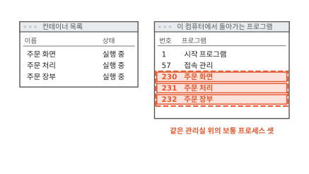

처음 장면의 두 창으로 돌아왔어요. 밖 목록에 세 부품이 보였던 것은 세 컨테이너가 이 컴퓨터의 관리실 위에서 도는 보통 프로세스라서였어요.

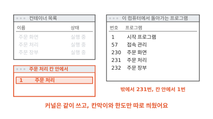

같은 주문 처리를 칸 안에서 보면 자기 하나뿐인 1번이에요. 가상 머신처럼 집을 따로 짓지 않았어요. 관리실을 같이 쓰면서 칸막이와 한도만 따로 씌웠어요. 컨테이너가 셋이든 삼백이든 건물의 관리실은 하나예요.

### 이 편에서 줄여 그린 것

그림을 쉽게 하려고 실제와 다르게 줄인 곳이 세 군데 있어요.

1. 칸막이를 벽 하나로 그렸어요. 실제로는 프로세스 번호, 파일, 네트워크, 사용자 번호처럼 나누는 대상마다 칸막이 종류가 따로 있어요. 사용자 번호를 나누는 칸막이는 [3편](03-user-and-permissions.md)에서 봐요.
2. 칸 안의 파일이 어디서 오는지는 그리지 않았어요. 컨테이너를 만드는 틀인 이미지에서 와요. [2편](02-image-layers.md)에서 봐요.
3. 메모리를 12칸으로 그리고 한도를 칸 수로 적었어요. 실제 한도는 바이트 단위로 적어요. 한도를 넘었을 때 일은 [10편](10-requests-limits.md)에서 봐요.

### 이 편에서 새로 나온 말

[^vm]: 쿠버네티스 문서는 가상 머신을 "자기 운영체제를 포함한 모든 구성 요소를 가상 하드웨어 위에서 돌리는 완전한 컴퓨터"로, 컨테이너를 "운영체제를 앱끼리 같이 쓰도록 격리를 느슨하게 한 것"으로 설명해요. <https://kubernetes.io/docs/concepts/overview/>
[^ns]: 리눅스 설명서 namespaces(7). 네임스페이스는 시스템 자원 하나를 감싸서 그 안의 프로세스에게 자기만의 사본처럼 보이게 하고, 안에서 바꾼 것은 밖에 보이지 않게 해요. <https://man7.org/linux/man-pages/man7/namespaces.7.html>
[^pid]: 리눅스 설명서 pid_namespaces(7). <https://man7.org/linux/man-pages/man7/pid_namespaces.7.html>
[^cg]: 리눅스 설명서 cgroups(7). 프로세스를 묶어서 묶음마다 자원 사용을 제한하고 재는 커널 기능이에요. 메모리 컨트롤러는 쓸 수 있는 메모리에 상한을 두고, CPU 컨트롤러는 바쁠 때 몫을 보장하거나 상한을 둬요. <https://man7.org/linux/man-pages/man7/cgroups.7.html>
[^limit]: 쿠버네티스 문서의 "Resource Management for Pods and Containers". CPU 한도는 CPU를 덜 주는 방식(throttling)으로 지키고, 메모리 한도를 넘으면 커널이 메모리가 모자란 때를 알아채고 그 컨테이너를 끝낼 수 있어요(OOM 킬). <https://kubernetes.io/docs/concepts/configuration/manage-resources-containers/>
[^k8s]: 쿠버네티스 문서는 이 때문에 컨테이너를 "가볍다"고 해요. <https://kubernetes.io/docs/concepts/overview/>
