# 이미지는 왜 층층이 쌓여 있을까요?

## 두 번째 이미지는 금방 받아졌어요

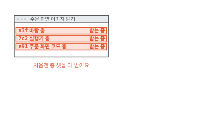

빵집 주문 앱의 주문 화면을 컨테이너로 띄우려고 해요. 컨테이너는 커널을 같이 쓰는 보통 프로세스에 칸막이와 사용량 한도를 씌운 것이에요([1편](01-container.md)). 띄우기 전에 컴퓨터가 주문 화면 이미지를 받아요. 화면을 보면 세 줄을 하나씩 받고 있어요. 줄마다 a3f 같은 짧은 글자와 "층"이라는 말이 붙어 있어요.

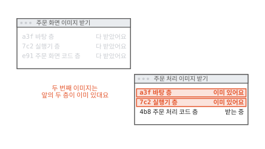

이어서 주문 처리 이미지를 받아요. 이번에는 처음 두 줄이 "이미 있어요"로 끝나요. 주문 처리 이미지는 처음 받는 이미지인데 무엇이 이미 있다는 걸까요?

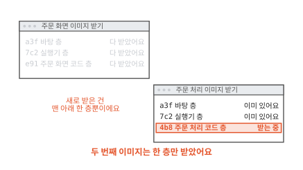

새로 받은 것은 4b8 한 줄뿐이에요. 그래서 두 번째 이미지는 금방 받아졌어요. 이미지는 왜 층으로 나뉘어 있고 컴퓨터는 무엇을 보고 "이미 있다"고 할까요? 먼저 이미지가 무엇인지부터 볼게요.

## 컨테이너 안의 파일은 이미지에서 와요

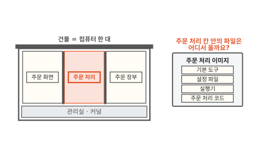

1편에서 칸막이를 치면 칸 안의 프로그램은 자기 칸의 파일만 본다고 했어요. 그러면 주문 처리 칸 안에는 어떤 파일이 있어야 할까요? 주문 처리 코드가 있어야 하고 그 코드를 돌리는 실행기도 있어야 해요. 실행기는 사람이 쓴 코드를 읽어서 컴퓨터에게 시키는 프로그램이에요. 그 밖에 기본 도구와 설정 파일도 필요해요.

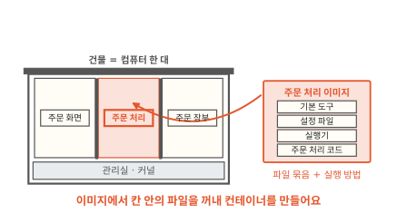

이 파일들을 한데 묶고 "켜면 주문 처리 코드를 실행해요" 같은 실행 방법을 붙여 둔 것을 **이미지**(image)라고 해요.[^image] 컨테이너를 만드는 틀이에요. 컴퓨터는 이미지의 파일로 칸 안의 파일을 채우고 적힌 방법대로 프로그램을 켜요.

빵집 앱은 부품마다 이미지가 하나씩 있어요. 이미지 여럿을 한 컴퓨터에 받아 두면 어떻게 될까요?

## 한 덩어리로 받으면 같은 파일을 또 받아요

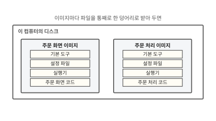

주문 화면과 주문 처리는 같은 바탕과 같은 실행기를 써요. 다른 것은 코드뿐이에요. 이미지를 파일 한 덩어리로 받는다면 그림처럼 디스크에 두 덩어리가 놓여요.

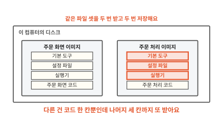

빨간 세 칸은 주문 화면 이미지에도 똑같이 있어요. 같은 파일을 두 번 받고 디스크에도 두 번 저장했어요. 코드 한 줄을 고쳐 새 이미지를 만들 때도 마찬가지예요. 바뀐 것은 코드뿐인데 덩어리 전체를 다시 받아야 해요. 바뀐 부분만 따로 떼어 둘 수는 없을까요?

## 투명 필름처럼 층을 겹쳐요

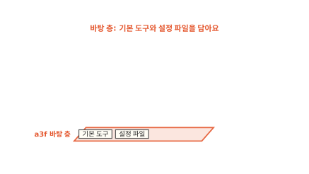

투명 필름에 그림을 나눠 그려서 겹치는 걸 떠올려 볼게요. 맨 아래 필름에는 기본 도구와 설정 파일을 담아요.

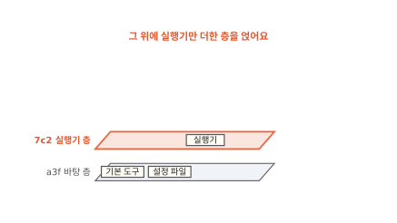

두 번째 필름에는 실행기만 담아요. 바탕 필름에 이미 있는 기본 도구와 설정 파일은 다시 담지 않아요.

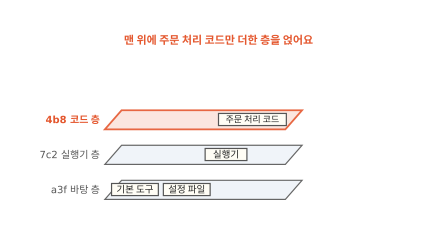

세 번째 필름에는 주문 처리 코드만 담아요. 필름 한 장 한 장에는 아래 필름에서 바뀐 것만 있어요.

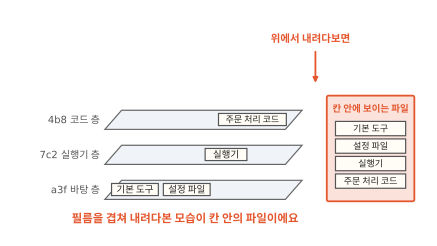

세 필름을 겹쳐 위에서 내려다보면 파일 넷이 한 장에 다 보여요. 주문 처리 칸 안에서 보이는 파일이 바로 이 모습이에요.

이렇게 아래 층에서 바뀐 파일만 담은 필름 한 장을 **레이어**(layer)라고 해요.[^layer] 이미지는 레이어 여러 장으로 되어 있어요. 레이어를 겹쳐서 하나의 파일 나무로 보여 주는 일은 커널이 해요. 리눅스에서는 이 일을 하는 겹쳐 쓰는 파일시스템으로 OverlayFS를 많이 써요.[^overlay]

??? info "심화: 위 층에서 파일을 지우면 어떻게 표시할까요?"
    위 층에서 아래 층의 파일을 없애고 싶을 때가 있어요. 그런데 필름에 무엇을 더 그릴 수는 있어도 아래 필름을 지울 수는 없어요. 그럴 때 어떻게 하는지 궁금하면 보는 칸이에요.

    위 층에 "이 파일은 없는 것으로 봐요"라는 표시 파일을 둬요. 이 표시를 화이트아웃(whiteout)이라고 해요. 이미지 형식을 정한 OCI 규격은 지운 파일 이름 앞에 `.wh.`를 붙인 빈 파일로 이 표시를 적어요.[^wh] 설정 파일을 지운 층에는 `.wh.설정 파일`이 들어가요. 겹쳐 내려다볼 때 이 표시가 아래 층의 설정 파일을 가려요.

    아래 층의 설정 파일 자체는 그대로 남아 있어요. 그래서 위 층에서 큰 파일을 지워도 이미지 크기는 줄지 않아요. 받을 때도 아래 층은 큰 파일을 담은 채로 내려와요. 큰 파일은 처음부터 그 층에 넣지 않아야 이미지가 작아져요.

## 같은 층은 한 번만 받고 한 번만 저장해요

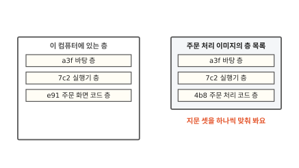

이제 처음 장면으로 돌아가 볼게요. 주문 화면 이미지를 받은 뒤라서 이 컴퓨터에는 층 셋이 있어요. 주문 처리 이미지는 자기 층 목록을 먼저 보내요. 목록의 a3f, 7c2, 4b8은 층마다 붙은 지문이에요.

지문은 층에 든 내용을 정해진 계산에 넣어서 얻은 긴 글자예요. 내용이 한 글자만 달라도 지문이 달라지고 내용이 같으면 지문도 같아요. 이 지문을 다이제스트(digest)라고 해요.[^digest] 그림에는 앞 세 글자만 적었어요.

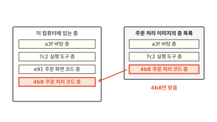

a3f와 7c2는 이미 가진 층과 지문이 같아요. 지문이 같으니 내용도 같아요. 그래서 컴퓨터는 이 두 층을 받지 않아요. 처음 장면의 "이미 있어요"는 이 뜻이었어요.

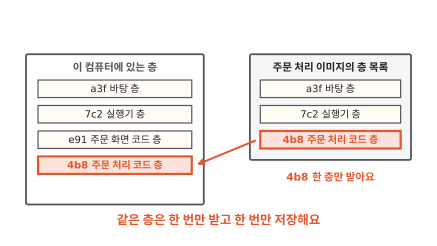

4b8만 새로 받아요. 이미지는 둘인데 디스크에 있는 층은 넷이에요. 덩어리로 받았다면 여섯 묶음이었을 거예요. 바탕 층과 실행기 층은 두 이미지가 같이 써요.[^share]

코드를 고쳐 새 주문 처리 이미지를 만들 때도 같아요. 바뀐 것은 맨 위 코드 층뿐이라 그 층 하나만 새로 받아요.

??? info "심화: 지문은 어떻게 만들까요?"
    a3f 같은 지문이 어디서 나오고 왜 믿을 만한지 궁금할 때 보는 칸이에요.

    지문은 해시 함수로 만들어요. 해시 함수는 아무리 긴 내용을 넣어도 정해진 길이의 글자를 내놓는 계산이에요([알고리즘 9편](../algorithms/09-hash.md)). 이미지에는 흔히 SHA-256을 써요. 다이제스트는 `sha256:` 뒤에 64글자가 붙은 모양이에요.

    OCI 규격은 이 다이제스트를 "내용 식별자"로 써요. 내용으로 이름을 정하니 받은 쪽이 직접 다시 계산해서 지문이 맞는지 확인할 수 있어요.[^digest] 받는 도중에 내용이 바뀌면 지문이 안 맞아서 들통나요.

    이미지 자체도 이런 지문 목록이에요. 이미지마다 "이 층들을 이 순서로 겹쳐요"라고 적은 목록(매니페스트)이 있고 거기에 층 다이제스트가 차례로 적혀 있어요. 처음 장면에서 받기 전에 층 목록부터 본 것도 이 목록이에요.

## 컨테이너가 파일을 고치면 맨 위 층에 써요

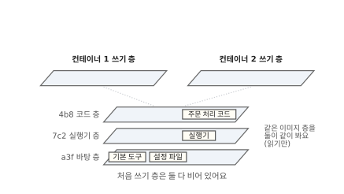

빵집에 주문이 몰리는 날에는 주문 처리를 컨테이너 둘로 띄워요. 두 컨테이너는 같은 이미지의 같은 층을 같이 봐요. 그래서 이미지 층은 읽기만 해요. 한 컨테이너가 이미지 층을 고치면 다른 컨테이너의 파일까지 바뀌니까요.

그 대신 컨테이너마다 맨 위에 빈 필름을 한 장씩 얹어요. 이 필름을 쓰기 층이라고 해요.[^docker] 컨테이너 1이 설정 파일을 고치면 어디에 써질까요?

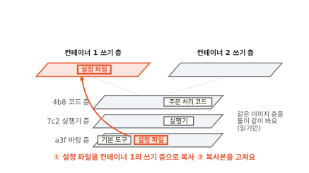

설정 파일은 맨 아래 바탕 층에 있어요. 바탕 층은 고칠 수 없어요. 그래서 처음 고치는 순간 설정 파일을 컨테이너 1의 쓰기 층으로 복사해요. 그다음 복사본을 고쳐요.

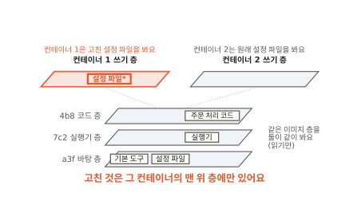

컨테이너 1이 위에서 내려다보면 쓰기 층의 고친 설정 파일이 아래 층의 원래 파일을 가려요. 그래서 고친 파일만 보여요. 컨테이너 2의 쓰기 층은 비어 있어요. 컨테이너 2는 바탕 층의 원래 설정 파일을 그대로 봐요.

이렇게 처음 고칠 때 그 파일을 맨 위 층으로 복사해서 고치는 방법을 **쓸 때 복사**(copy-on-write)라고 해요.[^docker] 고치지 않은 파일은 복사하지 않아요. 그래서 컨테이너를 열 개 띄워도 이미지 층은 디스크에 한 벌만 있어요.

??? info "심화: 큰 파일을 조금만 고쳐도 통째로 복사할까요?"
    아주 큰 파일을 컨테이너 안에서 조금씩 고치는 프로그램이 있을 때 걱정되면 보는 칸이에요.

    OverlayFS는 파일 단위로 일해요. 그래서 처음 고칠 때 파일 전체를 쓰기 층으로 복사해요. 고친 곳이 한 글자여도 파일 전체를 복사해요.[^copyup] 파일이 크면 첫 쓰기가 그만큼 느려지고 디스크도 그만큼 더 써요.

    한 번 복사한 뒤로는 복사본을 고치니 다시 복사하지 않아요. 그래도 데이터베이스 파일처럼 크고 자주 바뀌는 파일은 쓰기 층에 두지 않는 편이 좋아요. 다음 절에서 볼 까닭도 있어요.

## 컨테이너를 지우면 쓰기 층도 사라져요

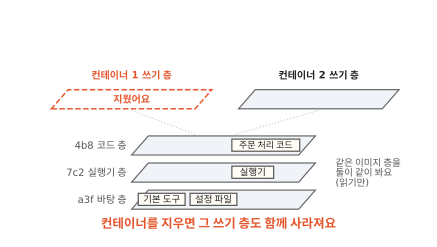

컨테이너 1을 지우면 그 쓰기 층도 함께 지워져요.[^docker] 고친 설정 파일도 같이 사라져요. 이미지 층은 그대로라서 같은 이미지로 새 컨테이너를 띄우면 원래 설정 파일로 다시 시작해요.

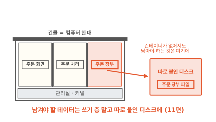

주문 장부라면 큰일이에요. 손님 주문을 적은 장부 파일이 쓰기 층에 있으면 컨테이너를 지울 때 장부도 사라져요. 그래서 남겨야 할 데이터는 쓰기 층에 두지 않고 컨테이너에 따로 붙인 디스크에 써요. 따로 붙인 디스크는 [11편](11-persistent-volume.md)에서 봐요.

## 층 나누기는 언제 쓸모 있을까요

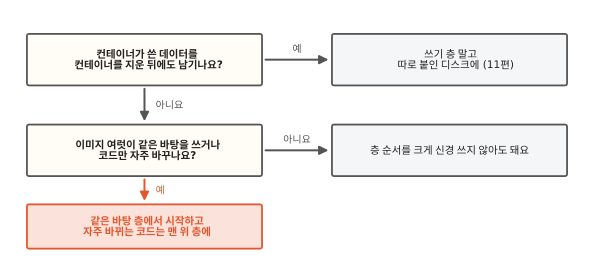

이미지를 만들 때 두 가지를 물어봐요. 첫째 물음은 "컨테이너가 쓴 데이터를 컨테이너를 지운 뒤에도 남기나요?"예요. 주문 장부처럼 남겨야 하면 쓰기 층에 맡기지 말고 따로 붙인 디스크에 써요. 고친 설정처럼 잠깐 쓰고 버려도 되는 것만 쓰기 층에 둬요.

둘째 물음은 "이미지 여럿이 같은 바탕을 쓰거나 코드만 자주 바꾸나요?"예요. 빵집 앱의 주문 화면과 주문 처리는 같은 바탕과 실행기를 써요. 두 이미지를 같은 바탕 층에서 시작하면 그 층은 한 번만 받아요. 코드는 날마다 고치니 맨 위 층에 둬요. 그러면 고칠 때마다 코드 층 하나만 새로 받아요. 반대로 코드를 아래 층에 넣으면 코드를 고칠 때마다 그 위의 층이 모두 다시 만들어져요.[^cache] 실행기 층이 코드 층 위에 있었다면 실행기 층까지 다시 만들고 다시 받아야 할 수 있어요.

## 다시 이미지 받기 화면을 볼게요

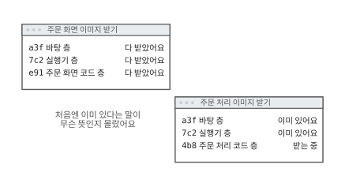

처음 장면의 화면으로 돌아왔어요. 그때는 처음 받는 이미지에서 "이미 있어요"가 왜 나오는지 몰랐어요.

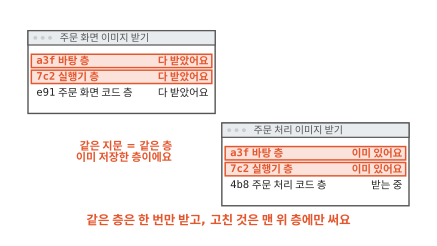

두 이미지는 a3f 바탕 층과 7c2 실행기 층을 같이 써요. 지문이 같으니 컴퓨터는 이미 저장한 층이라는 걸 알아요. 그래서 4b8 한 층만 받았어요. 그렇게 받은 층들은 읽기만 하고 컨테이너가 고친 것은 맨 위 쓰기 층에만 써요. 이미지가 둘이든 스물이든 같은 층은 한 번만 받아요.

### 이 편에서 줄여 그린 것

그림을 쉽게 하려고 실제와 다르게 줄인 곳이 네 군데 있어요.

1. 이미지마다 층을 셋으로 그렸어요. 실제 이미지는 만드는 설명서의 명령 가운데 파일을 바꾸는 명령마다 층이 하나씩 생겨서 보통 더 많아요.[^docker]
2. 지문을 세 글자로 줄였어요. 실제 다이제스트는 `sha256:` 뒤에 64글자예요.
3. 층을 받자마자 쓰는 것처럼 그렸어요. 실제로는 층을 압축한 채로 받아서 다 받은 뒤 풀어 둬요. 큰 이미지를 받는 데 시간이 걸리는 까닭은 [15편](15-image-pull.md)에서 봐요.
4. 층 하나에 파일을 한두 개만 그렸어요. 실제 바탕 층에는 파일이 수천 개 들어 있어요.

### 이 편에서 새로 나온 말

[^image]: 쿠버네티스 문서는 컨테이너 이미지를 "앱을 돌리는 데 필요한 모든 것, 곧 코드와 그 코드가 쓰는 실행 환경, 라이브러리, 기본 설정값을 담은 바로 실행할 수 있는 소프트웨어 꾸러미"라고 설명해요. <https://kubernetes.io/docs/concepts/containers/>
[^layer]: OCI 이미지 규격의 레이어 문서. 레이어는 아래 층에 대해 바뀐 것을 담은 묶음이고, 하나 이상의 레이어를 차례로 겹쳐서 완전한 파일시스템을 만들어요. <https://github.com/opencontainers/image-spec/blob/main/layer.md>
[^overlay]: 도커 문서의 "OverlayFS storage driver". 이미지 층마다 아래 층(lowerdir)으로, 컨테이너 층을 위 층으로 겹쳐 하나로 보여 줘요. <https://docs.docker.com/engine/storage/drivers/overlayfs-driver/>
[^wh]: OCI 이미지 규격의 레이어 문서, "Whiteouts" 절. <https://github.com/opencontainers/image-spec/blob/main/layer.md>
[^digest]: OCI 이미지 규격의 디스크립터 문서. 다이제스트는 내용 바이트를 충돌에 강한 해시로 계산한 값이고 내용 식별자로 써요. 받은 쪽은 다이제스트를 따로 계산해서 확인해요. <https://github.com/opencontainers/image-spec/blob/main/descriptor.md>
[^share]: 도커 문서는 같은 바탕 층을 쓰는 이미지끼리 그 층을 한 번만 저장하고, 이미 가진 층은 다시 받지 않는다고 설명해요. <https://docs.docker.com/engine/storage/drivers/>
[^docker]: 도커 문서의 "Storage drivers". 이미지 층은 읽기만 하고, 컨테이너를 만들면 그 위에 쓰기 층을 하나 얹고, 컨테이너를 지우면 쓰기 층도 지워져요. 쓸 때 복사와 명령마다 생기는 층도 이 문서에 있어요. 새로 설치한 도커 엔진 29.0부터는 containerd의 이미지 저장소를 기본으로 써서 명령과 저장 위치는 다를 수 있지만 층의 원리는 같아요. <https://docs.docker.com/engine/storage/drivers/>
[^cache]: 도커 문서의 "Docker build cache". 층 하나가 바뀌면 그 뒤에 오는 층도 모두 영향을 받아 다시 만들어져요. <https://docs.docker.com/build/cache/>
[^copyup]: 도커 문서의 "OverlayFS storage driver". OverlayFS의 복사(copy_up)는 큰 파일이라도 파일 전체를 복사해요. <https://docs.docker.com/engine/storage/drivers/overlayfs-driver/>
