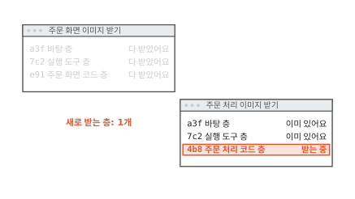
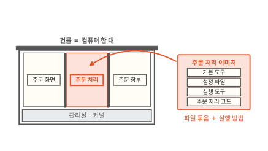
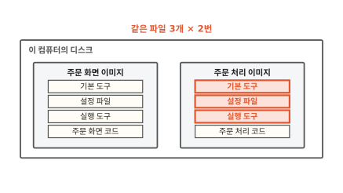
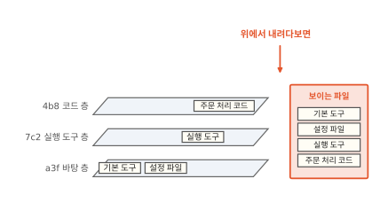
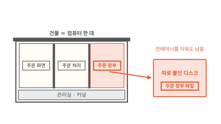

# 이미지와 레이어: 층층이 쌓인 컨테이너의 틀

주문 화면 이미지를 받은 다음 주문 처리 이미지를 받았더니 세 줄 가운데 두 줄이 "이미 있어요"로 끝났어요. 처음 받는 이미지인데 한 층만 새로 받은 거예요. 이 글을 읽고 나면 이미지를 왜 층으로 나눠 두는지 알게 돼요. 컴퓨터가 무엇을 보고 이미 있다고 하는지와 컨테이너 안에서 고친 파일이 어디로 가는지도 알게 돼요. 이걸 알면 받는 시간과 디스크를 아끼도록 이미지를 짤 수 있어요.

!!! abstract "이 글에서 알게 되는 것"
    1. 이미지는 컨테이너 안에 보일 파일 묶음과 실행 방법을 담은 틀이에요. 그 파일은 아래 층에서 바뀐 것만 담은 레이어 여러 장으로 나뉘어 있어요.
    2. 층마다 내용으로 계산한 지문(다이제스트)이 붙어 있어요. 컴퓨터는 지문으로 이미 가진 층을 알아봐서 같은 층은 한 번만 받고 한 번만 저장해요.
    3. 이미지 층은 읽기만 해요. 컨테이너가 파일을 고치면 그 파일을 맨 위 쓰기 층에 복사해서 고쳐요. 이 쓰기 층은 컨테이너를 지우면 함께 사라져요.

## 1. 두 번째 이미지는 한 층만 받았어요

빵집 주문 앱의 부품을 컨테이너로 띄우려고 해요. 컨테이너는 커널을 같이 쓰는 보통 프로세스에 칸막이와 사용량 한도를 씌운 것이에요([1편](01-container.md)). 띄우기 전에 컴퓨터가 부품마다 이미지를 받아요.

먼저 주문 화면 이미지를 받았어요. 화면에 a3f, 7c2, e91로 시작하는 세 줄이 나타나고 줄마다 "층"이라는 말이 붙어 있어요. 세 줄을 하나씩 다 받았어요. 이어서 주문 처리 이미지를 받아요. 아래 그림에서 두 번째 창의 상태 칸을 보세요.

**그림 1.** 주문 처리 이미지는 세 층 가운데 4b8 한 층만 새로 받아요.
{ .fig-cap }

a3f와 7c2는 "이미 있어요"로 끝나고 4b8만 받고 있어요. 그래서 두 번째 이미지는 금방 받아졌어요. 주문 처리 이미지는 처음 받는데 무엇이 이미 있다는 걸까요? 이미지가 무엇인지부터 보면 풀려요.

## 2. 이미지는 컨테이너 안 파일을 묶어 둔 틀이에요

1편에서 칸막이를 치면 칸 안의 프로그램은 자기 칸의 파일만 본다고 했어요. 그러면 주문 처리 칸 안에는 어떤 파일이 있어야 할까요? 주문 처리 코드가 있어야 하고 그 코드를 돌리는 실행 도구도 있어야 해요. 실행 도구는 사람이 쓴 코드를 읽어서 컴퓨터에게 시키는 프로그램이에요. 그 밖에 기본 도구와 설정 파일도 필요해요.

이 파일들을 한데 묶고 "켜면 주문 처리 코드를 실행해요" 같은 실행 방법을 붙여 둔 것을 **이미지**(image)라고 해요.[^image] 컨테이너를 만드는 틀이에요. 아래 그림에서 빨간 화살표가 어디로 가는지 보세요.

**그림 2.** 주문 처리 이미지의 파일이 주문 처리 칸 안의 파일이 돼요.
{ .fig-cap }

컴퓨터는 이미지의 파일로 칸 안을 채우고 적힌 방법대로 프로그램을 켜요. 빵집 앱은 부품마다 이미지가 하나씩 있어요.

여기서 걱정이 하나 생겨요. 주문 화면과 주문 처리는 같은 기본 도구와 같은 실행 도구를 써요. 다른 것은 코드뿐이에요. 이미지를 파일 한 덩어리로 받으면 어떻게 될까요? 아래 그림에서 빨간 칸을 보세요.

**그림 3.** 한 덩어리로 받으면 같은 파일 셋을 두 번 받고 디스크에도 두 번 저장해요.
{ .fig-cap }

빨간 세 칸은 주문 화면 이미지에도 똑같이 있어요. 같은 파일을 두 번 받고 디스크에도 두 번 저장했어요. 코드 한 줄을 고쳐 새 이미지를 만들 때도 마찬가지예요. 바뀐 것은 코드뿐인데 덩어리 전체를 다시 받아야 해요.

## 3. 바뀐 것만 담은 층을 겹쳐요

바뀐 부분만 따로 떼어 두면 이 문제가 풀려요. 투명 필름에 그림을 나눠 그려서 겹치는 걸 떠올려 보세요.

맨 아래 필름에는 기본 도구와 설정 파일을 담아요. 두 번째 필름에는 실행 도구만 담아요. 아래 필름에 이미 있는 기본 도구와 설정 파일은 다시 담지 않아요. 세 번째 필름에는 주문 처리 코드만 담아요. 아래 그림에서 세 필름과 오른쪽 상자를 함께 보세요.

**그림 4.** 필름 세 장을 겹쳐 위에서 내려다보면 파일 넷이 한 번에 보여요.
{ .fig-cap }

필름 한 장 한 장에는 아래 필름에서 바뀐 것만 있어요. 그런데 셋을 겹쳐 내려다보면 파일 넷이 다 보여요. 주문 처리 칸 안에서 보이는 파일이 이 모습이에요.

이렇게 아래 층에서 바뀐 파일만 담은 필름 한 장을 **레이어**(layer)라고 해요.[^layer] 이미지는 레이어 여러 장으로 되어 있어요. 레이어를 겹쳐서 하나의 파일 나무로 보여 주는 일은 커널이 해요. 리눅스에서는 이 일에 겹쳐 쓰는 파일시스템인 OverlayFS를 많이 써요.[^overlay]

필름에는 무엇을 더 그릴 수는 있어도 아래 필름을 지울 수는 없어요. 그래서 위 층에서 아래 층의 파일을 지우면 "이 파일은 없는 것으로 봐요"라는 표시만 남겨요.[^wh] 아래 층의 파일은 그대로 있어서 위 층에서 큰 파일을 지워도 이미지는 작아지지 않아요.

## 4. 지문이 같은 층은 한 번만 받아요

층으로 나눈 덕을 볼 차례예요. 처음 장면으로 돌아가요. 주문 화면 이미지를 받은 뒤라서 이 컴퓨터에는 a3f, 7c2, e91 층이 있어요. 주문 처리 이미지는 자기 층 목록을 먼저 보내요.

목록의 a3f, 7c2, 4b8은 층마다 붙은 지문이에요. 지문은 층에 든 내용을 정해진 계산에 넣어서 얻은 긴 글자예요. 내용이 한 글자만 달라도 지문이 달라지고 내용이 같으면 지문도 같아요. 이 지문을 **다이제스트**(digest)라고 해요.[^digest] 이런 계산을 해시 함수라고 해요([알고리즘 9편](../algorithms/09-hash.md)). 이미지에서는 흔히 SHA-256이라는 해시 함수를 써요. 실제 다이제스트는 `sha256:` 뒤에 64글자가 붙는데 그림에는 앞 세 글자만 적었어요.

컴퓨터는 목록의 지문을 자기가 가진 층의 지문과 하나씩 맞춰 봐요. 아래 그림에서 빨간 화살표 둘을 보세요.

**그림 5.** a3f와 7c2는 이 컴퓨터에 있는 층과 지문이 같아요.
{ .fig-cap }

지문이 같으니 내용도 같아요. 그래서 컴퓨터는 이 두 층을 받지 않아요. 처음 장면의 "이미 있어요"가 이 뜻이었어요. 남은 4b8은 어떻게 될까요?

**그림 6.** 4b8 한 층만 받아서 이미지 둘이 층 넷으로 끝나요.
{ .fig-cap }

4b8만 새로 받아요. 이미지는 둘인데 디스크에 있는 층은 넷이에요. 덩어리로 받았다면 여섯 묶음이었을 거예요. 바탕 층과 실행 도구 층은 두 이미지가 같이 써요.[^share]

코드를 고쳐 새 주문 처리 이미지를 만들 때도 같아요. 바뀐 것은 맨 위 코드 층뿐이라 그 층 하나만 새로 받아요. 그래서 이미지를 만들 때 층 순서가 중요해요. 자주 바뀌는 코드는 맨 위 층에 둬요. 코드를 아래 층에 넣으면 코드를 고칠 때마다 그 위의 층이 모두 다시 만들어져요.[^cache] 실행 도구 층이 코드 층 위에 있었다면 실행 도구 층까지 다시 만들고 다시 받아야 할 수 있어요.

## 5. 컨테이너가 고친 파일은 맨 위 쓰기 층에 들어가요

이번에는 받은 이미지로 컨테이너를 띄워요. 주문이 몰리는 날이라 주문 처리를 컨테이너 둘로 띄웠어요. 두 컨테이너는 같은 이미지의 같은 층을 같이 봐요. 그래서 이미지 층은 읽기만 해요. 한 컨테이너가 이미지 층을 고치면 다른 컨테이너의 파일까지 바뀌니까요.

그 대신 컨테이너마다 맨 위에 빈 필름을 한 장씩 얹어요. 이 필름을 **쓰기 층**이라고 해요.[^docker] 컨테이너 1이 설정 파일을 고치면 어디에 써질까요? 아래 그림에서 빨간 곡선 화살표를 보세요.

**그림 7.** 설정 파일을 처음 고칠 때 바탕 층에서 컨테이너 1의 쓰기 층으로 복사해요.
{ .fig-cap }

설정 파일은 맨 아래 바탕 층에 있고 바탕 층은 고칠 수 없어요. 그래서 처음 고치는 순간 설정 파일을 컨테이너 1의 쓰기 층으로 복사해요. 그다음 복사본을 고쳐요. 고친 뒤에 두 컨테이너는 무엇을 볼까요?

**그림 8.** 컨테이너 1은 고친 설정 파일을 보고 컨테이너 2는 원래 설정 파일을 봐요.
{ .fig-cap }

컨테이너 1이 위에서 내려다보면 쓰기 층의 고친 설정 파일이 아래 층의 원래 파일을 가려요. 그래서 고친 파일만 보여요. 컨테이너 2의 쓰기 층은 비어 있어서 바탕 층의 원래 설정 파일이 보여요.

이렇게 처음 고칠 때 그 파일을 맨 위 층으로 복사해서 고치는 방법을 **쓸 때 복사**(copy-on-write)라고 해요.[^docker] 고치지 않은 파일은 복사하지 않아요. 그래서 컨테이너를 열 개 띄워도 이미지 층은 디스크에 한 벌만 있어요.

다만 OverlayFS는 파일 단위로 복사해요. 아주 큰 파일에서 한 글자만 고쳐도 처음 한 번은 파일 전체를 쓰기 층으로 복사해요.[^copyup] 그만큼 첫 쓰기가 느리고 디스크도 더 써요.

## 6. 컨테이너를 지우면 쓰기 층도 사라져요

컨테이너 1을 지우면 그 쓰기 층도 함께 지워져요.[^docker] 고친 설정 파일도 같이 사라져요. 이미지 층은 그대로라서 같은 이미지로 새 컨테이너를 띄우면 원래 설정 파일로 다시 시작해요.

설정 파일이면 괜찮지만 주문 장부라면 큰일이에요. 손님 주문을 적은 장부 파일이 쓰기 층에 있으면 컨테이너를 지울 때 장부도 사라져요. 그래서 남겨야 할 데이터는 쓰기 층에 두지 않고 컨테이너에 따로 붙인 디스크에 써요. 아래 그림에서 주문 장부 칸의 화살표를 보세요.

**그림 9.** 주문 장부 파일은 쓰기 층에 두지 않고 따로 붙인 디스크에 써요.
{ .fig-cap }

따로 붙인 디스크는 컨테이너를 지워도 남아요. 이 디스크를 어떻게 붙이는지는 [11편](11-persistent-volume.md)에서 봐요. 쓰기 층에는 고친 설정처럼 잠깐 쓰고 버려도 되는 것만 둬요.

## 정리

처음 장면에서 주문 처리 이미지가 4b8 한 층만 받은 까닭을 이제 말할 수 있어요. 이미지는 컨테이너 안에 보일 파일을 담은 틀인데 그 파일을 레이어 여러 장으로 나눠 둬요. 층마다 내용으로 계산한 지문이 붙어 있어서 컴퓨터는 a3f와 7c2가 이미 가진 층이라는 걸 알아봤어요. 그래서 같은 층은 한 번만 받고 한 번만 저장해요. 자주 바뀌는 코드를 맨 위 층에 두면 고칠 때마다 그 층 하나만 다시 받아요.

받은 이미지 층은 여러 컨테이너가 같이 보니 읽기만 해요. 컨테이너가 설정 파일을 고치면 그 파일을 맨 위 쓰기 층에 복사해서 고쳐요. 쓰기 층은 컨테이너를 지우면 함께 사라지니 남겨야 할 주문 장부는 따로 붙인 디스크에 써요.

그림에서는 이미지마다 층을 셋으로 그렸어요. 실제 이미지는 만드는 설명서의 명령 가운데 파일을 바꾸는 명령마다 층이 하나씩 생겨서 보통 더 많아요.[^docker] 층은 압축한 채로 받아서 다 받은 뒤 풀어 둬요. 큰 이미지를 받는 데 시간이 걸리는 까닭은 [15편](15-image-pull.md)에서 봐요.

칸 안 파일에는 주인이 있어요. [3편](03-user-and-permissions.md)에서는 그 주인을 정하는 사용자 번호를 봐요.

### 새로 나온 말

- **이미지**: 컨테이너 안에 보일 파일 묶음과 실행 방법을 담은 틀. 주문 처리 이미지는 a3f, 7c2, 4b8 세 층으로 되어 있어요.
- **레이어**: 아래 층에서 바뀐 파일만 담은 층 하나. 7c2 실행 도구 층에는 실행 도구만 들어 있어요.
- **겹쳐 쓰는 파일시스템**: 레이어를 겹쳐 하나의 파일 나무로 보여 주는 방법. 리눅스에서는 OverlayFS를 많이 써요.
- **다이제스트**: 층 내용으로 계산한 지문. 두 이미지의 a3f 층은 지문이 같아서 한 번만 받았어요.
- **쓰기 층**: 컨테이너마다 맨 위에 얹는 빈 층. 컨테이너를 지우면 함께 사라져요.
- **쓸 때 복사**: 파일을 처음 고칠 때 그 파일을 맨 위 층으로 복사해서 고치는 방법. 컨테이너 1의 설정 파일*이 이렇게 생겼어요.

[^image]: 쿠버네티스 문서는 컨테이너 이미지를 앱을 돌리는 데 필요한 코드, 실행 환경, 라이브러리, 기본 설정값을 담은 바로 실행할 수 있는 소프트웨어 꾸러미라고 설명해요. <https://kubernetes.io/docs/concepts/containers/>
[^layer]: OCI 이미지 규격의 레이어 문서. 레이어는 아래 층에 대해 바뀐 것을 담은 묶음이에요. 레이어를 차례로 겹쳐서 완전한 파일시스템을 만들어요. <https://github.com/opencontainers/image-spec/blob/main/layer.md>
[^overlay]: 도커 문서 "OverlayFS storage driver". 이미지 층을 아래 층으로, 컨테이너 층을 위 층으로 겹쳐 하나로 보여 줘요. <https://docs.docker.com/engine/storage/drivers/overlayfs-driver/>
[^wh]: OCI 이미지 규격의 레이어 문서 "Whiteouts" 절. 지운 파일 이름 앞에 `.wh.`를 붙인 빈 파일로 이 표시를 적어요. <https://github.com/opencontainers/image-spec/blob/main/layer.md>
[^digest]: OCI 이미지 규격의 디스크립터 문서. 다이제스트는 내용을 해시로 계산한 값이고 내용 식별자로 써요. 받은 쪽은 다이제스트를 따로 계산해서 확인해요. <https://github.com/opencontainers/image-spec/blob/main/descriptor.md>
[^share]: 도커 문서는 같은 바탕 층을 쓰는 이미지끼리 그 층을 한 번만 저장하고 이미 가진 층은 다시 받지 않는다고 설명해요. <https://docs.docker.com/engine/storage/drivers/>
[^docker]: 도커 문서 "Storage drivers". 이미지 층은 읽기만 해요. 컨테이너를 만들면 그 위에 쓰기 층을 하나 얹고 컨테이너를 지우면 쓰기 층도 지워져요. 쓸 때 복사와 명령마다 생기는 층도 이 문서에 있어요. 도커 엔진 29.0부터 새로 설치하면 containerd의 이미지 저장소를 기본으로 써서 명령과 저장 위치는 다를 수 있지만 층의 원리는 같아요. <https://docs.docker.com/engine/storage/drivers/>
[^cache]: 도커 문서 "Docker build cache". 층 하나가 바뀌면 그 뒤에 오는 층도 모두 다시 만들어져요. <https://docs.docker.com/build/cache/>
[^copyup]: 도커 문서 "OverlayFS storage driver". OverlayFS의 복사(copy_up)는 큰 파일이라도 파일 전체를 복사해요. <https://docs.docker.com/engine/storage/drivers/overlayfs-driver/>
