# 컨테이너 안의 root는 진짜 root일까요?

## 장부 파일을 열 수 없대요

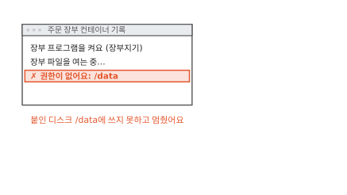

빵집 주문 앱의 주문 장부를 컨테이너로 띄웠어요. 컨테이너는 커널을 같이 쓰는 보통 프로세스에 칸막이와 사용량 한도를 씌운 것이에요([1편](01-container.md)). 주문 장부는 장부 파일을 따로 붙인 디스크 `/data`에 써요. 컨테이너를 지워도 장부가 남게 하려고 붙인 디스크예요([2편](02-image-layers.md)). 그런데 기록 창에 "권한이 없어요"가 뜨고 프로그램이 멈췄어요.

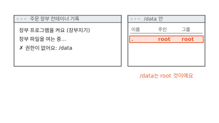

`/data` 안을 열어 보니 주인이 root라고 적혀 있어요. root는 그 컴퓨터에서 무엇이든 할 수 있는 관리자 계정이에요. 장부 프로그램은 장부지기라는 사용자로 돌고 있었어요.

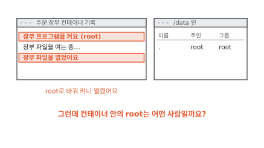

장부 프로그램을 root로 바꿔 켜니 장부 파일이 열렸어요. 문제는 풀린 것 같아요. 그런데 이 root는 칸 안에서만 관리자일까요, 아니면 이 컴퓨터 전체의 관리자일까요? 답을 알려면 컴퓨터가 파일 주인을 어떻게 적어 두는지부터 봐야 해요.

## 컴퓨터는 사람을 번호로 기억해요

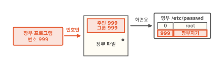

학교 사물함을 떠올려 볼게요. 사물함 문에는 이름 대신 번호표가 붙어 있어요. 내 번호와 번호표가 맞으면 내 사물함이에요. 컴퓨터의 파일도 이렇게 다뤄요.

파일마다 번호표가 붙어 있어요. 번호표에는 주인 번호와 그룹 번호가 적혀 있어요.[^inode] 프로그램도 번호를 하나씩 들고 돌아요. 장부 프로그램이 파일을 열면 커널이 프로그램의 번호와 파일 번호표를 맞춰 봐요. 커널은 프로그램과 하드웨어 사이에서 일을 나눠 주는 운영체제의 중심이에요(1편). 이 번호를 **사용자 번호**(UID)라고 해요.[^cred]

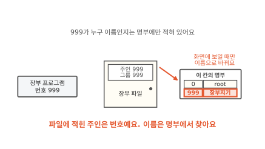

장부지기라는 이름은 어디서 왔을까요? 번호를 이름으로 바꿔 주는 표가 따로 있어요. 이 글에서는 명부라고 부를게요. 리눅스에서는 `/etc/passwd`라는 파일이 명부 노릇을 해요.[^passwd] 파일 목록을 보여 줄 때만 명부를 찾아서 999를 장부지기로 바꿔 보여 줘요. 커널이 권한을 따질 때는 번호만 봐요.

번호표에는 그룹 번호도 있어요. 그룹은 여러 사용자를 묶은 것이에요. 같은 그룹에 든 사람끼리는 파일을 나눠 쓰게 할 수 있어요. 그룹마다 붙는 번호를 **그룹 번호**(GID)라고 해요. 프로그램은 그룹 번호를 하나 넘게 가질 수 있어요.

## 이름이 달라도 번호가 같으면 같은 사람이에요

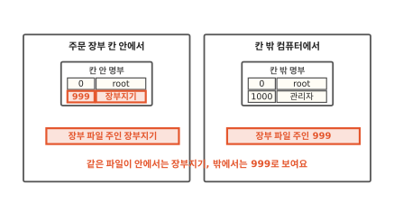

명부는 파일이에요. 그래서 칸막이마다 명부가 따로 있어요. 칸 안의 파일은 이미지에서 오니까 칸 안 명부도 이미지에 든 명부예요. 칸 밖 컴퓨터에는 칸 밖 명부가 있어요. 같은 장부 파일을 칸 안에서 보면 주인이 장부지기예요. 칸 밖 명부에는 999가 없어서 칸 밖에서 보면 999라는 번호 그대로 보여요.

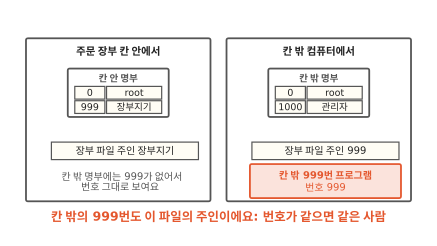

칸 밖에서 999번으로 도는 프로그램이 있으면 어떻게 될까요? 커널은 번호만 맞춰 봐요. 그 프로그램도 이 장부 파일의 주인으로 쳐요. 이름이 달라도 번호가 같으면 커널에게는 같은 사람이에요.

그럼 처음 장면의 root는 몇 번일까요?

## 컨테이너 안의 root는 0번이에요

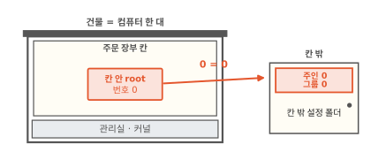

root는 이름이고 번호는 0번이에요. 칸 안 명부에서도 0번이 root이고 칸 밖 명부에서도 0번이 root예요. 1편에서 본 것처럼 칸 안과 밖은 관리실 하나, 곧 커널 하나를 같이 써요. 그 커널은 번호만 맞춰 봐요. 칸 안의 0번과 칸 밖의 0번을 구별할 근거가 없어요.

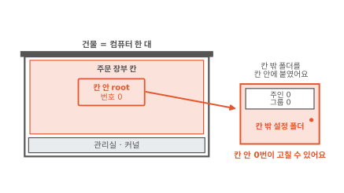

칸 밖 컴퓨터의 설정 폴더를 칸 안에 붙였다고 해 볼게요. 이 폴더의 주인은 칸 밖 root, 0번이에요. 칸 안의 root도 0번이라서 이 폴더를 주인처럼 고칠 수 있어요.

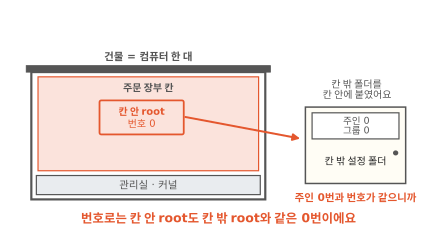

그래서 처음 질문의 답은 이래요. 파일 주인을 따질 때 칸 안의 root는 칸 밖 root와 같은 0번이에요. 칸 밖 파일이 칸 안에 보이기만 하면 그 파일을 마음대로 고쳐요. 그래서 칸 안 프로그램에 구멍이 나면 칸 밖 컴퓨터까지 위험해져요.[^userns]

그래서 컨테이너 프로그램은 0이 아닌 번호로 돌리는 편이 안전해요. 쿠버네티스에서는 파드 설정의 `runAsUser`에 번호를 적어요.[^sc] 파드는 쿠버네티스가 함께 띄우는 컨테이너 묶음이에요. 그런데 처음 장면에서 999번으로 돌릴 때는 장부 파일을 못 열었어요. 무엇이 맞지 않았을까요?

??? info "심화: 칸 안의 root는 무엇이든 할 수 있을까요?"
    칸 안 root가 칸 밖 root와 정말 똑같은 힘을 가졌는지 궁금할 때 보는 칸이에요.

    파일 주인을 따지는 일에서는 같아요. 하지만 root가 하는 특별한 일은 따로 쪼개져 있어요. 커널 기능 모듈을 끼우거나 네트워크 설정을 바꾸는 일 같은 것이에요. 이 쪼갠 권한 하나하나를 능력(capability)이라고 해요.

    컨테이너를 띄우는 프로그램은 보통 이 능력의 일부만 주고 컨테이너를 켜요. 도커 문서는 그래서 컨테이너 안 root가 진짜 root보다 권한이 훨씬 적다고 설명해요.[^cap] 그래도 본문처럼 0번 파일이 칸 안에 보이면 주인 자격으로 고칠 수 있어요. 능력을 줄이는 것만으로는 그 일을 막지 못해요.

??? info "심화: 칸 안의 0번을 칸 밖에서는 다른 번호로 바꿀 수 없을까요?"
    프로그램이 꼭 root로 돌아야 하는데 칸 밖이 걱정될 때 보는 칸이에요.

    사용자 번호를 나누는 칸막이도 있어요. 1편에서 본 리눅스 네임스페이스 가운데 User 종류예요. 이 칸막이를 치면 칸 안의 0번을 칸 밖의 다른 번호로 바꿔 적을 수 있어요. 칸 안에서 0번인 프로그램이 칸 밖에서는 아무 권한 없는 번호가 돼요.[^ns]

    쿠버네티스에서는 파드 설정에 `hostUsers: false`를 적으면 이 칸막이를 써요. 쿠버네티스 문서는 이 칸막이 없이 root로 도는 컨테이너가 칸 밖으로 빠져나오면 노드의 root 권한을 갖는다고 적어요. 노드는 컨테이너가 도는 컴퓨터 한 대예요. 이 칸막이를 치면 그렇지 않아요. 다만 리눅스 커널과 컨테이너 실행 프로그램이 일정 버전 이상이어야 해요.[^userns]

## 디스크 그룹에 들면 root가 아니어도 써요

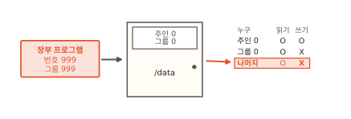

파일 번호표에는 번호만 있지 않아요. 누가 무엇을 할 수 있는지 적은 표도 함께 있어요. 그림 오른쪽처럼 주인, 같은 그룹, 나머지 세 줄로 읽기와 쓰기를 따로 정해요. `/data`는 주인 0번만 쓸 수 있어요. 장부 프로그램은 999번이고 그룹도 999예요. 주인 줄에도 그룹 줄에도 들지 못해서 나머지 줄을 따라요. 나머지 줄에는 쓰기가 없어요. 처음 장면의 "권한이 없어요"는 이것이었어요.

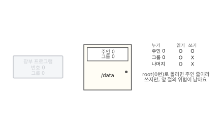

root로 돌리면 주인 줄에 들어서 써요. 처음 장면에서 열린 것도 그래서예요. 하지만 앞 절에서 본 위험이 그대로 남아요. 다른 길은 없을까요?

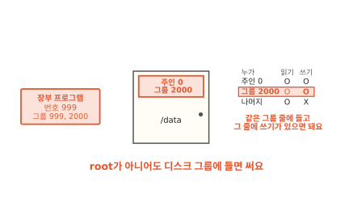

그룹 줄을 쓰면 돼요. `/data`의 그룹을 2000으로 바꾸고 그룹 줄에 쓰기를 열어요. 장부 프로그램도 그룹 2000에 넣어요. 그러면 장부 프로그램은 같은 그룹 줄에 들어서 쓸 수 있어요. 이 일을 누가 해 줄까요?

## 쿠버네티스가 디스크 그룹을 맞춰 줘요

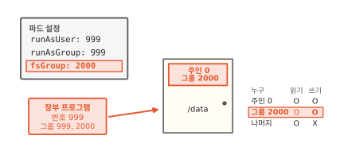

파드 설정에 세 줄을 적어요. 처음 두 줄은 장부 프로그램을 사용자 번호 999, 그룹 번호 999로 켜라는 뜻이에요.

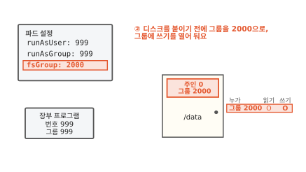

셋째 줄이 디스크 그룹을 정해요. 쿠버네티스는 디스크를 붙이기 전에 그 안의 파일과 폴더 그룹을 모두 2000으로 바꾸고 그룹에 쓰기를 열어 둬요.[^fsg]

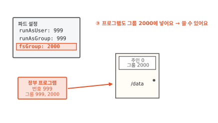

그리고 장부 프로그램을 그룹 2000에도 넣어요. 장부 프로그램의 그룹은 999와 2000 둘이 돼요. 이제 `/data`의 그룹 줄에 들어서 쓸 수 있어요.

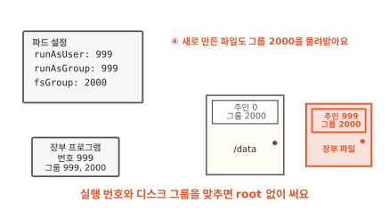

장부 프로그램이 새로 만든 장부 파일은 주인이 999예요. 그룹은 폴더를 따라 2000이 돼요.[^sc] 나중에 999가 아닌 번호로 도는 프로그램이 와도 그룹 2000에만 들면 이 파일을 함께 써요.

이렇게 붙인 디스크의 그룹을 맞추고 프로그램도 그 그룹에 넣는 설정을 **fsGroup**이라고 해요.[^sc]

??? info "심화: 디스크가 크면 그룹 바꾸기가 오래 걸리지 않을까요?"
    파일이 아주 많은 디스크를 붙이는 파드가 뜨는 데 오래 걸릴 때 보는 칸이에요.

    쿠버네티스는 기본으로 디스크를 붙일 때마다 그 안의 파일을 하나하나 다 보고 그룹과 권한을 바꿔요. 파일이 많으면 이 일 때문에 파드가 늦게 떠요.

    `fsGroupChangePolicy: OnRootMismatch`를 적으면 디스크 맨 위 폴더의 그룹과 권한이 이미 맞을 때는 건너뛰어요. 기본값 `Always`는 붙일 때마다 바꿔요.[^fsg]

    모든 디스크에 이 일이 일어나지는 않아요. 디스크 종류가 주인 바꾸기를 지원해야 해요. 디스크를 만들어 붙이는 플러그인을 CSI 드라이버라고 해요([11편](11-persistent-volume.md)). CSI 드라이버가 그룹 맞추기를 직접 하겠다고 하면 쿠버네티스는 그 일을 드라이버에 맡겨요.[^fsg]

## 번호 맞추기는 언제 쓸모 있을까요

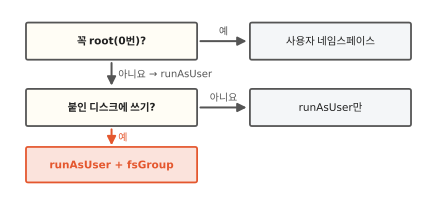

두 가지를 물어보면 정해져요. 첫째 물음은 "프로그램이 꼭 root로 돌아야 하나요?"예요. 대부분의 프로그램은 0번이 아니어도 돌아요. 그러면 `runAsUser`로 0이 아닌 번호를 정해요. 꼭 root여야 하는 프로그램이면 칸 안의 0번을 칸 밖의 다른 번호로 바꾸는 사용자 네임스페이스를 써요.

둘째 물음은 "붙인 디스크에 쓰나요?"예요. 주문 화면처럼 이미지에 든 파일만 읽는다면 실행 번호만 정하면 돼요. 주문 장부처럼 붙인 디스크에 써야 하면 디스크 번호표와 프로그램 번호가 맞아야 해요. 그때 `fsGroup`으로 디스크 그룹을 맞춰요.

## 다시 장부 프로그램을 켜 볼게요

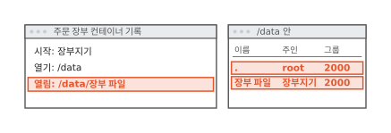

처음 장면으로 돌아왔어요. 그때는 999번 장부지기가 0번 root의 `/data`에 쓰려 했어요. 주인 줄에도 그룹 줄에도 들지 못해서 막혔어요.

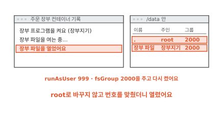

이번에는 `runAsUser: 999`와 `fsGroup: 2000`을 주고 다시 켰어요. 쿠버네티스가 `/data`의 그룹을 2000으로 바꾸고 장부 프로그램도 그 그룹에 넣었어요. 장부지기 그대로 장부 파일을 열었어요. 칸이 하나든 백 개든 커널은 이름 대신 번호만 맞춰 봐요.

### 이 편에서 줄여 그린 것

그림을 쉽게 하려고 실제와 다르게 줄인 곳이 세 군데 있어요.

1. 권한을 읽기와 쓰기 두 칸으로 그렸어요. 실제로는 실행 칸이 하나 더 있어요. 폴더에서는 이 칸이 "안으로 들어갈 수 있는지"를 뜻해요.
2. 칸 밖 폴더를 칸 안에 붙이는 일을 화살표 하나로 그렸어요. 쿠버네티스에서 디스크를 붙이는 방법은 [11편](11-persistent-volume.md)에서 봐요.
3. 명부를 표 하나로 그렸어요. 실제로는 사용자 명부 `/etc/passwd`와 그룹 명부 `/etc/group`이 따로 있어요.

### 이 편에서 새로 나온 말

[^inode]: 리눅스 설명서 inode(7). 파일마다 주인의 사용자 번호(`st_uid`)와 그룹 번호(`st_gid`)를 적어 둬요. <https://man7.org/linux/man-pages/man7/inode.7.html>
[^cred]: 리눅스 설명서 credentials(7). 프로세스마다 사용자 번호와 그룹 번호가 있고 파일에 접근할 때 권한을 이 번호로 따져요. <https://man7.org/linux/man-pages/man7/credentials.7.html>
[^passwd]: 리눅스 설명서 passwd(5). 사용자 이름과 사용자 번호를 한 줄씩 짝지어 적는 파일이에요. <https://man7.org/linux/man-pages/man5/passwd.5.html>
[^sc]: 쿠버네티스 문서의 "Configure a Security Context for a Pod or Container". `runAsUser`는 프로세스의 사용자 번호를, `runAsGroup`은 주 그룹 번호를 정해요. `fsGroup`을 주면 프로세스가 그 그룹에도 들고, 붙인 디스크와 그 안에 새로 만든 파일의 그룹이 그 번호가 돼요. <https://kubernetes.io/docs/tasks/configure-pod-container/security-context/>
[^fsg]: 같은 문서의 "Configure volume permission and ownership change policy for Pods" 절. 기본으로 디스크를 붙일 때 안의 내용을 모두 돌며 주인과 권한을 바꾸고, 큰 디스크는 파드 시작이 늦어질 수 있어요. `fsGroupChangePolicy`는 `OnRootMismatch`와 `Always` 두 값이 있어요. CSI 드라이버가 `VOLUME_MOUNT_GROUP` 기능을 지원하면 그 드라이버가 대신 맞춰요. <https://kubernetes.io/docs/tasks/configure-pod-container/security-context/>
[^ns]: 리눅스 설명서 user_namespaces(7). 프로세스는 사용자 네임스페이스 밖에서는 보통 사용자 번호를 가지면서 안에서는 0번을 가질 수 있어요. <https://man7.org/linux/man-pages/man7/user_namespaces.7.html>
[^userns]: 쿠버네티스 문서의 "User Namespaces". 사용자 네임스페이스 없이 root로 도는 컨테이너가 빠져나오면 노드의 root 권한을 갖는다고 적어요. 리눅스 6.3 이상, 컨테이너 실행 프로그램의 일정 버전 이상이 필요해요. 쿠버네티스 v1.28에 처음 들어왔어요. <https://kubernetes.io/docs/concepts/workloads/pods/user-namespaces/>
[^cap]: 도커 문서의 "Docker Engine security", 커널 능력(capabilities) 절. <https://docs.docker.com/engine/security/>
