# 컨테이너끼리는 왜 완전히 떨어져 있지 않을까요?

## 칸막이를 넘어간 침입자

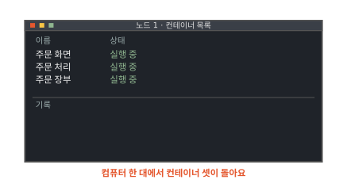

동네 빵집의 주문 앱은 부품 셋으로 돌아가요. 손님이 보는 주문 화면, 주문을 받아 처리하는 주문 처리, 주문을 적어 두는 주문 장부예요. 그림의 화면처럼 셋 다 컴퓨터 한 대에서 컨테이너로 돌아요. 컨테이너는 보통 프로그램에 칸막이와 사용량 한도를 씌운 것이에요([1편](01-container.md)). 칸막이 덕에 주문 화면 안에서는 주문 장부의 파일이 보이지 않아요.

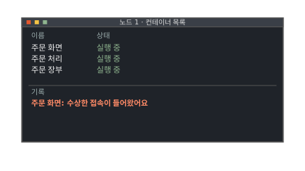

어느 날 기록에 수상한 줄이 찍혀요. 인터넷에 열려 있는 주문 화면에 누군가 몰래 들어왔어요.

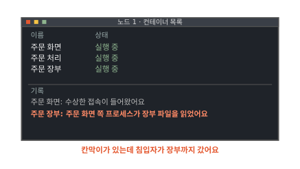

곧이어 주문 장부 쪽에도 기록이 남아요. 주문 화면 쪽에서 돌던 프로그램이 장부 파일을 읽었다는 기록이에요. 주문 화면 안에서는 장부 파일이 보이지도 않는데 침입자는 어떻게 거기까지 갔을까요?

## 칸막이 사무실에는 공용 관리실이 있어요

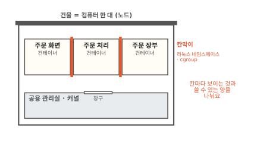

컴퓨터 한 대를 건물 한 채로 그려 볼게요. 컨테이너는 이 건물 안의 칸막이 사무실이에요. 그림의 빨간 벽이 칸막이예요. 1편에서 본 리눅스 네임스페이스와 cgroup이 이 칸막이를 만들어요. 리눅스 네임스페이스는 칸마다 보이는 파일과 프로그램을 나누고 cgroup은 칸마다 쓸 수 있는 CPU와 메모리의 양을 나눠요.

칸막이는 벽을 세운 것뿐이에요. 건물은 그대로 한 채예요. 전기와 수도는 누가 대 줄까요?

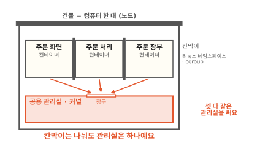

건물에는 아래층에 관리실이 하나 있어요. 관리실은 전기, 수도, 열쇠를 모든 사무실에 나눠 줘요. 컴퓨터에서 이 관리실 노릇을 하는 것이 커널이에요. 커널은 운영체제의 중심 프로그램이에요. CPU, 메모리, 디스크 같은 하드웨어를 프로그램들에 나눠 줘요. 그림처럼 컨테이너 셋은 모두 이 커널 하나를 같이 써요.

## 프로그램은 무엇을 하든 커널에 부탁해요

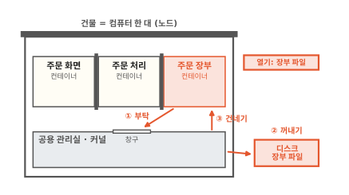

주문 장부가 장부 파일을 읽으려고 해요. 파일은 디스크에 있어요. 디스크는 전원이 꺼져도 내용이 남는 저장 장치예요([컴퓨터 5편](../computer/05-where-computers-remember.md)). 그런데 주문 장부는 디스크를 직접 만지지 못해요. 그림처럼 관리실 창구에 "장부 파일 열어 주세요"라고 부탁해요.

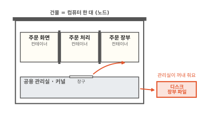

부탁을 받은 커널이 디스크에서 파일 내용을 꺼내 주문 장부에 건네줘요. 하드웨어를 만지는 일은 커널만 해요. 여러 프로그램이 디스크를 제멋대로 만지면 서로의 파일을 망가뜨릴 수 있어서예요.

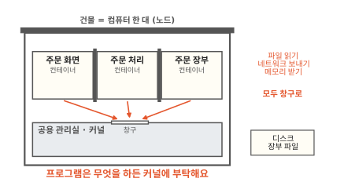

파일만 그런 게 아니에요. 네트워크로 주문을 보낼 때도, 메모리를 더 받을 때도 프로그램은 커널에 부탁해요. 이렇게 프로그램이 커널에 일을 부탁하는 창구를 **시스템 호출**(system call)이라고 해요.[^syscalls] 그림처럼 컨테이너 셋의 부탁은 모두 같은 커널의 같은 창구로 들어가요. 주문 화면이 장부 파일을 부탁하면 어떻게 될까요?

??? info "심화: 시스템 호출은 몇 가지나 있을까요?"
    프로그램이 커널에 부탁할 수 있는 일이 얼마나 다양한지 궁금할 때 보는 칸이에요.

    리눅스의 시스템 호출은 수백 가지예요. 파일을 여는 `openat`, 읽는 `read`, 네트워크 연결을 만드는 `socket`, 새 프로그램을 띄우는 `execve`처럼 이름이 하나씩 붙어 있어요. 컴퓨터 종류(CPU 구조)에 따라 있는 호출과 번호가 조금씩 달라요.[^syscalls]

    컨테이너 안의 프로그램도 똑같은 호출을 써요. 컨테이너 안이라고 시스템 호출이 따로 있지 않아요. 그래서 컨테이너 밖에서 돌던 프로그램을 그대로 컨테이너에 넣어도 돌아가요.

## 칸막이는 관리실이 지키는 규칙이에요

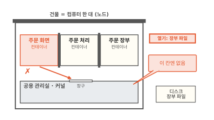

이번에는 주문 화면이 똑같이 "장부 파일 열어 주세요"라고 부탁해요.

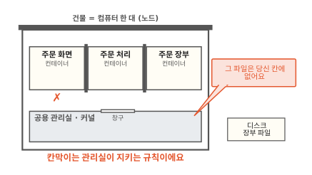

커널은 부탁을 받으면 누가 보냈는지부터 봐요. 보낸 프로그램이 어느 칸에 있는지 알아요. 주문 화면 칸에는 장부 파일이 없으니 "없어요"라고 답해요.

칸막이가 어떻게 생겼는지가 여기서 드러나요. 칸막이는 사무실 사이에 세운 콘크리트 벽과 달라요. 관리실이 부탁마다 "이 칸에는 무엇이 보이는가"를 따져서 지키는 규칙이에요. 리눅스 네임스페이스도 cgroup도 커널 안에 적힌 규칙이에요. 그럼 규칙을 지키는 커널 자신이 실수하면 어떻게 될까요?

## 관리실에 구멍이 나면 칸막이 전체가 뚫려요

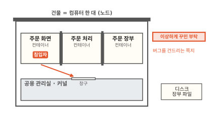

커널은 아주 큰 프로그램이에요. 큰 프로그램에는 버그가 숨어 있기 마련이에요. 버그는 프로그램이 만든 사람의 뜻과 다르게 움직이는 곳이에요. 주문 화면에 들어온 침입자는 그림처럼 시스템 호출을 이상하게 꾸며서 보내요. 보통 프로그램은 보내지 않을 순서나 값으로 커널의 버그를 건드리는 부탁이에요.

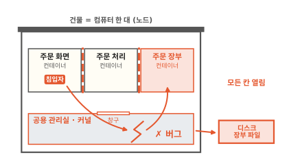

버그를 맞은 커널은 규칙을 제대로 지키지 못해요. 침입자가 커널이 하는 일 가운데 일부를 제 뜻대로 시킬 수 있게 되기도 해요. 커널은 컴퓨터의 모든 것을 다룰 수 있는 프로그램이에요.

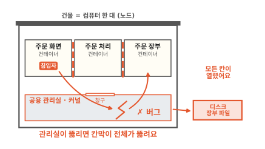

커널의 힘을 손에 넣으면 칸막이 규칙은 더는 침입자를 막지 못해요. 그림처럼 주문 장부 칸의 파일도 읽고 디스크도 만질 수 있어요. 커널 하나가 모든 칸막이를 지키고 있었어요. 그래서 한 번 뚫리면 모든 칸이 한꺼번에 열려요. 컨테이너 안의 프로그램이 칸막이를 벗어나 다른 칸이나 컴퓨터 전체에 닿았어요. 이 일을 **컨테이너 탈출**(container escape)이라고 해요.

커널 버그를 시스템 호출로 건드리는 공격은 실제로 가장 흔한 방법으로 꼽혀요.[^gvisor-sec] 컨테이너 셋이 커널 하나를 같이 쓰는 한 이 길은 늘 열려 있어요. 그렇다면 창구를 좁혀서 버그에 닿을 길을 줄일 수는 없을까요?

??? info "심화: 특권 컨테이너는 왜 더 위험할까요?"
    매니페스트에서 `privileged: true`라는 설정을 보고 무엇이 달라지는지 궁금할 때 보는 칸이에요.

    특권 컨테이너는 칸막이 규칙 대부분을 끈 컨테이너예요. 컴퓨터의 장치를 직접 볼 수 있고 커널의 여러 기능을 바꿀 수 있어요. 쿠버네티스 문서도 특권 파드는 보안 장치 대부분을 끈다고 적어요. 기본 보안 기준에서도 막도록 해요.[^privileged]

    그래서 특권 컨테이너에서는 커널 버그가 없어도 칸막이를 벗어나기 쉬워요. 아래 절의 seccomp도 특권 컨테이너에는 걸 수 없어요.[^seccomp]

## 창구를 좁히면 덜 위험해요

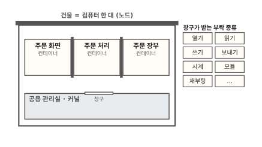

커널의 창구는 수백 가지 부탁을 받아요. 그런데 빵집 주문 화면이 실제로 쓰는 부탁은 그중 일부예요. 파일을 열고 읽고 네트워크로 보내는 정도예요. 커널에 새 기능을 끼워 넣는 부탁(그림의 모듈)이나 컴퓨터를 다시 켜는 부탁은 쓸 일이 없어요.

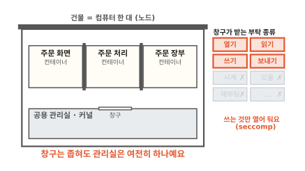

그래서 컨테이너마다 받아 줄 부탁의 종류를 미리 정해 둘 수 있어요. 목록에 없는 부탁은 창구에서 바로 거절해요. 이 장치를 seccomp라고 해요.[^lksc] 쓰지 않는 호출 속에 숨은 버그는 침입자가 건드릴 수 없게 돼요.

쿠버네티스에서는 파드 설정에 `seccompProfile`의 `type: RuntimeDefault`를 적으면 기본 목록이 걸려요. 이 목록은 노드에서 컨테이너를 실제로 띄우는 실행기, 곧 컨테이너 런타임이 마련해 둔 것이에요. 적지 않으면 기본으로는 아무 목록도 걸리지 않아요. 노드마다 kubelet 설정으로 이 기본 목록을 늘 쓰게 바꿀 수 있어요.[^seccomp]

seccomp로 창구를 좁혀도 남는 문제가 있어요. 열어 둔 부탁(파일 열기, 읽기) 속에도 버그가 있을 수 있어요. 그리고 그 부탁을 받는 커널은 여전히 모든 컨테이너가 같이 쓰는 하나예요.

## 칸막이만으로 충분할 때는 언제일까요

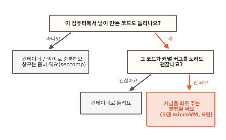

빵집이 직접 만든 주문 화면, 주문 처리, 주문 장부만 돌린다면 칸막이로 충분할 때가 많아요. 서로 믿는 프로그램끼리라서 칸막이는 실수를 막는 정도면 돼요. seccomp로 창구를 좁혀 두면 침입자가 들어와도 커널에 닿는 길이 줄어요.

이야기가 달라지는 때는 남이 만든 코드를 같은 컴퓨터에서 돌릴 때예요. 손님이 올린 코드를 실행해 주는 서비스나 여러 가게의 앱을 한 컴퓨터에 모아 돌리는 곳이 그래요. 그 코드가 처음부터 커널 버그를 노린다고 쳐야 해요. 이럴 때는 칸막이를 더 두껍게 하는 것으로는 모자라요. 커널을 칸마다 따로 줘야 해요. 칸마다 자기 커널을 주는 방법은 [5편](05-microvm.md)에서 커널 앞에 대리인을 세우는 방법은 [6편](06-sandbox-runtimes.md)에서 이어 가요.

## 다시 침입자가 지나간 길을 볼게요

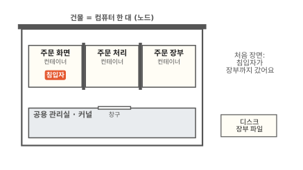

처음 화면의 기록을 건물 그림으로 옮겼어요. 침입자는 주문 화면 칸에 있었고 장부 파일은 주문 장부 칸에 있었어요.

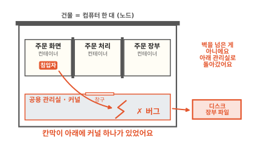

침입자는 칸막이를 넘지 않았어요. 아래층 공용 관리실, 커널로 내려갔어요. 커널의 버그를 건드려 규칙을 무너뜨리고 디스크의 장부 파일까지 갔어요. 컨테이너가 셋이든 백 개든 한 컴퓨터 위의 컨테이너는 모두 커널 하나 위에 서 있어요.

### 이 편에서 줄여 그린 것

그림을 쉽게 하려고 실제와 다르게 줄인 곳이 세 군데 있어요.

1. 커널을 아래층 방 하나로 그렸어요. 실제 커널은 따로 떨어진 방에 앉아 기다리지 않아요. 모든 프로그램이 시스템 호출을 하는 순간 그 프로그램을 대신해 커널의 코드가 돌아요.
2. 침입자가 버그 하나로 곧장 장부 파일에 닿게 그렸어요. 실제 공격은 버그 몇 개를 이어 붙이거나 권한을 조금씩 넓혀 가는 경우가 많아요.
3. 창구가 받는 부탁을 여덟 칸으로 그렸어요. 실제로는 수백 가지이고 seccomp는 호출 이름에 더해 호출에 넘기는 값까지 보고 거를 수 있어요.

### 이 편에서 새로 나온 말

[^syscalls]: 리눅스 man 페이지는 시스템 호출을 "응용 프로그램과 리눅스 커널 사이의 기본 접점"이라고 설명하고, 전체 목록을 싣고 있어요. <https://man7.org/linux/man-pages/man2/syscalls.2.html>
[^gvisor-sec]: gVisor 보안 모델 문서는 커널의 버그가 시스템 호출 같은 접점을 통해 악용될 수 있고 이것이 가장 흔한 공격 형태라고 적어요. <https://gvisor.dev/docs/architecture_guide/security/>
[^privileged]: 쿠버네티스 파드 보안 기준(Pod Security Standards)의 Baseline 항목. <https://kubernetes.io/docs/concepts/security/pod-security-standards/>
[^lksc]: 쿠버네티스 문서 "Linux kernel security constraints for Pods and containers". seccomp는 프로세스가 사용자 공간에서 커널로 하는 호출을 제한한다고 적어요. <https://kubernetes.io/docs/concepts/security/linux-kernel-security-constraints/>
[^seccomp]: 쿠버네티스 seccomp 튜토리얼. kubelet의 `seccompDefault` 설정이 켜져 있지 않으면 기본값은 `Unconfined`이고, 특권 컨테이너는 늘 `Unconfined`로 돌아요. <https://kubernetes.io/docs/tutorials/security/seccomp/>
