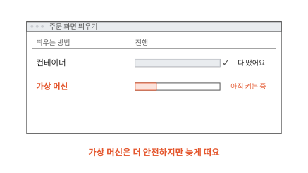
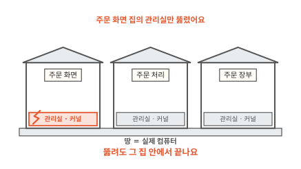
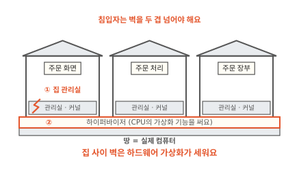
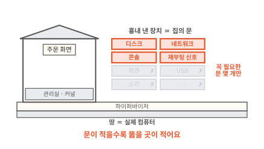
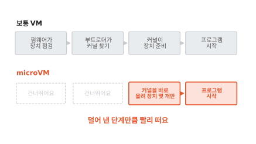
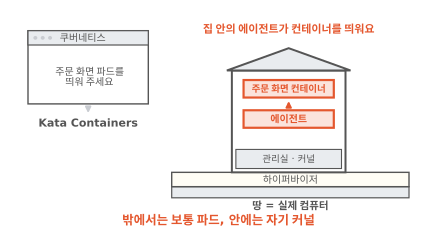
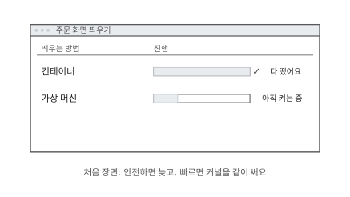
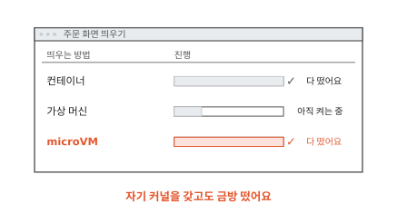

# microVM은 어떻게 빠르면서도 안전할까요?

## 안전한 쪽은 늦게 떠요

동네 빵집 주문 앱의 주문 화면은 인터넷에 열려 있어요. 침입자가 가장 먼저 노리는 곳이에요. 컨테이너끼리는 커널 하나를 같이 써서 커널이 뚫리면 칸막이 전체가 뚫린다는 것을 [4편](04-shared-kernel.md)에서 봤어요. 커널은 CPU, 메모리, 디스크 같은 하드웨어를 프로그램들에 나눠 주는 운영체제의 중심 프로그램이에요. 그래서 주문 화면만이라도 가상 머신(VM)에 따로 넣기로 해요. 가상 머신은 커널까지 갖춘 컴퓨터 한 대를 통째로 흉내 낸 것이에요([1편](01-container.md)). 그림의 창에서 컨테이너와 가상 머신을 함께 띄워 봐요.

컨테이너는 금방 떠요. 가상 머신은 아직 켜는 중이에요. 컴퓨터 한 대를 켜는 일을 처음부터 다 하기 때문이에요. 커널을 따로 갖는 안전함과 컨테이너의 빠르기를 함께 가질 수는 없을까요?

먼저 가상 머신이 왜 더 안전한지부터 볼게요.

## 따로 지은 집에는 관리실도 따로 있어요

4편에서는 컴퓨터 한 대를 건물 한 채로 그렸어요. 컨테이너는 칸막이 사무실이고 커널은 아래층의 공용 관리실이었어요. 관리실이 하나라서 관리실이 뚫리면 모든 칸이 한꺼번에 열렸어요.

가상 머신은 건물 안에 칸막이를 세우지 않아요. 땅 위에 집을 따로 지어요. 땅은 실제 컴퓨터예요. 집마다 관리실이 따로 있어요. 주문 화면 집 안의 프로그램은 자기 집 관리실, 곧 자기 커널에 부탁해요.

주문 화면에 들어온 침입자가 커널 버그를 건드려도 뚫리는 것은 주문 화면 집의 관리실이에요. 옆집 관리실은 그대로예요. 그런데 집들은 같은 땅 위에 있어요. 집과 집 사이 경계는 누가 지킬까요?

## 집 사이 벽은 하이퍼바이저와 CPU가 세워요

땅과 집 사이에는 집을 짓고 관리하는 프로그램이 있어요. 실제 컴퓨터의 메모리와 CPU를 떼어 집마다 나눠 주고 집에 전원을 넣고 끄는 일을 해요. 이 프로그램을 **하이퍼바이저**(hypervisor)라고 해요.

요즘 CPU에는 가상 머신을 돌리는 데 쓰는 기능이 들어 있어요. 이 기능을 하드웨어 가상화라고 해요. 하이퍼바이저는 이 기능으로 집마다 쓸 수 있는 메모리의 범위를 정해 둬요. 리눅스에서는 커널에 든 KVM이 이 기능을 다뤄요.[^fc]

뚫린 주문 화면 집의 커널이 옆집 메모리를 건드리려 한다고 해 볼게요. 그 집에 나눠 준 범위 밖이에요. CPU는 그 일을 하지 않고 집을 멈춘 뒤 하이퍼바이저에 넘겨요. 집 안의 커널은 자기에게 나눠 준 메모리 밖을 볼 방법이 없어요. 4편의 칸막이는 커널이 지키는 규칙이었어요. 집 사이 벽은 CPU라는 하드웨어가 함께 지켜요.

그래서 침입자가 다른 집이나 실제 컴퓨터에 닿으려면 벽을 두 겹 넘어야 해요. ① 자기 집의 커널을 뚫고 ② 하이퍼바이저까지 뚫어야 해요. Kata Containers 문서도 하드웨어 가상화를 컨테이너의 "두 번째 방어선"이라고 불러요.[^kata] 그렇다면 하이퍼바이저는 얼마나 단단할까요?

??? info "심화: 하이퍼바이저 자신은 어떻게 지킬까요?"
    하이퍼바이저가 실제 컴퓨터 위에서 도는 프로그램이라면 하이퍼바이저가 뚫렸을 때는 어떻게 되는지 궁금할 때 보는 칸이에요.

    Firecracker는 집 안의 코드를 처음부터 나쁜 코드로 보고 설계했어요. 그리고 하이퍼바이저 프로그램 자신에게도 벽을 한 겹 더 둘러요.[^fc-design]

    - jailer라는 도우미가 먼저 하이퍼바이저가 쓸 자리를 4편의 칸막이로 마련해요. 리눅스 네임스페이스와 cgroup이에요. 그다음 특별한 권한을 내려놓은 채 Firecracker를 띄워요.
    - Firecracker는 손님 코드를 돌리기 전에 스스로 seccomp를 걸어요. 4편에서 본 대로 seccomp는 쓸 수 있는 시스템 호출의 종류를 줄이는 장치예요. 하이퍼바이저가 뚫려도 실제 커널에 할 수 있는 부탁이 적어요.

## 흉내 내는 장치가 적을수록 뚫을 곳이 적어요

집 안의 커널도 디스크에 파일을 쓰고 네트워크로 주문을 보내야 해요. 그런데 집 안에는 진짜 디스크가 없어요. 하이퍼바이저가 디스크인 척하는 가짜 장치를 집에 달아 줘요. 집 안의 커널은 그것이 진짜 디스크인 줄 알고 부탁해요. 하이퍼바이저가 그 부탁을 받아 실제 디스크에 대신 써요.

이 가짜 장치는 집과 바깥을 잇는 문이에요. 문 너머에서 부탁을 받는 것은 하이퍼바이저의 코드예요. 침입자가 하이퍼바이저를 노린다면 이 문으로 이상한 부탁을 보내요. 4편에서 커널의 창구로 이상한 시스템 호출을 보낸 것과 같은 수법이에요.

보통 가상 머신은 PC 한 대를 그대로 흉내 내요. 그 위에서 어떤 운영체제든 돌 수 있게 하려는 거예요. 그래서 화면 키보드, 마우스, USB, 소리 장치까지 흉내 내요. 문이 많으면 문 뒤의 코드도 많고 그만큼 버그가 숨을 곳도 많아요.

주문 화면은 화면도 마우스도 소리도 쓰지 않아요. 디스크와 네트워크만 있으면 돌아가요. Firecracker는 이렇게 서버 프로그램을 돌리는 데 꼭 필요한 장치만 남기고 나머지는 흉내 내지 않아요. 남긴 것은 디스크, 네트워크, 글자를 주고받는 콘솔, 그리고 집 안에서 다시 켜 달라는 신호를 보낼 장치 정도예요.[^fc-design] Firecracker 문서는 이렇게 장치를 줄인 까닭으로 공격받을 면을 줄이는 것을 꼽아요.[^fc]

??? info "심화: 흉내 낸 디스크는 왜 진짜 디스크와 다르게 생겼을까요?"
    하이퍼바이저가 실제로 있는 디스크 제품 하나를 그대로 흉내 내는지 궁금할 때 보는 칸이에요.

    오래된 실제 장치를 하나하나 흉내 내려면 그 장치의 세세한 동작까지 따라 해야 해요. 코드가 길어지고 느려져요. 그래서 가상 머신용으로 따로 정한 단순한 장치 규격을 많이 써요. 이 규격을 virtio라고 해요. 집 안의 커널과 하이퍼바이저가 "가짜 장치"라는 것을 서로 알고 짧은 약속으로 주고받아요.

    Firecracker가 집에 다는 네트워크, 디스크, 그리고 집과 바깥이 글을 주고받는 vsock 장치가 모두 virtio 장치예요.[^fc-design]

## 덜어 낸 만큼 빨리 떠요

처음 장면에서 가상 머신이 늦게 뜬 까닭이 여기서 이어져요. 보통 가상 머신은 PC를 켤 때와 같은 단계를 밟아요. 펌웨어라는 작은 프로그램이 먼저 장치를 점검하고 부트로더가 디스크에서 커널을 찾아 올려요. 그다음 커널이 깨어나 흉내 낸 장치를 하나하나 찾아 준비해요. 그 뒤에야 주문 화면 프로그램이 시작해요. 흉내 낸 장치가 많으면 점검하고 준비할 것도 그만큼 많아요.

Firecracker는 커널 파일을 직접 받아 그대로 올려요. 펌웨어가 점검하고 부트로더가 커널을 찾는 단계를 거치지 않아요.[^fc-start] 깨어난 커널이 준비할 장치도 몇 개뿐이에요. 문을 줄인 일이 켜는 시간까지 줄여요. 공격받을 면과 켜는 시간이 같은 이유로 함께 줄어요.

이렇게 꼭 필요한 장치만 남기고 켜는 단계를 덜어 작게 만든 VM을 **microVM**이라고 해요. 작게 만들었으니 집 하나가 차지하는 메모리도 적어서 실제 컴퓨터 한 대에 집을 많이 지을 수 있어요.[^fc]

그럼 쿠버네티스가 띄우는 파드를 이 작은 집에 넣으려면 어떻게 할까요?

## 파드를 microVM에 넣어 주는 Kata Containers

Firecracker는 집을 짓는 하이퍼바이저일 뿐이라 쿠버네티스의 파드를 직접 알아듣지 못해요. 파드는 쿠버네티스가 함께 띄우는 컨테이너 묶음이에요. 그 사이를 잇는 것이 Kata Containers예요. 쿠버네티스가 파드를 띄워 달라고 하면 Kata Containers는 하이퍼바이저에게 집을 하나 짓게 해요. 집 안에서는 자기 커널이 깨어나요.[^kata]

집 안에는 에이전트라는 프로그램이 함께 떠요. 에이전트가 바깥의 지시를 받아 집 안에서 주문 화면 컨테이너를 띄우고 돌봐요. 쿠버네티스 쪽에서 보면 여느 파드와 다르지 않아요. 안을 열어 보면 그 파드만의 커널이 있어요.

Kata Containers는 집을 짓는 하이퍼바이저를 골라 쓸 수 있어요. Firecracker 말고도 QEMU, Cloud Hypervisor 같은 것을 쓸 수 있어요.[^kata-hv] 쿠버네티스에서 파드마다 어느 방식으로 띄울지 고르는 방법은 [6편](06-sandbox-runtimes.md)에서 봐요.

??? info "심화: 파드에 컨테이너가 여럿이면 집도 여러 채일까요?"
    파드 하나에 컨테이너 둘을 넣었을 때 Kata Containers가 집을 몇 채 짓는지 궁금할 때 보는 칸이에요.

    한 채예요. 쿠버네티스의 파드 하나가 집 하나가 되고 그 파드의 컨테이너는 모두 같은 집 안에서 떠요. 집마다 에이전트는 하나만 돌아요.[^kata]

    그래서 같은 파드 안의 컨테이너끼리는 다시 커널 하나를 같이 써요. 4편의 칸막이 사이처럼요. 집 사이 벽은 파드와 파드 사이에 서요.

## microVM은 언제 쓸모 있을까요

microVM에도 값이 있어요. 파드마다 커널이 하나씩 더 떠서 그만큼 메모리를 더 써요. 작게 만들었다 해도 커널을 켜는 시간이 있어서 컨테이너보다는 늦게 떠요. 서로 믿는 빵집 프로그램끼리라면 컨테이너로 충분할 때가 많아요(4편).

장치를 덜어 낸 것도 값이에요. 그래픽 카드(GPU)처럼 특별한 장치를 집 안에 들여야 하는 프로그램은 문이 몇 개뿐인 microVM에서 돌리기 어려워요. Kata Containers 문서에서도 GPU를 지원하는 하이퍼바이저로는 장치를 많이 흉내 내는 QEMU만 꼽아요.[^kata-hv] 남이 만든 코드를 돌려야 하는데 그런 장치가 필요 없다면 microVM이 알맞아요.

## 다시 주문 화면을 띄워 볼게요

처음 창으로 돌아왔어요. 커널을 같이 쓰는 컨테이너는 빨리 떴고 커널을 따로 갖는 가상 머신은 늦게 떴어요.

이번에는 주문 화면을 microVM으로 띄웠어요. 자기 커널을 갖고도 금방 떴어요. 장치와 켜는 단계를 덜어 낸 덕분이에요. 집이 한 채든 천 채든 집마다 자기 관리실이 있고 집 사이 벽은 CPU가 지켜요.

### 이 편에서 줄여 그린 것

그림을 쉽게 하려고 실제와 다르게 줄인 곳이 세 군데 있어요.

1. 하이퍼바이저를 땅 위의 띠 하나로 그렸어요. Firecracker는 실제 커널 안의 KVM과 바깥의 Firecracker 프로그램이 함께 하이퍼바이저 일을 나눠 해요. microVM 하나마다 Firecracker 프로그램이 하나씩 돌아요.
2. 흉내 낸 장치를 문 몇 개로 그렸어요. 실제로는 CPU가 시간을 재는 장치처럼 집 안 커널이 돌아가는 데 꼭 필요한 작은 장치도 몇 개 더 있어요.
3. 보통 VM의 켜는 단계를 네 칸으로 그렸어요. 하이퍼바이저와 설정에 따라 단계가 더 있거나 보통 VM도 커널을 바로 올리게 할 수 있어요.

### 이 편에서 새로 나온 말

[^fc]: Firecracker 누리집. 리눅스 KVM으로 microVM을 만들고, 꼭 필요한 장치만 남기고 나머지 기능을 빼서 메모리 사용량과 공격받을 면을 줄이고 켜는 시간을 줄였다고 적어요. <https://firecracker-microvm.github.io/>
[^fc-design]: Firecracker 설계 문서. 흉내 내는 장치(virtio 네트워크·디스크·vsock, 시리얼 콘솔, 재부팅 신호용 키보드 컨트롤러 일부), jailer와 seccomp, 집 안 코드를 나쁜 코드로 보는 위협 모델이 나와요. <https://github.com/firecracker-microvm/firecracker/blob/main/docs/design.md>
[^fc-start]: Firecracker 시작 안내는 압축을 푼 리눅스 커널 파일을 직접 넘겨 microVM을 켜게 해요. <https://github.com/firecracker-microvm/firecracker/blob/main/docs/getting-started.md> FAQ는 빨리 켜지는 까닭으로 간소한 커널 올리기 과정과 적은 장치를 꼽아요. <https://github.com/firecracker-microvm/firecracker/blob/main/FAQ.md>
[^kata]: Kata Containers 구조 문서. 하드웨어 가상화를 두 번째 방어선으로 쓰고, 하이퍼바이저가 손님 커널로 VM을 켜고, VM 안의 에이전트가 컨테이너를 관리하며, 파드 하나에 VM 하나를 만든다고 적어요. <https://github.com/kata-containers/kata-containers/blob/main/docs/design/architecture/README.md>
[^kata-hv]: Kata Containers 하이퍼바이저 문서. Cloud Hypervisor, Firecracker, QEMU 등을 지원하고, 표에서 GPU 지원은 QEMU만 표시돼 있어요. <https://github.com/kata-containers/kata-containers/blob/main/docs/hypervisors.md>
