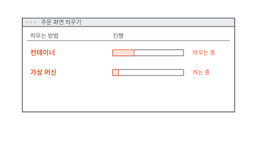
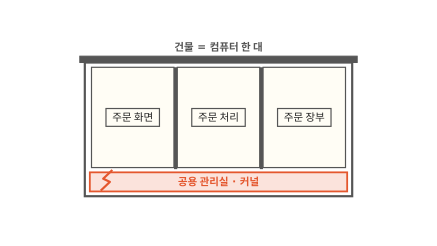
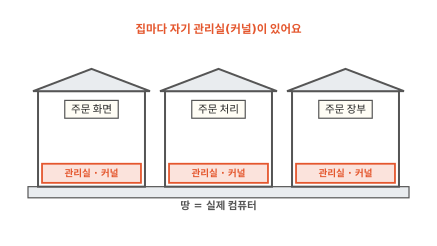
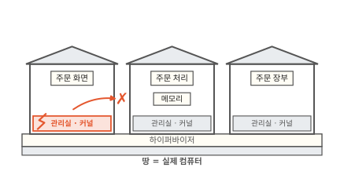
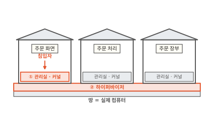
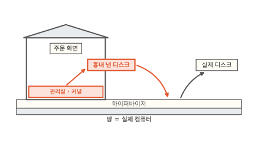
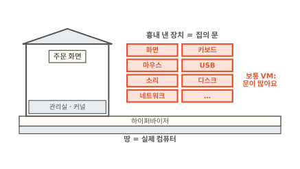
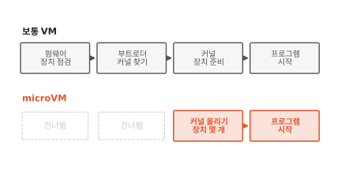
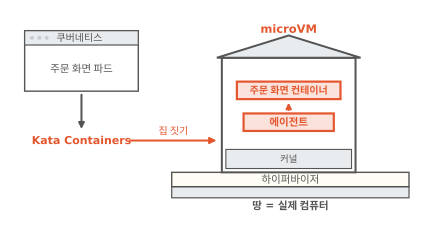
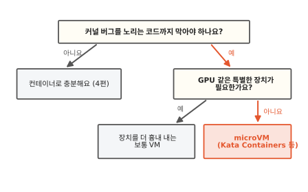

# microVM: 자기 커널을 갖고도 빨리 뜨는 작은 VM

빵집 주문 앱의 주문 화면은 인터넷에 열려 있어서 낯선 사람의 요청을 가장 먼저 받아요. 그런데 [4편](04-shared-kernel.md)에서 본 대로 컨테이너끼리는 커널 하나를 같이 써서 커널이 뚫리면 칸막이가 모두 열려요. 주문 화면만이라도 커널을 따로 주고 싶은데 가상 머신은 늦게 떠요. 이 글을 읽고 나면 microVM이 자기 커널을 갖고도 어떻게 빨리 뜨는지 알게 돼요. 이걸 알면 낯선 코드나 요청을 다루는 프로그램을 무엇에 넣어 돌릴지 고를 수 있어요.

!!! abstract "이 글에서 알게 되는 것"
    1. 가상 머신은 집마다 자기 커널을 둬요. 집 사이 벽은 하이퍼바이저와 CPU가 함께 지켜서 커널 하나가 뚫려도 옆집으로 번지지 않아요.
    2. 하이퍼바이저가 흉내 내는 디스크·네트워크 같은 장치는 집과 바깥을 잇는 문이에요. 문을 꼭 필요한 몇 개로 줄이면 뚫을 곳도 줄고 켜는 단계도 줄어요. 이렇게 작게 만든 VM이 microVM이에요.
    3. 쿠버네티스에서는 Kata Containers가 파드 하나를 microVM 하나에 넣어 띄워요. 대신 커널이 하나씩 더 떠서 메모리를 더 쓰고 GPU 같은 장치는 쓰기 어려워요.

## 1. 가상 머신은 안전하지만 늦게 떠요

주문 화면을 컨테이너와 가상 머신으로 하나씩 띄워 볼게요. [1편](01-container.md)에서 본 가상 머신(VM)은 커널까지 갖춘 컴퓨터 한 대를 통째로 흉내 낸 것이에요. 커널은 CPU, 메모리, 디스크 같은 하드웨어를 프로그램들에 나눠 주는 운영체제의 중심 프로그램이고요.

아래 창에서 두 줄의 진행 막대를 보세요.

**그림 1.** 같은 주문 화면인데 컨테이너는 다 떴고 가상 머신은 아직 켜는 중이에요.
{ .fig-cap }

컨테이너는 이미 돌고 있는 커널 위에서 프로그램 하나를 시작하면 끝나요. 가상 머신은 컴퓨터 한 대를 켜는 일을 처음부터 다 해요. 그래서 늦어요.

여기서 이런 생각이 들 거예요. 커널을 따로 갖는 게 늦게 뜨는 걸 참을 만큼 안전할까요? 그것부터 볼게요.

## 2. 가상 머신은 집마다 커널이 따로 있어요

4편에서는 컴퓨터 한 대를 건물 한 채로 그렸어요. 컨테이너는 건물 안 칸막이 사무실이고 커널은 아래층의 공용 관리실이었어요. 아래 그림에서 관리실에 난 금을 보세요.

**그림 2.** 사무실 세 칸이 관리실 하나를 같이 써서 관리실이 뚫리면 세 칸이 모두 열려요.
{ .fig-cap }

가상 머신은 건물 안에 칸막이를 세우지 않아요. 땅 위에 집을 따로 지어요. 땅은 실제 컴퓨터예요. 집마다 관리실이 따로 있어서 주문 화면 집 안의 프로그램은 자기 집 관리실, 곧 자기 커널에 부탁해요.

주문 화면에 들어온 침입자가 커널 버그를 건드렸다고 해 볼게요. 아래 그림에서 어느 관리실이 빨간지 보세요.

**그림 3.** 주문 화면 집의 관리실만 뚫리고 옆 두 집의 관리실은 멀쩡해요.
{ .fig-cap }

뚫린 것은 주문 화면 집의 커널 하나예요. 주문 처리 집과 주문 장부 집은 자기 커널을 쓰니까 그 버그가 닿지 않아요. 그런데 세 집은 같은 땅 위에 있어요. 뚫린 커널이 옆집으로 손을 뻗으면 누가 막을까요?

## 3. 집 사이 벽은 하이퍼바이저와 CPU가 지켜요

땅과 집 사이에는 집을 짓고 관리하는 프로그램이 있어요. 실제 컴퓨터의 메모리와 CPU를 떼어 집마다 나눠 주고 집을 켜고 꺼요. 이 프로그램을 **하이퍼바이저**라고 해요.

요즘 CPU에는 가상 머신을 돌리는 데 쓰는 기능이 들어 있어요. 이 기능을 **하드웨어 가상화**라고 해요. 하이퍼바이저는 이 기능으로 집마다 쓸 수 있는 메모리 범위를 CPU에 정해 둬요. 리눅스에서는 커널에 든 KVM이 이 기능을 다뤄요.[^fc]

뚫린 주문 화면 집의 커널이 옆집 메모리를 건드리려 한다고 해 볼게요. 아래 그림에서 빨간 화살표가 어디서 멈추는지 보세요.

**그림 4.** 주문 화면 집에서 옆집 메모리로 가는 화살표가 집 사이에서 막혀요.
{ .fig-cap }

옆집 메모리는 주문 화면 집에 나눠 준 범위 밖이에요. CPU는 그 일을 하지 않고 집을 멈춘 다음 하이퍼바이저에 넘겨요. 집 안의 커널은 자기 몫 밖의 메모리를 볼 길이 없어요. 4편의 칸막이는 커널이 지키는 규칙이었어요. 집 사이 벽은 CPU라는 하드웨어가 같이 지켜요.

그래서 침입자가 옆집이나 실제 컴퓨터에 닿으려면 벽을 두 겹 넘어야 해요. 아래 그림의 ①과 ②를 보세요.

**그림 5.** 침입자가 밖으로 나가려면 ① 자기 집 커널과 ② 하이퍼바이저를 모두 뚫어야 해요.
{ .fig-cap }

Kata Containers 문서도 하드웨어 가상화를 컨테이너의 두 번째 방어선이라고 불러요.[^kata] 그럼 하이퍼바이저는 얼마나 단단할까요? 하이퍼바이저를 노리는 길이 어디에 있는지부터 볼게요.

## 4. 흉내 내는 장치가 적을수록 뚫을 곳이 적어요

집 안의 커널도 디스크에 파일을 쓰고 네트워크로 주문을 보내야 해요. 그런데 집 안에는 진짜 디스크가 없어요. 하이퍼바이저가 디스크인 척하는 가짜 장치를 집에 달아 줘요. 아래 그림에서 관리실에서 나가는 빨간 화살표를 따라가 보세요.

**그림 6.** 집 안 커널은 흉내 낸 디스크에 부탁하고 하이퍼바이저가 그 부탁을 받아 실제 디스크에 써요.
{ .fig-cap }

집 안 커널은 그것이 진짜 디스크인 줄 알고 부탁해요. 문 너머에서 그 부탁을 받는 것은 하이퍼바이저의 코드예요. 그래서 흉내 낸 장치 하나하나가 집과 바깥을 잇는 문이에요. 침입자가 하이퍼바이저를 노린다면 이 문으로 이상한 부탁을 보내요. 4편에서 커널 창구로 이상한 시스템 호출을 보낸 것과 같은 수법이에요.

보통 가상 머신은 PC 한 대를 그대로 흉내 내요. 그 위에서 어떤 운영체제든 돌게 하려는 거예요. 그래서 키보드, 마우스, USB, 소리, 화면 장치까지 흉내 내요. 문이 많으면 문 뒤의 코드도 많고 버그가 숨을 곳도 많아요.

주문 화면은 화면도 마우스도 소리도 쓰지 않아요. 디스크와 네트워크만 있으면 돌아가요. Firecracker라는 하이퍼바이저는 이렇게 서버 프로그램에 꼭 필요한 장치만 남겼어요. 아래 그림에서 두 집에 달린 문 수를 비교해 보세요.

**그림 7.** 보통 VM은 PC 장치를 두루 흉내 내고 Firecracker는 디스크, 네트워크, 콘솔, 재부팅 신호 정도만 달아요.
{ .fig-cap }

콘솔은 글자를 주고받는 창이고 재부팅 신호는 집 안에서 다시 켜 달라고 알리는 장치예요.[^fc-design] Firecracker 문서는 장치를 이렇게 줄인 까닭으로 공격받을 면을 줄이는 것을 꼽아요.[^fc]

## 5. 장치를 덜어 낸 만큼 빨리 떠요

1절에서 가상 머신이 늦게 뜬 까닭도 이 문과 이어져 있어요. 보통 가상 머신은 PC를 켤 때와 같은 단계를 밟아요. 펌웨어라는 작은 프로그램이 먼저 장치를 점검하고 부트로더가 디스크에서 커널을 찾아 올려요. 그다음 커널이 깨어나 흉내 낸 장치를 하나하나 찾아 준비해요. 그제야 주문 화면 프로그램이 시작해요.

Firecracker는 커널 파일을 받아 그대로 올려서 펌웨어 점검과 부트로더 단계를 거치지 않아요.[^fc-start] 깨어난 커널이 준비할 장치도 몇 개뿐이에요. 아래 그림에서 두 줄의 칸 수를 비교해 보세요.

**그림 8.** microVM은 보통 VM의 앞 두 단계를 건너뛰고 준비할 장치도 적어요.
{ .fig-cap }

문을 줄인 일이 켜는 시간까지 줄여요. 장치가 적으니 점검하고 준비할 것도 적거든요. 뚫을 곳과 켜는 시간이 같은 까닭으로 함께 줄어요.

이렇게 꼭 필요한 장치만 남기고 켜는 단계를 덜어 작게 만든 VM을 **microVM**이라고 해요. 집 하나가 차지하는 메모리도 적어서 실제 컴퓨터 한 대에 집을 많이 지을 수 있어요.[^fc]

## 6. Kata Containers가 파드를 microVM에 넣어 줘요

이제 주문 화면을 microVM에 넣을 차례예요. 그런데 주문 화면은 쿠버네티스가 파드로 띄워요. 파드는 쿠버네티스가 함께 띄우는 컨테이너 묶음이에요. Firecracker는 집을 짓는 하이퍼바이저일 뿐이라 파드를 알아듣지 못해요. 그 사이를 잇는 것이 Kata Containers예요.

쿠버네티스가 파드를 띄워 달라고 하면 Kata Containers는 하이퍼바이저에게 집을 하나 짓게 해요. 집 안에서는 자기 커널이 깨어나고 에이전트라는 프로그램이 함께 떠요. 에이전트는 바깥의 지시를 받아 집 안에서 주문 화면 컨테이너를 띄우고 돌봐요.[^kata] 아래 그림에서 쿠버네티스의 부탁이 집 안 컨테이너까지 가는 길을 따라가 보세요.

**그림 9.** Kata Containers가 파드를 받아 microVM을 짓고 집 안 에이전트가 주문 화면 컨테이너를 띄워요.
{ .fig-cap }

쿠버네티스 쪽에서 보면 여느 파드와 다르지 않아요. 안을 열어 보면 그 파드만의 커널이 있어요. 파드에 컨테이너가 둘이면 둘 다 같은 집 안에서 떠요. 파드 하나가 집 하나예요. 그래서 같은 파드 안의 컨테이너끼리는 다시 커널을 같이 쓰고 집 사이 벽은 파드와 파드 사이에 서요.[^kata]

Kata Containers는 하이퍼바이저를 골라 쓸 수 있어요. Firecracker 말고도 QEMU, Cloud Hypervisor 같은 것을 써요.[^kata-hv] 파드마다 어느 방식으로 띄울지 쿠버네티스에서 고르는 법은 [6편](06-sandbox-runtimes.md)에서 봐요.

## 7. 커널까지 지켜야 하는 곳에 microVM을 써요

microVM에도 값이 있어요. 파드마다 커널이 하나씩 더 떠서 그만큼 메모리를 더 써요. 작게 만들었어도 커널을 켜는 시간이 있어서 컨테이너보다는 늦게 떠요. 서로 믿는 빵집 프로그램끼리라면 컨테이너로 충분할 때가 많아요.

장치를 덜어 낸 것도 값이에요. 그래픽 카드(GPU)처럼 특별한 장치가 필요한 프로그램은 문이 몇 개뿐인 microVM에서 돌리기 어려워요. Kata Containers 문서에서도 GPU를 지원하는 하이퍼바이저로는 장치를 많이 흉내 내는 QEMU만 꼽아요.[^kata-hv]

아래 갈림길에서 주문 화면이 어디로 가는지 따라가 보세요.

**그림 10.** 남이 만든 코드나 낯선 요청을 다루고 GPU 같은 장치가 필요 없으면 microVM으로 가요.
{ .fig-cap }

주문 화면은 낯선 사람의 요청을 받으니까 첫 물음에 "예"예요. 그래픽 카드는 쓰지 않으니까 둘째 물음에는 "아니요"고요. 그래서 주문 화면은 microVM에 넣어요. 주문 처리와 주문 장부는 바깥 요청을 바로 받지 않으니 컨테이너로 두어도 돼요.

??? info "그림에서 줄여 그린 곳"
    그림을 쉽게 하려고 실제와 다르게 줄인 곳이 세 군데 있어요.

    1. 하이퍼바이저를 땅 위의 띠 하나로 그렸어요. Firecracker는 실제 커널 안의 KVM과 바깥의 Firecracker 프로그램이 하이퍼바이저 일을 나눠 해요. microVM 하나마다 Firecracker 프로그램이 하나씩 돌아요.[^fc-design]
    2. 흉내 낸 장치를 문 몇 개로 그렸어요. 실제로는 시간을 재는 장치처럼 집 안 커널이 돌아가는 데 꼭 필요한 작은 장치가 몇 개 더 있어요.
    3. 보통 VM의 켜는 단계를 네 칸으로 그렸어요. 하이퍼바이저와 설정에 따라 단계가 더 있기도 하고 보통 VM도 커널을 바로 올리게 할 수 있어요.

## 정리

처음 창으로 돌아가 볼게요. 컨테이너는 이미 돌고 있는 커널을 같이 써서 빨리 떴고 가상 머신은 컴퓨터 한 대를 처음부터 켜서 늦게 떴어요.

가상 머신은 집마다 자기 커널을 둬서 커널 하나가 뚫려도 그 집 안에서 끝나요. 집 사이 벽은 하이퍼바이저가 CPU의 하드웨어 가상화로 세워요. 그래서 침입자는 자기 집 커널과 하이퍼바이저를 모두 넘어야 해요.

하이퍼바이저가 흉내 내는 장치는 집과 바깥을 잇는 문이에요. Firecracker는 문을 디스크, 네트워크, 콘솔, 재부팅 신호 정도로 줄여서 뚫을 곳을 줄였어요. 장치가 적으니 펌웨어와 부트로더 단계를 건너뛰고 빨리 떠요. 이렇게 작게 만든 VM이 microVM이에요. 쿠버네티스에서는 Kata Containers가 파드 하나를 microVM 하나에 넣어 줘요. 대신 메모리를 더 쓰고 GPU 같은 장치는 쓰기 어려워요.

[6편](06-sandbox-runtimes.md)에서는 집을 짓지 않고 시스템 호출을 중간에서 대신 받아 주는 방식을 보고 파드마다 띄울 방식을 고르는 법을 봐요.

### 새로 나온 말

- **하이퍼바이저**: 실제 컴퓨터의 메모리와 CPU를 떼어 VM마다 나눠 주고 VM을 켜고 끄는 프로그램. 이 글에서는 땅과 집 사이의 띠였어요.
- **하드웨어 가상화**: CPU에 든 가상 머신용 기능. 집마다 쓸 메모리 범위를 정해 두고 그 밖을 건드리면 CPU가 멈춰요.
- **흉내 낸 장치**: 하이퍼바이저가 VM에 달아 주는 가짜 디스크·네트워크. VM 안 커널은 진짜로 알고 쓰고 이것이 집과 바깥을 잇는 문이 돼요.
- **microVM**: 꼭 필요한 장치만 남기고 켜는 단계를 덜어 작게 만든 VM. Firecracker가 짓는 집이에요.
- **Kata Containers**: 쿠버네티스 파드 하나를 VM 하나에 넣어 띄워 주는 도구. 집 안 에이전트가 컨테이너를 돌봐요.

[^fc]: Firecracker 누리집. 리눅스 KVM으로 microVM을 만들어요. 꼭 필요한 장치만 남기고 나머지 기능을 빼서 메모리 사용량과 공격받을 면과 켜는 시간을 줄였다고 적어요. <https://firecracker-microvm.github.io/>
[^fc-design]: Firecracker 설계 문서. 흉내 내는 장치(virtio 네트워크·디스크·vsock, 시리얼 콘솔, 재부팅 신호용 키보드 컨트롤러 일부)와 microVM마다 Firecracker 프로그램 하나가 도는 짜임이 나와요. <https://github.com/firecracker-microvm/firecracker/blob/main/docs/design.md>
[^fc-start]: Firecracker 시작 안내는 압축을 푼 리눅스 커널 파일을 넘겨 microVM을 켜게 해요. <https://github.com/firecracker-microvm/firecracker/blob/main/docs/getting-started.md> FAQ는 빨리 켜지는 까닭으로 간소한 커널 올리기 과정과 적은 장치를 꼽아요. <https://github.com/firecracker-microvm/firecracker/blob/main/FAQ.md>
[^kata]: Kata Containers 구조 문서. 하드웨어 가상화를 두 번째 방어선으로 써요. 하이퍼바이저가 손님 커널로 VM을 켜고 VM 안의 에이전트가 컨테이너를 관리해요. 파드 하나에 VM 하나를 만든다고 적어요. <https://github.com/kata-containers/kata-containers/blob/main/docs/design/architecture/README.md>
[^kata-hv]: Kata Containers 하이퍼바이저 문서. Cloud Hypervisor, Firecracker, QEMU 등을 지원해요. 표에서 GPU 지원은 QEMU만 표시돼 있어요. <https://github.com/kata-containers/kata-containers/blob/main/docs/hypervisors.md>
