# VM과 컨테이너 사이에는 무엇이 있을까요?

## 주문 화면만 다르게 띄우고 싶어요

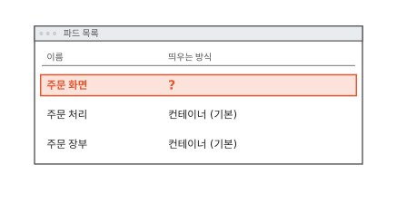

동네 빵집 주문 앱은 쿠버네티스 위에서 파드 셋으로 돌아요. 파드는 쿠버네티스가 함께 띄우는 컨테이너 묶음이에요. 그림의 목록처럼 지금은 셋 다 보통 컨테이너로 떠요. 컨테이너는 커널 하나를 같이 쓰는 칸막이 사무실이었어요([4편](04-shared-kernel.md)). 커널은 하드웨어를 프로그램들에 나눠 주는 운영체제의 중심이고 컨테이너 셋이 모두 커널 하나에 기대요.

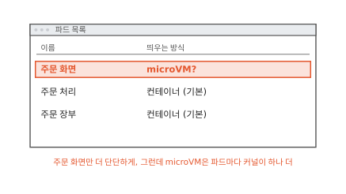

인터넷에 열린 주문 화면만은 더 단단히 떼어 두고 싶어요. [5편](05-microvm.md)의 microVM에 넣으면 주문 화면은 자기 커널을 가져요. microVM은 장치와 켜는 단계를 덜어 작게 만든 가상 머신이에요. 그래도 파드마다 커널이 하나씩 더 떠서 메모리를 그만큼 더 써요.

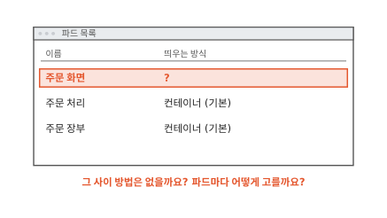

커널을 같이 쓰는 컨테이너와 커널을 따로 주는 microVM 사이에 다른 방법은 없을까요? 그리고 방법을 골랐다면 주문 화면 파드에만 어떻게 적용할까요?

## 공용 관리실 앞에 대리인을 세워요

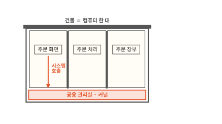

4편에서 프로그램은 파일을 읽든 네트워크로 보내든 커널에 부탁했어요. 이 부탁이 시스템 호출이에요. 침입자는 이상하게 꾸민 시스템 호출로 커널의 버그를 건드려 칸막이를 뚫었어요. 그림처럼 주문 화면의 부탁이 곧장 커널로 가기 때문이에요.

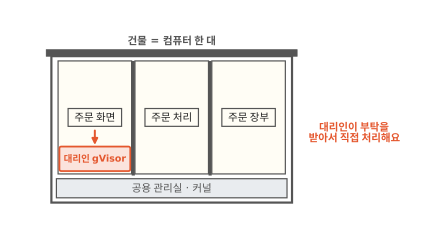

그러면 주문 화면과 관리실 사이에 대리인을 세워 볼게요. 민원 창구 앞에 선 대리인처럼 주문 화면의 부탁을 대리인이 먼저 받아요. 그리고 관리실에 넘기지 않고 대리인이 직접 처리해요. 파일을 열어 달라면 대리인이 자기가 관리하는 파일 목록에서 열어 주는 식이에요. 이런 대리인 노릇을 하는 프로그램이 gVisor예요.[^gvisor]

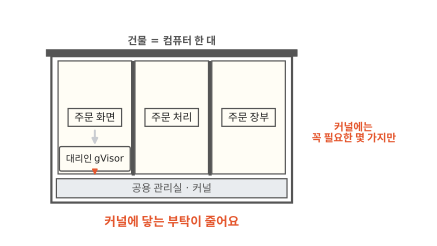

대리인도 결국 진짜 커널이 있어야 일을 해요. 다만 대리인이 진짜 커널에 하는 부탁은 몇 가지로 정해져 있어요. 주문 화면이 보낸 부탁을 그대로 커널에 넘기는 일은 없어요.[^gvisor-sec] 주문 화면이 아무리 이상한 부탁을 꾸며도 그 부탁은 대리인에게 닿을 뿐 진짜 커널에는 닿지 않아요. 그럼 대리인 자신이 뚫리면 어떻게 될까요?

## 대리인은 보통 프로그램 자리에서 커널 일을 해요

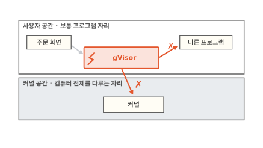

컴퓨터 안에는 자리가 둘 있어요. 그림 아래 칸은 진짜 커널이 도는 자리예요. 컴퓨터 전체를 다룰 수 있어서 커널 공간이라고 불러요.

그림 위 칸은 주문 화면 같은 보통 프로그램이 도는 자리예요. 권한이 좁고 이름은 사용자 공간이에요.

gVisor는 파일 열기, 메모리 나눠 주기 같은 커널 일을 해요. 그런데 그림처럼 보통 프로그램과 같은 사용자 공간에서 돌아요. 이렇게 사용자 공간에서 돌면서 커널 일을 해 주는 프로그램을 **사용자 공간 커널**이라고 해요.[^gvisor]

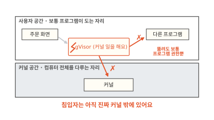

침입자가 gVisor의 버그를 찾아 뚫었다고 해 볼게요. 침입자가 얻은 것은 사용자 공간의 보통 프로그램 하나예요. 그 프로그램은 진짜 커널에 몇 가지 정해진 부탁만 할 수 있어요. 새 파일을 열거나 네트워크 연결을 새로 만드는 부탁도 막혀 있어요.[^gvisor-sec] 침입자는 진짜 커널의 버그를 노리려면 벽을 한 겹 더 넘어야 해요. gVisor는 메모리를 잘못 다루는 실수가 적은 Go 언어로 쓰여서 버그가 숨을 틈도 줄였어요.[^gvisor]

5편의 microVM이 집마다 커널을 따로 주고 CPU로 벽을 세웠다면 gVisor는 커널 일을 보통 프로그램이 대신 맡아 벽을 세워요. gVisor 문서는 이것을 VM과 seccomp 같은 규칙 기반 방법 옆의 "세 번째 접근"이라고 불러요.[^gvisor] 그렇다면 대리인을 거치는 데는 어떤 값이 들까요?

??? info "심화: gVisor는 시스템 호출을 어떻게 가로챌까요?"
    주문 화면 프로그램은 진짜 커널에 부탁하는 줄 아는데 어떻게 그 부탁이 gVisor로 가는지 궁금할 때 보는 칸이에요.

    gVisor에서 이 일을 맡는 부분을 플랫폼이라고 해요. 플랫폼은 프로그램이 시스템 호출을 하는 순간을 붙잡아 gVisor의 커널 부분(Sentry)으로 돌려보내요. 붙잡는 방법은 여러 가지예요. 한 프로그램이 다른 프로그램의 동작을 지켜보게 해 주는 리눅스 기능(ptrace)을 쓰는 방법이 있어요. 5편에서 본 CPU의 가상화 기능을 쓰는 방법도 있어요.[^gvisor-sec]

    어느 방법이든 주문 화면이 보낸 시스템 호출은 진짜 커널에서 바로 실행되지 않아요. gVisor가 받아서 자기 방식으로 처리해요.

## 대리인을 거치면 무엇을 치를까요

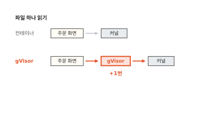

먼저 시간이에요. 보통 컨테이너에서 파일 하나를 읽으면 부탁이 곧장 커널로 가요. gVisor에서는 부탁이 대리인을 한 번 더 거쳐요. 부탁 하나에 드는 시간이 길어져요.[^gvisor] 파일과 네트워크를 쉴 새 없이 쓰는 프로그램일수록 이 차이가 쌓여요.

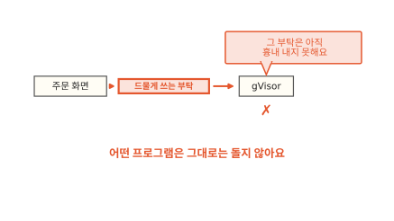

다음 값은 호환성이에요. 대리인은 진짜 커널이 받는 부탁을 하나하나 다시 만들어 흉내 내요. 그런데 아직 흉내 내지 못한 시스템 호출과 파일이 있어요.[^gvisor] 드물게 쓰는 부탁을 하는 프로그램은 gVisor 위에서 그대로 돌지 않을 수 있어요. 쿠버네티스 문서도 이런 샌드박스는 계산 자원을 더 쓰고 GPU 같은 특별한 장치와 맞지 않을 수 있다고 적어요.[^lksc]

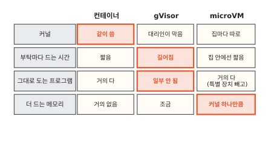

세 방법을 한 표에 모았어요. 빨간 칸이 그 방법이 치르는 값이에요. 셋 중 어느 것도 모든 줄에서 이기지 못해요. 보통 컨테이너는 가볍고 빠르지만 커널을 같이 써요. gVisor는 커널 앞을 막고 메모리도 적게 들어요. 대신 부탁마다 느려지고 못 도는 프로그램이 있어요. microVM은 커널을 따로 주고 프로그램도 거의 다 돌지만 파드마다 커널 하나만큼 메모리를 더 써요.

그래서 파드마다 알맞은 방법이 달라요. 주문 화면에는 벽이 더 필요하고 주문 장부는 지금처럼 빠른 게 나을 수 있어요. 쿠버네티스에서는 파드마다 어떻게 고를까요?

## 파드마다 고르는 RuntimeClass

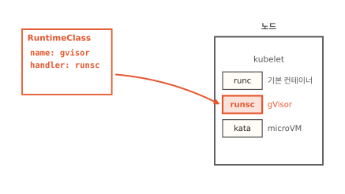

노드에는 컨테이너를 실제로 띄우는 실행기가 들어 있어요. 노드는 쿠버네티스가 부리는 컴퓨터 한 대예요. 실행기를 컨테이너 런타임이라고 불러요. 노드 하나에 실행기를 여럿 설치해 둘 수 있어요. 그림의 노드에는 실행기가 셋 있어요. 보통 컨테이너를 띄우는 runc, gVisor로 띄우는 runsc, microVM으로 띄우는 Kata Containers예요.[^runsc]

쿠버네티스에 이 실행기 가운데 하나를 이름으로 알려 주는 문서가 있어요. 그림 왼쪽 위 문서는 노드의 runsc를 `gvisor`라는 이름으로 부르기로 정해요. `handler`가 노드 쪽 실행기 설정의 이름이에요. 이 문서를 **RuntimeClass**라고 해요.[^rc]

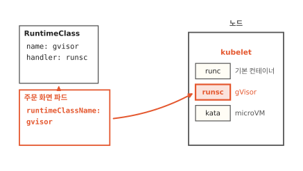

파드 쪽에서는 매니페스트에 한 줄을 더해요. 매니페스트는 원하는 상태를 적은 문서예요([7편](07-reconcile-loop.md)). 주문 화면 파드의 매니페스트에 `runtimeClassName: gvisor`를 적어요. 이 파드는 `gvisor`라는 RuntimeClass로 띄워 달라는 뜻이에요.

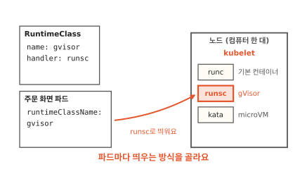

파드가 노드에 배정되면 노드의 kubelet이 파드를 받아요. kubelet은 노드마다 돌면서 파드를 실제로 띄우는 쿠버네티스의 일꾼이에요. kubelet은 RuntimeClass를 보고 runsc로 주문 화면을 띄워요. 주문 처리와 주문 장부는 `runtimeClassName`이 없으니 늘 하던 대로 runc로 떠요.

적어 둔 RuntimeClass가 없거나 노드가 그 실행기로 띄우지 못하면 파드는 뜨지 못하고 실패 상태로 끝나요.[^rc] 그래서 실행기를 모든 노드에 설치하지 않았다면 그 실행기가 있는 노드로만 파드를 보내도록 함께 정해 둬야 해요.

??? info "심화: RuntimeClass에는 또 무엇을 적을까요?"
    gVisor나 microVM을 깐 노드가 일부뿐이거나, 대리인과 커널이 쓰는 메모리를 쿠버네티스가 계산에 넣는지 궁금할 때 보는 칸이에요.

    `scheduling` 칸에는 이 RuntimeClass를 쓸 수 있는 노드의 라벨을 적어요. 그러면 이 RuntimeClass를 고른 파드는 그 라벨이 붙은 노드로만 배정돼요. 적지 않으면 모든 노드가 이 실행기를 갖췄다고 봐요.[^rc]

    `overhead` 칸에는 실행기 자신이 파드마다 더 쓰는 CPU와 메모리를 적어요. gVisor의 대리인이나 microVM의 커널이 쓰는 몫이에요. 쿠버네티스는 노드를 고를 때 이 몫을 파드가 쓰는 양에 더해서 따져요.[^rc]

## 어느 방법은 언제 쓸모 있을까요

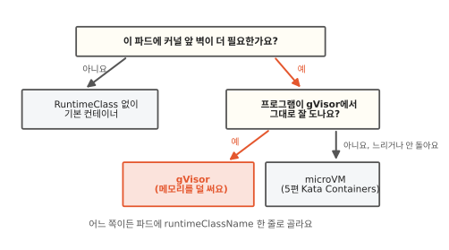

서로 믿는 프로그램만 돌리는 파드라면 RuntimeClass 없이 기본 컨테이너로 충분해요(4편). 남이 만든 코드나 인터넷에서 오는 공격을 커널 앞에서 막아야 하는 파드라면 gVisor나 microVM을 고려해요.

그다음은 프로그램을 gVisor 위에서 직접 돌려 보는 게 빨라요. 그대로 잘 돌고 느려진 정도가 견딜 만하면 gVisor가 메모리를 덜 써요. 드문 시스템 호출 때문에 안 돌면 microVM이 맞아요. 파일과 네트워크를 쉴 새 없이 써서 너무 느려질 때도 그래요. 어느 쪽이든 파드에 적는 것은 `runtimeClassName` 한 줄이에요. 이 매니페스트를 쿠버네티스가 어떻게 받아 실제 파드로 만드는지는 [7편](07-reconcile-loop.md)에서 이어 가요.

## 다시 파드 목록을 열어 볼게요

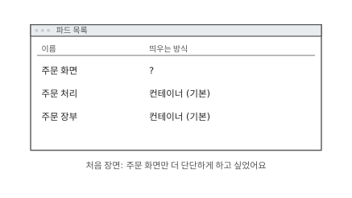

처음 목록으로 돌아왔어요. 주문 화면만 더 단단하게 하고 싶었는데 방법도, 고르는 법도 몰랐어요.

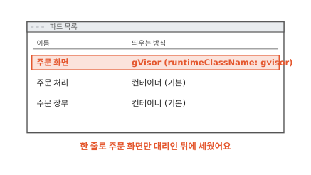

이번에는 주문 화면 매니페스트에 `runtimeClassName: gvisor`를 적었어요. 주문 화면의 부탁은 대리인이 받고 주문 처리와 주문 장부는 전처럼 빠르게 돌아요. 파드가 셋이든 삼백 개든 파드마다 벽의 두께를 따로 고를 수 있어요.

### 이 편에서 줄여 그린 것

그림을 쉽게 하려고 실제와 다르게 줄인 곳이 세 군데 있어요.

1. gVisor를 상자 하나로 그렸어요. 실제로는 커널 일을 하는 부분(Sentry)과 시스템 호출을 붙잡는 부분이 나뉘어 있어요. 설정에 따라 파일을 대신 열어 주는 도우미 프로그램이 따로 돌기도 해요.
2. 노드의 실행기 이름을 runc, runsc, kata로 그렸어요. RuntimeClass의 `handler`에 적는 이름은 노드의 컨테이너 런타임 설정에서 정한 이름이라 설치한 곳마다 다를 수 있어요.
3. 비교 표는 세 방법을 칸 하나씩으로 줄였어요. 실제로 얼마나 느려지고 메모리를 얼마나 더 쓰는지는 프로그램과 설정에 따라 크게 달라요.

### 이 편에서 새로 나온 말

[^gvisor]: gVisor 문서 소개. 사용자 공간에서 도는 응용 프로그램 커널이고 메모리 안전한 Go로 썼으며, 그 대가로 응용 프로그램 호환성이 줄고 시스템 호출마다 드는 비용이 늘며, VM·규칙 기반 방법과 다른 세 번째 접근이라고 적어요. <https://gvisor.dev/docs/>
[^gvisor-sec]: gVisor 보안 모델 문서. 어떤 시스템 호출도 진짜 커널로 그대로 넘기지 않고, Sentry는 진짜 커널에 정해진 적은 수의 호출만 하며 새 파일·소켓을 만들지 못한다고 적어요. 플랫폼으로 ptrace를 쓰는 방식과 가상화 하드웨어를 쓰는 방식도 나와요. <https://gvisor.dev/docs/architecture_guide/security/>
[^lksc]: 쿠버네티스 문서 "Linux kernel security constraints for Pods and containers". 더 격리된 환경이 필요하면 gVisor 같은 샌드박스를 고려하되 노드 자원을 더 쓰고 GPU 등과 호환 문제가 있을 수 있다고 적어요. <https://kubernetes.io/docs/concepts/security/linux-kernel-security-constraints/>
[^runsc]: runsc는 gVisor를 띄우는 OCI 규격 실행기예요. gVisor의 containerd 안내는 `handler: runsc`인 RuntimeClass `gvisor`와 `runtimeClassName: gvisor`를 적은 파드 예를 보여 줘요. <https://gvisor.dev/docs/user_guide/containerd/quick_start/>
[^rc]: 쿠버네티스 RuntimeClass 문서(쿠버네티스 1.20부터 안정). 성능과 보안 사이에서 파드마다 다른 RuntimeClass를 고를 수 있고, 없는 RuntimeClass를 적으면 파드가 `Failed`로 끝나며, `scheduling`과 `overhead` 칸이 있다고 적어요. <https://kubernetes.io/docs/concepts/containers/runtime-class/>
