# 쿠버네티스는 명령을 어떻게 따를까요?

## 지운 파드가 다시 생겨요

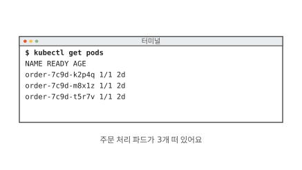

동네 빵집에 주문 앱이 있어요. 앱은 주문 화면, 주문 처리, 주문 장부 세 부품으로 돼 있어요. 그중 주문 처리 프로그램이 쿠버네티스 위에서 돌아요. 쿠버네티스는 컴퓨터 여러 대에 프로그램을 나눠 띄우고 돌봐 주는 프로그램이에요.

프로그램은 컨테이너에 담겨 떠요. 컨테이너는 커널을 같이 쓰는 보통 프로세스에 칸막이와 사용량 한도를 씌운 것이에요([1편](01-container.md)). 쿠버네티스는 컨테이너를 파드라는 단위로 띄워요. 파드는 함께 뜨는 컨테이너 묶음이에요. 이 편에서는 파드 하나에 컨테이너 하나라고 봐도 돼요.

그림은 쿠버네티스를 다루는 명령 도구 `kubectl`로 파드 목록을 본 화면이에요. 주문 처리 파드가 3개 떠 있어요.

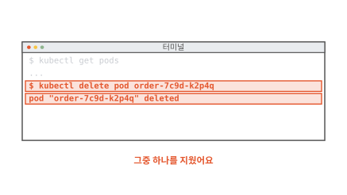

그중 `order-7c9d-k2p4q`를 지우라고 명령했어요. 쿠버네티스는 지웠다고 답했어요.

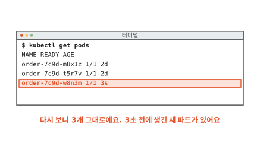

목록을 다시 보니 파드는 여전히 3개예요. 지운 파드는 없어졌어요. 대신 3초 전에 생긴 낯선 파드 `order-7c9d-w8n3m`이 있어요. 아무도 만들라고 하지 않았는데 누가 만들었을까요? 답을 찾기 전에 집에 있는 기계 하나를 먼저 볼게요.

## 온도 조절기는 무엇을 듣고 움직일까요?

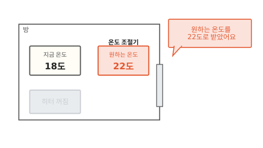

겨울에 방이 18도예요. 벽의 온도 조절기를 22도에 맞췄어요. 우리가 조절기에 알려 준 것은 22도라는 숫자 하나예요.

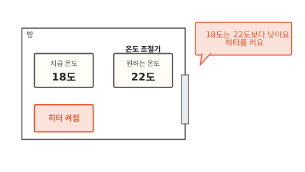

조절기는 지금 온도를 재서 원하는 온도와 비교해요. 18도는 22도보다 낮으니 히터를 켜요. 히터를 켜라고 말한 사람은 없어요.

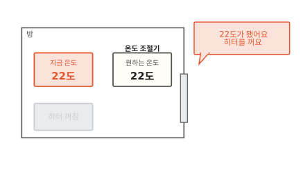

방이 22도가 되면 조절기는 히터를 꺼요. 일이 끝난 것 같아요. 그런데 창문을 열면 어떻게 될까요?

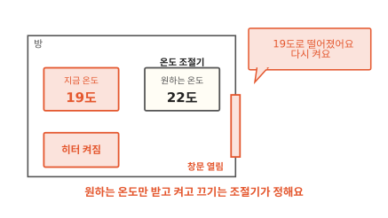

방이 19도로 떨어지자 조절기는 히터를 다시 켜요. 조절기는 22도에 닿은 뒤에도 온도를 계속 재고 있었어요. 우리는 원하는 온도만 알려 주고 언제 켜고 끌지는 조절기가 정해요.

쿠버네티스도 이렇게 일해요.[^ctrl] 그렇다면 쿠버네티스에서 "원하는 온도"는 어디에 적을까요?

## 원하는 상태는 어디에 적을까요?

주문 처리 파드를 3개 띄워 두고 싶으면 그 바람을 문서에 적어요. 그림 왼쪽 위의 `order.yaml`이 그 문서예요.

`replicas: 3`은 파드를 3개 띄워 두라는 뜻이에요. `image: order:1`은 파드를 어떤 이미지로 띄울지 적은 줄이에요. 이미지는 컨테이너를 만드는 틀이에요([2편](02-image-layers.md)). 맨 위 `kind: Deployment`는 문서의 종류예요. Deployment는 파드를 몇 개, 어떤 모습으로 띄울지 적는 종류예요.

문서 어디에도 "파드를 만들어라"는 말은 없어요. 파드 3개가 떠 있는 모습만 적혀 있어요. 조절기에 맞춘 22도와 같아요. 이렇게 원하는 상태를 적은 문서를 **매니페스트**(manifest)라고 해요.[^manifest]

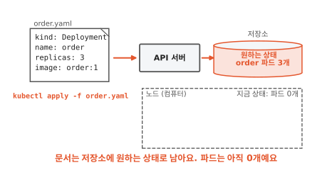

매니페스트는 `kubectl apply -f order.yaml`로 쿠버네티스에 보내요. 받는 쪽은 API 서버예요. API 서버는 쿠버네티스의 접수 창구예요. 쿠버네티스에 무엇을 알리거나 물어보는 일은 모두 이 창구를 거쳐요. API 서버는 받은 문서를 저장소에 원하는 상태로 남겨요.[^etcd]

그런데 노드에는 파드가 아직 하나도 없어요. 노드는 파드가 실제로 도는 컴퓨터 한 대예요. 문서를 저장해 뒀을 뿐이니 누군가 이 상태를 실제로 만들어야 해요.

??? info "심화: 매니페스트를 다시 읽으면 무엇이 더 붙어 있나요?"
    보낸 매니페스트를 `kubectl get deployment order -o yaml`로 다시 꺼내 보면 내가 쓰지 않은 칸이 잔뜩 붙어 있어서 놀랄 때 보는 칸이에요.

    쿠버네티스 문서는 대개 두 칸으로 나뉘어요. 내가 쓰는 `spec`은 원하는 상태예요. 쿠버네티스가 채우는 `status`는 지금 상태예요. 다시 꺼낸 문서에는 `status` 아래에 지금 준비된 파드 수(`readyReplicas`) 같은 값이 적혀 있어요. 기본값으로 채워진 칸도 함께 보여요.

    공식 문서는 이 구조를 "의도를 적은 기록"이라고 불러요. 문서를 만들면 쿠버네티스는 그 문서가 말하는 상태가 되도록 계속 일한다는 뜻이에요.[^manifest]

## 누가 문서대로 맞출까요?

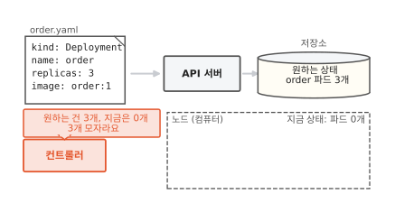

그림 왼쪽 아래에 새 일꾼이 있어요. 이 일꾼은 저장소에서 원하는 상태를 읽고 노드의 지금 상태를 봐요. 원하는 건 3개인데 지금은 0개예요. 3개가 모자라요.

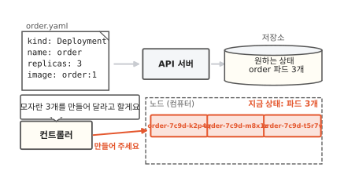

일꾼은 모자란 만큼 파드를 만들어 달라고 해요. 노드에 파드 3개가 떠요.

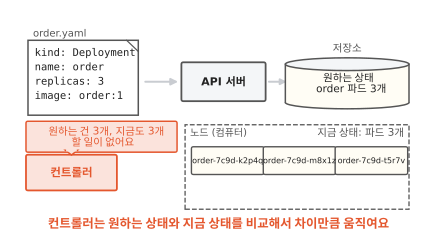

3개가 다 뜨면 원하는 상태와 지금 상태가 같아져요. 일꾼은 할 일이 없어요. 원하는 상태와 지금 상태를 비교해서 차이만큼 맞추는 이 일꾼을 **컨트롤러**(controller)라고 해요.

쿠버네티스에는 컨트롤러가 여럿이에요. Deployment를 맡는 컨트롤러, 노드를 맡는 컨트롤러처럼 저마다 맡은 종류가 있어요. 이 편 그림의 컨트롤러는 Deployment를 맡은 컨트롤러예요. 할 일이 없어진 컨트롤러는 이제 쉴까요?

??? info "심화: 컨트롤러가 직접 컨테이너를 띄우나요?"
    그림에서는 컨트롤러가 노드에 파드를 바로 만드는 것처럼 그렸어요. 실제로 누가 어떤 일을 나눠 하는지 궁금할 때 보는 칸이에요.

    컨트롤러는 파드를 직접 띄우지 않아요. API 서버에 "파드를 이렇게 만들어 주세요"라는 문서를 보내요. 그러면 다른 일꾼들이 그 문서를 보고 차례로 움직여요. 스케줄러는 아직 노드가 정해지지 않은 파드를 보고 그 파드가 돌 노드를 골라요. 각 노드에서 도는 kubelet은 자기 노드에 배정된 파드를 보고 컨테이너를 실제로 띄워요.[^parts]

    이 일꾼들도 모두 같은 방식으로 일해요. 저마다 API 서버에서 원하는 상태를 읽고 자기 몫의 지금 상태를 맞춰요. 그래서 일꾼 하나가 잠시 멈췄다 돌아와도 밀린 차이를 그때 맞추면 돼요.

## 지운 파드는 왜 다시 생겼을까요?

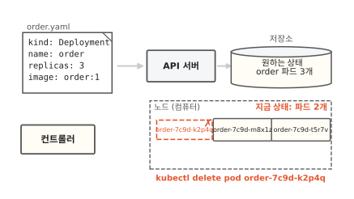

처음 장면으로 돌아가요. 우리가 `kubectl delete pod`로 지운 것은 노드에 떠 있던 파드 하나예요. 지금 상태가 3개에서 2개로 바뀌었어요. 저장소의 원하는 상태는 그대로 3개예요.

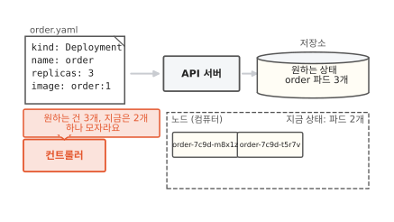

컨트롤러는 그 사이에도 지켜보고 있었어요. 원하는 건 3개인데 지금은 2개예요.

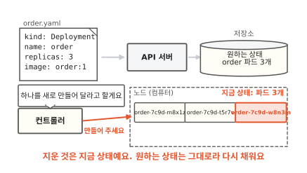

그래서 하나를 새로 만들었어요. 처음 장면의 `order-7c9d-w8n3m`이 이렇게 생긴 파드예요. 쿠버네티스는 지우라는 명령을 따랐어요. 그다음 컨트롤러가 원하는 상태대로 다시 채웠어요. 노드가 고장 나서 파드가 사라질 때도 똑같이 채워요.

컨트롤러가 하는 일은 그림의 세 걸음이에요. 지금 상태를 지켜보고 원하는 상태와 비교하고 차이만큼 맞춰요. 그리고 다시 지켜봐요. 이 세 걸음을 끝없이 되풀이하는 것을 **조정 루프**(control loop)라고 해요.[^loop]

명령과 나란히 놓으면 차이가 보여요. "파드 하나를 더 만들어라"는 명령은 한 번 실행되면 끝이에요. 그 파드가 나중에 죽어도 명령은 다시 돌지 않아요. "파드 3개"라는 원하는 상태는 컨트롤러가 도는 동안 계속 지켜져요. 그럼 언제 명령을 쓰고 언제 문서를 고쳐야 할까요?

??? info "심화: 명령으로 늘린 파드 수가 왜 되돌아가나요?"
    급할 때 `kubectl scale`로 파드 수를 바꿨는데 얼마 뒤 원래대로 돌아가서 당황했을 때 보는 칸이에요.

    `kubectl scale deployment order --replicas=5`는 저장소의 원하는 상태를 5개로 바꿔요. 이건 지금 상태가 아니라서 컨트롤러가 되돌리지 않아요. 문제는 그다음이에요. 누가 `order.yaml`을 다시 `kubectl apply`로 보내면 문서에 적힌 `replicas: 3`이 다시 원하는 상태가 돼요. 명령으로 바꾼 5개는 덮여요.[^scale]

    그래서 오래 남겨야 하는 바꿈은 문서 파일을 고쳐서 보내요. 문서 파일과 저장소의 원하는 상태가 어긋나 있으면 다음 apply가 언제든 어긋난 쪽을 덮어요.

## 원하는 상태로 적기는 언제 쓸모 있을까요?

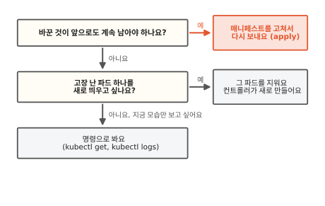

빵집 주문 처리 파드의 개수나 이미지를 바꾸는 일은 앞으로도 남아야 해요. 그러니 매니페스트를 고쳐서 보내요. 문서를 고치지 않고 명령으로만 바꾸면 다음 apply가 덮어요.

파드 하나가 이상하게 굴 때는 그 파드를 지워도 돼요. 컨트롤러가 원하는 상태대로 새 파드를 채워 주니까요. 목록을 보거나 기록을 보는 일은 상태를 바꾸지 않으니 명령으로 해요.

8편에서는 매니페스트의 한 줄만 바꿨는데 파드가 전부 새로 뜨는 까닭을 이어 가요.

## 다시 파드를 지워 볼게요

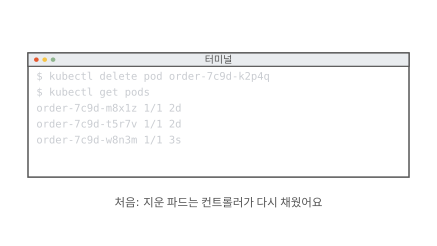

처음 장면의 터미널이에요. 파드를 지웠더니 컨트롤러가 원하는 상태대로 다시 채웠어요.

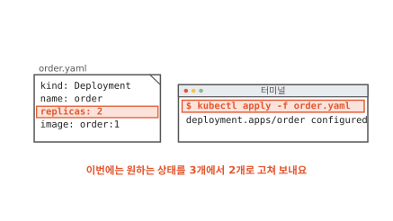

정말 파드를 하나 줄이고 싶다면 지우는 대신 원하는 상태를 고쳐요. 매니페스트의 `replicas`를 2로 고쳐서 보내요.

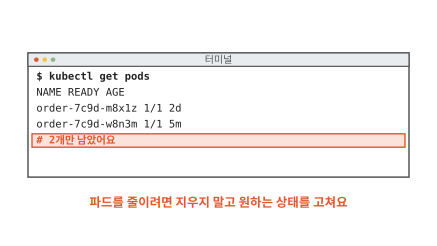

컨트롤러는 원하는 건 2개인데 지금은 3개인 것을 보고 하나를 지워요. 이번에는 다시 생기지 않아요. 파드가 셋이든 삼백이든 쿠버네티스는 적어 둔 상태를 보고 지금 모습을 그쪽으로 맞춰 가요.

### 이 편에서 줄여 그린 것

그림을 쉽게 하려고 실제와 다르게 줄인 곳이 세 군데 있어요.

1. 컨트롤러가 노드에 파드를 바로 만드는 것처럼 그렸어요. 실제로는 API 서버에 파드 문서를 보내고 스케줄러가 노드를 고르고 노드의 kubelet이 컨테이너를 띄워요. 심화 칸 "컨트롤러가 직접 컨테이너를 띄우나요?"에 적었어요.
2. Deployment 컨트롤러가 파드를 바로 세는 것처럼 그렸어요. 실제로는 그 사이에 ReplicaSet이라는 단계가 하나 더 있어요. 이 단계가 왜 있는지는 [8편](08-rolling-update.md)에서 봐요.
3. 노드를 한 대만 그렸어요. 실제로는 노드가 여러 대이고 파드는 그중 어디에든 뜰 수 있어요.

### 이 편에서 새로 나온 말

[^ctrl]: 쿠버네티스 공식 문서도 컨트롤러를 설명하며 방의 온도 조절기를 예로 들어요. <https://kubernetes.io/docs/concepts/architecture/controller/>
[^manifest]: 공식 문서의 표현은 record of intent예요. 문서를 `kubectl`에 넘기는 파일을 매니페스트라고 부르고 보통 YAML 형식으로 써요. `spec`과 `status`의 구분도 같은 문서에 있어요. <https://kubernetes.io/docs/concepts/overview/working-with-objects/>
[^etcd]: 이 저장소의 이름은 etcd예요. 쿠버네티스의 모든 데이터를 담는 키-값 저장소예요. <https://kubernetes.io/docs/concepts/architecture/#etcd>
[^parts]: 스케줄러(kube-scheduler)와 kubelet이 하는 일은 공식 문서의 구성 요소 설명에 있어요. <https://kubernetes.io/docs/concepts/architecture/>
[^loop]: 공식 문서는 control loop를 "멈추지 않고 시스템의 상태를 다스리는 되풀이"라고 설명해요. 컨트롤러가 차이를 맞추는 일은 흔히 조정(reconcile)이라고도 불러서 reconcile loop라는 이름도 자주 보여요. <https://kubernetes.io/docs/concepts/architecture/controller/>
[^scale]: Deployment 문서의 Replicas 절에 이 동작이 적혀 있어요. <https://kubernetes.io/docs/concepts/workloads/controllers/deployment/#replicas>
