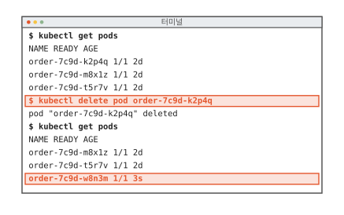
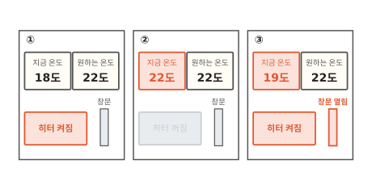
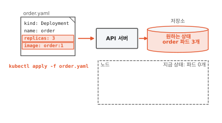
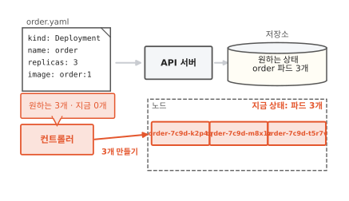
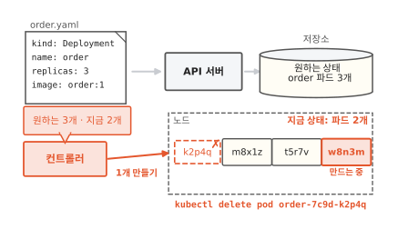
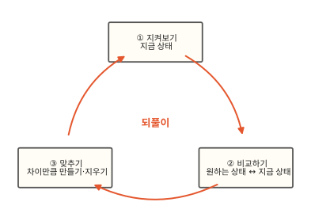
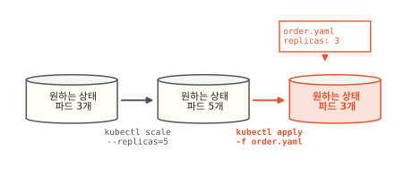
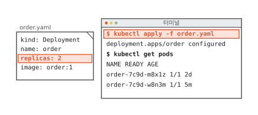

# 조정 루프: 쿠버네티스가 원하는 상태를 지키는 방법

쿠버네티스에서 파드 하나를 지우라고 명령했어요. 지웠다는 답이 왔는데 목록을 다시 보니 파드 수가 그대로예요. 쿠버네티스는 명령을 한 번 실행하고 끝내지 않아요. 이 글을 읽고 나면 쿠버네티스가 적어 둔 상태를 어떻게 계속 지키는지 알게 돼요. 이걸 알면 파드 수나 설정을 바꿀 때 명령을 칠지 문서를 고칠지 고를 수 있어요.

!!! abstract "이 글에서 알게 되는 것"
    1. 쿠버네티스에는 "파드 3개"처럼 원하는 상태를 문서로 적어 보내요. 이 문서를 매니페스트라고 해요.
    2. 컨트롤러는 원하는 상태와 지금 상태를 계속 비교해서 차이만큼 파드를 만들거나 지워요. 이 되풀이를 조정 루프라고 해요.
    3. 그래서 지운 파드는 다시 생겨요. 오래 남길 바꿈은 명령 대신 매니페스트를 고쳐서 보내요.

## 1. 지운 파드가 몇 초 만에 다시 생겨요

동네 빵집에 주문 앱이 있어요. 앱은 세 부품으로 돼 있어요. 주문 화면과 주문 처리, 주문 장부예요. 그중 주문 처리 프로그램이 쿠버네티스 위에서 돌아요. 쿠버네티스는 컴퓨터 여러 대에 프로그램을 나눠 띄우고 돌봐 주는 프로그램이에요.

프로그램은 컨테이너에 담겨 떠요. 컨테이너는 칸막이와 사용량 한도를 씌운 보통 프로그램이에요([1편](01-container.md)). 쿠버네티스는 컨테이너를 파드라는 단위로 띄워요. 파드는 함께 뜨는 컨테이너 묶음이에요. 이 글에서는 파드 하나에 컨테이너 하나라고 생각해도 돼요.

쿠버네티스는 `kubectl`이라는 명령 도구로 다뤄요. 아래 터미널은 명령 세 개를 차례로 친 화면이에요. 빨간 두 줄을 보세요.

**그림 1.** `order-7c9d-k2p4q`를 지웠는데 3초 된 새 파드가 생겨서 다시 3개가 됐어요.
{ .fig-cap }

처음 `kubectl get pods`로 본 목록에는 주문 처리 파드가 3개 있어요. 그중 `order-7c9d-k2p4q`를 `kubectl delete pod`로 지웠어요. 쿠버네티스는 지웠다(deleted)고 답했어요. 그런데 목록을 다시 보니 파드가 여전히 3개예요. 지운 파드는 없어졌고 3초 전에 생긴 낯선 파드 `order-7c9d-w8n3m`이 있어요.

아무도 만들라고 하지 않았는데 누가 만들었을까요? 답을 찾기 전에 집에 있는 기계 하나를 먼저 볼게요.

## 2. 온도 조절기는 원하는 온도만 듣고 히터는 스스로 켜고 꺼요

겨울에 방이 18도예요. 벽의 온도 조절기를 22도에 맞췄어요. 우리가 조절기에 알려 준 건 22도라는 숫자 하나예요. 히터를 켜라는 말은 하지 않았어요.

아래 세 칸은 그다음에 방에서 일어나는 일이에요. 칸마다 빨간 곳을 보세요.

**그림 2.** 원하는 온도는 22도로 그대로인데 지금 온도에 따라 히터가 켜졌다 꺼졌다 해요.
{ .fig-cap }

①에서 조절기는 지금 온도를 재서 원하는 온도와 비교해요. 18도는 22도보다 낮으니 히터를 켜요. ②에서 방이 22도가 되면 히터를 꺼요. 이걸로 일이 끝난 것 같지만 ③처럼 창문을 열면 방이 19도로 떨어져요. 그러면 조절기는 히터를 다시 켜요. 22도에 닿은 다음에도 온도를 계속 재고 있었거든요.

우리는 원하는 온도만 알려 줬어요. 언제 켜고 끌지는 조절기가 정했어요. 쿠버네티스도 이렇게 일해요.[^ctrl] 그럼 쿠버네티스에서는 "22도"를 어디에 적을까요?

## 3. 원하는 상태는 매니페스트에 적어 보내요

주문 처리 파드를 3개 띄워 두고 싶으면 그 바람을 문서에 적어요. 아래 그림 왼쪽 위의 `order.yaml`이 그 문서예요. 빨간 두 줄을 보세요.

**그림 3.** `order.yaml`이 API 서버를 거쳐 저장소에 원하는 상태로 남았지만 노드에는 파드가 아직 0개예요.
{ .fig-cap }

`replicas: 3`은 파드를 3개 띄워 두라는 뜻이에요. `image: order:1`은 파드를 어떤 이미지로 띄울지 적은 줄이에요. 이미지는 컨테이너를 만드는 틀이에요([2편](02-image-layers.md)). 맨 위 `kind: Deployment`는 문서의 종류예요. Deployment는 파드를 몇 개, 어떤 모습으로 띄울지 적는 종류예요.

문서 어디에도 "파드를 만들어라"는 말은 없어요. 파드 3개가 떠 있는 모습만 적혀 있어요. 조절기에 맞춘 22도와 같아요. 이렇게 원하는 상태를 적은 문서를 **매니페스트**(manifest)라고 해요.[^manifest]

매니페스트는 `kubectl apply -f order.yaml`로 쿠버네티스에 보내요. 받는 쪽은 API 서버예요. API 서버는 쿠버네티스의 접수 창구라서 쿠버네티스에 무엇을 알리거나 물어보는 일은 모두 여기를 거쳐요. API 서버는 받은 문서를 저장소에 원하는 상태로 남겨요.[^etcd]

그런데 그림 아래쪽 노드에는 파드가 하나도 없어요. 노드는 파드가 실제로 도는 컴퓨터 한 대예요. 문서를 저장해 뒀을 뿐이니까 누군가 이 상태를 실제로 만들어야 해요.

## 4. 컨트롤러가 원하는 상태와 지금 상태의 차이를 메워요

그 일을 맡은 일꾼이 따로 있어요. 아래 그림 왼쪽 아래의 빨간 상자예요. 말풍선의 두 숫자를 보세요.

**그림 4.** 컨트롤러가 원하는 3개와 지금 0개를 비교하고 모자란 3개를 만들어 달라고 해서 노드에 파드 3개가 떴어요.
{ .fig-cap }

이 일꾼은 저장소에서 원하는 상태를 읽고 노드의 지금 상태를 봐요. 원하는 건 3개인데 지금은 0개예요. 3개가 모자라니까 3개를 만들어 달라고 해요. 그래서 노드에 파드 3개가 떠요.

3개가 다 뜨면 원하는 상태와 지금 상태가 같아져요. 일꾼은 할 일이 없어요. 원하는 상태와 지금 상태를 비교해서 차이만큼 맞추는 이 일꾼을 **컨트롤러**(controller)라고 해요.

쿠버네티스에는 컨트롤러가 여럿이에요. Deployment를 맡는 컨트롤러, 노드를 맡는 컨트롤러처럼 저마다 맡은 종류가 있어요. 이 글 그림의 컨트롤러는 Deployment를 맡은 컨트롤러예요.

할 일이 없어진 컨트롤러는 이제 쉴까요? 1절에서 지운 파드가 그 답이에요.

## 5. 지운 파드는 컨트롤러가 다시 채워요

1절로 돌아가요. `kubectl delete pod`로 지운 것은 노드에 떠 있던 파드 하나예요. 지금 상태가 3개에서 2개로 바뀌었어요. 저장소의 원하는 상태는 여전히 3개예요.

아래 그림에서 점선으로 지워진 파드와 빨간 새 파드를 보세요. 칸이 좁아서 파드 이름은 끝 다섯 글자만 적었어요.

**그림 5.** `k2p4q`가 지워져 2개가 되자 컨트롤러가 1개를 더 만들어 달라고 해서 `w8n3m`이 생겼어요.
{ .fig-cap }

컨트롤러는 그 사이에도 지켜보고 있었어요. 원하는 건 3개인데 지금은 2개라서 하나를 새로 만들어 달라고 했어요. 1절의 `order-7c9d-w8n3m`이 이렇게 생긴 파드예요. 쿠버네티스는 지우라는 명령을 따랐어요. 그다음 컨트롤러가 원하는 상태대로 다시 채웠어요. 노드가 고장 나서 파드가 사라질 때도 똑같이 채워요.

컨트롤러가 하는 일은 세 걸음이에요. 아래 그림에서 빨간 화살표를 따라가 보세요.

**그림 6.** 지켜보기, 비교하기, 맞추기가 끝나면 다시 지켜보기로 돌아가요.
{ .fig-cap }

지금 상태를 지켜보고 원하는 상태와 비교하고 차이만큼 맞춰요. 그리고 다시 지켜봐요. 이 세 걸음을 멈추지 않고 되풀이하는 것을 **조정 루프**(control loop)라고 해요.[^loop]

명령과 나란히 놓으면 차이가 보여요. "파드 하나를 더 만들어라"는 명령은 한 번 돌고 끝나요. 그 파드가 나중에 죽어도 명령은 다시 돌지 않아요. 컨트롤러는 돌아가는 동안 "파드 3개"를 계속 지켜요.

## 6. 오래 남길 바꿈은 매니페스트를 고쳐서 보내요

파드 수를 명령으로 바꾸는 방법도 있어요. 급하게 파드를 5개로 늘리고 싶을 때 `kubectl scale deployment order --replicas=5`를 쳐요. 이 명령은 저장소의 원하는 상태를 5개로 바꿔요. 지금 상태를 바꾼 게 아니니까 컨트롤러는 되돌리지 않고 파드를 5개로 맞춰요.

문제는 그다음이에요. 아래 그림에서 저장소의 숫자가 어떻게 바뀌는지 보세요.

**그림 7.** `kubectl scale`로 5개가 됐던 원하는 상태가 `order.yaml`을 다시 보내자 3개로 돌아갔어요.
{ .fig-cap }

누가 `order.yaml`을 다시 `kubectl apply`로 보내면 파일에 적힌 `replicas: 3`이 원하는 상태가 돼요. apply가 명령으로 바꾼 5개를 덮어써요.[^scale] 그러면 컨트롤러는 파드를 3개로 맞춰요. 파일과 저장소가 어긋나 있으면 다음 apply가 언제든 저장소 쪽을 덮어써요.

그래서 앞으로도 남아야 하는 바꿈은 파일을 고쳐서 보내요. 파드를 2개로 줄이고 싶다고 해 볼게요. 아래 그림 왼쪽 파일의 빨간 줄을 보세요.

**그림 8.** `replicas`를 2로 고친 파일을 apply하자 파드가 2개만 남았어요.
{ .fig-cap }

`replicas`를 2로 고쳐서 보냈어요. 컨트롤러는 원하는 건 2개인데 지금은 3개인 것을 보고 하나를 지워요. 이번에는 다시 생기지 않아요. 파일과 저장소가 둘 다 2개라서 다음 apply가 와도 바뀌지 않아요.

다른 경우도 같은 생각으로 고르면 돼요. 파드 하나가 이상하게 굴 때는 그 파드를 지워도 돼요. 컨트롤러가 원하는 상태대로 새 파드를 채워 주니까요. 목록이나 기록을 보는 일(`kubectl get`, `kubectl logs`)은 상태를 바꾸지 않으니 명령으로 해요.

??? info "심화: 실제로는 일꾼이 더 있어요"
    그림을 쉽게 하려고 줄인 곳이 세 군데 있어요.

    첫째, 컨트롤러는 파드를 직접 띄우지 않아요. API 서버에 "파드를 이렇게 만들어 주세요"라는 문서를 보내요. 스케줄러는 아직 노드가 정해지지 않은 파드를 보고 그 파드가 돌 노드를 골라요. 노드마다 도는 kubelet은 자기 노드에 배정된 파드를 보고 컨테이너를 실제로 띄워요.[^parts] 이 일꾼들도 모두 API 서버에서 원하는 상태를 읽고 자기 몫의 지금 상태를 맞춰요. 그래서 일꾼 하나가 잠시 멈췄다 돌아와도 밀린 차이를 그때 맞추면 돼요.

    둘째, Deployment 컨트롤러와 파드 사이에는 ReplicaSet이라는 단계가 하나 더 있어요. 이 단계가 왜 있는지는 [8편](08-rolling-update.md)에서 봐요.

    셋째, 노드를 한 대만 그렸어요. 실제로는 노드가 여러 대이고 파드는 그중 어디에든 뜰 수 있어요.

## 정리

쿠버네티스에는 "파드 3개"처럼 원하는 상태를 매니페스트에 적어 보내요. 온도 조절기를 22도에 맞추는 것과 같아서 만드는 순서는 적지 않아요.

컨트롤러는 저장소의 원하는 상태와 노드의 지금 상태를 계속 비교해서 차이만큼 파드를 만들거나 지워요. 이 되풀이가 조정 루프예요. 그래서 파드를 지워도 컨트롤러가 다시 채워요.

명령으로 바꾼 원하는 상태는 다음 apply가 덮어써요. 파드 수처럼 오래 남길 바꿈은 매니페스트를 고쳐서 보내요.

[8편](08-rolling-update.md)에서는 매니페스트의 한 줄만 바꿨는데 파드가 전부 새로 뜨는 까닭을 봐요.

### 새로 나온 말

- **매니페스트**: 원하는 상태를 적은 문서. `order.yaml`에는 `replicas: 3`과 `image: order:1`이 적혀 있어요.
- **Deployment**: 파드를 몇 개, 어떤 모습으로 띄울지 적는 매니페스트 종류.
- **API 서버**: 쿠버네티스의 접수 창구. 매니페스트를 받아 저장소에 원하는 상태로 남겨요.
- **컨트롤러**: 원하는 상태와 지금 상태를 계속 비교해서 맞추는 일꾼. 원하는 3개, 지금 2개를 보고 하나를 더 만들어 달라고 해요.
- **조정 루프**: 지켜보기, 비교하기, 맞추기를 멈추지 않고 되풀이하는 것.

[^ctrl]: 쿠버네티스 공식 문서도 컨트롤러를 설명하며 방의 온도 조절기를 예로 들어요. <https://kubernetes.io/docs/concepts/architecture/controller/>
[^manifest]: 공식 문서는 이런 문서를 record of intent(의도를 적은 기록)라고 불러요. `kubectl`에 넘기는 이 파일을 매니페스트라고 하고 보통 YAML 형식으로 써요. <https://kubernetes.io/docs/concepts/overview/working-with-objects/>
[^etcd]: 이 저장소의 이름은 etcd예요. 쿠버네티스의 모든 데이터를 담는 키-값 저장소예요. <https://kubernetes.io/docs/concepts/architecture/#etcd>
[^parts]: 스케줄러(kube-scheduler)와 kubelet이 하는 일은 공식 문서의 구성 요소 설명에 있어요. <https://kubernetes.io/docs/concepts/architecture/>
[^loop]: 공식 문서는 control loop를 "멈추지 않고 시스템의 상태를 다스리는 되풀이"라고 설명해요. 컨트롤러가 차이를 맞추는 일을 흔히 조정(reconcile)이라고도 불러서 reconcile loop라는 이름도 자주 보여요. <https://kubernetes.io/docs/concepts/architecture/controller/>
[^scale]: Deployment 문서의 Replicas 절에 이 동작이 적혀 있어요. <https://kubernetes.io/docs/concepts/workloads/controllers/deployment/#replicas>
