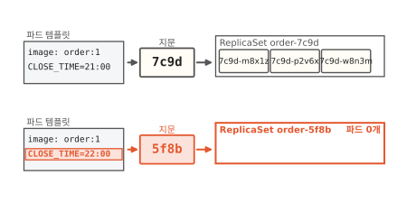
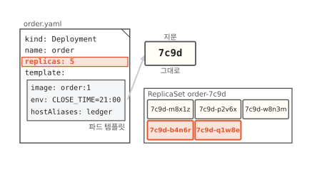
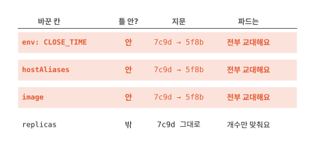

# 롤링 업데이트: 설정 한 줄에 파드가 모두 바뀌는 까닭

매니페스트에서 마감 시간 한 줄만 고쳐서 보냈어요. 그런데 떠 있던 파드 3개가 모두 처음 보는 이름으로 바뀌었어요. 이 글을 읽고 나면 한 줄에 파드가 모두 바뀌는 까닭과 쿠버네티스가 파드를 어떤 순서로 바꿔 끼우는지 알게 돼요. 이걸 알면 무엇을 바꿀 때 파드가 모두 새로 뜨는지 미리 알고 준비할 수 있어요.

!!! abstract "이 글에서 알게 되는 것"
    1. 파드는 Deployment 안의 파드 템플릿이라는 틀로 찍어 내요. 떠 있는 파드는 틀을 따라 바뀌지 않아서 틀이 바뀌면 파드를 새로 만들어야 해요.
    2. 틀 안의 칸을 하나라도 바꾸면 틀의 지문(해시)이 바뀌고 새 지문의 ReplicaSet이 생겨요. 틀 밖의 `replicas`만 바꾸면 지문이 그대로라 개수만 맞춰요.
    3. Deployment는 새 파드를 하나 띄우고 옛 파드를 하나 내리기를 되풀이해서 바꿔 끼워요. 이 교대를 롤링 업데이트라고 해요.

## 1. 마감 시간 한 줄을 바꿨더니 파드가 모두 새로 떴어요

동네 빵집이 문 닫는 시간을 밤 9시에서 10시로 늦췄어요. 빵집 주문 앱의 주문 처리 프로그램은 마감 시간을 환경 변수 `CLOSE_TIME`으로 받아요. 환경 변수는 프로그램이 뜰 때 밖에서 넘겨받는 이름과 값의 짝이에요.

마감 시간은 주문 처리 파드의 매니페스트에 적혀 있어요. 매니페스트는 원하는 상태를 적은 문서예요([7편](07-reconcile-loop.md)). 7편 끝에서 2개로 줄였던 파드는 `replicas: 3`으로 다시 돌려 두었어요. 그때 `order-7c9d-p2v6x`가 새로 떠서 파드는 다시 3개예요. 이제 `21:00`을 `22:00`으로 한 줄만 고쳐서 `kubectl apply`로 보냈어요. 몇십 초 지나서 파드 목록을 봤어요. 아래 그림 왼쪽 문서의 빨간 줄과 오른쪽 목록의 빨간 세 줄을 보세요.

**그림 1.** `CLOSE_TIME` 한 줄을 고쳐 보냈더니 파드 3개가 모두 `order-5f8b`로 시작하는 새 파드가 됐어요.
{ .fig-cap }

고치기 전 파드는 `order-7c9d-m8x1z`, `order-7c9d-p2v6x`, `order-7c9d-w8n3m`이었어요. 지금은 셋 다 처음 보는 이름이에요. 이름 가운데 글자도 `7c9d`에서 `5f8b`로 달라졌어요. 나이(AGE)는 40초, 25초, 9초예요. 한꺼번에 뜨지 않고 하나씩 차례로 떴다는 뜻이에요.

한 줄만 고쳤는데 왜 파드가 전부 새로 떴을까요? 그리고 왜 하나씩 떴을까요? 파드가 무엇을 보고 만들어지는지부터 볼게요.

## 2. 파드는 파드 템플릿이라는 틀로 찍어 내요

빵집 직원은 근무 지침대로 일해요. 무엇을 입고 몇 시에 문을 닫는지가 지침에 적혀 있어요. 파드에도 이런 지침이 있어요.

아래 그림은 1절의 매니페스트를 고치기 전 모습이에요. 빨간 상자를 보세요.

**그림 2.** `template:` 아래 상자 하나로 파드 3개를 똑같이 찍어 내고 `replicas`는 그 상자 밖에 있어요.
{ .fig-cap }

`template:` 아래 상자에는 파드를 띄울 이미지, 넘길 환경 변수, 호스트 이름 목록이 적혀 있어요. 호스트 이름 목록은 파드 안에서 `ledger` 같은 이름을 어느 주소로 볼지 적은 목록이에요. 파드 3개는 모두 이 상자 하나를 보고 똑같이 만들어요. 이 상자처럼 파드를 찍어 내는 틀을 **파드 템플릿**(Pod template)이라고 해요.[^tpl]

몇 개를 띄울지 적은 `replicas: 3`은 틀 밖에 있어요. 틀은 파드 하나가 어떤 모습인지만 말하고 개수는 말하지 않아요.

여기서 이런 생각이 들 거예요. 틀을 고치면 떠 있는 파드도 따라 고쳐지면 되잖아요? 그런데 파드는 만든 다음에 고칠 수 있는 칸이 아주 적어요. 환경 변수나 호스트 이름 목록은 바꿀 수 없는 칸이에요.[^podupdate] 그래서 틀이 바뀌면 새 틀로 파드를 새로 만들어야 해요. 새 근무 지침이 나오면 일하던 직원을 그 자리에서 바꿀 수 없으니 새 지침을 받은 직원과 교대하는 것과 같아요.

그럼 쿠버네티스는 틀이 바뀐 것을 어떻게 알아챌까요?

## 3. 틀이 바뀌면 지문이 바뀌고 새 묶음이 생겨요

틀에 적힌 글자 전체를 한 계산에 넣으면 짧은 글자 하나가 나와요. 같은 틀을 넣으면 늘 같은 글자가 나와요. 틀이 조금만 달라도 대개 전혀 다른 글자가 나와요. 이런 계산을 해시라고 해요([알고리즘 9편](../algorithms/09-hash.md)). 이 글에서는 해시로 나온 글자를 틀의 지문이라고 부를게요.

Deployment를 맡은 컨트롤러는 지문마다 파드 묶음을 하나씩 만들어요. 묶음은 같은 지문의 파드를 정한 개수만큼 지켜요. 모자라면 채우고 넘치면 지워요. 7편의 컨트롤러와 같은 일꾼이에요. 이 묶음을 **ReplicaSet**이라고 해요.

아래 그림의 위아래 두 줄을 비교해 보세요. 윗줄은 고치기 전이고 아랫줄은 고친 다음이에요.

**그림 3.** `CLOSE_TIME`이 22:00이 되자 지문이 `7c9d`에서 `5f8b`로 바뀌고 빈 ReplicaSet `order-5f8b`가 새로 생겼어요.
{ .fig-cap }

고치기 전 틀의 지문은 `7c9d`예요. 그 지문의 ReplicaSet `order-7c9d`가 파드 3개를 지키고 있었어요. 마감 시간 한 줄을 바꾸자 틀이 달라져서 지문이 `5f8b`로 바뀌었어요. 지문 `5f8b`의 ReplicaSet은 아직 없으니 Deployment 컨트롤러가 새로 만들어요. 새 묶음 `order-5f8b`가 원하는 상태는 새 틀의 파드 3개예요. 옛 묶음 `order-7c9d`는 0개로 줄여 가요.

ReplicaSet 이름과 그 안의 파드 이름 가운데에는 지문이 붙어요.[^hash] 1절에서 이름 가운데 글자가 `7c9d`에서 `5f8b`로 바뀐 까닭이 이거예요. 그림은 칸이 좁아서 파드 이름 앞의 `order-`를 떼고 적었어요.

마감 시간은 틀 안의 한 칸이에요. 틀 안이면 어느 칸이 바뀌든 지문이 바뀌고 파드는 새 묶음으로 모두 옮겨 가요. 그럼 틀 밖의 칸을 바꾸면 어떻게 될까요?

## 4. 틀 밖의 개수만 바꾸면 있던 파드는 그대로예요

마감 시간을 고치기 전으로 돌아가 볼게요. 주말이라 주문이 많아서 파드를 5개로 늘리려고 해요. 이번에는 틀 밖의 `replicas`만 3에서 5로 바꿔서 보냈어요. 아래 그림에서 지문과 묶음을 보세요.

**그림 4.** `replicas`만 5로 바꾸면 지문은 `7c9d` 그대로이고 같은 묶음에 파드 2개만 더해져요.
{ .fig-cap }

틀이 그대로니까 지문도 `7c9d` 그대로예요. 새 묶음은 생기지 않아요. 같은 묶음이 원하는 개수만 3에서 5로 바뀌어요. 그래서 원래 파드 3개는 그대로 두고 2개만 더 띄워요. 개수를 바꾸는 일은 교대를 일으키지 않아요.[^trigger]

바꾼 칸에 따라 어떻게 되는지 아래 표에 모았어요. 빨간 세 줄과 맨 아래 줄을 비교해 보세요.

**그림 5.** 틀 안의 칸은 무엇을 바꾸든 지문이 바뀌어 파드가 전부 교대하고 틀 밖의 `replicas`는 개수만 맞춰요.
{ .fig-cap }

마감 시간, 호스트 이름 목록, 이미지는 모두 틀 안에 있어요. 셋 중 무엇을 바꾸든 지문이 바뀌고 파드가 전부 교대해요.

그런데 1절에서 파드는 한꺼번에 바뀌지 않고 하나씩 바뀌었어요. 교대는 어떤 순서로 할까요?

## 5. 새 파드를 하나 띄우고 옛 파드를 하나 내리며 바꿔 끼워요

빵집이 직원을 바꿀 때 문을 닫지는 않아요. 새 직원이 먼저 와서 계산대에 서고 그다음 옛 직원이 퇴근해요. 손님은 교대하는 줄도 모르고 빵을 사 가요. Deployment도 이렇게 바꿔요.

아래 표는 교대를 한 줄에 한 걸음씩 적은 거예요. 줄마다 빨간 칸과 오른쪽 숫자를 보세요.

**그림 6.** 새 파드를 하나 띄우고 옛 파드를 하나 내리기를 되풀이하는 동안 일하는 파드는 늘 3개예요.
{ .fig-cap }

①에서 새 틀로 파드 `5f8b-a3k9d`를 먼저 띄워요. 잠깐 파드가 모두 4개가 돼요. 새 파드는 아직 준비 중이라 주문은 옛 파드 3개가 받아요. ②에서 새 파드가 준비되면 옛 파드 `7c9d-m8x1z`를 내려요. 일하는 파드는 여전히 3개예요. ③과 ④에서 같은 일을 두 번 더 해요. 그림은 ③과 ④에서 뜨기와 내리기를 한 줄에 함께 적었어요.

이렇게 새 파드를 띄우고 옛 파드를 내리기를 조금씩 되풀이하는 교대를 **롤링 업데이트**(rolling update)라고 해요.

기본 설정에서 파드가 3개면 교대하는 동안 늘 3개 이상이 일하고 많아야 4개까지 떠요.[^surge] 그래서 1절에서 파드가 한꺼번에 사라지지 않고 하나씩 바뀌었어요. 내려가는 옛 파드는 신호를 받은 다음 하던 일을 마무리할 시간을 받고 사라져요.

옛 묶음 `order-7c9d`는 파드가 0개가 돼도 지우지 않고 남겨 둬요. 새 틀에 문제가 있어서 앞 모습으로 돌아가고 싶을 때 쓰려고요. `kubectl rollout undo deployment order`로 되돌리면 Deployment는 옛 틀을 다시 원하는 상태로 삼아요. 옛 틀의 지문은 `7c9d`이니 남아 있던 `order-7c9d`를 다시 키우고 `order-5f8b`를 줄여요. 이 교대도 롤링 업데이트로 해요. 옛 묶음은 기본으로 10개까지 남기고 그보다 오래된 것은 지워요.[^history]

## 6. 틀 안을 바꿀 때는 교대를 미리 준비해요

이제 무엇을 바꾸기 전에 그 칸이 틀 안인지 먼저 볼 수 있어요. 틀 안이면 파드가 모두 교대하니까 그 교대를 미리 준비해요. 노드에 파드 하나를 더 띄울 자리가 있어야 해요. 새 파드가 주문을 받을 준비가 됐는지 알리는 확인 방법(readiness probe)도 파드에 적어 둬요.[^ready] 틀 안의 칸을 바꿀 때마다 교대를 한 번씩 하니까 여러 칸을 바꿀 거면 한 번에 모아서 보내요.

틀 밖이라도 조심할 곳이 하나 있어요. 설정값을 따로 모아 두는 ConfigMap이라는 문서예요. 마감 시간을 매니페스트에 쓰지 않고 ConfigMap `order-config`에 두었다고 해 볼게요. 틀에는 "이 ConfigMap을 읽어라"라는 이름만 적어 둬요. 아래 그림에서 ConfigMap의 빨간 줄과 떠 있는 파드의 빨간 줄을 비교해 보세요.

**그림 7.** ConfigMap의 마감 시간을 22:00으로 고쳐도 틀의 지문은 그대로라서 떠 있는 파드는 21:00을 계속 써요.
{ .fig-cap }

ConfigMap 내용을 고쳐도 틀에 적힌 글자는 그대로예요. 지문이 바뀌지 않으니 교대도 일어나지 않아요. 파드가 ConfigMap 값을 환경 변수로 읽었다면 떠 있는 파드는 옛 값을 계속 써요.[^cm] 이때는 `kubectl rollout restart deployment order`로 파드를 다시 교대시켜요.[^restart]

??? info "심화: 교대 빠르기는 무엇으로 정하나요?"
    파드가 아주 많아서 하나씩 교대하기엔 너무 오래 걸릴 때 보는 칸이에요.

    두 값이 정해요. `maxSurge`는 원하는 개수보다 더 띄워도 되는 파드 수예요. `maxUnavailable`은 원하는 개수보다 모자라도 되는 파드 수예요. 둘 다 기본값이 25%예요.[^surge]

    퍼센트는 원하는 개수에 곱해서 개수로 바꿔요. 파드 3개의 25%는 0.75예요. `maxSurge`는 올려서 1개가 되고 `maxUnavailable`은 내려서 0개가 돼요. 그래서 한 개 더 띄우고 하나도 모자라게 두지 않아요. 파드가 40개면 둘 다 10개라서 열 개씩 교대해요.

    노드에 여유 자리가 없으면 `maxSurge: 0`, `maxUnavailable: 1`처럼 줄 수 있어요. 옛 파드 하나를 먼저 내리고 그 자리에 새 파드를 띄워요. 대신 교대하는 동안 일하는 파드가 하나 줄어요. 두 값을 함께 0으로 둘 수는 없어요.

## 정리

마감 시간 한 줄을 바꿨는데 파드가 모두 새로 뜬 까닭은 그 줄이 파드 템플릿 안에 있어서예요. 파드는 이 틀로 찍어 내고 떠 있는 파드는 틀을 따라 바뀌지 않아요. 그래서 틀이 바뀌면 파드를 새로 만들어야 해요.

틀 안의 칸이 하나라도 바뀌면 지문이 `7c9d`에서 `5f8b`로 바뀌고 새 지문의 ReplicaSet이 생겨요. 틀 밖의 `replicas`만 바꾸면 지문이 그대로라 같은 묶음이 개수만 맞춰요.

Deployment는 새 파드를 하나 띄우고 옛 파드를 하나 내리기를 되풀이해서 바꿔 끼워요. 이 롤링 업데이트 덕분에 교대하는 동안에도 주문을 받는 파드가 3개 아래로 줄지 않아요.

새로 뜬 파드는 이름만 바뀌지 않고 주소도 바뀌어요. 바뀌는 주소로 어떻게 찾아가는지는 [9편](09-service.md)에서 봐요.

### 새로 나온 말

- **파드 템플릿**: 파드를 찍어 내는 틀. Deployment의 `template:` 아래 칸으로 이미지, 환경 변수, 호스트 이름 목록이 들어 있어요.
- **지문(해시)**: 틀 전체를 해시해서 얻은 짧은 글자. 마감 시간을 바꾸자 `7c9d`에서 `5f8b`로 바뀌었어요.
- **ReplicaSet**: 같은 지문의 파드를 정한 개수만큼 지키는 묶음. 지문마다 하나씩 있어요.
- **롤링 업데이트**: 새 파드를 하나 띄우고 옛 파드를 하나 내리기를 되풀이하는 교대.
- **ConfigMap**: 설정값을 따로 모아 두는 문서. 내용을 고쳐도 틀의 지문은 그대로예요.

[^tpl]: Deployment의 `.spec.template`은 파드와 같은 모양의 문서예요. 실제 문서에서는 이미지와 환경 변수가 `spec.template.spec.containers` 아래에, 호스트 이름 목록이 `spec.template.spec.hostAliases` 아래에 있어요. <https://kubernetes.io/docs/concepts/workloads/controllers/deployment/#pod-template>
[^podupdate]: 떠 있는 파드에서 바꿀 수 있는 칸은 이미지 같은 몇 개뿐이에요. 틀을 바꾸면 그 틀을 쓰는 쪽이 새 파드를 만들어야 한다는 설명도 같은 문서에 있어요. <https://kubernetes.io/docs/concepts/workloads/pods/#pod-update-and-replacement>
[^hash]: 지문의 정식 이름은 `pod-template-hash` 라벨이에요. Deployment 컨트롤러가 틀을 해시해서 ReplicaSet과 그 파드에 붙여요. 파드 이름은 `[Deployment 이름]-[지문]-[무작위 글자]` 꼴이에요. 그림의 지문은 네 글자로 줄였고 공식 문서 예에서는 열 글자예요. <https://kubernetes.io/docs/concepts/workloads/controllers/deployment/#pod-template-hash-label>
[^trigger]: 공식 문서는 교대(rollout)가 틀(`.spec.template`)이 바뀔 때만 일어나고 개수를 바꾸는 일은 교대를 일으키지 않는다고 적어요. <https://kubernetes.io/docs/concepts/workloads/controllers/deployment/#updating-a-deployment>
[^surge]: 파드 3개짜리 예에서 "적어도 3개가 쓸 수 있는 상태이고 모두 합쳐 많아야 4개"라는 설명과 `maxSurge`·`maxUnavailable` 기본값 25%, 올림·내림 규칙이 Deployment 문서에 있어요. <https://kubernetes.io/docs/concepts/workloads/controllers/deployment/#rolling-update-deployment>
[^history]: 남겨 두는 개수는 `revisionHistoryLimit`으로 정해요. 지운 묶음의 틀로는 돌아갈 수 없어요. <https://kubernetes.io/docs/concepts/workloads/controllers/deployment/#clean-up-policy>
[^cm]: 공식 문서는 환경 변수로 읽은 ConfigMap 값은 저절로 바뀌지 않고 파드를 다시 띄워야 한다고 적어요. 파일로 붙여 읽는 방식은 시간이 지나면 새 값으로 바뀌어요. <https://kubernetes.io/docs/concepts/configuration/configmap/>
[^restart]: <https://kubernetes.io/docs/reference/kubectl/generated/kubectl_rollout/kubectl_rollout_restart/>
[^ready]: <https://kubernetes.io/docs/concepts/workloads/pods/pod-lifecycle/#container-probes>
