# 설정 한 줄 바꿨는데 왜 파드가 전부 다시 뜰까요?

## 마감 시간 한 줄을 바꿨어요

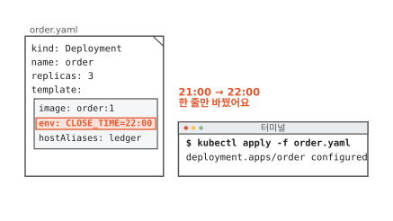

동네 빵집이 문 닫는 시간을 밤 9시에서 10시로 늦췄어요. 빵집 주문 앱의 주문 처리 프로그램은 마감 시간을 환경 변수 `CLOSE_TIME`으로 받아요. 환경 변수는 프로그램이 뜰 때 밖에서 넘겨받는 이름과 값의 짝이에요.

마감 시간은 주문 처리 파드의 매니페스트에 적혀 있어요. 매니페스트는 원하는 상태를 적은 문서예요([7편](07-reconcile-loop.md)). 파드는 쿠버네티스가 띄우는 컨테이너 묶음이에요. 그림처럼 `21:00`을 `22:00`으로 한 줄만 고쳐서 보냈어요.

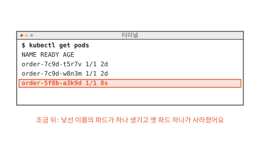

조금 뒤 파드 목록을 보니 이름이 낯선 파드가 하나 생겼어요. 옛 파드 하나는 사라졌어요.

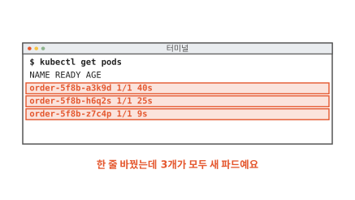

몇십 초 뒤에는 3개가 모두 새 파드로 바뀌었어요. 나이(AGE)를 보면 한꺼번에 바뀌지 않고 하나씩 차례로 떴어요. 이름 가운데 글자도 `7c9d`에서 `5f8b`로 달라졌어요. 한 줄만 고쳤는데 왜 파드가 전부 새로 떴을까요?

## 파드는 무엇을 보고 만들어질까요?

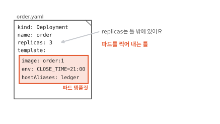

빵집 직원은 근무 지침대로 일해요. 무엇을 입고 몇 시에 문을 닫는지가 지침에 적혀 있어요. 파드에도 이런 지침이 있어요.

그림의 매니페스트에서 `template:` 아래 상자가 그 지침이에요. 파드를 띄울 이미지, 넘길 환경 변수, 호스트 이름 목록이 여기에 적혀 있어요. 호스트 이름 목록은 파드 안에서 `ledger` 같은 이름을 어느 주소로 볼지 적은 목록이에요. 이 상자는 파드를 찍어 내는 틀이에요. 이 틀을 **파드 템플릿**(Pod template)이라고 해요.[^tpl]

몇 개를 띄울지 적은 `replicas: 3`은 틀 밖에 있어요. 틀은 파드 하나가 어떤 모습인지만 말하고 개수는 말하지 않아요.

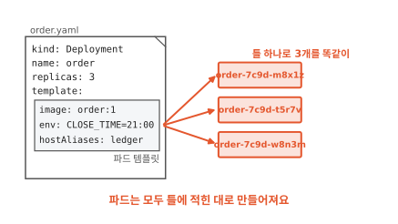

파드 3개는 모두 이 틀 하나로 똑같이 찍어 내요. 그런데 이미 떠 있는 파드는 틀을 고쳐도 따라 바뀌지 않아요. 파드는 만든 뒤에 고칠 수 있는 칸이 아주 적어요. 환경 변수나 호스트 이름 목록은 바꿀 수 없는 칸이에요.[^podupdate]

그래서 틀이 바뀌면 새 틀로 파드를 새로 만들어야 해요. 새 지침이 나오면 일하던 직원을 그 자리에서 바꿀 수 없으니 새 지침을 받은 직원과 교대하는 것과 같아요. 쿠버네티스는 틀이 바뀐 것을 어떻게 알아챌까요?

## 틀이 바뀐 것은 어떻게 알아챌까요?

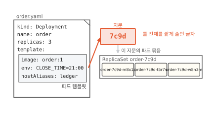

틀에 적힌 글자 전체를 한 계산에 넣으면 짧은 글자 하나가 나와요. 같은 틀을 넣으면 늘 같은 글자가 나와요. 틀이 조금만 달라도 대개 전혀 다른 글자가 나와요. 이런 계산을 해시라고 해요([알고리즘 9편](../algorithms/09-hash.md)). 이 편에서는 해시로 나온 글자를 틀의 지문이라고 부를게요. 지금 틀의 지문은 `7c9d`예요.

Deployment는 파드를 몇 개, 어떤 모습으로 띄울지 적는 문서 종류예요(7편). Deployment를 맡은 컨트롤러는 지문마다 묶음을 하나씩 만들어요. 묶음은 같은 지문의 파드를 정한 개수만큼 지키는 일을 해요. 개수가 모자라면 채워요. 넘치면 지워요. 7편의 컨트롤러와 같은 일꾼이에요. 이 묶음의 이름이 ReplicaSet이에요. ReplicaSet 이름과 그 안의 파드 이름 가운데에 지문이 붙어요.[^hash]

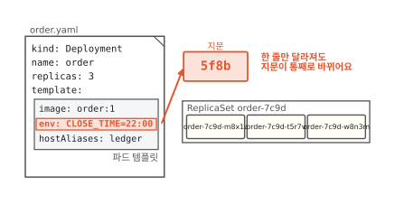

이제 마감 시간 한 줄을 바꿔요. 틀이 달라졌으니 지문도 `5f8b`로 바뀌어요.

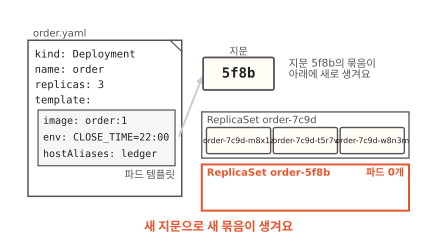

지문 `5f8b`의 ReplicaSet은 아직 없어요. Deployment 컨트롤러는 새 ReplicaSet `order-5f8b`를 만들어요. 이 묶음이 원하는 상태는 새 틀의 파드 3개예요. 옛 묶음 `order-7c9d`는 0개로 줄여 가요.

처음 장면의 이름 변화가 여기서 나왔어요. 마감 시간은 틀 안의 한 칸이에요. 틀 안이면 어느 칸이 바뀌든 지문이 바뀌고 파드는 새 묶음으로 모두 옮겨 가요. 그렇다면 틀 밖의 칸을 바꾸면 어떻게 될까요?

## 파드 개수만 바꾸면 어떻게 될까요?

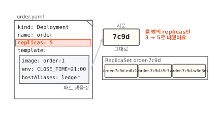

주말이라 주문이 많아서 파드를 5개로 늘려요. 이번에는 틀 밖의 `replicas`만 바꿨어요. 틀은 그대로이니 지문도 `7c9d` 그대로예요.

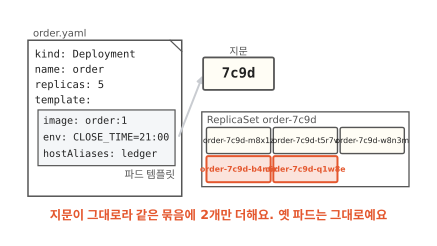

새 묶음은 생기지 않아요. 같은 묶음이 원하는 개수만 3에서 5로 바뀌어요. 그래서 원래 파드 3개는 그대로 두고 2개만 더 띄워요. 개수를 바꾸는 일은 교대를 일으키지 않아요.[^trigger]

표에 바꾼 칸에 따라 어떻게 되는지 모았어요. 마감 시간, 호스트 이름 목록, 이미지는 모두 틀 안에 있어요. 셋 중 무엇을 바꾸든 지문이 바뀌고 파드가 전부 교대해요. 틀 밖의 `replicas`만 바꾸면 지문은 그대로이고 개수만 맞춰요.

그런데 처음 장면에서 파드는 한꺼번에 바뀌지 않고 하나씩 바뀌었어요. 교대는 어떤 순서로 할까요?

## 새 파드로는 어떻게 바꿔 끼울까요?

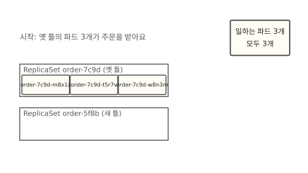

빵집이 직원을 바꿀 때 문을 닫지는 않아요. 새 직원이 먼저 와서 계산대에 서고 그다음 옛 직원이 퇴근해요. 손님은 교대하는 줄도 모르고 빵을 사 가요. Deployment도 이렇게 바꿔요.

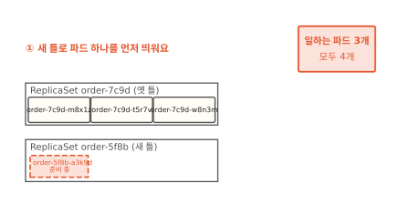

먼저 새 틀로 파드를 하나 띄워요. 잠깐 파드가 모두 4개가 돼요. 새 파드는 아직 준비 중이라 주문은 옛 파드 3개가 받아요.

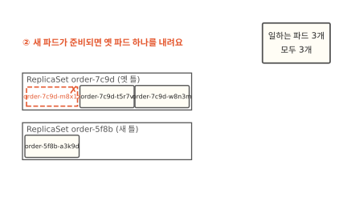

새 파드가 준비되면 옛 파드 하나를 내려요. 주문을 받는 파드는 여전히 3개예요.

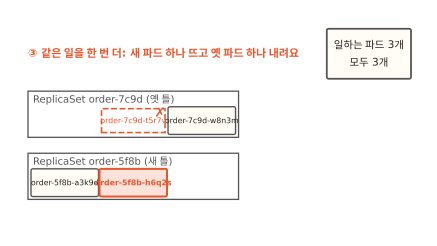

같은 일을 한 번 더 해요. 새 파드가 하나 더 뜨고 옛 파드가 하나 더 내려가요.

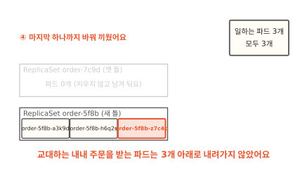

마지막 옛 파드까지 바꿔 끼우면 교대가 끝나요. 이렇게 새 파드를 띄우고 옛 파드를 내리기를 조금씩 되풀이하는 교대를 **롤링 업데이트**(rolling update)라고 해요.

기본 설정에서 파드가 3개면 교대하는 동안 늘 3개 이상이 일하고 많아야 4개까지 떠요.[^surge] 그래서 처음 장면에서 파드가 한꺼번에 사라지지 않고 하나씩 바뀌었어요. 옛 묶음 `order-7c9d`는 파드가 0개가 돼도 지우지 않고 남겨 둬요. 왜 남겨 둘까요? 아래 심화 칸에 있어요.

??? info "심화: 교대 빠르기는 무엇으로 정하나요?"
    파드가 아주 많아 하나씩 교대하기엔 너무 오래 걸릴 때 보는 칸이에요. 노드 자리가 모자라 한 개 더 띄우기도 어려울 때도 봐요.

    두 값이 정해요. `maxSurge`는 원하는 개수보다 더 띄워도 되는 파드 수예요. `maxUnavailable`은 원하는 개수보다 모자라도 되는 파드 수예요. 둘 다 기본값이 25%예요.[^surge]

    퍼센트는 원하는 개수에 곱해서 개수로 바꿔요. 파드 3개의 25%는 0.75예요. `maxSurge`는 올려서 1개, `maxUnavailable`은 내려서 0개가 돼요. 그래서 한 개 더 띄우고 하나도 모자라게 두지 않아요. 파드가 40개면 둘 다 10개라서 열 개씩 교대해요.

    노드에 여유 자리가 없으면 `maxSurge: 0`, `maxUnavailable: 1`처럼 줄 수 있어요. 옛 파드 하나를 먼저 내리고 그 자리에 새 파드를 띄워요. 대신 교대하는 동안 일하는 파드가 하나 줄어요. 두 값을 동시에 0으로 둘 수는 없어요.

??? info "심화: 옛 ReplicaSet은 왜 남겨 둘까요?"
    새 틀에서 문제가 생겨 바로 앞 모습으로 돌아가고 싶을 때 보는 칸이에요.

    옛 묶음에는 옛 틀이 그대로 들어 있어요. 그래서 `kubectl rollout undo deployment order`로 되돌리면 Deployment는 옛 틀을 다시 원하는 상태로 삼아요. 옛 틀의 지문은 `7c9d`이니 남아 있던 `order-7c9d` 묶음을 다시 키우고 `order-5f8b`를 줄여요. 이 교대도 롤링 업데이트로 해요.

    되돌리는 것은 틀뿐이에요. `replicas`는 틀 밖이라 되돌리지 않아요. 옛 묶음은 기본으로 10개까지 남기고 그보다 오래된 것은 지워요(`revisionHistoryLimit`). 지운 묶음의 틀로는 돌아갈 수 없어요.[^history]

## 파드 템플릿을 알면 언제 쓸모 있을까요?

무엇을 바꾸기 전에 그 칸이 틀 안인지 먼저 봐요. 틀 안이면 파드가 모두 교대해요. 그 교대를 미리 준비해요. 노드에 파드 하나를 더 띄울 자리가 있어야 하고 새 파드가 준비됐는지 알릴 방법도 있어야 해요. 틀 안의 칸을 바꿀 때마다 교대를 한 번씩 하니 여러 칸을 바꿀 거면 한 번에 모아서 보내요.

틀 밖이라도 조심할 곳이 하나 있어요. 설정값을 따로 모아 두는 ConfigMap이라는 문서가 있어요. 파드가 ConfigMap의 값을 환경 변수로 읽으면 ConfigMap 내용을 고쳐도 떠 있는 파드는 모르는 채로 옛 값을 써요.[^cm] 틀은 "이 ConfigMap을 읽어라"라는 이름만 들고 있어서 지문이 그대로예요. 이때는 `kubectl rollout restart deployment order`로 파드를 다시 교대시켜요.[^restart]

새로 뜬 파드는 이름만 바뀌지 않아요. 주소도 바뀌어요. 그 이야기는 [9편](09-service.md)에서 이어 가요.

## 다시 한 줄을 바꿔 볼게요

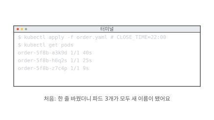

처음 장면이에요. 마감 시간 한 줄을 바꿨더니 파드 3개가 모두 새 이름이 됐어요.

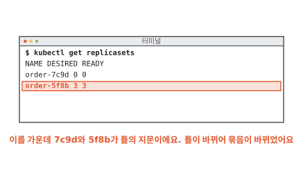

ReplicaSet 목록을 보면 까닭이 보여요. 마감 시간은 틀 안의 칸이라 지문이 `7c9d`에서 `5f8b`로 바뀌었어요. 새 묶음 `order-5f8b`가 파드 3개를 갖고 옛 묶음은 0개로 남았어요.

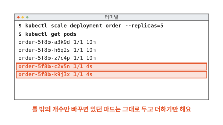

이번에는 틀 밖의 개수만 5로 바꿔요. 있던 파드 3개는 그대로 두고 같은 지문의 파드 2개만 더해져요. 파드가 셋이든 백이든 같아요. 틀이 바뀌면 교대해요. 개수만 바뀌면 그대로예요.

### 이 편에서 줄여 그린 것

그림을 쉽게 하려고 실제와 다르게 줄인 곳이 네 군데 있어요.

1. 매니페스트를 일곱 줄로 줄여 그렸어요. 실제 Deployment 문서에서는 이미지와 환경 변수가 `spec.template.spec.containers` 아래에, 호스트 이름 목록이 `spec.template.spec.hostAliases` 아래에 있어요. 파드 템플릿에는 라벨 같은 칸도 더 있어요. 라벨은 [9편](09-service.md)에서 봐요.
2. 지문을 네 글자로 그렸어요. 실제 지문은 공식 문서 예에서 열 글자예요. 지문이 겹치는 드문 경우에 대비해 Deployment는 겹친 횟수(`collisionCount`)를 세어 두고 새 ReplicaSet 이름을 지을 때 써요.[^collision]
3. 옛 파드가 바로 사라지는 것처럼 그렸어요. 실제로는 내려가라는 신호를 받은 뒤 하던 일을 마무리할 시간을 받고 그동안은 목록에 남아 있어요.
4. "준비됐다"를 한 장면으로 그렸어요. 파드가 주문을 받을 준비가 됐는지는 파드에 적어 둘 수 있는 확인 방법(readiness probe)으로 판단해요.[^ready]

### 이 편에서 새로 나온 말

[^tpl]: Deployment의 `.spec.template`은 파드와 같은 모양의 문서예요. <https://kubernetes.io/docs/concepts/workloads/controllers/deployment/#pod-template>
[^podupdate]: 떠 있는 파드에서 바꿀 수 있는 칸은 이미지 같은 몇 개뿐이에요. 틀을 바꾸면 그 틀을 쓰는 쪽이 새 파드를 만들어야 한다는 설명도 같은 문서에 있어요. <https://kubernetes.io/docs/concepts/workloads/pods/#pod-update-and-replacement>
[^hash]: 지문의 정식 이름은 `pod-template-hash` 라벨이에요. Deployment 컨트롤러가 틀을 해시해서 ReplicaSet과 그 파드에 붙여요. 파드 이름은 `[Deployment 이름]-[지문]-[무작위 글자]` 꼴이에요. <https://kubernetes.io/docs/concepts/workloads/controllers/deployment/#pod-template-hash-label>
[^trigger]: 공식 문서는 "교대(rollout)는 틀(`.spec.template`)이 바뀔 때만 일어나고 개수를 바꾸는 일은 교대를 일으키지 않는다"고 적어요. <https://kubernetes.io/docs/concepts/workloads/controllers/deployment/#updating-a-deployment>
[^surge]: 파드 3개짜리 예에서 "적어도 3개가 쓸 수 있는 상태이고 모두 합쳐 많아야 4개"라는 설명과 `maxSurge`·`maxUnavailable` 기본값 25%, 올림·내림 규칙이 Deployment 문서에 있어요. <https://kubernetes.io/docs/concepts/workloads/controllers/deployment/#rolling-update-deployment>
[^history]: <https://kubernetes.io/docs/concepts/workloads/controllers/deployment/#clean-up-policy>
[^cm]: 공식 문서는 환경 변수로 읽은 ConfigMap 값은 저절로 바뀌지 않고 파드를 다시 띄워야 한다고 적어요. 파일로 붙여 읽는 방식은 시간이 지나면 새 값으로 바뀌어요. <https://kubernetes.io/docs/concepts/configuration/configmap/>
[^restart]: <https://kubernetes.io/docs/reference/kubectl/generated/kubectl_rollout/kubectl_rollout_restart/>
[^collision]: <https://kubernetes.io/docs/reference/kubernetes-api/workload-resources/deployment-v1/>
[^ready]: <https://kubernetes.io/docs/concepts/workloads/pods/pod-lifecycle/#container-probes>
