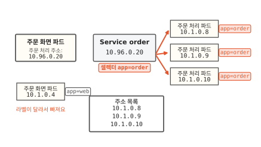
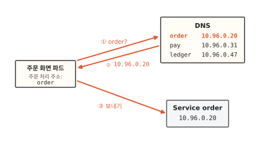
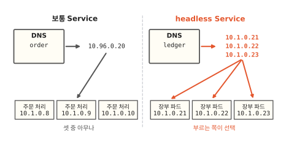

# Service: 자꾸 바뀌는 파드를 이름 하나로 찾아가기

어제까지 잘 되던 빵집 앱 주문이 아침에 갑자기 "주문 실패"로 끝나요. 주문을 처리하는 파드는 멀쩡히 떠 있는데도요. 이 글을 읽고 나면 쿠버네티스에서 파드의 주소가 왜 자꾸 바뀌는지 알게 돼요. 주소가 바뀌어도 주문이 제자리를 찾아가게 하는 방법도 함께 봐요. 쿠버네티스에서 프로그램끼리 서로를 부르는 일은 거의 다 이 방법을 거쳐요.

!!! abstract "이 글에서 알게 되는 것"
    1. 쿠버네티스는 파드를 고쳐 쓰지 않고 새로 만들어요. 새 파드는 IP 주소도 새로 받아서 파드 IP를 적어 두면 언젠가 막혀요.
    2. Service는 파드들 앞에 바뀌지 않는 이름과 주소를 세워요. 라벨이 맞고 준비된 파드의 주소 목록을 계속 고쳐 가며 그중 하나에 요청을 넘겨요.
    3. DNS가 Service 이름을 주소로 바꿔 줘서 부르는 쪽은 `order` 같은 이름 하나만 알면 돼요.

## 1. 파드를 새로 만들면 IP도 새로 받아요

빵집 앱에서 크루아상 두 개와 식빵 하나를 담고 주문하기를 눌러요. 휴대폰이 보낸 주문은 주문 화면 파드가 받아서 주문 처리 파드에 넘겨요. 파드는 쿠버네티스가 띄우는 컨테이너 묶음이에요([7편](07-reconcile-loop.md)).

넘기려면 주소가 있어야 해요. 쿠버네티스에서는 파드마다 IP 주소가 하나씩 붙어요.[^podip] IP 주소는 인터넷에서 컴퓨터마다 붙는 숫자 주소와 같은 것이에요([컴퓨터 11편](../computer/11-how-messages-travel.md)). 주문 화면 파드는 주문 처리 파드의 주소 `10.1.0.5`를 적어 두고 거기로 보내요.

아래 그림에서 빨간 화살표가 어디로 가는지 보세요.

**그림 1.** 주문 화면 파드가 적어 둔 `10.1.0.5`로 주문을 보내서 주문이 들어갔어요.
{ .fig-cap }

밤사이 빵집 마감 시간을 바꿨어요. [8편](08-rolling-update.md)에서 본 것처럼 설정이 바뀌면 주문 처리 파드 셋이 모두 새 파드로 교대해요. 새 파드의 IP는 `10.1.0.8`, `10.1.0.9`, `10.1.0.10`이에요.

아침에 다시 주문하기를 눌러요. 아래 그림에서 주문 화면 파드가 적어 둔 주소를 보세요.

**그림 2.** 주문 화면 파드는 여전히 `10.1.0.5`로 보내는데 그 주소의 파드는 이제 없어요.
{ .fig-cap }

파드가 떠 있는데도 주문이 막힌 까닭은 주소가 바뀌었기 때문이에요. 쿠버네티스는 파드를 고쳐 쓰지 않고 지운 다음 새로 만들어요. 7편에서는 지운 파드를 컨트롤러가 새로 채웠고 8편에서는 설정이 바뀌자 파드를 모두 교대했어요. 파드가 도는 컴퓨터(노드)가 고장 나도 그 위의 파드는 다른 노드에 새로 떠요.

새로 만든 파드는 IP도 새로 받아요. 옛 파드의 IP를 물려받는다는 보장은 없어요. 그래서 파드 IP를 적어 두면 언젠가는 그림 2처럼 막혀요. 바뀌지 않는 주소가 따로 있어야 해요.

## 2. Service는 바뀌지 않는 주소를 파드들 앞에 세워요

빵집에 전화하는 손님은 직원 휴대폰 번호를 몰라요. 가게 대표 번호로 걸면 그날 일하는 직원 누군가가 받아요. 직원이 바뀌어도 대표 번호는 그대로예요.

쿠버네티스에도 대표 번호가 있어요. 주문 처리 파드들 앞에 바뀌지 않는 이름 `order`와 주소 `10.96.0.20`을 하나 세워요. 이 대표 이름과 주소를 **Service**라고 해요.[^svc] 주문 화면 파드는 이제 파드 IP 대신 Service 주소를 적어 둬요.

아래 그림에서 주문이 Service를 지나 어느 파드에 닿는지 보세요.

**그림 3.** Service 주소로 보낸 주문을 뒤에 선 파드 셋 가운데 `10.1.0.9`가 받았어요.
{ .fig-cap }

이제 `10.1.0.9` 파드가 교대해서 `10.1.0.11`이 됐다고 해 볼게요. 아래 그림에서 주문 화면 파드가 적어 둔 주소를 그림 3과 비교해 보세요.

**그림 4.** 주소는 `10.96.0.20` 그대로이고 받는 파드만 `10.1.0.11`로 바뀌었어요.
{ .fig-cap }

주문 화면 파드는 아무것도 고치지 않았어요. 그런데 주문은 새 파드에 닿았어요. 여기서 궁금해질 거예요. Service는 지금 뒤에 선 파드가 누구인지 어떻게 알까요?

## 3. Service는 라벨로 뒤에 선 파드를 골라요

Service가 파드 IP를 하나하나 적어 두면 그림 2와 똑같이 금방 낡아요. 그래서 Service는 IP 대신 파드에 붙은 이름표를 봐요.

파드에는 `app=order`처럼 이름과 값으로 된 이름표를 붙일 수 있어요. 이 이름표를 **라벨**이라고 해요. 주문 처리 파드는 모두 `app=order` 라벨을 달고 떠요. 라벨은 8편의 파드 템플릿에 적혀 있어서 교대로 새로 뜬 파드도 같은 라벨을 달아요.

Service에는 "`app=order` 라벨이 붙은 파드 모두"라는 조건을 적어 둬요. 라벨로 파드를 고르는 이 조건을 **라벨 셀렉터**(label selector)라고 해요.[^label] 쿠버네티스는 이 조건에 맞는 파드를 찾아 그 주소를 목록 하나에 모아요.

아래 그림에서 셀렉터와 라벨이 같은 파드에만 화살표가 가는지 보세요.

**그림 5.** 라벨이 `app=order`인 파드 셋만 골라 주소 목록에 올렸고 `app=web`인 주문 화면 파드는 빠졌어요.
{ .fig-cap }

그림 아래 주소 목록이 Service 뒤에 선 파드의 명단이에요. 이 목록의 이름은 **EndpointSlice**예요. Service로 온 요청은 이 목록에 있는 주소 가운데 하나로 가요.

라벨은 여러 파드가 함께 다는 이름표라서 조심할 곳이 하나 있어요. 다른 프로그램의 파드에 실수로 `app=order`를 붙이면 그 파드도 목록에 올라 주문을 받아요. 서로 다른 묶음은 라벨이 겹치지 않게 지어요.

## 4. 주소 목록은 준비된 파드로 계속 고쳐져요

주소 목록은 한 번 만들고 끝나지 않아요. 파드가 교대할 때 목록이 어떻게 바뀌는지 세 장으로 따라가 볼게요. 그림 5가 첫 장이에요.

8편의 교대가 다시 시작돼서 새 파드 `10.1.0.11`이 떴어요. 아래 그림에서 새 파드와 주소 목록을 함께 보세요.

**그림 6.** 새 파드는 라벨이 맞지만 아직 준비 중이라 주소 목록에 오르지 않았어요.
{ .fig-cap }

라벨이 맞는데도 목록에 넣지 않는 까닭은 새 파드가 아직 주문을 받을 수 없어서예요. 프로그램을 띄우고 준비를 마치는 데 시간이 걸리거든요. 준비도 안 된 파드에 주문이 가면 그 주문은 실패해요.

새 파드가 준비를 마치면 옛 파드 `10.1.0.9`가 내려가요. 아래 그림에서 주소 목록의 빨간 두 줄을 보세요.

**그림 7.** 준비된 `10.1.0.11`은 목록에 오르고 내려간 `10.1.0.9`는 목록에서 빠졌어요.
{ .fig-cap }

이 목록을 고치는 것도 7편에서 본 컨트롤러예요. 컨트롤러가 원하는 상태는 "라벨이 맞고 준비된 파드 전부"예요. 컨트롤러는 파드가 뜨고 내려갈 때마다 이 상태와 지금 목록을 비교해서 맞춰요.[^eps] 그래서 파드가 몇 번을 교대해도 Service 뒤에는 지금 주문을 받을 수 있는 파드만 서 있어요.

## 5. DNS가 Service 이름을 주소로 바꿔 줘요

이제 `10.96.0.20`은 바뀌지 않아요. 그래도 숫자 주소를 외워서 적기는 불편해요. 전화를 걸 때도 번호를 외우지 않고 연락처에서 "빵집"을 골라요. 쿠버네티스 안에도 이런 전화번호부가 있어요.

이름을 주소로 바꿔 주는 전화번호부를 **DNS**라고 해요.[^dns] 인터넷에서 웹 주소를 IP 주소로 바꿔 주는 것과 같은 방식이에요. 쿠버네티스는 Service를 만들면 그 이름을 DNS에 저절로 올려요. 파드도 처음부터 이 DNS에 묻도록 맞춰진 채로 떠요.

그래서 주문 화면 파드는 주소 칸에 `order`라는 이름만 적어요. 아래 그림에서 번호가 붙은 화살표를 ①부터 차례로 따라가 보세요.

**그림 8.** 주문 화면 파드가 DNS에 `order`를 물어 `10.96.0.20`을 받고 그 주소로 주문을 보내요.
{ .fig-cap }

이제 주문이 가는 길이 다 이어졌어요. 주문 화면 파드는 DNS에서 `order`의 주소를 받아 Service로 보내요. Service는 라벨로 챙긴 주소 목록에서 지금 준비된 파드 하나에 넘겨요. 밤사이 파드가 몇 번 바뀌어도 주문 화면 파드가 알아야 할 것은 이름 `order` 하나예요.

## 6. 정해진 파드를 불러야 하면 대표 주소 없는 Service를 써요

주문 처리 파드는 셋 가운데 누가 받아도 결과가 같아요. 그래서 대표 주소 하나로 보내고 받는 파드는 Service에 맡겨요. 이게 보통 Service예요.

그렇지 않은 경우도 있어요. 주문 장부를 적는 데이터베이스를 파드 셋으로 띄우면 쓰기는 그중 주인 파드 하나만 받는 경우가 많아요. 대표 주소로 보내면 아무 파드에나 가 버려서 곤란해요. 이럴 때는 대표 주소를 만들지 않는 Service를 써요. 이 Service를 **headless Service**라고 해요. DNS에 물으면 Service 주소 대신 뒤에 선 파드들의 주소를 모두 알려 줘요.[^headless]

아래 그림에서 왼쪽과 오른쪽의 DNS 답을 비교해 보세요.

**그림 9.** 보통 Service는 주소 하나를 알려 주고 headless Service는 파드 주소 셋을 모두 알려 줘요.
{ .fig-cap }

headless Service에서는 어느 파드로 보낼지를 부르는 쪽이 골라요. 한편 밤마다 혼자 돌며 지난 주문을 정리하는 작업처럼 아무도 찾아오지 않는 파드에는 Service가 필요 없어요.

??? info "심화: Service 주소로 보낸 요청은 누가 파드로 넘기나요?"
    그림에서는 Service를 상자 하나로 그렸어요. 그런데 `10.96.0.20`이라는 주소를 가진 컴퓨터는 어디에도 없어요. Service 주소는 어느 기계에도 붙어 있지 않은 가상 주소예요.

    노드마다 kube-proxy라는 프로그램이 떠 있어요. kube-proxy는 Service와 그 주소 목록이 바뀌는 것을 지켜보다가 자기 노드에 규칙을 깔아요. "`10.96.0.20`으로 가는 요청은 목록의 파드 주소 가운데 하나로 바꿔 보내라"는 규칙이에요. 주문 화면 파드가 Service 주소로 보내면 그 노드의 규칙이 요청을 붙잡아 파드 주소로 돌려 보내요. 기본 방식(iptables 모드)에서는 받을 파드를 무작위로 골라요.[^proxy]

    그림에서 줄인 곳이 몇 군데 더 있어요. 실제 주소 목록에는 IP 말고도 포트 번호와 준비 상태가 함께 적혀요. 포트 번호는 한 주소 안에서 어느 프로그램에게 갈지 정하는 번호예요. DNS에 오르는 이름도 실제로는 `order.….svc.cluster.local`처럼 더 길어요. 파드가 `order`처럼 짧게 물으면 정해진 규칙에 따라 긴 이름으로 늘려서 찾아요.[^dns]

## 정리

쿠버네티스는 파드를 고쳐 쓰지 않고 지운 다음 새로 만들어요. 새 파드는 IP도 새로 받아서 주문 화면 파드가 `10.1.0.5`를 적어 두면 교대 한 번에 주문이 막혀요.

그래서 주문 처리 파드들 앞에 Service `order`를 세우고 바뀌지 않는 주소 `10.96.0.20`을 줘요. Service는 라벨 셀렉터 `app=order`로 파드를 골라요. 컨트롤러는 라벨이 맞고 준비된 파드만 주소 목록에 오르도록 목록을 계속 고쳐요. DNS는 이름 `order`를 `10.96.0.20`으로 바꿔 줘요. 덕분에 주문 화면 파드는 이름 하나로 지금 떠 있는 파드를 찾아가요. 정해진 파드 하나를 불러야 하면 파드 주소를 모두 알려 주는 headless Service를 써요.

다음 [10편](10-requests-limits.md)에서는 파드가 노드의 CPU와 메모리를 얼마나 쓸지 정하는 방법을 볼게요.

### 새로 나온 말

- **Service**: 파드들 앞에 세우는 바뀌지 않는 이름과 주소. 주문 처리 파드 앞의 `order`, `10.96.0.20`이에요.
- **라벨**: 파드에 붙이는 이름과 값으로 된 이름표. 주문 처리 파드에는 `app=order`가 붙어요.
- **라벨 셀렉터**: 라벨로 파드를 고르는 조건. Service `order`는 `app=order`가 붙은 파드를 모두 골라요.
- **EndpointSlice**: Service 뒤에 선 준비된 파드의 주소 목록. 파드가 교대하면 컨트롤러가 고쳐요.
- **DNS**: 이름을 주소로 바꿔 주는 전화번호부. `order`를 물으면 `10.96.0.20`을 알려 줘요.
- **headless Service**: 대표 주소를 만들지 않는 Service. DNS가 뒤에 선 파드 주소를 모두 알려 줘요.

[^podip]: 공식 문서는 파드가 오래 살지 않는 것이고(ephemeral) 파드마다 자기 IP 주소를 받는다고 적어요. 지금 떠 있는 파드와 조금 지나서 떠 있는 파드가 다를 수 있다는 것이 Service가 필요한 까닭이에요. <https://kubernetes.io/docs/concepts/services-networking/service/>
[^svc]: Service 주소의 정식 이름은 cluster IP예요. <https://kubernetes.io/docs/concepts/services-networking/service/>
[^label]: <https://kubernetes.io/docs/concepts/overview/working-with-objects/labels/>
[^eps]: 공식 문서는 Service의 컨트롤러가 셀렉터에 맞는 파드를 계속 살펴서 EndpointSlice를 고친다고 적어요. 파드의 준비 확인이 실패하면 그 파드 IP를 목록에서 빼요. <https://kubernetes.io/docs/concepts/services-networking/endpoint-slices/>
[^dns]: DNS는 Domain Name System의 줄임말이에요. kubelet이 파드마다 DNS 설정을 맞춰 둬서 파드 안 프로그램이 Service를 이름으로 찾을 수 있어요. 짧은 이름이 긴 이름으로 늘어나는 규칙도 같은 문서에 있어요. <https://kubernetes.io/docs/concepts/services-networking/dns-pod-service/>
[^headless]: <https://kubernetes.io/docs/concepts/services-networking/service/#headless-services>
[^proxy]: <https://kubernetes.io/docs/reference/networking/virtual-ips/>
