# 파드 IP가 계속 바뀌는데 어떻게 찾아갈까요?

## 어제는 되던 주문이 막혔어요

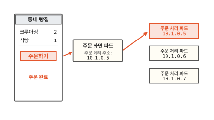

동네 빵집 앱에서 크루아상 두 개와 식빵 하나를 담고 주문하기를 눌렀어요. 휴대폰 앱이 보낸 주문은 주문 화면 파드가 받아요. 주문 화면 파드는 그 주문을 주문 처리 파드에 넘겨요. 파드는 쿠버네티스가 띄우는 컨테이너 묶음이에요([7편](07-reconcile-loop.md)).

주문 화면 파드는 주문 처리 파드의 주소를 알아야 넘길 수 있어요. 그림에서는 그 주소로 `10.1.0.5`를 적어 뒀어요. 이 숫자 주소를 IP 주소라고 해요. 인터넷의 컴퓨터마다 붙는 숫자 주소와 같은 것이에요([컴퓨터 11편](../computer/11-how-messages-travel.md)). 쿠버네티스에서는 파드마다 IP 주소가 하나씩 붙어요.[^podip]

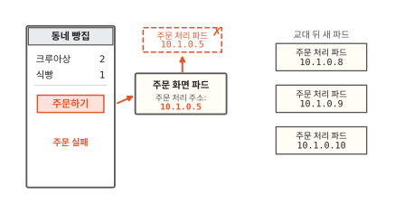

밤사이 빵집 마감 시간을 바꿨어요. 8편에서 본 것처럼 주문 처리 파드 3개가 모두 새 파드로 교대했어요([8편](08-rolling-update.md)). 새 파드의 IP는 `10.1.0.8`, `10.1.0.9`, `10.1.0.10`이에요.

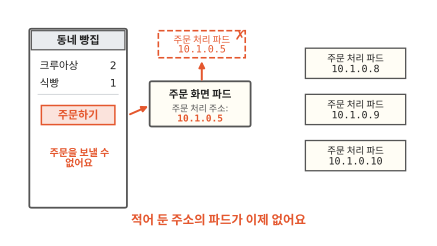

아침에 다시 주문하기를 누르니 "주문을 보낼 수 없어요"가 떠요. 주문 화면 파드는 여전히 `10.1.0.5`로 보내는데 그 주소의 파드는 이제 없어요. 주문 처리 파드는 계속 떠 있는데 왜 찾아가지 못할까요?

## 파드 IP는 왜 바뀔까요?

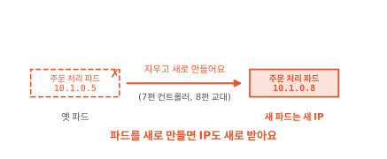

쿠버네티스는 파드를 고쳐 쓰지 않고 새로 만들어요. 7편에서는 지운 파드를 컨트롤러가 새로 채웠어요. 8편에서는 틀이 바뀌자 파드를 모두 새것으로 교대했어요. 노드(파드가 도는 컴퓨터 한 대)가 고장 나도 그 위의 파드는 다른 노드에 새로 떠요.

새로 만든 파드는 IP도 새로 받아요. 옛 파드의 IP를 물려받는다는 보장은 없어요. 공식 문서도 파드는 오래 살 거라고 기대하지 말라고 적어요.[^podip] 그러니 파드 IP를 적어 두고 찾아가면 언젠가는 처음 장면처럼 막혀요. 바뀌지 않는 주소는 어디서 얻을까요?

## 바뀌지 않는 주소는 어떻게 만들까요?

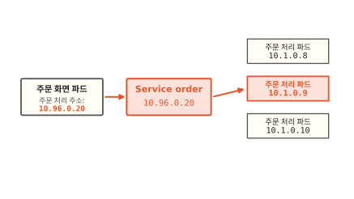

빵집에 전화하는 손님은 직원 휴대폰 번호를 몰라요. 가게 대표 번호로 걸면 그날 일하는 직원 누군가가 받아요. 직원이 바뀌어도 대표 번호는 그대로예요.

쿠버네티스에도 대표 번호가 있어요. 그림 가운데 상자처럼 주문 처리 파드들 앞에 바뀌지 않는 이름 `order`와 주소 `10.96.0.20`을 하나 세워요. 이 대표 이름과 주소를 **Service**라고 해요.[^svc] 주문 화면 파드는 이제 파드 IP 대신 Service 주소를 적어 둬요.

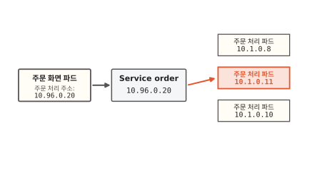

주문을 Service 주소로 보내면 뒤에 선 주문 처리 파드 셋 중 하나가 받아요. 그림에서는 `10.1.0.9`가 받았어요.

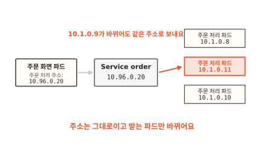

`10.1.0.9` 파드가 새 파드 `10.1.0.11`로 바뀌어도 주문 화면 파드는 똑같이 `10.96.0.20`으로 보내요. 이번에는 새 파드가 받아요. 그런데 Service는 지금 뒤에 선 파드가 누구인지 어떻게 알까요?

??? info "심화: Service 주소로 보낸 요청은 누가 파드로 넘기나요?"
    `10.96.0.20`이라는 주소를 가진 컴퓨터가 정말 있는지 궁금할 때 보는 칸이에요.

    그런 컴퓨터는 없어요. Service 주소는 어디에도 붙어 있지 않은 가상 주소예요. 노드마다 kube-proxy라는 프로그램이 떠 있어요. kube-proxy는 Service와 그 뒤의 파드 주소 목록이 바뀌는 것을 지켜보다가 자기 노드에 규칙을 깔아요. "`10.96.0.20`으로 가는 요청은 이 파드 주소들 가운데 하나로 바꿔 보내라"는 규칙이에요.

    그래서 주문 화면 파드가 Service 주소로 보내면 그 노드의 규칙이 요청을 붙잡아 파드 주소로 돌려 보내요. 기본 방식(iptables 모드)에서는 받을 파드를 무작위로 골라요.[^proxy] 규칙을 지켜보고 맞추는 일도 7편의 조정 루프와 같은 방식으로 돌아요.

## Service는 뒤에 선 파드를 어떻게 알까요?

Service는 파드 IP를 하나하나 적어 두지 않아요. 적어 두면 처음 장면과 똑같이 낡아 버려요. 대신 파드에 붙인 이름표를 봐요.

파드에는 `app=order`처럼 이름과 값으로 된 이름표를 붙일 수 있어요. 이 이름표를 라벨이라고 해요. 주문 처리 파드는 모두 `app=order` 라벨을 달고 떠요. 라벨은 8편의 파드 템플릿에 적혀 있어서 새 파드도 같은 라벨을 달아요.

Service에는 "`app=order` 라벨이 붙은 파드 모두"라는 조건을 적어 둬요. 라벨로 파드를 고르는 이 조건을 **라벨 셀렉터**(label selector)라고 해요.[^label] 그림 왼쪽 아래 주문 화면 파드는 라벨이 `app=web`이라 고르지 않아요.

고른 파드의 주소는 그림 가운데 아래 주소 목록에 모아요. 이 목록의 이름은 EndpointSlice예요. 목록은 한 번 만들고 끝나지 않아요. 파드가 바뀌면 목록은 어떻게 될까요?

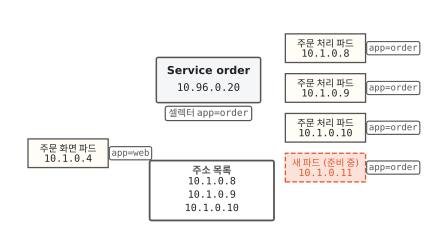

8편의 교대가 다시 시작돼서 새 파드 `10.1.0.11`이 떴어요. 라벨은 `app=order`로 맞아요. 하지만 아직 준비 중이라 주소 목록에 올리지 않아요. 준비도 안 된 파드에 주문이 가면 안 되니까요.

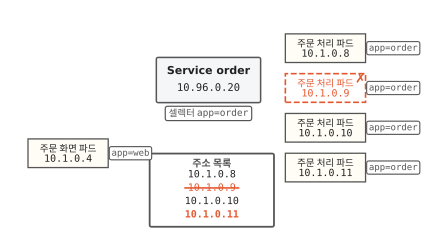

새 파드가 준비되면 목록에 올라가요. 내려간 옛 파드 `10.1.0.9`는 목록에서 빠져요. Service를 맡은 컨트롤러가 라벨이 맞는 파드를 계속 살펴서 목록을 고쳐요.[^eps] 여기서 원하는 상태는 라벨이 맞고 준비된 파드 전부예요. 7편의 컨트롤러처럼 이 상태와 지금 목록을 계속 맞춰요.

이제 주소 `10.96.0.20`은 바뀌지 않아요. 그런데 이 숫자도 사람이 외워서 적기엔 불편해요. 이름 `order`만으로 찾아갈 수는 없을까요?

??? info "심화: 라벨은 파드를 어떻게 고르나요?"
    라벨 셀렉터에 조건을 두 개 넘게 적거나 "이 값이 아닌 것"을 고르고 싶을 때 보는 칸이에요.

    라벨 셀렉터에는 두 방식이 있어요. `app=order`처럼 값이 같은지 보는 방식과 `env in (prod, stage)`처럼 값이 목록 안에 있는지 보는 방식이에요. 조건을 쉼표로 여러 개 적으면 모두 맞아야 골라요. "이것 또는 저것"을 뜻하는 기호는 없어요.[^label]

    라벨은 이름 하나에 파드 하나가 짝지어지는 표지가 아니에요. 같은 라벨을 여러 파드가 나눠 달아요. 그래서 다른 Deployment의 파드에 실수로 `app=order`를 붙이면 그 파드도 주문을 받아요. 서로 다른 묶음은 라벨이 겹치지 않게 지어요.

## 이름으로는 어떻게 찾아갈까요?

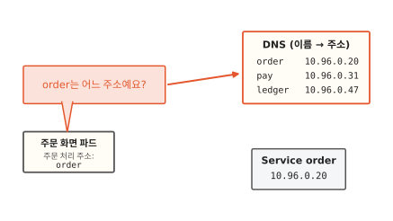

전화를 걸 때 번호를 외우지 않아도 돼요. 휴대폰 연락처에서 "빵집"을 고르면 번호가 나와요. 쿠버네티스 안에도 이런 전화번호부가 있어요.

그림의 주문 화면 파드는 주소 칸에 `order`라는 이름만 적었어요. 보내기 전에 전화번호부에 "`order`는 어느 주소예요?" 하고 물어요.

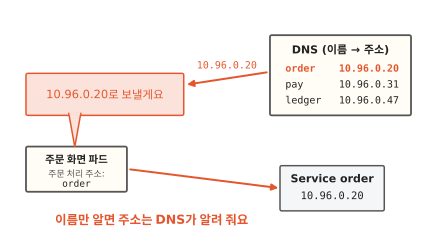

전화번호부는 `order` 줄을 찾아 `10.96.0.20`을 알려 줘요. 주문 화면 파드는 그 주소로 보내요. 이름을 주소로 바꿔 주는 이 전화번호부를 **DNS**라고 해요. 인터넷에서 웹 주소를 IP 주소로 바꿔 주는 것과 같은 방식이에요.

쿠버네티스는 Service를 만들면 그 이름을 DNS에 저절로 올려요. 파드도 이 DNS에 묻도록 처음부터 맞춰져서 떠요.[^dns] 그래서 주문 화면 파드는 `order`라는 이름만 알면 돼요.

??? info "심화: DNS 말고 다른 길로도 Service를 찾나요?"
    파드 안에서 환경 변수를 보다가 `ORDER_SERVICE_HOST` 같은 낯선 값이 들어 있어서 궁금할 때 보는 칸이에요.

    쿠버네티스는 파드가 뜰 때 그 순간 있던 Service마다 주소를 환경 변수로 넣어 줘요. `order` Service라면 `ORDER_SERVICE_HOST`에 Service 주소, `ORDER_SERVICE_PORT`에 포트 번호가 들어가요. 포트 번호는 한 주소 안에서 어느 프로그램에게 갈지 정하는 번호예요.

    이 방식에는 순서 문제가 있어요. 환경 변수는 파드가 뜰 때 한 번만 넣어요. 그래서 Service를 파드보다 늦게 만들면 그 파드에는 변수가 없어요. DNS로 찾으면 이 순서를 신경 쓰지 않아도 돼요.[^env]

## Service는 언제 쓸모 있을까요?

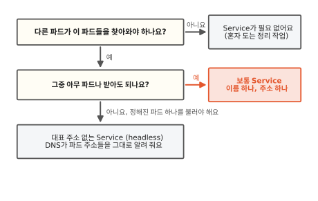

빵집 앱에서 주문 처리 파드는 주문 화면 파드가 찾아와야 해요. 어느 주문 처리 파드가 받아도 결과가 같으니 보통 Service를 하나 세워요. 밤마다 혼자 돌며 지난 주문을 정리하는 작업처럼 아무도 찾아오지 않는 파드에는 Service가 필요 없어요.

정해진 파드 하나를 콕 집어 불러야 할 때도 있어요. 주문 장부 데이터베이스를 여러 파드로 띄우면 쓰기는 그중 주인 파드 하나만 받는 경우가 많아요. 대표 주소로 보내면 아무 파드에나 가 버려요. 이럴 때는 대표 주소를 만들지 않는 Service를 써요. 이름은 headless Service예요. DNS에 물으면 Service 주소 대신 뒤에 선 파드들의 주소를 그대로 알려 줘요.[^headless] 고르는 일은 부르는 쪽이 맡아요.

## 다시 주문하기를 눌러 볼게요

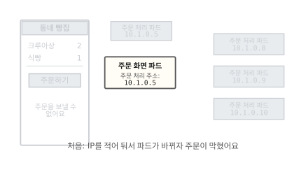

처음 장면이에요. 주문 화면 파드가 파드 IP `10.1.0.5`를 적어 둬서 파드가 바뀌자 주문이 막혔어요.

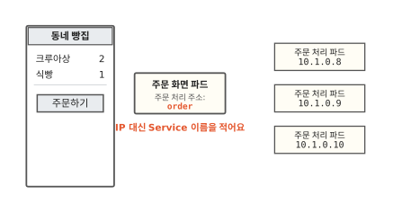

이번에는 주소 칸에 파드 IP 대신 Service 이름 `order`를 적어요.

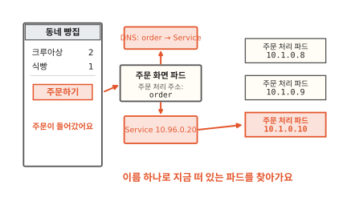

주문하기를 누르면 주문 화면 파드는 DNS에서 `order`의 주소를 받아 Service로 보내요. Service는 라벨로 챙겨 둔 목록에서 지금 떠 있는 파드 하나에 넘겨요. 밤사이 파드가 몇 번을 바뀌어도 주문 화면 파드가 아는 것은 이름 하나로 충분해요.

### 이 편에서 줄여 그린 것

그림을 쉽게 하려고 실제와 다르게 줄인 곳이 네 군데 있어요.

1. Service가 상자 하나로 서서 요청을 넘기는 것처럼 그렸어요. 실제로는 노드마다 깔린 규칙이 요청을 파드로 돌려 보내요. 심화 칸 "Service 주소로 보낸 요청은 누가 파드로 넘기나요?"에 적었어요.
2. 주소 목록을 IP만 적은 표로 그렸어요. 실제 EndpointSlice에는 포트 번호와 "준비됐는지", "내려가는 중인지" 같은 상태도 함께 적혀요. 파드가 많으면 목록이 여러 조각으로 나뉘어요.
3. DNS에 Service 이름을 `order`로만 적었어요. 실제로 DNS에 오르는 전체 이름은 `order.….svc.cluster.local`처럼 더 길고 짧은 이름은 파드에 맞춰 둔 규칙에 따라 긴 이름으로 늘려서 찾아요.[^dns]
4. 주소에는 포트 번호를 뺐어요. 실제 Service는 "80번 포트로 오면 파드의 8080번 포트로 넘겨라"처럼 포트도 함께 정해요.

### 이 편에서 새로 나온 말

[^podip]: 공식 문서는 파드가 오래 살지 않는 것이고(ephemeral) 파드마다 자기 IP 주소를 받는다고 적어요. 같은 Deployment라도 지금 떠 있는 파드와 조금 뒤에 떠 있는 파드가 다를 수 있다는 것이 Service가 필요한 까닭이에요. <https://kubernetes.io/docs/concepts/services-networking/service/>
[^svc]: Service 주소의 정식 이름은 cluster IP예요. <https://kubernetes.io/docs/concepts/services-networking/service/>
[^proxy]: <https://kubernetes.io/docs/reference/networking/virtual-ips/>
[^label]: <https://kubernetes.io/docs/concepts/overview/working-with-objects/labels/>
[^eps]: 공식 문서는 Service의 컨트롤러가 셀렉터에 맞는 파드를 계속 살펴서 EndpointSlice를 고친다고 적어요. 파드의 준비 확인이 실패하면 EndpointSlice 컨트롤러가 그 파드 IP를 목록에서 빼요(파드 수명 문서). <https://kubernetes.io/docs/concepts/services-networking/endpoint-slices/>
[^dns]: DNS는 Domain Name System의 줄임말이에요. kubelet이 파드마다 DNS 설정을 맞춰 둬서 파드 안 프로그램이 Service를 이름으로 찾을 수 있어요. 짧은 이름이 긴 이름으로 늘어나는 규칙도 같은 문서에 있어요. <https://kubernetes.io/docs/concepts/services-networking/dns-pod-service/>
[^env]: <https://kubernetes.io/docs/concepts/services-networking/service/#environment-variables>
[^headless]: <https://kubernetes.io/docs/concepts/services-networking/service/#headless-services>
