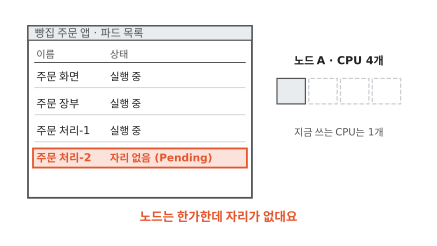
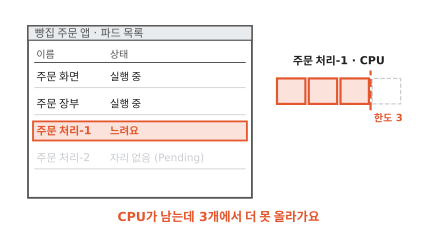
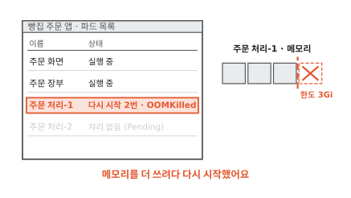
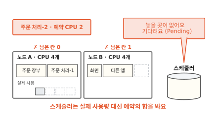
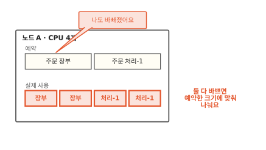
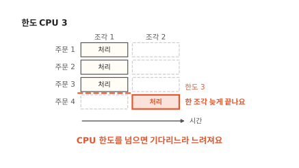
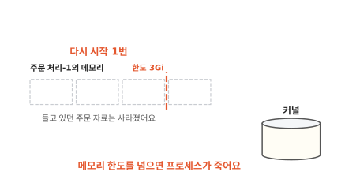
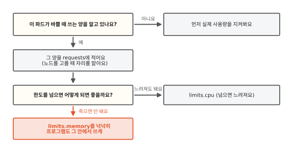
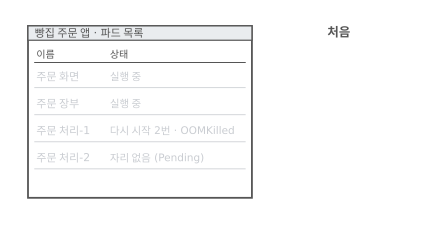
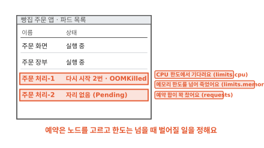

# 예약(requests)과 한도(limits)는 무엇이 다를까요?

## 노드는 한가한데 자리가 없대요

동네 빵집 주문 앱이 쿠버네티스 위에서 돌아가요. 부품은 셋이에요. 손님이 보는 주문 화면, 주문을 받아 처리하는 주문 처리, 주문을 적어 두는 주문 장부예요. 부품마다 컨테이너에 담겨 있어요. 컨테이너는 칸막이와 사용량 한도를 씌워 따로 떼어 놓은 프로그램이에요([1편](01-container.md)). 쿠버네티스는 이 컨테이너를 파드라는 묶음으로 띄워요.



점심이 되자 주문이 몰려서 주문 처리 파드를 하나 더 띄웠어요. 그런데 목록에 "자리 없음"이 떠요. 그림 오른쪽의 노드 A는 CPU 4개 가운데 1개만 쓰고 있어요. 노드는 파드가 올라가는 컴퓨터 한 대예요.



그사이 이미 떠 있던 주문 처리-1은 느려졌어요. 노드에 CPU가 남아 있는데도 3개에서 더 올라가지 않아요.



조금 뒤에는 주문 처리-1이 저절로 다시 시작했어요. 목록에는 OOMKilled라는 이유가 남았어요.

세 일은 모두 주문 처리의 매니페스트에 적힌 몇 줄에서 나와요. 매니페스트는 원하는 상태를 적어 쿠버네티스에 건네는 문서예요([7편](07-reconcile-loop.md)).

```yaml
resources:
  requests:        # 예약
    cpu: "2"
    memory: 2Gi
  limits:          # 한도
    cpu: "3"
    memory: 3Gi
```

`cpu: "2"`는 CPU 코어 두 개만큼이에요.[^cpu] `2Gi`는 메모리 크기를 나타내는 단위예요. requests와 limits는 둘 다 "얼마만큼"을 적는 칸인데 쓰이는 때가 달라요. requests가 먼저 쓰이는 곳은 파드를 놓을 노드를 고르는 순간이에요.

## 새 파드는 어느 노드에 놓일까요?


그림에 노드가 두 대 있어요. 칸 하나가 CPU 하나예요. 노드 A에서는 주문 장부가 2칸을 맡아 두었고 노드 B에서는 주문 화면과 다른 앱이 3칸을 맡아 두었어요. 여기에 주문 처리-1을 놓을 차례예요. 파드를 놓을 노드를 고르는 쪽은 쿠버네티스의 스케줄러예요. 스케줄러는 무엇을 보고 고를까요?


스케줄러는 노드마다 맡아 둔 칸을 더해서 남은 칸을 세요. 주문 처리-1은 2칸이 필요해요. 노드 A에는 2칸이 남아서 들어가요. 노드 B에는 1칸뿐이라 못 들어가요.



주문 처리-2도 2칸이 필요해요. 이제 노드 A에도 B에도 2칸이 남아 있지 않아요. 그림 아래 막대처럼 노드 A가 실제로 쓰는 CPU는 1개뿐이에요. 그래도 스케줄러는 주문 처리-2를 놓지 않아요. 파드는 놓일 자리를 기다리며 Pending 상태로 남아요. 처음 장면의 "자리 없음"이 이 상태였어요.

스케줄러가 노드를 고를 때 더하는 값은 매니페스트의 **requests**예요. 쉬운 말로 예약이에요. 스케줄러는 노드마다 예약의 합이 노드가 내줄 수 있는 양을 넘지 않게 지켜요.[^sched]

실제 사용량을 보지 않는 데는 이유가 있어요. 지금 한가한 노드도 점심이 되면 바빠져요. 그때도 파드마다 예약한 만큼은 쓸 수 있도록 자리를 미리 비워 두는 거예요. 식당이 예약석을 비워 두는 것과 같아요. 예약 손님이 아직 안 와도 그 자리를 다른 손님에게 내주지 않아요.

그런데 예약은 자리를 맡아 두는 약속일 뿐이에요. 주문 처리가 예약보다 더 쓰려고 하면 어떻게 될까요?

## 예약보다 더 쓰면 어떻게 될까요?


점심이 되자 주문 처리-1은 CPU 3개만큼 일하려 해요. 예약은 2개예요. 그림의 노드 A에서는 주문 장부가 예약한 2칸 가운데 1칸만 쓰고 있어요.


노드에 노는 CPU가 있으면 예약보다 더 써도 돼요.[^over] 예약 손님이 아직 오지 않은 자리에 잠깐 앉는 것과 비슷해요. 그 손님이 오면 어떻게 될까요?



주문 장부도 바빠지면 둘이 CPU를 다퉈요. 이때 커널은 예약이 큰 쪽에 CPU 시간을 더 많이 줘요.[^weight] 커널은 운영체제의 중심에서 CPU와 메모리를 프로그램에 나눠 주는 관리자예요. 그림처럼 예약이 2와 2면 2개씩 나눠 써요. 예약은 바쁠 때도 받을 몫을 지켜 줘요.

그럼 노드에 CPU가 많이 남아 있으면 주문 처리는 끝없이 더 쓸 수 있을까요? 여기서 매니페스트의 두 번째 묶음이 나서요.

## CPU 한도를 넘으면 어떻게 될까요?


커널은 CPU를 아주 짧은 시간 조각으로 잘라서 나눠 줘요. 주문 처리-1이 주문 네 건을 한꺼번에 처리한다고 해 볼게요. 주문 한 건이 CPU 하나를 한 조각 동안 쓴다고 쳐요. 한도가 없고 노드에 CPU가 넉넉하면 그림처럼 네 건이 한 조각 안에 끝나요.


이번에는 한도를 CPU 3으로 정했어요. 조각 하나에서 쓸 수 있는 CPU가 3개로 묶여요. 주문 4는 다음 조각을 기다려요.



주문 4는 조각 2에서야 처리돼요. 이렇게 넘으면 막히는 선을 매니페스트에 적은 값이 **limits**예요. 쉬운 말로 한도예요. 컨테이너의 사용량 한도를 지키는 일은 1편에서 본 cgroup이 맡아요. cgroup은 커널이 프로그램 묶음마다 쓸 수 있는 양을 정해 두는 장치예요.

CPU 한도를 넘으려 하면 커널은 그 컨테이너를 다음 조각까지 기다리게 해요.[^throttle] 이 일을 스로틀(throttle)이라고 해요. 프로그램이 죽지는 않아요. 느려질 뿐이에요. 처음 장면의 주문 처리-1도 한도 3에 걸려 기다리느라 느렸어요. 뷔페 접시로 말하면 접시 크기가 정해져 있어서 한 번에 담을 양이 묶이는 거예요. 더 먹으려면 다음 차례에 다시 담아요.

??? info "심화: requests나 limits 가운데 하나만 적으면 어떻게 될까요?"
    매니페스트를 짤 때 두 값을 다 적어야 하는지 궁금할 때 보는 칸이에요.

    limits만 적고 requests를 비우면 쿠버네티스는 limits 값을 requests에도 그대로 써요. 따로 정해 둔 기본값이 없을 때 이야기예요.[^copy]

    requests만 적고 limits를 비우면 한도가 없어요. 그 파드는 노드에 남는 만큼 더 쓸 수 있어요.[^qos]

    requests와 limits를 CPU와 메모리 모두 같은 값으로 적은 파드는 Guaranteed라는 등급을 받아요. 아무것도 안 적은 파드는 BestEffort, 그 사이는 Burstable이에요. 이 등급은 다음 칸에서 다시 나와요.

그럼 메모리 한도도 넘으면 기다리게 할까요?

## 메모리 한도를 넘으면 어떻게 될까요?


메모리는 프로그램이 지금 쓰는 자료를 올려 두는 작업 공간이에요([컴퓨터 5편](../computer/05-where-computers-remember.md)). 주문 처리-1은 들어온 주문 자료를 메모리에 올려 두고 일해요. 그림에서는 한도 3Gi가 꽉 찼는데 자료를 하나 더 올려야 해요.

CPU 시간은 미룰 수 있어요. 다음 조각에 쓰면 되니까요. 메모리는 사정이 달라요. 이미 올려 둔 자료는 프로그램이 지금 쓰고 있어서 커널이 마음대로 비울 수 없어요. 비우면 그 자료가 없어져요.


그래서 커널은 메모리를 더 달라는 프로세스를 끝내요.[^oom] 프로세스는 실행 중인 프로그램이에요. 이 일을 **OOM 킬**이라고 해요. OOM은 메모리가 모자라다는 뜻의 out of memory를 줄인 말이에요.



컨테이너의 주된 프로세스가 끝나면 쿠버네티스는 그 컨테이너를 다시 시작해요. 들고 있던 자료는 모두 사라지고 처음부터 다시 떠요. 처음 장면의 "다시 시작 2번 · OOMKilled"는 한도를 넘어서 두 번 죽었다는 기록이에요.

뷔페로 말하면 접시에 넘치게 담는 순간 기다려 주지 않고 접시째 치워 가요. 비유와 다른 점도 있어요. 접시만 바꾸면 되는 뷔페와 달리 컨테이너는 하던 일을 다 잃고 처음부터 다시 시작해요.

??? info "심화: 노드 전체 메모리가 모자라면 누가 먼저 나갈까요?"
    파드마다 한도 안에서 쓰는데도 노드 메모리가 바닥날 수 있는지 궁금할 때 보는 칸이에요.

    바닥날 수 있어요. 파드는 노드에 남는 만큼 예약보다 더 쓸 수 있으니까요. 그래서 노드에서 파드를 돌보는 프로그램(kubelet)은 메모리가 정해 둔 선 아래로 떨어지면 파드 몇 개를 내보내요. 이 일을 노드 압박 퇴출이라고 해요. 영어 이름은 node-pressure eviction이에요.[^evict]

    내보낼 파드를 고를 때는 앞 칸의 등급과 예약이 쓰여요. 예약보다 더 쓰고 있는 파드만 후보가 되고 등급으로는 BestEffort가 먼저, Guaranteed가 맨 나중이에요.[^qos] 예약을 실제 쓰는 양에 맞게 적어 두면 이런 때에도 덜 밀려나요.

    kubelet이 미처 내보내기 전에 노드 전체 메모리가 바닥나면 커널이 직접 프로세스를 골라 끝내요. 이때도 등급에 따라 끝날 차례가 달라지게 쿠버네티스가 미리 점수를 매겨 둬요.

## 예약과 한도는 언제 쓸모 있을까요?



고르는 길을 그림 한 장에 모았어요. requests는 바쁠 때 쓰는 양을 알아야 적을 수 있어요. 너무 크게 적으면 노드가 한가한데도 자리가 없다고 나와요. 너무 작게 적으면 한 노드에 파드가 몰려서 바쁠 때 서로 다퉈요.

limits는 넘었을 때 벌어질 일을 보고 정해요. CPU는 넘어도 느려질 뿐이에요. 메모리는 넘으면 프로세스가 죽어요. 그래서 메모리 한도는 넉넉하게 잡고 프로그램이 그 안에서 쓰도록 맞춰 둬요. 자바처럼 자기 메모리 크기를 따로 정해 쓰는 프로그램이라면 그 크기가 컨테이너 한도보다 작아야 해요. 자바 프로그램이 뜰 때 하는 일은 [16편](16-jvm-startup.md)에서 이어 가요.

## 다시 파드 목록을 볼게요



처음 장면의 목록으로 돌아왔어요. 그때는 한가한 노드에 자리가 없고 남는 CPU를 못 쓰고 프로그램이 저절로 다시 시작하는 일이 따로따로 보였어요.



이제 줄마다 이유를 붙일 수 있어요. "자리 없음"은 예약의 합이 꽉 차서 생겼어요. 느려진 건 CPU 한도에서 기다렸기 때문이에요. 다시 시작은 메모리 한도를 넘어서예요. 노드가 두 대든 이백 대든 스케줄러는 예약으로 자리를 고르고 커널은 한도로 선을 지켜요.

### 이 편에서 줄여 그린 것

그림을 쉽게 하려고 실제와 다르게 줄인 곳이 네 군데 있어요.

1. 노드의 CPU 4개를 모두 파드에 내주는 것처럼 그렸어요. 실제 노드는 운영체제와 쿠버네티스 자신이 쓸 몫을 떼고 남은 양만 파드에 내줘요. 이 양을 할당 가능량(Allocatable)이라고 해요.[^alloc]
2. 스케줄러가 예약만 보고 노드를 고르는 것처럼 그렸어요. 실제로는 파드를 특정 노드에 두거나 떼어 놓으라는 규칙 같은 다른 조건도 함께 봐요.
3. 메모리는 비울 수 없다고 했어요. 실제 커널은 파일을 다시 읽으면 되는 메모리처럼 비워도 되는 곳은 먼저 비워요. 그래도 모자랄 때 프로세스를 끝내요.
4. CPU를 예약한 크기에 딱 맞춰 나누는 것처럼 그렸어요. 실제로는 예약이 비율을 정하는 무게로 쓰여서 나누는 양은 대략 그 비율을 따라요.

### 이 편에서 새로 나온 말


[^cpu]: 쿠버네티스에서 CPU 1은 물리 코어 하나, 또는 가상 머신이라면 가상 코어 하나예요. `0.5`나 `500m`처럼 나눠 적을 수도 있어요. <https://kubernetes.io/docs/concepts/configuration/manage-resources-containers/#meaning-of-cpu>
[^sched]: 노드의 실제 사용량이 아주 낮아도 예약의 합이 노드 용량을 넘으면 스케줄러는 그 노드에 파드를 놓지 않아요. 나중에 사용량이 오를 때 노드가 모자라지 않게 하려는 것이에요. <https://kubernetes.io/docs/concepts/configuration/manage-resources-containers/#how-pods-with-resource-requests-are-scheduled>
[^over]: 노드에 남는 자원이 있으면 컨테이너가 requests보다 더 쓰는 것은 허용돼요. <https://kubernetes.io/docs/concepts/configuration/manage-resources-containers/#requests-and-limits>
[^weight]: CPU requests는 보통 무게로 쓰여요. 여러 컨테이너가 CPU를 다툴 때 requests가 큰 쪽이 CPU 시간을 더 받아요. <https://kubernetes.io/docs/concepts/configuration/manage-resources-containers/#how-kubernetes-applies-resource-requests-and-limits>
[^throttle]: CPU limits는 커널이 시간 조각마다 넘었는지 보고, 넘었으면 다음까지 기다리게 하는 방식으로 지켜져요. <https://kubernetes.io/docs/concepts/configuration/manage-resources-containers/#how-kubernetes-applies-resource-requests-and-limits>
[^oom]: 컨테이너가 메모리 한도보다 더 많이 받으려 하면 리눅스 커널의 메모리 부족 처리가 나서서 보통 그 컨테이너 안에서 메모리를 받으려던 프로세스를 끝내요. 그 프로세스가 컨테이너의 첫 프로세스이고 다시 시작하도록 되어 있으면 쿠버네티스가 컨테이너를 다시 시작해요. 같은 문서 같은 절.
[^copy]: <https://kubernetes.io/docs/concepts/configuration/manage-resources-containers/#requests-and-limits>
[^qos]: <https://kubernetes.io/docs/concepts/workloads/pods/pod-qos/>
[^evict]: <https://kubernetes.io/docs/concepts/scheduling-eviction/node-pressure-eviction/>
[^alloc]: 스케줄러는 할당 가능량을 넘겨 파드를 놓지 않아요. <https://kubernetes.io/docs/tasks/administer-cluster/reserve-compute-resources/#node-allocatable>
