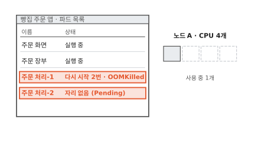
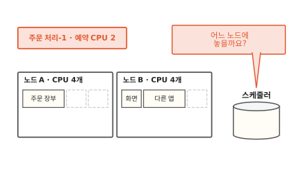
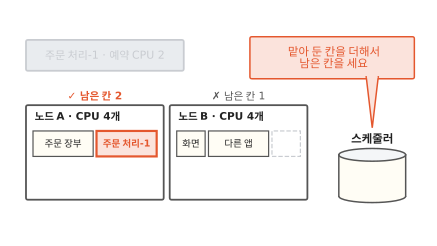
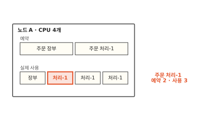
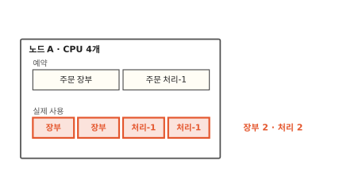
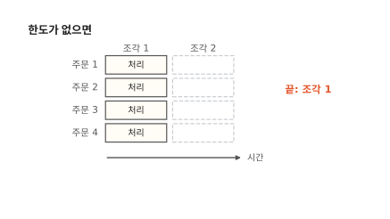
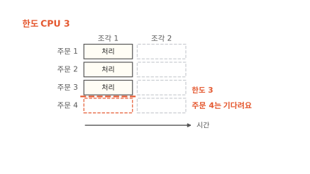
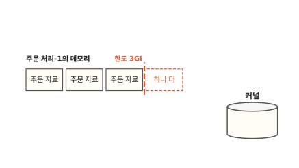
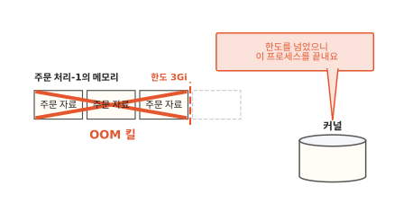

# requests와 limits: 파드가 쓰는 CPU와 메모리 정하기

점심에 주문이 몰려서 빵집 앱의 주문 처리 파드를 하나 더 띄웠더니 "자리 없음"이 떠요. 노드는 한가해 보이는데도요. 이미 떠 있던 파드는 느려지다가 저절로 다시 시작하기까지 해요. 이 글을 읽고 나면 세 가지 일이 모두 매니페스트에 적은 두 칸, requests와 limits에서 나온다는 걸 알게 돼요. 이 두 칸을 알면 파드가 쓸 CPU와 메모리를 어떻게 적어야 할지 정할 수 있어요.

!!! abstract "이 글에서 알게 되는 것"
    1. requests(예약)는 스케줄러가 노드를 고를 때 더하는 값이에요. 실제 사용량은 보지 않아서 한가한 노드에도 자리가 없을 수 있어요.
    2. 노드에 CPU가 남으면 예약보다 더 쓸 수 있어요. 여럿이 다투면 예약한 크기대로 나눠요.
    3. limits(한도)는 넘으면 막히는 선이에요. CPU는 다음 차례까지 기다려서 느려지고 메모리는 프로세스가 끝나요.

## 1. 세 가지 일은 매니페스트의 두 칸에서 나와요

빵집 주문 앱의 부품은 주문 화면과 주문 처리, 주문 장부 셋이에요. 부품마다 컨테이너에 담겨 있어요. 컨테이너는 칸막이와 사용량 한도를 씌워 따로 떼어 놓은 프로그램이에요([1편](01-container.md)). 쿠버네티스는 컨테이너를 파드라는 묶음으로 띄우고 파드를 노드에 올려요. 노드는 파드가 올라가는 컴퓨터 한 대예요.

점심에 세 가지 일이 생겼어요. 새로 띄운 주문 처리-2는 자리가 없다며 뜨지 않았어요. 주문 처리-1은 노드에 CPU가 남는데도 느려졌어요. 조금 뒤에는 주문 처리-1이 저절로 다시 시작했어요.

아래 파드 목록에서 빨간 두 줄과 오른쪽 노드 A의 CPU 칸을 함께 보세요.


**그림 1.** 노드 A는 CPU 4개 가운데 1개만 쓰는데 주문 처리-2는 자리가 없고 주문 처리-1은 두 번 다시 시작했어요.
{ .fig-cap }

세 일은 모두 주문 처리의 매니페스트에 적힌 몇 줄에서 나와요. 매니페스트는 원하는 상태를 적어 쿠버네티스에 건네는 문서예요([7편](07-reconcile-loop.md)).

```yaml
resources:
  requests:        # 예약
    cpu: "2"
    memory: 2Gi
  limits:          # 한도
    cpu: "3"
    memory: 3Gi
```

`cpu: "2"`는 CPU 코어 두 개만큼이에요.[^cpu] `2Gi`는 메모리 크기를 나타내는 단위예요. requests와 limits는 둘 다 "얼마만큼"을 적는 칸인데 쓰이는 때가 달라요. requests부터 볼게요.

## 2. 스케줄러는 예약의 합으로 노드를 골라요

새 파드를 어느 노드에 놓을지는 쿠버네티스의 스케줄러가 정해요. 스케줄러는 노드마다 파드들이 맡아 둔 CPU를 더해서 남은 양을 세요. 노드가 두 대 있고 칸 하나를 CPU 하나로 그려 볼게요. 노드 A에서는 주문 장부가 2칸을 맡았고 노드 B에서는 주문 화면과 다른 앱이 3칸을 맡았어요.

주문 처리-1은 2칸이 필요해요. 아래 그림에서 두 노드 위에 적힌 남은 칸을 보세요.


**그림 2.** 2칸이 남은 노드 A에 주문 처리-1이 들어갔어요. 노드 B는 1칸뿐이라 못 들어가요.
{ .fig-cap }

이제 주문 처리-2도 2칸이 필요해요. 아래 그림에서 노드 A의 실제 사용 막대를 보세요.


**그림 3.** 노드 A가 실제로 쓰는 CPU는 1개뿐인데도 맡아 둔 칸이 꽉 차서 주문 처리-2는 놓일 곳이 없어요.
{ .fig-cap }

주문 처리-2는 놓일 자리를 기다리며 Pending 상태로 남아요. 그림 1의 "자리 없음"이 이 상태예요. 스케줄러가 더하는 값은 매니페스트의 **requests**예요. 쉬운 말로 예약이에요. 스케줄러는 노드마다 예약의 합이 노드가 내줄 수 있는 양을 넘지 않게 지켜요.[^sched]

실제 사용량을 보지 않는 데는 까닭이 있어요. 지금 한가한 노드도 점심이 되면 바빠져요. 그때도 파드마다 예약한 만큼은 쓸 수 있도록 자리를 미리 비워 두는 거예요. 식당이 예약석을 비워 두는 것과 같아요. 예약 손님이 아직 안 와도 그 자리를 다른 손님에게 내주지 않아요.

## 3. 노드에 CPU가 남으면 예약보다 더 써요

예약은 자리를 맡아 두는 약속이에요. 실제로 그만큼만 쓰라는 뜻은 아니에요. 점심이 되자 주문 처리-1은 CPU 3개만큼 일하려 해요. 예약은 2개예요. 마침 노드 A의 주문 장부는 예약한 2칸 가운데 1칸만 쓰고 있어요.

아래 그림에서 실제 사용 줄의 빨간 칸을 보세요.


**그림 4.** 주문 장부가 쓰지 않는 칸 하나를 주문 처리-1이 빌려 써서 예약 2보다 많은 3을 써요.
{ .fig-cap }

노드에 노는 CPU가 있으면 예약보다 더 써도 돼요.[^over] 예약 손님이 아직 오지 않은 자리에 잠깐 앉는 것과 비슷해요. 그런데 그 손님이 오면 어떻게 될까요? 주문 장부도 바빠져서 둘이 CPU를 다투는 경우예요.

아래 그림에서 실제 사용 줄이 어떻게 나뉘었는지 보세요.


**그림 5.** 둘 다 바빠지자 예약한 크기대로 2개씩 나눠 써요.
{ .fig-cap }

CPU를 다툴 때 커널은 예약이 큰 쪽에 CPU 시간을 더 많이 줘요.[^weight] 커널은 운영체제의 중심에서 CPU와 메모리를 프로그램에 나눠 주는 관리자예요. 그림처럼 예약이 2와 2면 2개씩 나눠 써요. 그래서 예약은 바쁠 때도 받을 몫을 지켜 줘요.

그럼 노드에 CPU가 아주 많이 남아 있으면 주문 처리는 끝없이 더 쓸 수 있을까요? 여기서 매니페스트의 두 번째 칸이 나서요.

## 4. CPU 한도를 넘으면 다음 조각까지 기다려요

커널은 CPU를 아주 짧은 시간 조각으로 잘라서 나눠 줘요. 주문 처리-1이 주문 네 건을 한꺼번에 처리한다고 해 볼게요. 주문 한 건이 CPU 하나를 한 조각 동안 쓴다고 쳐요.

먼저 한도가 없을 때예요. 아래 그림에서 주문 네 건이 어느 조각에서 끝나는지 보세요.


**그림 6.** 한도가 없고 CPU가 넉넉하면 네 건이 모두 조각 1에서 끝나요.
{ .fig-cap }

이번에는 매니페스트처럼 한도를 CPU 3으로 정해요. 조각 하나에서 쓸 수 있는 CPU가 3개로 묶여요. 아래 그림에서 주문 4의 칸을 보세요.


**그림 7.** 한도 3에 걸린 주문 4는 조각 1을 건너뛰고 조각 2에서 처리돼요.
{ .fig-cap }

이렇게 넘으면 막히는 선을 매니페스트에 적은 값이 **limits**예요. 쉬운 말로 한도예요. 한도를 지키는 일은 1편에서 본 cgroup이 맡아요. cgroup은 커널이 프로그램 묶음마다 쓸 수 있는 양을 정해 두는 장치예요.

CPU 한도를 넘으려 하면 커널은 그 컨테이너를 다음 조각까지 기다리게 해요.[^throttle] 이 일을 **스로틀**(throttle)이라고 해요. 프로그램은 죽지 않고 느려지기만 해요. 1절에서 주문 처리-1이 노드에 CPU가 남는데도 느렸던 까닭이 이거예요. 뷔페 접시로 말하면 접시 크기가 정해져 있어서 한 번에 담을 양이 묶이는 거예요. 더 먹으려면 다음 차례에 다시 담아요.

## 5. 메모리 한도를 넘으면 프로세스가 끝나요

메모리 한도도 넘으면 기다리게 할까요? 메모리는 프로그램이 지금 쓰는 자료를 올려 두는 작업 공간이에요([컴퓨터 5편](../computer/05-where-computers-remember.md)). 주문 처리-1은 들어온 주문 자료를 메모리에 올려 두고 일해요.

아래 그림에서 한도 선 바깥의 빨간 칸을 보세요.


**그림 8.** 한도 3Gi가 꽉 찼는데 주문 자료를 하나 더 올려야 해요.
{ .fig-cap }

CPU 시간은 미룰 수 있어요. 다음 조각에 쓰면 되니까요. 메모리는 사정이 달라요. 이미 올려 둔 자료는 프로그램이 지금 쓰고 있어서 커널이 마음대로 비울 수 없어요. 비우면 그 자료가 없어져요. 그러면 커널은 어떻게 할까요?


**그림 9.** 커널이 메모리를 더 달라는 프로세스를 끝내서 올려 둔 주문 자료가 모두 사라져요.
{ .fig-cap }

커널은 메모리를 더 달라는 프로세스를 끝내요.[^oom] 프로세스는 실행 중인 프로그램이에요. 이 일을 **OOM 킬**이라고 해요. OOM은 메모리가 모자라다는 뜻의 out of memory를 줄인 말이에요.

컨테이너의 주된 프로세스가 끝나면 쿠버네티스는 그 컨테이너를 다시 시작해요. 들고 있던 자료는 모두 사라지고 처음부터 다시 떠요. 그림 1의 "다시 시작 2번 · OOMKilled"는 메모리 한도를 넘어서 두 번 끝났다는 기록이에요. 뷔페로 말하면 접시에 넘치게 담는 순간 기다려 주지 않고 접시째 치워 가는 거예요.

## 6. 예약은 바쁠 때 쓰는 양으로, 한도는 넘었을 때 벌어질 일로 정해요

이제 두 칸을 어떻게 적을지 정할 수 있어요.

requests는 파드가 바쁠 때 쓰는 양을 적어요. 그 양을 모르면 먼저 실제 사용량을 지켜봐요. 너무 크게 적으면 그림 3처럼 노드가 한가한데도 자리가 없다고 나와요. 너무 작게 적으면 한 노드에 파드가 몰려서 바쁠 때 서로 다퉈요.

limits는 넘었을 때 벌어질 일을 보고 정해요. CPU는 넘어도 느려지기만 해요. 메모리는 넘으면 프로세스가 끝나요. 그래서 메모리 한도는 넉넉하게 잡고 프로그램이 그 안에서 쓰도록 맞춰 둬요. 자바처럼 자기 메모리 크기를 따로 정해 쓰는 프로그램이라면 그 크기가 컨테이너 한도보다 작아야 해요. 자바 프로그램이 뜰 때 하는 일은 [16편](16-jvm-startup.md)에서 이어 가요.

??? info "심화: 둘 중 하나만 적으면 어떻게 될까요?"
    limits만 적고 requests를 비우면 쿠버네티스는 limits 값을 requests에도 그대로 써요. 따로 정해 둔 기본값이 없을 때 이야기예요.[^copy] requests만 적고 limits를 비우면 한도가 없어요. 그 파드는 노드에 남는 만큼 더 쓸 수 있어요.

    적은 방식에 따라 파드는 등급을 받아요. CPU와 메모리 모두 requests와 limits를 같은 값으로 적으면 Guaranteed예요. 아무것도 안 적으면 BestEffort예요. 그 사이는 Burstable이에요.[^qos] 이 등급은 노드 전체 메모리가 모자랄 때 쓰여요. 파드는 예약보다 더 쓸 수 있으니 모두 한도 안에서 써도 노드 메모리가 바닥날 수 있거든요. 그러면 노드에서 파드를 돌보는 프로그램(kubelet)이 파드 몇 개를 내보내요.[^evict] 예약보다 더 쓰고 있는 파드가 먼저 후보가 되고 등급으로는 BestEffort가 먼저, Guaranteed가 맨 나중이에요.

    그림에서 줄인 곳도 있어요. 실제 노드는 운영체제와 쿠버네티스 자신이 쓸 몫을 떼고 남은 양만 파드에 내줘요. 이 양을 할당 가능량(Allocatable)이라고 해요.[^alloc] 커널도 파일을 다시 읽으면 되는 메모리처럼 비워도 되는 곳은 먼저 비워요. 그래도 모자랄 때 프로세스를 끝내요.

## 정리

그림 1의 세 줄에 이제 까닭을 붙일 수 있어요. 주문 처리-2의 "자리 없음"은 스케줄러가 실제 사용량 대신 예약의 합으로 노드를 골라서 생겼어요. 주문 처리-1이 느려진 건 CPU 한도 3에 걸려 다음 조각을 기다렸기 때문이에요. 다시 시작은 메모리 한도 3Gi를 넘어서 커널이 프로세스를 끝냈기 때문이에요.

requests는 노드를 고를 때 쓰는 예약이에요. 노드에 남는 CPU가 있으면 예약보다 더 쓸 수 있어요. 여럿이 다툴 때는 예약한 크기대로 나눠요. limits는 넘으면 막히는 한도예요. CPU는 기다리느라 느려지고 메모리는 프로세스가 끝나요.

다음 [11편](11-persistent-volume.md)에서는 파드가 사라져도 데이터를 남기는 방법을 볼게요.

### 새로 나온 말

- **requests**: 스케줄러가 노드를 고를 때 더하는 예약. 주문 처리는 CPU 2, 메모리 2Gi를 예약했어요.
- **limits**: 넘으면 막히는 한도. 주문 처리는 CPU 3, 메모리 3Gi가 한도예요.
- **스케줄러**: 새 파드를 놓을 노드를 고르는 쿠버네티스의 부품. 노드마다 예약의 합을 세요.
- **스로틀**: CPU 한도를 넘은 컨테이너를 다음 시간 조각까지 기다리게 하는 일. 주문 4가 조각 2로 밀렸어요.
- **OOM 킬**: 메모리 한도를 넘은 프로세스를 커널이 끝내는 일. 주문 처리-1이 두 번 겪었어요.

[^cpu]: 쿠버네티스에서 CPU 1은 물리 코어 하나, 또는 가상 머신이라면 가상 코어 하나예요. `0.5`나 `500m`처럼 나눠 적을 수도 있어요. <https://kubernetes.io/docs/concepts/configuration/manage-resources-containers/#meaning-of-cpu>
[^sched]: 노드의 실제 사용량이 아주 낮아도 예약의 합이 노드 용량을 넘으면 스케줄러는 그 노드에 파드를 놓지 않아요. 나중에 사용량이 오를 때 노드가 모자라지 않게 하려는 것이에요. <https://kubernetes.io/docs/concepts/configuration/manage-resources-containers/#how-pods-with-resource-requests-are-scheduled>
[^over]: 노드에 남는 자원이 있으면 컨테이너가 requests보다 더 쓰는 것은 허용돼요. <https://kubernetes.io/docs/concepts/configuration/manage-resources-containers/#requests-and-limits>
[^weight]: CPU requests는 보통 무게로 쓰여요. 여러 컨테이너가 CPU를 다툴 때 requests가 큰 쪽이 CPU 시간을 더 받아요. 나누는 양은 대략 그 비율을 따라요. <https://kubernetes.io/docs/concepts/configuration/manage-resources-containers/#how-kubernetes-applies-resource-requests-and-limits>
[^throttle]: CPU limits는 커널이 시간 조각마다 넘었는지 보고 넘었으면 다음까지 기다리게 하는 방식으로 지켜져요. <https://kubernetes.io/docs/concepts/configuration/manage-resources-containers/#how-kubernetes-applies-resource-requests-and-limits>
[^oom]: 컨테이너가 메모리 한도보다 더 많이 받으려 하면 리눅스 커널의 메모리 부족 처리가 나서서 보통 그 컨테이너 안에서 메모리를 받으려던 프로세스를 끝내요. 그 프로세스가 컨테이너의 첫 프로세스이고 다시 시작하도록 되어 있으면 쿠버네티스가 컨테이너를 다시 시작해요. 같은 문서 같은 절.
[^copy]: <https://kubernetes.io/docs/concepts/configuration/manage-resources-containers/#requests-and-limits>
[^qos]: <https://kubernetes.io/docs/concepts/workloads/pods/pod-qos/>
[^evict]: <https://kubernetes.io/docs/concepts/scheduling-eviction/node-pressure-eviction/>
[^alloc]: 스케줄러는 할당 가능량을 넘겨 파드를 놓지 않아요. <https://kubernetes.io/docs/tasks/administer-cluster/reserve-compute-resources/#node-allocatable>
