# 파드는 사라지는데 데이터는 어디에 둘까요?

## 파드가 다시 뜨자 주문이 없어졌어요

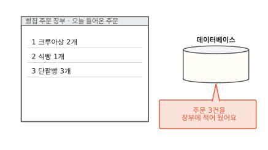

동네 빵집 주문 앱에는 주문 장부가 있어요. 손님이 휴대폰으로 주문하면 주문 처리 서버가 그 주문을 장부에 적어요. 장부는 데이터베이스예요. 오늘은 주문이 세 건 들어왔어요.

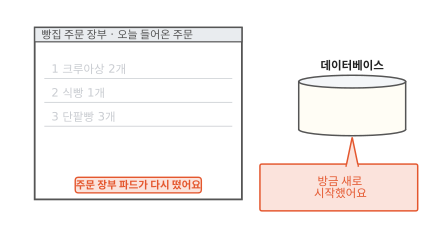

그런데 주문 장부가 돌던 파드가 다시 떴어요. 파드는 쿠버네티스가 함께 띄우는 컨테이너 묶음이에요. 컨테이너는 칸막이를 씌운 보통 프로그램이에요([1편](01-container.md)).

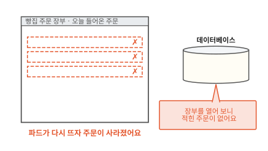

다시 뜬 데이터베이스가 장부를 열어 보니 주문이 하나도 없어요. 세 건은 어디로 갔을까요? 그리고 파드가 몇 번을 다시 떠도 주문이 남게 하려면 장부를 어디에 둬야 할까요?

## 컨테이너 안에 적은 파일은 왜 사라질까요?

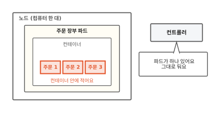

처음 장면의 데이터베이스는 주문을 컨테이너 안의 파일에 적고 있었어요. 컨테이너 안의 파일은 그 컨테이너가 살아 있는 동안만 있어요. 컨테이너가 멈추면 그동안 만들고 고친 파일이 함께 사라져요.[^volumes]

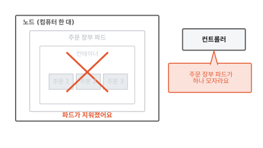

파드는 생각보다 자주 사라져요. 노드가 고장 나거나 설정을 바꿔 새로 띄울 때도 사라져요. 노드는 파드가 도는 컴퓨터 한 대예요. 파드가 사라지면 컨트롤러가 알아차려요. 컨트롤러는 원하는 상태와 지금 상태를 계속 비교해서 맞추는 일꾼이에요([7편](07-reconcile-loop.md)).

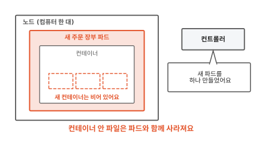

컨트롤러는 파드를 하나 새로 만들어요. 새 파드는 이미지에서 처음 상태 그대로 시작해요. 이미지는 컨테이너를 만드는 틀이에요([2편](02-image-layers.md)). 틀에는 오늘 들어온 주문이 없으니 장부는 비어 있어요. 파드는 언제든 새것으로 바뀔 수 있어요. 그럼 주문은 파드와 상관없이 남는 곳에 적어야 해요.

## 장부를 파드 바깥에 두면 어떻게 될까요?

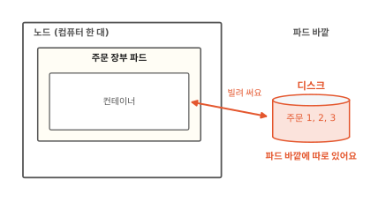

디스크는 전원이 꺼져도 내용이 남는 저장 장치예요([컴퓨터 5편](../computer/05-where-computers-remember.md)). 그림처럼 장부를 파드 바깥의 디스크에 두고 파드는 그 디스크를 빌려 쓰기만 해요. 데이터베이스가 보기에는 자기 폴더에 파일을 적는 것과 똑같아요. 그 폴더가 실제로는 바깥 디스크로 이어져 있을 뿐이에요.

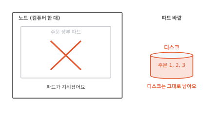

이번에도 파드가 사라졌어요. 디스크는 파드 바깥에 있으니 함께 사라지지 않아요.

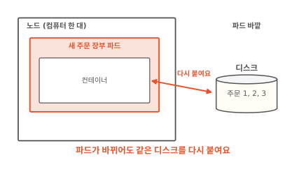

새 파드는 같은 디스크를 다시 붙여요. 주문 세 건이 그대로 있어요. 쿠버네티스는 이렇게 파드와 따로 사는 디스크를 하나의 대상으로 다뤄요. 이 디스크를 **PV**(PersistentVolume)라고 불러요.[^pv]

그런데 주문 앱을 만드는 사람은 디스크가 어느 기계에 있는지 몰라요. 알고 싶지도 않아요. 그럼 맞는 PV를 어떻게 얻을까요?

## 필요한 것만 적어 내면 누가 디스크를 골라 줄까요?

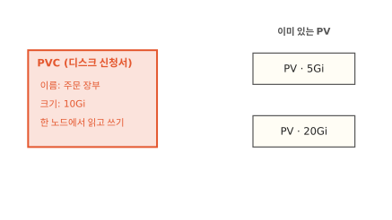

도서관 사물함을 떠올려 봐요. 사물함을 쓰려면 신청서에 "큰 사물함 하나"라고 적어 내요. 어느 층 몇 번 사물함인지는 사서가 골라 줘요. 쿠버네티스도 똑같아요. 앱을 만드는 사람은 그림 왼쪽처럼 신청서를 내요. "주문 장부용으로 10Gi(약 10기가바이트)짜리, 한 노드에서 읽고 쓰기"라고요. 이 디스크 신청서를 **PVC**(PersistentVolumeClaim)라고 해요.

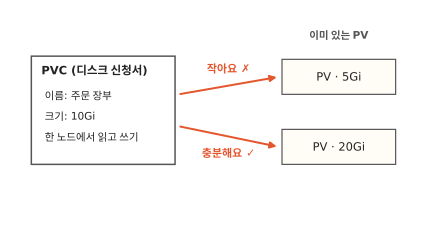

사서 노릇은 쿠버네티스 안의 컨트롤러가 해요. 새 PVC가 들어오면 이미 있는 PV 가운데 조건에 맞는 것을 찾아요. 5Gi짜리는 작아서 안 돼요. 20Gi짜리는 10Gi를 담고도 남아요.

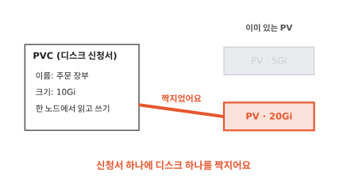

컨트롤러는 신청서와 20Gi짜리 PV를 짝지어요. 짝은 하나 대 하나예요.[^pv] 한번 짝지은 PV는 다른 신청서가 가져가지 못해요. 사물함 하나를 두 사람에게 내주지 않는 것과 같아요.

이 방법에는 빈틈이 있어요. 누군가 PV를 미리 만들어 둬야 해요. 맞는 PV가 하나도 없으면 신청서는 짝을 찾을 때까지 하염없이 기다려요.

## 맞는 디스크가 없으면 누가 만들까요?

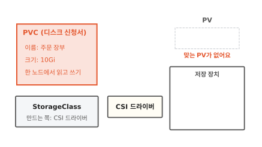

이번에는 미리 만든 PV가 없어요. 사물함이 모자란 도서관이라면 신청서를 보고 사물함을 새로 들여놓으면 돼요. 쿠버네티스도 그렇게 해요. 신청서를 보고 그때 디스크를 새로 만들어요. 이 일을 동적 프로비저닝이라고 해요.[^dynamic]

새로 만들려면 어떤 디스크를 누가 만들지 정해져 있어야 해요. 그림 왼쪽 아래 카드가 그걸 적어 둔 종류표예요. 이름은 `StorageClass`예요. 신청서에 종류를 따로 적지 않으면 기본으로 정해 둔 종류표를 써요.[^dynamic]

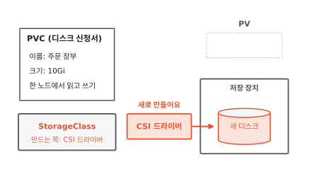

종류표가 가리키는 쪽은 **CSI 드라이버**예요. 저장 장치마다 디스크를 만들고 붙이는 방법이 달라요. 쿠버네티스가 그 방법을 다 알 수는 없어요. 그래서 저장 장치를 만드는 쪽이 약속된 말(CSI)을 알아듣는 플러그인을 따로 만들어 붙여요.[^csi] 이 플러그인이 CSI 드라이버예요. 그림에서 CSI 드라이버가 저장 장치에 새 디스크를 만들었어요.

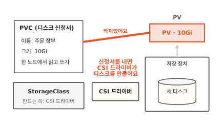

새 디스크는 PV로 올라오고 신청서와 바로 짝지어져요. 신청한 사람은 PVC 한 장만 냈어요. 디스크를 고르고 만드는 일은 쿠버네티스와 CSI 드라이버가 했어요.

??? info "심화: 신청서를 지우면 디스크도 사라질까요?"
    주문 장부 PVC를 실수로 지웠을 때 주문이 남는지 궁금할 때 보는 칸이에요.

    PV에는 짝이 풀렸을 때 할 일이 적혀 있어요. 이름은 반납 정책(reclaim policy)이에요. `Delete`이면 PV와 실제 디스크를 함께 지워요. `Retain`이면 PV와 데이터를 남겨 두고 사람이 정리하기를 기다려요. 동적 프로비저닝으로 만든 PV는 StorageClass의 정책을 물려받아요. 따로 적지 않으면 그 기본값은 `Delete`예요.[^reclaim]

    파드가 쓰는 중인 PVC는 지워도 바로 사라지지 않아요. 쿠버네티스는 그 PVC를 쓰는 파드가 모두 없어질 때까지 지우기를 미뤄요. 그동안 PVC 상태는 `Terminating`으로 보여요.[^reclaim]

    파드를 지우는 것과는 달라요. 파드를 지워도 PVC와 PV는 그대로 남아요.

PV가 생겼다고 끝은 아니에요. 디스크는 아직 저장 장치 안에 있고 파드는 어느 노드에서 돌아요. 둘은 어떻게 만날까요?

## 디스크는 어떻게 파드가 있는 노드까지 갈까요?

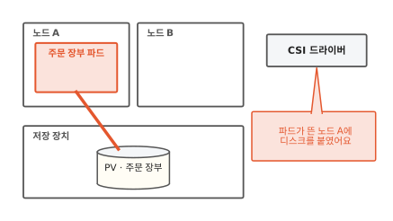

파드가 노드 A에 자리를 잡으면 CSI 드라이버가 디스크를 노드 A에 붙여요. 그다음 컨테이너 안의 한 폴더에 이어 줘요. 데이터베이스는 그 폴더에 파일을 적어요.[^csi]

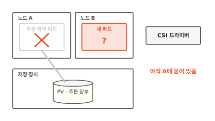

이번에는 노드 A가 고장 나서 새 파드가 노드 B에 떴어요. 디스크는 아직 노드 A에 붙어 있어요. 신청서에 적은 "한 노드에서 읽고 쓰기" 때문에 디스크를 두 노드에 동시에 붙일 수 없어요. 이 방식을 `ReadWriteOnce`라고 해요.[^rwo] 그래서 CSI 드라이버는 노드 A에서 먼저 디스크를 떼야 해요.

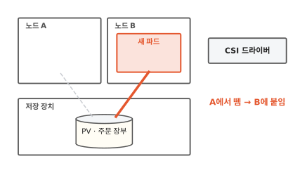

디스크를 노드 A에서 떼어 노드 B에 붙였어요. 새 파드는 같은 폴더에서 같은 주문 세 건을 읽어요. 파드는 노드를 옮겨 다니고 디스크는 그 뒤를 따라가요.

??? info "심화: ReadWriteOnce면 파드 하나만 쓸 수 있나요?"
    주문 장부 파드 둘이 같은 디스크를 붙였다는 이야기가 이상하게 들릴 때 보는 칸이에요.

    `ReadWriteOnce`는 노드 하나를 기준으로 막아요. 같은 노드에 뜬 파드라면 여럿이 같은 디스크를 읽고 쓸 수 있어요. 클러스터 전체에서 파드 딱 하나만 쓰게 하려면 `ReadWriteOncePod`를 적어요. 이 방식은 CSI 드라이버로 만든 디스크에서만 돼요.[^rwo]

    여러 노드에서 동시에 쓰는 `ReadWriteMany`도 있어요. 이건 저장 장치가 그렇게 쓰도록 만들어져 있어야 해요. 디스크 하나를 그냥 두 노드에 꽂는 일과는 달라요.

??? info "심화: CSI 드라이버는 어디에서 돌까요?"
    디스크가 안 붙어서 파드가 멈춰 있을 때 무엇부터 살펴봐야 할지 궁금할 때 보는 칸이에요.

    CSI 드라이버는 쿠버네티스에 처음부터 들어 있지 않아요. 클러스터를 관리하는 사람이 저장 장치에 맞는 드라이버를 따로 설치해요.[^csi] 그림에서는 상자 하나로 그렸지만 실제로는 두 부분으로 나뉘어요. 한쪽은 디스크를 만들고 지우고 노드에 붙이라고 저장 장치에 시켜요. 다른 쪽은 노드마다 하나씩 떠서 붙은 디스크를 폴더에 이어 줘요. 노드 쪽 부분은 장치를 살피고 폴더를 잇는 일을 해서 높은 권한으로 돌아요.

    그래서 디스크가 안 붙으면 PVC가 PV와 짝지어졌는지 먼저 봐요. 그다음 그 노드의 드라이버를 봐요.

## PVC는 언제 쓸모 있을까요

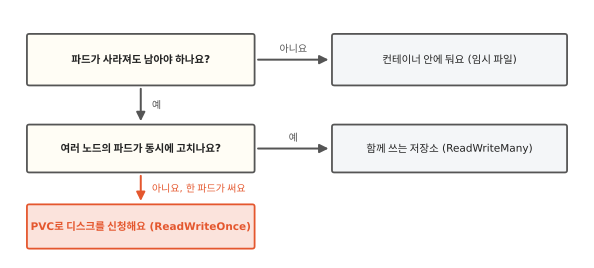

먼저 "파드가 사라져도 남아야 하나요?"를 물어요. 주문 화면이 잠깐 만들어 두는 그림 파일처럼 다시 만들면 되는 것은 컨테이너 안에 둬도 괜찮아요. 오히려 디스크를 신청하고 붙이는 수고만 늘어요. 주문 장부처럼 잃으면 안 되는 것은 PVC로 디스크를 받아요.

그다음 "여러 노드의 파드가 동시에 고치나요?"를 물어요. 데이터베이스는 보통 파드 하나가 자기 디스크를 혼자 써요. 그럼 `ReadWriteOnce`로 충분해요. 여러 노드의 파드가 같은 파일을 함께 고쳐야 할 때만 `ReadWriteMany`를 받아 주는 저장소를 찾아요.

디스크가 저장 장치 하나에만 있으면 그 장치가 고장 났을 때는 어떻게 될까요? 노드들의 디스크에 같은 내용을 나눠 두는 방법은 [12편](12-longhorn.md)에서 이어 가요.

## 다시 주문 장부를 열어 볼게요

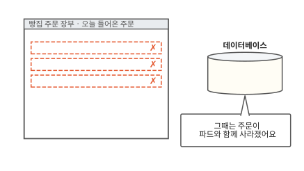

처음 장면으로 돌아왔어요. 그때는 주문을 컨테이너 안에 적어서 파드와 함께 사라졌어요.

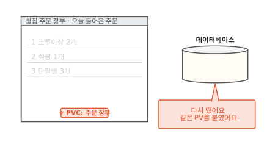

이번에는 주문 장부 파드에 PVC를 달았어요. 파드가 다시 뜨자 CSI 드라이버가 짝지어 둔 PV를 그 노드에 붙여요.

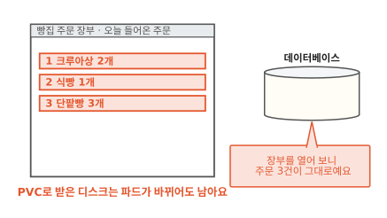

장부를 열어 보니 주문 세 건이 그대로예요. 파드가 열 번을 다시 떠도, 다른 노드로 옮겨 가도 신청서에 짝지어진 디스크는 따라와요.

### 이 편에서 줄여 그린 것

그림을 쉽게 하려고 실제와 다르게 줄인 곳이 세 군데 있어요.

1. 저장 장치를 노드 바깥의 상자 하나로 그렸어요. 실제 저장 장치는 클라우드가 빌려주는 디스크일 수도 있고 노드들에 꽂힌 디스크를 묶은 것일 수도 있어요. 뒤의 것은 [12편](12-longhorn.md)에서 봐요.
2. CSI 드라이버를 상자 하나로 그렸어요. 실제로는 저장 장치에 일을 시키는 부분과 노드마다 도는 부분으로 나뉘어요. 심화 칸 "CSI 드라이버는 어디에서 돌까요?"에 적었어요.
3. 디스크를 노드에 붙이는 일을 선 하나로 그렸어요. 실제로는 노드에 디스크를 붙이는 단계와 그 디스크를 컨테이너 폴더에 잇는 단계가 따로 있어요.

### 이 편에서 새로 나온 말

[^volumes]: 쿠버네티스 문서 "Volumes": 컨테이너가 멈추거나 다시 시작되면 그동안 만들고 고친 파일을 잃고 깨끗한 상태로 다시 시작해요. 볼륨을 쓰면 컨테이너가 다시 시작돼도 데이터가 남고, PV는 파드가 없어져도 지우지 않아요. <https://kubernetes.io/docs/concepts/storage/volumes/>
[^pv]: 쿠버네티스 문서 "Persistent Volumes": PV는 파드와 따로 사는 저장 공간이고 PVC는 저장 공간을 달라는 요청이에요. PVC와 PV의 짝은 하나 대 하나이고, 맞는 PV가 없으면 PVC는 짝을 찾지 못한 채 남아요. <https://kubernetes.io/docs/concepts/storage/persistent-volumes/>
[^dynamic]: 쿠버네티스 문서 "Dynamic Volume Provisioning": StorageClass마다 디스크를 만들 플러그인(provisioner)과 넘길 값을 적어요. 기본 StorageClass를 정해 두면 종류를 적지 않은 PVC에 그 이름이 붙어요. <https://kubernetes.io/docs/concepts/storage/dynamic-provisioning/>
[^csi]: CSI(Container Storage Interface)는 쿠버네티스 같은 시스템이 여러 저장 장치를 컨테이너에 내주도록 정한 표준 약속이에요. 쿠버네티스는 CSI 드라이버를 직접 설치하지 않아요. 노드 쪽 드라이버는 장치를 살피고 파일 시스템을 이어야 해서 보통 높은 권한으로 돌아요. <https://kubernetes.io/docs/concepts/storage/volumes/#csi>
[^reclaim]: 쿠버네티스 문서 "Persistent Volumes"의 Reclaiming, Storage Object in Use Protection 절. <https://kubernetes.io/docs/concepts/storage/persistent-volumes/#reclaiming>
[^rwo]: 쿠버네티스 문서 "Persistent Volumes"의 Access Modes 절. `ReadWriteOnce`는 노드 하나가 읽고 쓰게 붙이고, 같은 노드의 파드 여럿은 함께 쓸 수 있어요. `ReadWriteOncePod`는 파드 하나만 쓰게 하고 CSI 볼륨에서만 돼요. <https://kubernetes.io/docs/concepts/storage/persistent-volumes/#access-modes>
