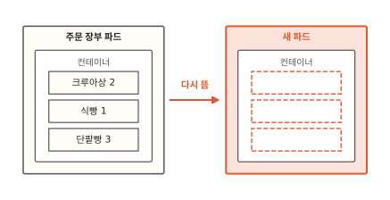
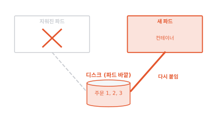
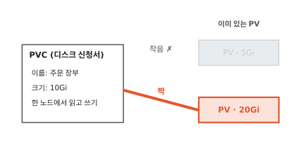
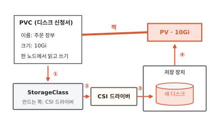

# PV와 PVC: 파드가 사라져도 남는 디스크

빵집 주문 앱에 오늘 주문이 세 건 들어왔어요. 그런데 주문 장부를 맡은 파드가 다시 뜨고 나니 장부가 텅 비었어요. 이 글을 읽고 나면 파드가 몇 번을 다시 떠도 데이터가 남게 하는 방법을 알게 돼요. 데이터베이스처럼 잃으면 안 되는 것을 쿠버네티스에 올릴 때 꼭 거치는 길이에요.

!!! abstract "이 글에서 알게 되는 것"
    1. 컨테이너 안에 적은 파일은 파드와 함께 사라져요. 남아야 하는 데이터는 파드 바깥의 디스크(PV)에 두고 새 파드가 그 디스크를 다시 붙여요.
    2. 앱을 만드는 사람은 디스크 신청서(PVC)에 크기와 쓰는 방식만 적어요. 쿠버네티스가 맞는 PV를 짝지어 주고 없으면 CSI 드라이버가 새로 만들어요.
    3. CSI 드라이버는 파드가 뜬 노드에 디스크를 붙여요. 한 노드에만 붙는 디스크는 파드가 다른 노드로 옮기면 떼어서 옮겨 붙여요.

## 1. 컨테이너 안에 적은 주문은 파드와 함께 사라져요

먼저 주문이 어디에 적혀 있었는지 볼게요. 주문 장부는 데이터베이스예요. 데이터베이스는 파드 안에서 돌고 있었어요. 파드는 쿠버네티스가 함께 띄우는 컨테이너 묶음이에요. 컨테이너는 칸막이를 씌운 보통 프로그램이고요([1편](01-container.md)).

데이터베이스는 주문 세 건을 자기 컨테이너 안의 파일에 적었어요. 컨테이너 안의 파일은 그 컨테이너가 살아 있는 동안만 있어요. 컨테이너가 멈추면 그동안 만들고 고친 파일도 함께 사라져요.[^volumes]

파드는 생각보다 자주 사라져요. 파드가 도는 컴퓨터 한 대를 노드라고 해요. 노드가 고장 나도 파드는 사라지고 설정을 바꿔 새로 띄울 때도 사라져요. 그러면 컨트롤러가 파드가 모자란 걸 알아차리고 새 파드를 만들어요. 컨트롤러는 원하는 상태와 지금 상태를 계속 비교해서 맞추는 일꾼이에요([7편](07-reconcile-loop.md)).

새 파드는 이미지에서 처음 상태로 시작해요. 이미지는 컨테이너를 만드는 틀이에요([2편](02-image-layers.md)). 아래 그림에서 왼쪽 파드와 오른쪽 새 파드의 컨테이너 안을 비교해 보세요.

**그림 1.** 다시 뜬 새 파드의 컨테이너에는 주문 세 건이 없어요.
{ .fig-cap }

틀에는 오늘 들어온 주문이 없으니 새 장부는 비어 있어요. 파드는 언제든 새것으로 바뀔 수 있어요. 그래서 남아야 하는 주문은 파드와 상관없이 남는 곳에 적어야 해요.

## 2. 장부를 파드 바깥 디스크에 두면 새 파드가 다시 붙여요

앞에서 주문은 컨테이너 안에 있어서 사라졌어요. 이번에는 장부를 파드 바깥에 둬 볼게요.

디스크는 전원이 꺼져도 내용이 남는 저장 장치예요([컴퓨터 5편](../computer/05-where-computers-remember.md)). 장부를 파드 바깥의 디스크에 두고 파드는 그 디스크를 빌려 쓰기만 해요. 데이터베이스가 보기에는 자기 폴더에 파일을 적는 것과 똑같아요. 그 폴더가 실제로는 바깥 디스크로 이어져 있을 뿐이에요.

이제 파드가 사라지면 어떻게 될까요? 아래 그림에서 가운데 디스크와 오른쪽 새 파드를 잇는 빨간 선을 보세요.

**그림 2.** 파드가 지워져도 디스크는 남고 새 파드가 같은 디스크를 다시 붙여요.
{ .fig-cap }

디스크는 파드 바깥에 있어서 파드와 함께 사라지지 않아요. 새 파드가 같은 디스크를 붙이면 주문 세 건이 그대로 있어요. 쿠버네티스는 이렇게 파드와 따로 사는 디스크를 **PV**(PersistentVolume)라고 불러요.[^pv]

여기서 이런 생각이 들 거예요. 주문 앱을 만드는 사람은 디스크가 어느 기계에 있는지 몰라요. 그럼 맞는 PV를 어떻게 얻을까요?

## 3. PVC에 필요한 것을 적어 내면 쿠버네티스가 PV를 짝지어 줘요

도서관 사물함을 떠올려 봐요. 사물함을 쓰려면 신청서에 "큰 사물함 하나"라고 적어 내요. 어느 층 몇 번 사물함인지는 사서가 골라 줘요.

쿠버네티스도 그렇게 해요. 앱을 만드는 사람은 신청서 한 장을 내요. "이름은 주문 장부, 크기는 10Gi(약 10기가바이트), 한 노드에서 읽고 쓰기"라고요. 이 디스크 신청서를 **PVC**(PersistentVolumeClaim)라고 해요.

사서 노릇은 쿠버네티스 안의 컨트롤러가 해요. 새 PVC가 들어오면 이미 있는 PV 가운데 조건에 맞는 것을 찾아요. 5Gi짜리와 20Gi짜리 PV가 미리 있다고 해 볼게요. 아래 그림에서 신청서와 빨간 선으로 이어진 PV를 보세요.

**그림 3.** 5Gi짜리는 빠지고 20Gi짜리 PV가 신청서와 짝지어졌어요.
{ .fig-cap }

5Gi짜리는 10Gi를 담기에 작아요. 20Gi짜리는 담고도 남아요. 그래서 컨트롤러는 신청서와 20Gi짜리 PV를 짝지어요. 짝은 하나 대 하나라서 한번 짝지은 PV는 다른 신청서가 가져가지 못해요.[^pv] 사물함 하나를 두 사람에게 내주지 않는 것과 같아요.

이 방법에는 빈틈이 있어요. 누군가 PV를 미리 만들어 둬야 해요. 맞는 PV가 하나도 없으면 신청서는 짝을 찾을 때까지 기다리기만 해요.

## 4. 맞는 PV가 없으면 CSI 드라이버가 새로 만들어요

사물함이 모자란 도서관이라면 신청서를 보고 사물함을 새로 들여놓으면 돼요. 쿠버네티스도 신청서를 보고 그때 디스크를 새로 만들 수 있어요. 이 일을 동적 프로비저닝이라고 해요.[^dynamic]

새로 만들려면 어떤 디스크를 누가 만들지 미리 정해 둬야 해요. 그걸 적어 둔 종류표가 `StorageClass`예요. 신청서에 종류를 따로 적지 않으면 기본으로 정해 둔 종류표를 써요.[^dynamic]

종류표에 "누가 만들지"로 적힌 쪽이 **CSI 드라이버**예요. 저장 장치마다 디스크를 만들고 붙이는 방법이 달라요. 쿠버네티스가 그 방법을 다 알 수는 없어요. 그래서 쿠버네티스는 CSI라는 약속만 정해 둬요. 저장 장치를 만드는 쪽은 그 약속을 알아듣는 플러그인을 만들어 붙여요.[^csi] 이 플러그인이 CSI 드라이버예요.

아래 그림에서 빨간 번호를 차례로 따라가 보세요.

**그림 4.** 신청서 한 장에서 시작해 새 PV · 10Gi가 생기고 신청서와 짝지어져요.
{ .fig-cap }

① 쿠버네티스는 신청서에 맞는 StorageClass를 찾아요. ② 그 종류표에 적힌 CSI 드라이버에게 10Gi짜리 디스크를 만들라고 해요. ③ CSI 드라이버가 저장 장치에 새 디스크를 만들어요. ④ 새 디스크는 PV로 올라오고 신청서와 짝지어져요.

신청한 사람은 PVC 한 장만 냈어요. 디스크를 고르고 만드는 일은 쿠버네티스와 CSI 드라이버가 했어요.

## 5. 디스크는 파드가 뜬 노드로 따라가요

PV가 생겼다고 끝은 아니에요. 디스크는 저장 장치 안에 있고 파드는 어느 노드에서 돌아요. 둘을 이어 주는 것도 CSI 드라이버예요.

아래 그림 세 장에서 디스크와 파드를 잇는 빨간 선이 어디로 가는지 보세요. 첫 장에서는 파드가 노드 A에 떴어요.

**그림 5.** 파드가 노드 A에 뜨자 CSI 드라이버가 디스크를 노드 A에 붙였어요.
{ .fig-cap }

CSI 드라이버는 디스크를 노드 A에 붙이고 컨테이너 안의 한 폴더에 이어 줘요. 데이터베이스는 그 폴더에 주문을 적어요.[^csi]

이번에는 노드 A가 고장 나서 새 파드가 노드 B에 떴어요.

**그림 6.** 새 파드는 노드 B에 떴는데 디스크는 아직 노드 A에 붙어 있어요.
{ .fig-cap }

신청서에 적은 "한 노드에서 읽고 쓰기" 때문에 이 디스크는 두 노드에 동시에 붙일 수 없어요. 이 방식을 `ReadWriteOnce`라고 해요.[^rwo] 그래서 CSI 드라이버는 노드 A에서 디스크를 먼저 떼요.

**그림 7.** 노드 A에서 디스크를 떼고 노드 B에 붙였어요.
{ .fig-cap }

새 파드는 같은 폴더에서 같은 주문 세 건을 읽어요. 파드는 노드를 옮겨 다니고 디스크는 그 파드를 따라가요.

`ReadWriteOnce`는 노드 하나를 기준으로 막아요. 같은 노드에 뜬 파드라면 여럿이 같은 디스크를 쓸 수 있어요. 파드 딱 하나만 쓰게 하려면 `ReadWriteOncePod`를 적어요.[^rwo] 여러 노드에서 동시에 쓰는 `ReadWriteMany`도 있는데 저장 장치가 그렇게 쓰도록 만들어져 있어야 해요.

## 6. 잃으면 안 되는 데이터만 PVC로 받아요

이제 무엇을 PVC로 받을지 고를 수 있어요. 아래 그림의 질문 두 개를 위에서부터 따라가 보세요.

**그림 8.** 남아야 하고 한 노드에서만 고치는 데이터는 PVC로 디스크를 받아요.
{ .fig-cap }

먼저 "파드가 사라져도 남아야 하나요?"를 물어요. 주문 화면이 잠깐 만들어 두는 그림 파일처럼 다시 만들면 되는 것은 컨테이너 안에 둬도 괜찮아요. 디스크를 신청하고 붙이는 수고만 늘거든요. 주문 장부처럼 잃으면 안 되는 것은 PVC로 디스크를 받아요.

그다음 "여러 노드에서 동시에 고치나요?"를 물어요. 데이터베이스는 보통 파드 하나가 자기 디스크를 혼자 써요. 그럼 `ReadWriteOnce`로 충분해요. 여러 노드의 파드가 같은 파일을 함께 고쳐야 할 때만 `ReadWriteMany`를 받아 주는 저장소를 찾아요.

??? info "심화: 신청서를 지우면 디스크도 사라지나요?"
    PV에는 짝이 풀렸을 때 할 일이 적혀 있어요. 이름은 반납 정책(reclaim policy)이에요. `Delete`이면 PV와 실제 디스크를 함께 지워요. `Retain`이면 PV와 데이터를 남겨 두고 사람이 정리하기를 기다려요. 동적 프로비저닝으로 만든 PV는 StorageClass의 정책을 물려받는데 따로 적지 않으면 `Delete`예요.[^reclaim]

    파드가 쓰는 중인 PVC는 지워도 바로 사라지지 않아요. 그 PVC를 쓰는 파드가 모두 없어질 때까지 쿠버네티스가 지우기를 미뤄요.[^reclaim] 파드만 지우면 PVC와 PV는 그대로 남아요.

## 정리

컨테이너 안에 적은 주문은 파드와 함께 사라졌어요. 파드는 노드가 고장 나거나 설정을 바꾸면 언제든 새것으로 바뀌어요. 그래서 남아야 하는 주문은 파드 바깥의 디스크인 PV에 두고 새 파드가 그 디스크를 다시 붙여요.

앱을 만드는 사람은 "주문 장부, 10Gi, 한 노드에서 읽고 쓰기"라고 적은 PVC 한 장만 내요. 쿠버네티스가 맞는 PV를 짝지어 주고 맞는 게 없으면 StorageClass에 적힌 CSI 드라이버가 새 디스크를 만들어요.

CSI 드라이버는 파드가 뜬 노드에 디스크를 붙여요. `ReadWriteOnce` 디스크는 한 노드에만 붙어서 파드가 노드 B로 옮기면 노드 A에서 떼어 B에 붙여요.

이 글에서는 저장 장치를 노드 바깥의 상자 하나로 그렸어요. 그런데 바깥 저장 장치 없이 노드에 꽂힌 디스크만 있다면 어떻게 될까요? 그 노드가 고장 나면 디스크도 함께 멈춰요. 노드마다 꽂힌 디스크에 같은 내용을 나눠 두는 방법은 [12편](12-longhorn.md)에서 볼게요.

### 새로 나온 말

- **PV**(PersistentVolume): 파드와 따로 사는 디스크. 파드가 지워져도 주문 세 건이 남아 있던 디스크예요.
- **PVC**(PersistentVolumeClaim): 필요한 디스크를 적어 내는 신청서. "주문 장부, 10Gi, 한 노드에서 읽고 쓰기"라고 적었어요.
- **StorageClass**: 어떤 디스크를 누가 만들지 적어 둔 종류표. 주문 장부의 종류표에는 만드는 쪽으로 CSI 드라이버가 적혀 있었어요.
- **CSI 드라이버**: 저장 장치에 디스크를 만들고 파드가 뜬 노드에 붙이는 플러그인. 주문 장부 디스크를 노드 A에서 떼어 노드 B에 붙였어요.
- **동적 프로비저닝**: 맞는 PV가 없을 때 신청서를 보고 디스크를 새로 만드는 일.
- **ReadWriteOnce**: 디스크를 한 번에 한 노드에만 붙여 읽고 쓰는 방식.

[^volumes]: 쿠버네티스 문서 "Volumes". 컨테이너가 멈추거나 다시 시작되면 그동안 만들고 고친 파일을 잃고 깨끗한 상태로 다시 시작해요. <https://kubernetes.io/docs/concepts/storage/volumes/>
[^pv]: 쿠버네티스 문서 "Persistent Volumes". PV는 파드와 따로 사는 저장 공간이고 PVC는 저장 공간을 달라는 요청이에요. PVC와 PV의 짝은 하나 대 하나예요. 맞는 PV가 없으면 PVC는 짝을 찾지 못한 채 남아요. <https://kubernetes.io/docs/concepts/storage/persistent-volumes/>
[^dynamic]: 쿠버네티스 문서 "Dynamic Volume Provisioning". StorageClass마다 디스크를 만들 플러그인(provisioner)과 넘길 값을 적어요. 기본 StorageClass를 정해 두면 종류를 적지 않은 PVC에 그 이름이 붙어요. <https://kubernetes.io/docs/concepts/storage/dynamic-provisioning/>
[^csi]: CSI(Container Storage Interface)는 쿠버네티스 같은 시스템이 여러 저장 장치를 컨테이너에 내주도록 정한 표준 약속이에요. CSI 드라이버는 쿠버네티스에 들어 있지 않아서 클러스터를 관리하는 사람이 따로 설치해요. <https://kubernetes.io/docs/concepts/storage/volumes/#csi>
[^reclaim]: 쿠버네티스 문서 "Persistent Volumes"의 Reclaiming, Storage Object in Use Protection 절. <https://kubernetes.io/docs/concepts/storage/persistent-volumes/#reclaiming>
[^rwo]: 쿠버네티스 문서 "Persistent Volumes"의 Access Modes 절. `ReadWriteOnce`는 노드 하나가 읽고 쓰게 붙이고 같은 노드의 파드 여럿은 함께 쓸 수 있어요. `ReadWriteOncePod`는 파드 하나만 쓰게 하고 CSI 볼륨에서만 돼요. <https://kubernetes.io/docs/concepts/storage/persistent-volumes/#access-modes>
