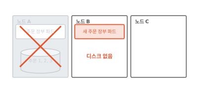
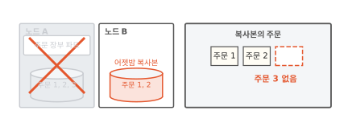
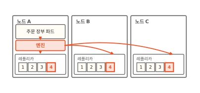
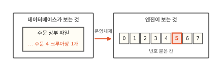
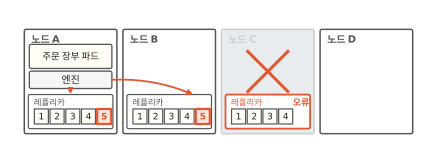
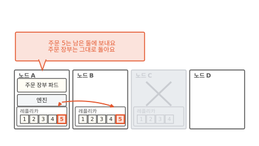
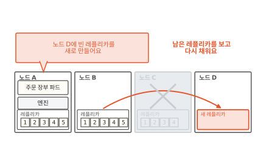
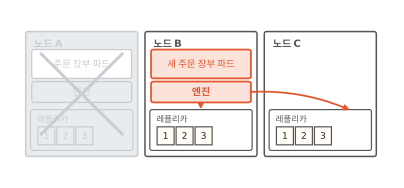
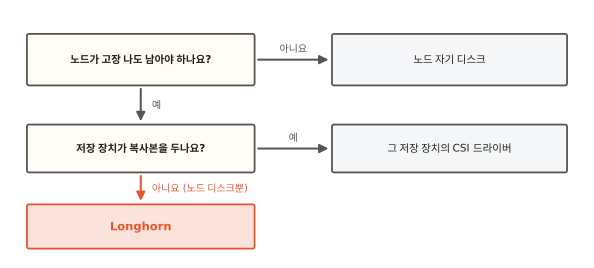

# Longhorn: 노드 하나가 죽어도 남는 디스크

[11편](11-persistent-volume.md)에서 주문 장부는 PVC로 받은 디스크에 주문을 적었어요. 그런데 그 디스크가 노드 하나에 꽂혀 있으면 그 노드가 고장 나는 날 장부도 함께 멈춰요. 이 글을 읽고 나면 Longhorn이 디스크 하나를 여러 노드에 나눠 두는 방법을 알게 돼요. 이 방법을 알면 노드 하나가 죽어도 장부가 이어지는 까닭과 쓰기가 왜 무거워지는지가 함께 보여요.

!!! abstract "이 글에서 알게 되는 것"
    1. 디스크가 노드 하나에만 있으면 그 노드와 함께 멈춰요. 가끔 떠 둔 복사본에는 복사한 다음에 들어온 주문이 없어요.
    2. Longhorn은 볼륨마다 엔진 하나를 파드 곁에 둬요. 엔진은 받은 쓰기를 노드마다 하나씩 둔 볼륨 레플리카 모두에 그 자리에서 보내요.
    3. 노드 하나가 죽으면 남은 레플리카로 이어 가고 다른 노드에 새 레플리카를 만들어 다시 채워요.

## 1. 디스크가 노드 하나에만 있으면 그 노드와 함께 멈춰요

PVC는 "이만큼 필요하다"고 적어 내는 디스크 신청서예요. 11편에서는 디스크가 노드 바깥의 저장 장치에 있다고 그렸어요. 이번 빵집에는 그런 저장 장치가 없어요. 노드에 꽂힌 디스크를 써요. 노드는 파드가 도는 컴퓨터 한 대예요. 그래서 주문 장부 디스크는 주문 장부 파드가 도는 노드 A 안에 있어요.

어느 날 노드 A가 고장 났어요. 쿠버네티스는 주문 장부 파드를 노드 B에 새로 띄워요. 아래 그림에서 노드 B의 새 파드 아래를 보세요.

**그림 1.** 새 파드는 노드 B에 떴는데 주문이 든 디스크는 고장 난 노드 A 안에 있어요.
{ .fig-cap }

11편에서는 디스크를 떼어 새 노드에 붙였어요. 이번에는 그럴 수 없어요. 디스크가 노드 A에 꽂혀 있으니까요. 새 파드는 장부를 열지 못해요. 노드 하나가 고장 나도 장부가 멈추지 않으려면 주문이 다른 노드에도 있어야 해요.

## 2. 가끔 떠 둔 복사본에는 마지막 주문이 없어요

먼저 떠오르는 방법은 밤마다 디스크를 다른 노드에 복사해 두는 거예요. 노드 A가 고장 나면 복사본을 쓰면 돼요. 어젯밤 노드 B에 복사해 둔 다음 오늘 주문 3이 들어왔다고 해 볼게요. 아래 그림에서 복사본의 주문 칸을 보세요.

**그림 2.** 어젯밤 복사본에는 주문 1과 2만 있고 주문 3 칸은 비어 있어요.
{ .fig-cap }

주문 3은 복사한 다음에 들어와서 노드 A에만 있다가 함께 사라졌어요. 복사를 한 시간마다 해도 마지막 한 시간의 주문은 잃어요. 주문이 들어오는 그 순간에 다른 노드에도 적혀 있어야 해요.

## 3. 엔진 하나가 쓰기를 받아 레플리카 모두에 보내요

교실에서 선생님이 불러 주는 말을 학생 세 명이 각자 공책에 받아 적는다고 해 봐요. 한 명이 공책을 잃어버려도 나머지 두 권에 같은 내용이 있어요. 마지막 한 줄까지요. 말이 나오는 그 순간에 받아 적으니까요.

Longhorn은 이 방법을 디스크에 써요.[^arch] Longhorn은 쿠버네티스 안에서 도는 저장소 프로그램이에요. 노드들에 꽂힌 디스크를 묶어서 PVC로 받을 디스크를 내줘요. PVC로 받은 디스크 하나를 볼륨이라고 해요.

Longhorn은 볼륨 하나의 내용을 노드 A, B, C에 하나씩 둬요. 이 하나하나가 학생의 공책이에요. 이걸 **볼륨 레플리카**라고 해요. 볼륨 레플리카는 그 볼륨의 온전한 복사본이에요. 같은 볼륨의 레플리카끼리는 같은 노드에 두지 않아요.[^place] 노드 하나가 죽을 때 레플리카 둘을 한꺼번에 잃지 않으려는 거예요.

선생님 자리에는 **엔진**이 서요. 엔진은 볼륨마다 하나씩 있고 늘 그 볼륨을 쓰는 파드와 같은 노드에서 돌아요.[^arch] 데이터베이스가 주문 4를 디스크에 쓰면 그 쓰기는 먼저 엔진에 닿아요. 데이터베이스는 엔진이 있는 줄도 몰라요. 보통 디스크에 쓴다고 생각해요.

아래 그림에서 엔진에서 나가는 빨간 화살표 셋을 보세요.

**그림 3.** 엔진이 주문 4를 받아 노드 A, B, C의 레플리카 셋에 모두 보냈어요.
{ .fig-cap }

엔진은 받은 쓰기를 레플리카 셋에 그 자리에서 보내요. 모아 두었다가 나중에 보내지 않아요. Longhorn 문서는 이걸 동기 복제라고 불러요.[^arch] 그래서 주문 4는 들어오는 순간 세 노드에 함께 적혀요.

받아 적기와 다른 점도 하나 있어요. 레플리카는 들은 말의 뜻을 알고 적지 않아요. 엔진이 보내는 것을 그대로 옮겨 적어요. 엔진은 무엇을 보낼까요?

## 4. 엔진은 파일을 모르고 번호 붙은 칸만 보내요

데이터베이스는 "장부 파일에 주문 4를 적는다"고 생각해요. 그런데 디스크 쪽에서 보면 파일이 없어요. 번호 붙은 칸이 길게 줄지어 있을 뿐이에요. 파일은 이 칸들 위에 운영체제가 짜 놓은 정리 방식이에요. 운영체제는 컴퓨터의 부품을 관리하는 바탕 프로그램이에요.

아래 그림에서 왼쪽 파일 속 주문 4와 오른쪽 빨간 칸을 비교해 보세요.

**그림 4.** 운영체제가 "장부 파일에 주문 4"를 "5번 칸을 이렇게 바꿔라"로 바꿔서 보내요.
{ .fig-cap }

엔진은 이렇게 칸 단위로 바뀐 요청만 받아서 레플리카에 보내요. 번호 붙은 칸 단위로 읽고 쓰는 저장소를 **블록 저장소**라고 해요. 칸 하나가 블록이에요. Longhorn은 파일 단위로 일하지 않고 블록 단위로 일해요.[^arch]

블록 저장소에는 대가가 하나 있어요. 칸 위의 파일 정리 방식은 디스크를 붙인 노드의 운영체제가 들고 있어요. 두 노드가 같은 볼륨을 붙여 각자 칸을 고치면 서로 상대가 무엇을 고쳤는지 몰라요. 그래서 Longhorn 볼륨은 한 번에 한 노드에만 붙여요. 11편에서 본 `ReadWriteOnce` 방식이에요.[^rwo]

여러 노드의 파드가 같은 파일을 함께 써야 할 때도 있어요. 그때는 볼륨을 붙인 파드 하나가 파일 공유 서버 노릇을 해요. 다른 노드의 파드들은 네트워크로 그 서버에 접속해서 파일을 읽고 써요.[^rwx]

## 5. 노드가 죽으면 남은 레플리카로 이어 가고 새로 채워요

이제 주문이 세 노드에 함께 적혀요. 먼저 레플리카만 둔 노드 C가 고장 났다고 해 볼게요. 엔진이 노드 C에 보낸 쓰기는 답이 오지 않아요. 엔진은 노드 C의 레플리카를 오류 상태로 표시해요. 그다음 쓰기부터는 남은 레플리카에만 보내요.[^arch]

아래 그림 세 장에서 노드 D를 보세요. 첫 장은 주문 5가 들어온 때예요.

**그림 5.** 노드 C의 레플리카는 오류로 표시되고 주문 5는 노드 A와 B의 레플리카에만 적혀요.
{ .fig-cap }

주문 장부 파드는 아무 일 없었다는 듯 계속 돌아요.[^arch] 받아 적던 학생 한 명이 빠져도 수업은 계속되는 것과 같아요. 그런데 이대로 두면 레플리카가 둘뿐이에요. 하나가 더 고장 나면 한 권만 남아요.

그래서 Longhorn은 건강한 레플리카 수가 정해 둔 수보다 적으면 새 레플리카를 만들어요. 정해 둔 수는 따로 바꾸지 않으면 3이에요.[^settings]

**그림 6.** 노드 D에 빈 새 레플리카를 만들고 노드 B의 레플리카를 보고 채워요.
{ .fig-cap }

새 레플리카는 처음에 비어 있어요. Longhorn은 건강한 레플리카의 내용을 옮겨 새 레플리카를 채워요. 이 일을 재구축이라고 해요. 채우는 동안 들어오는 쓰기도 새 레플리카에 함께 보내서 그사이 주문도 빠지지 않아요.[^arch]

**그림 7.** 다 채우자 노드 D의 레플리카에도 주문 1부터 5까지 들어 있어요.
{ .fig-cap }

레플리카가 다시 셋이에요. 셋이면 둘까지 잃어도 볼륨이 살아 있어요. 건강한 레플리카가 하나라도 남아 있으면 되니까요.[^arch]

이번에는 처음 장면처럼 주문 장부 파드가 도는 노드 A가 고장 났다고 해 볼게요. 노드 A, B, C에 주문 1부터 3까지 든 레플리카가 있던 때예요. 엔진도 노드 A에 있었어요. 아래 그림에서 노드 B에 새로 뜬 것을 보세요.

**그림 8.** 노드 B에 새 파드와 새 엔진이 떠서 노드 B와 C의 레플리카로 이어 가요.
{ .fig-cap }

쿠버네티스가 주문 장부 파드를 노드 B에 띄우면 엔진도 파드 곁인 노드 B에 새로 떠요. 새 엔진은 노드 B와 C에 남은 레플리카로 볼륨을 이어 가요. 새 파드는 장부를 열고 주문 세 건을 그대로 읽어요. 그사이 Longhorn은 다른 노드에 레플리카를 새로 만들어 다시 셋으로 채워요.

## 6. 노드에 꽂힌 디스크밖에 없을 때 Longhorn을 써요

Longhorn이 늘 필요하지는 않아요. 아래 그림의 질문 두 개를 위에서부터 따라가 보세요.

**그림 9.** 노드가 고장 나도 남아야 하는데 노드에 꽂힌 디스크밖에 없으면 Longhorn을 써요.
{ .fig-cap }

먼저 "노드가 고장 나도 남아야 하나요?"를 물어요. 다시 만들 수 있는 캐시는 잃어도 괜찮아요. 캐시는 빨리 꺼내 쓰려고 잠깐 옮겨 둔 사본이에요. 이런 데이터는 노드 자기 디스크에 두는 게 가장 가벼워요.

그다음 "저장 장치가 복사본을 두나요?"를 물어요. 저장 장치가 스스로 복사본을 둔다면 그 저장 장치의 CSI 드라이버를 쓰면 돼요. CSI 드라이버는 디스크를 만들어 노드에 붙이는 플러그인이에요(11편). 노드에 꽂힌 디스크밖에 없다면 Longhorn이 그 디스크들을 묶어 레플리카를 만들어 줘요.

공짜는 아니에요. 쓰기 하나가 네트워크를 타고 레플리카 수만큼 노드로 가요. 그래서 노드 자기 디스크에 쓰는 것보다 쓰기가 무거워요. 디스크 공간도 레플리카 수만큼 들어요. 레플리카가 셋이면 주문 장부 하나가 디스크 세 개에 자리를 잡아요.

## 정리

디스크가 노드 하나에만 있으면 그 노드가 고장 날 때 장부도 함께 멈춰요. 밤마다 복사해 두어도 복사한 다음에 들어온 주문 3은 잃어요.

Longhorn은 볼륨마다 엔진 하나를 파드 곁에 둬요. 엔진은 데이터베이스가 쓴 주문 4를 받아 노드 A, B, C의 볼륨 레플리카에 그 자리에서 모두 보내요. 엔진은 파일을 모르고 5번 칸 같은 번호 붙은 칸만 보내요. 그래서 Longhorn은 블록 저장소예요.

레플리카를 둔 노드 C가 죽으면 엔진은 남은 둘에 계속 쓰고 노드 D에 새 레플리카를 만들어 채워요. 파드와 엔진이 있던 노드 A가 죽으면 노드 B에 새 엔진이 떠서 남은 레플리카로 이어 가요.

레플리카 안을 들여다보면 내용이 한 덩어리로 들어 있지 않고 층층이 쌓여 있어요. 그 층으로 디스크 사진을 순식간에 찍는 방법은 [13편](13-snapshot.md)에서 볼게요.

### 새로 나온 말

- **볼륨 레플리카**: 노드마다 하나씩 두는 볼륨의 온전한 복사본. 주문 장부 볼륨은 노드 A, B, C에 레플리카를 하나씩 뒀어요.
- **엔진**: 볼륨마다 하나씩 파드 곁에서 돌며 쓰기를 받아 레플리카 모두에 보내는 프로그램. 주문 4를 받아 레플리카 셋에 보냈어요.
- **블록 저장소**: 디스크를 번호 붙은 칸으로 보고 칸 단위로 읽고 쓰는 저장소. "장부 파일에 주문 4"는 엔진에게 "5번 칸"으로 와요.
- **동기 복제**: 쓰기를 받는 그 자리에서 모든 레플리카에 보내는 방식.
- **재구축**: 잃은 레플리카 대신 새것을 만들어 남은 레플리카의 내용으로 채우는 일. 노드 D의 레플리카를 이렇게 채웠어요.

[^arch]: Longhorn 문서 "Architecture and Concepts"(1.13 기준). 볼륨마다 엔진이 하나 있고 엔진은 늘 그 볼륨을 쓰는 파드와 같은 노드에서 돌아요. 엔진은 볼륨을 여러 노드의 레플리카에 동기로 복제해요. 레플리카 하나가 고장 나면 오류로 표시하고 파드는 그대로 돌아요. 건강한 레플리카가 정해 둔 수보다 적으면 새 레플리카를 만들어 재구축해요. 재구축 중인 레플리카에는 쓰기만 보내요. Longhorn은 파일이 아닌 블록 단위로 일해요. <https://longhorn.io/docs/1.13.0/concepts/>
[^place]: 같은 문서는 레플리카를 서로 다른 노드나 다른 디스크에 두라고 하고 최대한 버티려면 서로 다른 노드에 두라고 해요. <https://longhorn.io/docs/1.13.0/concepts/>
[^rwo]: 같은 Longhorn 문서는 이런 블록 저장소가 본래 `ReadWriteOnce`라서 파드끼리 나눠 쓸 수 없다고 해요. `ReadWriteOnce`의 뜻은 쿠버네티스 문서 "Persistent Volumes"의 Access Modes 절. <https://kubernetes.io/docs/concepts/storage/persistent-volumes/#access-modes>
[^rwx]: Longhorn 문서 "ReadWriteMany (RWX) Volume". 보통 Longhorn 볼륨을 share-manager 파드 안의 NFSv4 서버로 내놓아 `ReadWriteMany`를 받아 줘요. <https://longhorn.io/docs/1.13.0/nodes-and-volumes/volumes/rwx-volumes/>
[^settings]: Longhorn 문서 "Settings Reference"(1.13 기준)의 Default Replica Count. <https://longhorn.io/docs/1.13.0/references/settings/>
