# Longhorn은 디스크 하나를 어떻게 여러 노드에 나눠 둘까요?

## 노드 하나가 고장 나자 장부를 못 열어요

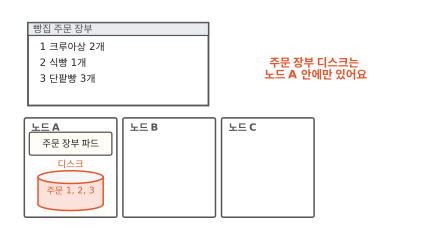

빵집 주문 장부는 PVC로 받은 디스크에 주문을 적어요. PVC는 "이만큼 필요하다"고 적어 내는 디스크 신청서예요([11편](11-persistent-volume.md)). 이 빵집은 클라우드가 빌려주는 디스크를 쓰지 않아요. 노드에 꽂힌 디스크를 써요. 노드는 파드가 도는 컴퓨터 한 대예요. 그래서 주문 장부 디스크는 노드 A 안에만 있어요.

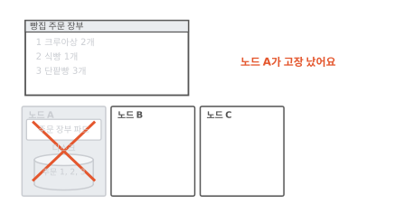

어느 날 노드 A가 고장 났어요.

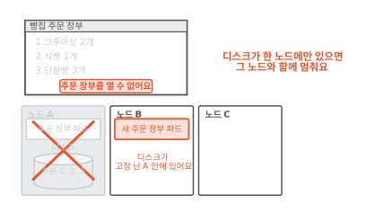

쿠버네티스는 주문 장부 파드를 노드 B에 새로 띄워요. 그런데 디스크는 고장 난 노드 A 안에 있어요. 11편에서는 디스크를 떼어 새 노드에 붙였지만 이번에는 뗄 수가 없어요. 디스크가 노드 A에 꽂혀 있으니까요. 화면은 "주문 장부를 열 수 없어요"만 띄워요. 노드 하나가 고장 나도 주문 장부가 멈추지 않게 하려면 어떻게 해야 할까요?

## 어젯밤에 떠 둔 복사본으로는 안 될까요?

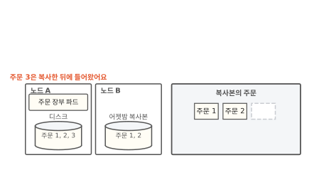

먼저 떠오르는 방법은 밤마다 디스크를 다른 노드에 복사해 두는 거예요. 노드 A가 고장 나면 복사본을 쓰면 돼요. 그림에서 노드 B에 어젯밤 복사본이 있어요. 주문 3은 복사한 뒤에 들어왔어요.

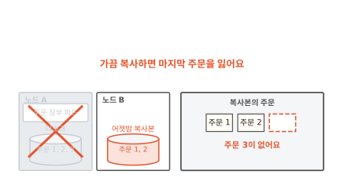

노드 A가 고장 나서 복사본으로 바꿨어요. 주문 1과 2는 있는데 주문 3이 없어요. 복사한 뒤에 들어온 주문은 노드 A에만 있다가 함께 사라졌어요. 복사를 한 시간마다 해도 마지막 한 시간의 주문은 잃어요. 주문이 들어오는 그 순간에 다른 노드에도 적혀 있어야 해요.

## 받아 적는 사람을 셋 두면 어떨까요?

교실에서 선생님이 불러 주는 말을 학생 세 명이 각자 공책에 받아 적는다고 해 봐요. 한 명이 공책을 잃어버려도 나머지 두 권에 같은 내용이 있어요. 그것도 마지막 한 줄까지요. 받아 적는 일은 말이 나오는 그 순간에 일어나니까요.

Longhorn은 이 방법을 디스크에 써요.[^arch] 노드 A, B, C에 같은 내용을 담은 공책을 하나씩 둬요. 이 공책 하나하나를 **볼륨 레플리카**라고 해요. 볼륨은 PVC로 받은 디스크 하나를 가리키는 말이에요. 볼륨 레플리카는 그 볼륨의 온전한 복사본이고 레플리카끼리 같은 노드에 두지 않아요.[^place]

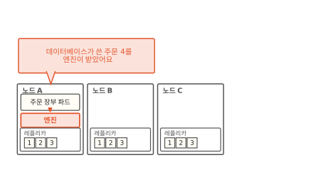

선생님 자리에는 **엔진**이 서요. 엔진은 볼륨마다 하나씩 있고 늘 파드가 뜬 노드에서 돌아요.[^arch] 데이터베이스가 주문 4를 디스크에 쓰면 그 쓰기는 먼저 엔진에 닿아요. 데이터베이스는 엔진이 있는 줄도 몰라요. 보통 디스크에 쓴다고 생각해요.

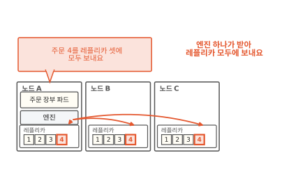

엔진은 받은 쓰기를 레플리카 셋에 모두 보내요. 나중에 모아서 보내지 않고 받는 그때 보내요. Longhorn 문서는 이걸 동기 복제라고 불러요.[^arch] 그래서 주문 4는 들어오는 순간 세 노드에 함께 적혀요. 받아 적기와 다른 점도 있어요. 레플리카는 들은 말을 뜻으로 받아 적지 않아요. 엔진이 보내는 것을 그대로 옮겨 적어요. 엔진은 무엇을 보낼까요?

## 엔진은 파일을 알까요?

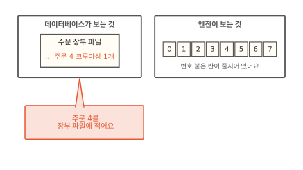

데이터베이스는 "장부 파일에 주문 4를 적는다"고 생각해요. 그런데 엔진 쪽에서 보면 디스크에는 파일이 없어요. 번호 붙은 칸이 길게 줄지어 있을 뿐이에요. 파일은 이 칸들 위에 운영체제가 짜 놓은 정리 방식이에요. 운영체제는 컴퓨터의 부품을 관리하는 바탕 프로그램이에요.

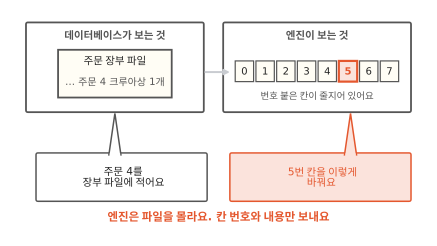

운영체제가 "장부 파일에 주문 4"를 "5번 칸을 이렇게 바꿔라"로 바꿔서 디스크에 보내요. 엔진은 이 칸 단위 요청만 받아서 레플리카에 보내요. 이렇게 번호 붙은 칸 단위로 읽고 쓰는 저장소를 **블록 저장소**라고 해요. Longhorn은 파일이 아닌 칸 단위로 일해요.[^arch]

블록 저장소는 대가가 하나 있어요. 칸 위의 파일 정리 방식은 디스크를 붙인 노드의 운영체제가 들고 있어요. 두 노드가 같은 볼륨을 붙여 각자 칸을 고치면 서로 상대가 무엇을 고쳤는지 몰라요. 그래서 Longhorn 볼륨은 한 번에 한 노드에만 붙여요. 11편에서 본 `ReadWriteOnce` 방식이에요.[^rwo]

??? info "심화: 여러 노드의 파드가 같은 파일을 써야 하면 어떻게 할까요?"
    주문 화면 파드 여럿이 상품 사진 폴더 하나를 함께 써야 할 때 보는 칸이에요.

    Longhorn은 블록 저장소인 볼륨을 그대로 여러 노드에 붙이지 않아요. 대신 볼륨 하나를 붙인 파드 하나가 파일 공유 서버(NFS) 노릇을 해요. 다른 노드의 파드들은 네트워크로 그 서버에 접속해서 파일을 읽고 써요. 이 방식으로 `ReadWriteMany`를 받아 줘요.[^rwx]

    볼륨 자체는 여전히 서버 파드가 있는 노드 하나에만 붙어 있어요. 여러 노드가 함께 쓰는 일은 파일 공유 서버가 맡아요.

## 레플리카가 있는 노드가 죽으면 어떻게 될까요?

이번에는 레플리카를 둔 노드 C가 고장 났어요. 엔진이 노드 C에 보낸 쓰기는 답이 오지 않아요. 엔진은 노드 C의 레플리카를 오류 상태로 표시해요.[^arch]

그다음 쓰기부터는 남은 두 레플리카에만 보내요. 주문 장부 파드는 아무 일 없었다는 듯 계속 돌아요.[^arch] 받아 적던 학생 한 명이 빠져도 수업은 계속되는 것과 같아요. 그런데 이대로 두면 레플리카가 둘뿐이에요. 하나가 더 고장 나면 남는 건 한 권이에요.

Longhorn은 건강한 레플리카 수가 정해 둔 수보다 적으면 새 레플리카를 만들어요. 그림에서는 노드 D에 빈 레플리카를 만들고 건강한 레플리카의 내용을 옮겨 채워요. 이 일을 재구축(rebuild)이라고 해요.[^arch]

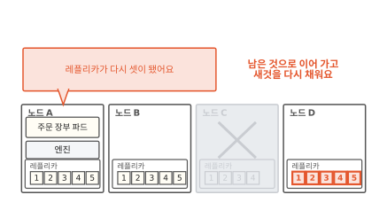

다 채우면 레플리카가 다시 셋이에요. 레플리카가 셋이면 둘까지 잃어도 볼륨이 살아 있어요. 건강한 레플리카가 하나라도 남아 있으면 되니까요.[^arch]

??? info "심화: 재구축하는 동안 들어온 주문은 어디에 적힐까요?"
    재구축이 오래 걸리는 큰 볼륨에서 그사이 들어온 쓰기를 잃지 않는지 궁금할 때 보는 칸이에요.

    엔진은 새 레플리카를 만들자마자 레플리카 명단에 넣어요. 그때부터 들어오는 쓰기는 새 레플리카에도 함께 보내요. 다만 아직 채우는 중이라 새 레플리카에서 읽지는 않아요. 쓰기만 받아요. 그동안 옛 내용은 건강한 레플리카에서 옮겨 와요. 다 옮기면 새 레플리카도 다른 레플리카와 똑같이 쓰여요.[^arch]

??? info "심화: 노드가 잠깐 껐다 켜진 거라면요?"
    노드를 다시 켜는 몇 분 동안 레플리카를 처음부터 새로 채우는 게 아깝다고 느낄 때 보는 칸이에요.

    Longhorn은 오류가 난 레플리카를 바로 버리지 않고 정해 둔 시간 동안 기다려요. 그 안에 노드가 돌아오면 그 레플리카에 남은 데이터를 다시 써서 빠진 부분만 채워요. 기다리는 시간이 지나도 돌아오지 않으면 새 레플리카를 만들어요. 이 시간은 `Replica Replenishment Wait Interval` 설정으로 정해요.[^settings]

    한 노드에 같은 볼륨의 레플리카를 둘 두지 않는 것도 설정으로 정해요(`Replica Node Level Soft Anti-Affinity`). 기본값은 꺼져 있어요. 그래서 레플리카가 없는 노드가 남아 있지 않으면 새 레플리카를 둘 자리를 찾지 못해요. 노드 하나가 죽을 때 레플리카 둘을 한꺼번에 잃지 않으려는 거예요. Longhorn 1.13 기준으로 기본 레플리카 수는 3이에요.[^settings]

## Longhorn은 언제 쓸모 있을까요

먼저 "노드가 고장 나도 남아야 하나요?"를 물어요. 다시 만들 수 있는 캐시는 잃어도 괜찮아요. 이런 데이터는 노드 자기 디스크에 두는 게 가장 가벼워요.

그다음 "저장 장치가 이미 복사본을 두나요?"를 물어요. 저장 장치가 스스로 복사본을 둔다면 그 저장 장치의 CSI 드라이버를 쓰면 돼요. CSI 드라이버는 디스크를 만들어 노드에 붙이는 플러그인이에요(11편). 노드에 꽂힌 디스크밖에 없다면 Longhorn이 그 디스크들을 묶어 복사본을 만들어 줘요.

공짜는 아니에요. 쓰기 하나가 네트워크를 타고 레플리카 수만큼 노드로 가요. 그래서 노드 자기 디스크에 바로 쓰는 것보다 쓰기가 무거워요. 디스크 공간도 레플리카 수만큼 들어요. 레플리카 셋이면 주문 장부 하나가 디스크 세 개를 차지해요.

## 다시 노드 A가 고장 나면

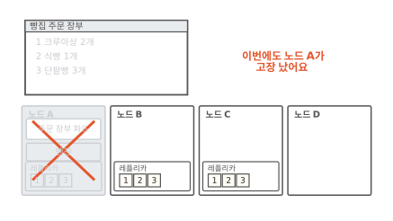

처음 장면으로 돌아왔어요. 이번에는 주문 장부 볼륨을 Longhorn으로 받았어요. 노드 A, B, C에 레플리카가 하나씩 있어요. 그리고 노드 A가 또 고장 났어요.

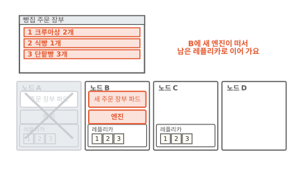

쿠버네티스는 주문 장부 파드를 노드 B에 띄워요. 엔진은 늘 파드 곁에서 도니까 노드 B에 새 엔진이 떠요. 새 엔진은 노드 B와 C에 남은 레플리카로 볼륨을 이어 가요. 화면에 주문 세 건이 그대로 나와요.

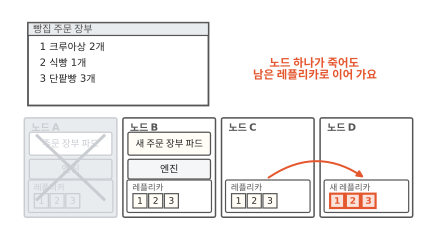

그사이 Longhorn은 노드 D에 새 레플리카를 만들어 다시 셋으로 채워요. 노드가 셋이든 서른이든 어느 노드 하나가 죽어도 주문 장부는 남은 레플리카로 이어 가요.

레플리카 안을 들여다보면 내용이 한 덩어리로 들어 있지 않아요. 층층이 쌓여 있어요. 그 층이 디스크 사진을 순식간에 찍는 방법이에요([13편](13-snapshot.md)).

### 이 편에서 줄여 그린 것

그림을 쉽게 하려고 실제와 다르게 줄인 곳이 세 군데 있어요.

1. 레플리카 안을 주문 번호 칸으로 그렸어요. 실제 레플리카에는 번호 붙은 칸이 들어 있어요. 그 칸들은 시점마다 층(스냅샷)으로 나뉘어 쌓여 있어요.[^arch] 층 이야기는 [13편](13-snapshot.md)에서 봐요.
2. 레플리카를 노드 안의 상자로 그렸어요. 실제로는 노드 디스크에 놓인 파일이에요. 아직 쓰지 않은 칸은 공간을 차지하지 않는 파일(sparse file)이라서 처음부터 볼륨 크기만큼 디스크를 먹지 않아요.[^arch]
3. 엔진에서 데이터베이스까지를 바로 이어 그렸어요. 실제로는 엔진이 노드에 블록 장치를 하나 내놓아요. Longhorn의 CSI 드라이버가 그 장치에 파일 정리 방식을 올리고 컨테이너 폴더에 이어 줘요.[^arch]

### 이 편에서 새로 나온 말

[^arch]: Longhorn 문서 "Architecture and Concepts"(1.13 기준). 볼륨마다 엔진이 하나 있고 엔진은 늘 그 볼륨을 쓰는 파드와 같은 노드에서 돌아요. 엔진은 볼륨을 여러 노드의 레플리카에 동기로 복제해요. 레플리카 하나가 고장 나면 오류로 표시하고 파드는 그대로 돌아요. 건강한 레플리카가 정해 둔 수보다 적으면 새 레플리카를 만들어 재구축하고, 재구축 중인 레플리카에는 쓰기만 보내요. Longhorn은 파일이 아닌 블록 단위로 일하고, 레플리카는 리눅스 sparse file로 만들고, CSI 드라이버가 블록 장치를 포맷해 노드에 이어 줘요. <https://longhorn.io/docs/1.13.0/concepts/>
[^place]: 같은 문서는 레플리카를 서로 다른 노드나 다른 디스크에 두라고 하고, 최대한 버티려면 서로 다른 노드에 두라고 해요. <https://longhorn.io/docs/1.13.0/concepts/>
[^rwo]: 같은 Longhorn 문서는 이런 블록 저장소가 본래 `ReadWriteOnce`라서 파드끼리 나눠 쓸 수 없다고 해요. `ReadWriteOnce`의 뜻은 쿠버네티스 문서 "Persistent Volumes"의 Access Modes 절. <https://kubernetes.io/docs/concepts/storage/persistent-volumes/#access-modes>
[^rwx]: Longhorn 문서 "ReadWriteMany (RWX) Volume": 보통 Longhorn 볼륨을 share-manager 파드 안의 NFSv4 서버로 내놓아 RWX를 받아 줘요. <https://longhorn.io/docs/1.13.0/nodes-and-volumes/volumes/rwx-volumes/>
[^settings]: Longhorn 문서 "Settings Reference"(1.13 기준)의 Default Replica Count, Replica Node Level Soft Anti-Affinity, Replica Replenishment Wait Interval. <https://longhorn.io/docs/1.13.0/references/settings/>
