# 스냅샷은 어떻게 순식간에 찍힐까요?

## 누르자마자 완료가 떠요

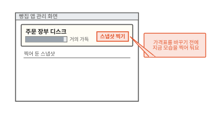

동네 빵집 주문 앱에는 주문 장부가 있어요. 손님이 넣은 주문을 적어 두는 데이터베이스예요. 사장님이 가격표를 한꺼번에 바꾸려고 해요. 일이 잘못되면 지금 모습으로 돌아오고 싶어요. 그래서 관리 화면의 "스냅샷 찍기"를 눌렀어요.

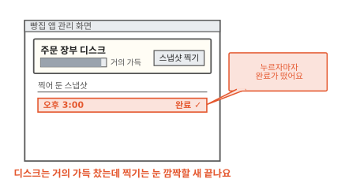

누르자마자 "완료"가 떴어요. 주문 장부 디스크는 거의 가득 차 있었어요. 디스크 전체를 어딘가에 옮겨 적었다면 이렇게 빠를 수 없어요. 무엇을 했길래 순식간에 끝났을까요?

답을 보려면 먼저 디스크 안이 어떻게 생겼는지 봐야 해요.

## 디스크는 같은 크기의 칸으로 나뉘어 있어요

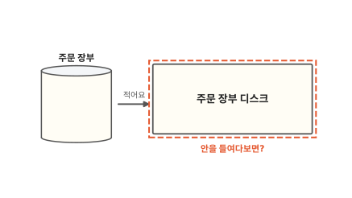

주문 장부는 주문을 디스크에 적어요. 디스크는 전원이 꺼져도 내용이 남는 저장 장치예요([컴퓨터 5편](../computer/05-where-computers-remember.md)). 쿠버네티스에서는 파드가 디스크 신청서인 PVC를 내면 실제 디스크인 PV가 붙어요([11편](11-persistent-volume.md)).

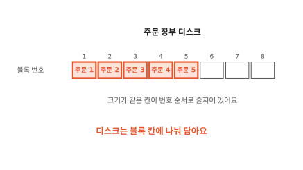

디스크 안을 들여다보면 크기가 같은 칸이 번호 순서로 줄지어 있어요. 그림에서는 8칸이고 1번부터 5번 칸에 주문 1부터 5까지 들어 있어요. 6번부터 8번 칸은 아직 비었어요.

디스크를 나눈 이 칸 하나를 **블록**(block)이라고 해요.

디스크는 파일 이름을 몰라요. "3번 블록을 읽어 줘", "6번 블록에 이걸 써 줘"처럼 번호로만 부탁을 받아요. 이 블록들을 사진처럼 남기려면 어떻게 해야 할까요?

## 다 복사하는 방법은 느려요

먼저 느린 방법부터 볼게요.

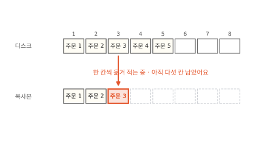

가장 먼저 떠오르는 방법은 블록을 처음부터 끝까지 다른 자리에 옮겨 적는 거예요. 그림에서는 3번 블록까지 옮겼고 다섯 칸이 남았어요.

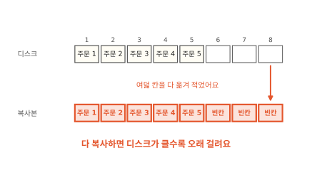

여덟 칸이면 금방이에요. 실제 디스크에는 블록이 아주 많아요. 다 옮기려면 블록 수에 비례해 시간이 걸려요. 처음 장면처럼 누르자마자 끝날 수 없어요. 옮기는 동안 주문이 들어오면 앞쪽 블록과 끝쪽 블록이 서로 다른 순간의 모습이 되기도 해요.

그래서 스냅샷은 블록을 옮기지 않아요. 그럼 무엇을 할까요?

## 찍는 순간 빈 투명 필름을 한 장 덮어요

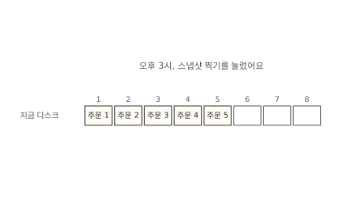

오후 3시에 스냅샷 찍기를 눌렀어요. 디스크에는 주문 1부터 5까지 들어 있어요.

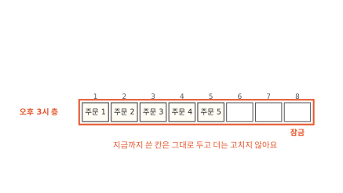

먼저 지금까지 쓴 블록을 한 층으로 묶어 잠가요. 이 층은 이제 고치지 않아요. 그림의 "오후 3시 층"이에요.

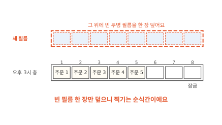

그리고 그 위에 빈 층을 하나 덮어요. 그림 위에 투명 필름을 덮는 것과 같아요. 필름이 비어 있으니 아래 그림이 그대로 비쳐 보여요. 블록은 한 칸도 옮기지 않았어요. 빈 필름 한 장을 놓는 일은 디스크가 크든 작든 똑같이 짧아요.

이렇게 어느 순간의 디스크 모습을 잠가 둔 층을 **스냅샷**(snapshot)이라고 해요. Longhorn 문서도 스냅샷을 이미지의 층처럼 설명해요. 가장 오래된 스냅샷이 맨 아래 층이고 새 스냅샷이 그 위에 쌓여요.[^lh-snap]

컨테이너 이미지도 투명 필름처럼 층을 겹쳐요. 고친 것은 맨 위 층에만 쓰고 아래층은 건드리지 않아요. 이 방식을 쓸 때 복사라고 불러요([2편](02-image-layers.md)). 스냅샷도 같은 방식이에요. 다른 점은 파일이 아닌 블록 칸 단위로 위층에 쓴다는 거예요.

??? info "심화: 찍는 순간 메모리에 있던 내용은 어떻게 될까요?"
    주문 장부가 한창 바쁠 때 스냅샷을 찍어도 괜찮은지 궁금할 때 보는 칸이에요.

    데이터베이스는 받은 주문을 곧바로 디스크에 쓰지 않고 메모리에 잠시 들고 있기도 해요. 메모리는 전원이 꺼지면 내용이 사라지는 빠른 작업 공간이에요. 스냅샷은 디스크의 블록만 잠가요. 메모리에만 있던 내용은 스냅샷에 들어가지 않아요.

    그래서 스냅샷으로 되돌린 디스크는 전원이 갑자기 꺼졌던 컴퓨터의 디스크와 같은 상태예요. 데이터베이스는 보통 이런 상태에서 다시 켜는 방법을 갖추고 있어요. 다시 켜면서 기록을 맞춰요.

    쿠버네티스 문서는 이런 사진을 crash-consistent하다고 불러요.[^k8s-group] 앱이 하던 일을 멈추고 메모리 내용까지 디스크에 다 써 둔 뒤에 찍으면 다시 켤 때 맞출 일이 줄어요.

그런데 찍은 뒤에도 주문은 계속 들어와요. 새 주문은 어디에 쓸까요?

## 찍은 뒤에 바뀐 블록만 위층에 써요

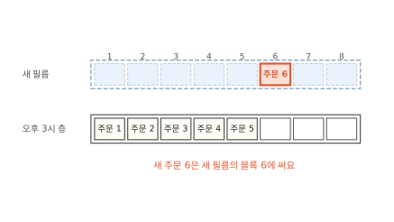

주문 6이 들어왔어요. 디스크는 6번 블록에 쓰려고 해요. 오후 3시 층은 잠겨 있으니 새 필름의 6번 칸에 써요.

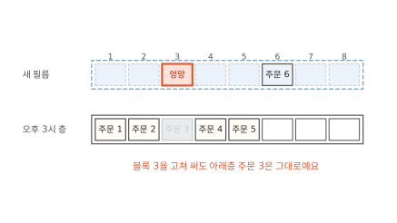

이번에는 가격표를 바꾸다 실수를 해서 3번 블록이 엉망으로 덮어써졌어요. 이것도 새 필름의 3번 칸에 써요. 아래층의 주문 3은 그대로 남아요. 그림에서 흐리게 그린 건 위에 가려서 지금은 읽히지 않는다는 뜻이에요.

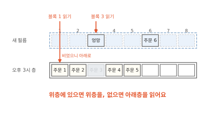

읽을 때는 위층부터 봐요. 3번 블록을 읽으면 새 필름에 "엉망"이 있으니 그걸 읽어요. 1번 블록은 새 필름이 비었으니 아래층의 주문 1을 읽어요. 앱은 층이 몇 장인지 몰라요. 디스크 하나를 쓰는 것처럼 읽고 써요.

새 필름에 쌓이는 건 찍은 뒤에 바뀐 블록뿐이에요. 그래서 스냅샷이 늘리는 자리도 바뀐 블록만큼이에요. 이제 가격표 실수를 되돌려 볼까요?

## 되돌리기는 위층을 떼어 내는 일이에요

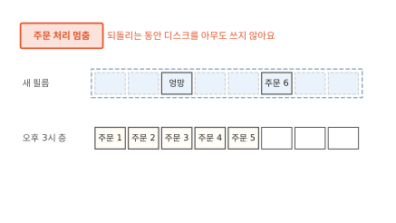

되돌리기 전에 주문 처리를 멈춰서 디스크를 쓰는 프로그램이 없게 해요. 주문 처리는 디스크에서 읽은 내용 일부를 메모리에 들고 있어요. 그 밑에서 디스크가 옛 모습으로 바뀌면 메모리와 디스크가 서로 어긋나요. 쓰던 블록이 반쯤만 남을 수도 있어요. Longhorn도 되돌릴 때는 볼륨을 앱이 쓸 수 없는 정비 상태로 둬요.[^lh-revert]

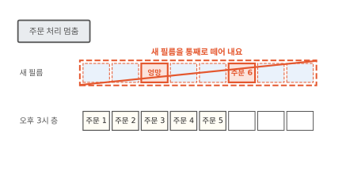

그다음 새 필름을 통째로 떼어 내요. 블록을 한 칸씩 되돌려 적지 않아요.

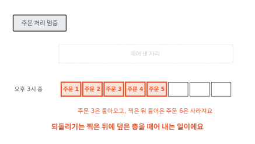

이제 맨 위는 오후 3시 층이에요. 3번 블록은 다시 주문 3이에요. 찍은 뒤에 들어온 주문 6도 함께 사라졌어요. 되돌리기는 찍은 뒤의 변경을 하나하나 고르지 않아요. 위층에 쓴 것을 한꺼번에 버려요.

??? info "심화: 쿠버네티스에서는 스냅샷을 어떻게 찍고 되돌릴까요?"
    관리 화면 대신 쿠버네티스 매니페스트로 스냅샷을 다루고 싶을 때 보는 칸이에요.

    쿠버네티스에는 `VolumeSnapshot`이라는 문서 종류가 있어요. 어느 PVC를 찍을지 적어 두면 디스크를 만들어 붙이는 플러그인인 CSI 드라이버가 저장 시스템에 스냅샷을 찍게 해요.[^k8s-snap]

    되돌릴 때는 기존 디스크를 바꾸지 않아요. 새 PVC를 만들면서 `dataSource`에 그 스냅샷 이름을 적어요. 그러면 스냅샷 모습을 담은 새 디스크가 생겨요. 앱이 새 PVC를 쓰도록 바꾸면 되돌린 것과 같아요. 원래 디스크는 남아 있어서 마음이 바뀌면 그쪽으로 돌아갈 수도 있어요.

여기까지는 디스크가 멀쩡하다는 전제였어요. 디스크를 통째로 잃으면 어떻게 될까요?

## 스냅샷과 백업은 사는 곳이 달라요

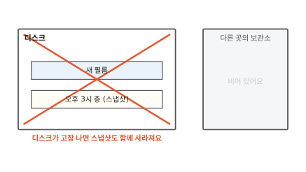

스냅샷의 층은 모두 같은 디스크 안에 있어요. Longhorn은 볼륨마다 엔진 하나가 쓰기를 받아 여러 노드의 볼륨 레플리카에 똑같이 보내요([12편](12-longhorn.md)). 스냅샷도 볼륨 레플리카마다 그 일부로 저장돼요.[^lh-snap] 노드 하나가 고장 나면 남은 레플리카에 스냅샷이 남아요. 하지만 실수로 볼륨을 지우면 스냅샷도 함께 사라져요.

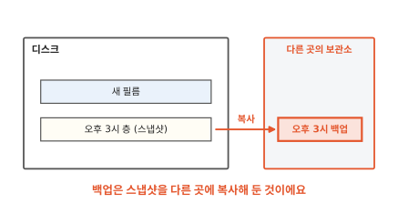

그래서 스냅샷 하나를 골라 디스크 바깥의 보관소로 복사해 둬요. 이것을 **백업**(backup)이라고 해요. Longhorn은 백업을 클러스터 바깥의 NFS나 S3 호환 저장소에 둬요.[^lh-snap]

백업은 블록을 실제로 옮겨 적어요. 그래서 스냅샷처럼 순식간에 끝나지 않아요. 스냅샷은 같은 디스크 안에서 빨리 되돌리는 데 쓰고 백업은 디스크를 잃었을 때 살리는 데 써요.

지금까지는 주문 장부 하나만 찍었어요. 저장소가 둘이면 무엇이 달라질까요?

## 저장소 두 개는 뒤쪽부터 찍어요

손님이 지난 주문을 낱말로 찾을 수 있게 빵집 앱에 주문 검색 저장소를 붙였다고 해 볼게요. 저장소가 둘일 때만 생기는 문제라서 예시에 부품을 하나 더했어요. 검색 저장소는 장부가 바뀔 때마다 바뀐 주문을 받아 자기 쪽에 적어요. 장부가 앞쪽이고 검색 저장소는 받아 쓰는 뒤쪽이에요.

두 저장소는 디스크가 따로라서 스냅샷도 따로 찍어요. 두 번 누르는 사이에도 주문은 들어와요.

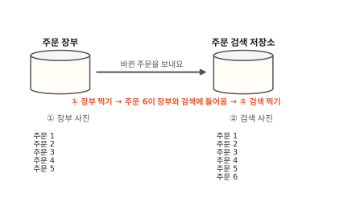

장부를 먼저 찍었어요. 그 사이 주문 6이 들어와 검색 저장소까지 갔어요. 그다음 검색 저장소를 찍었어요.

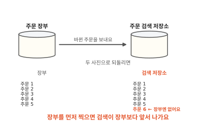

두 사진으로 되돌리면 검색 저장소에는 주문 6이 있는데 장부에는 없어요. 손님이 검색에서 주문 6을 눌러도 장부에서 찾을 수 없어요. 검색 저장소는 장부가 보내 준 것만 고쳐요. 장부가 모르는 주문 6을 지우라는 연락은 오지 않아요.

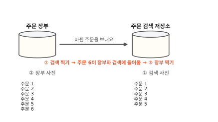

순서를 바꿔요. 검색 저장소를 먼저 찍고 주문 6이 들어온 뒤에 장부를 찍어요.

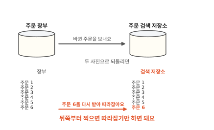

되돌리면 이번에는 장부에 주문 6이 있고 검색 저장소에는 없어요. 검색 저장소가 뒤처졌을 뿐이에요. 마지막으로 받은 주문 다음부터 다시 받으면 따라잡아요. 장부 내용으로 검색 저장소를 다시 채워도 돼요.

변경을 받아 쓰는 뒤쪽은 앞쪽보다 앞서 나가면 안 돼요. 뒤처진 것은 따라잡으면 돼요. 앞서 나간 것은 바로잡을 근거가 없어요. 그래서 뒤쪽부터 찍어요. 저장소 셋이 줄줄이 이어져 있어도 맨 끝에서부터 앞쪽으로 찍어요.

??? info "심화: 디스크 여러 개를 한 순간에 찍을 수는 없을까요?"
    찍는 순서를 따지지 않고 한 번에 같은 순간을 남길 방법이 있는지 궁금할 때 보는 칸이에요.

    같은 저장 시스템 안의 디스크끼리는 할 수 있어요. 쿠버네티스에는 PVC 여러 개를 라벨로 묶어 한 순간에 찍게 하는 `VolumeGroupSnapshot`이 있어요. 쿠버네티스 1.36에서 정식 기능이 됐고 CSI 드라이버가 이 기능을 갖춰야 써요.[^k8s-group]

    주문 장부와 검색 저장소가 서로 다른 저장 시스템에 있으면 이 방법으로 묶을 수 없어요. 그때는 본문의 순서 원리로 맞춰요.

## 스냅샷은 언제 쓸모 있을까요?

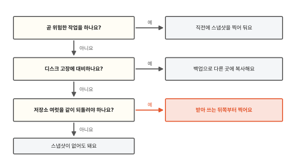

스냅샷은 찍기가 빨라서 위험한 작업 바로 앞에 부담 없이 찍어 둘 수 있어요. 가격표 바꾸기, 앱 새 버전 올리기, 데이터 한꺼번에 고치기가 그런 작업이에요. 디스크를 잃는 일까지 대비하려면 스냅샷을 백업으로 바깥에 복사해요. 저장소 여럿을 같은 순간으로 되돌려야 하면 받아 쓰는 뒤쪽부터 찍어요.

Longhorn에는 블록을 더 빨리 읽고 쓰는 새 저장 엔진도 있어요. 무엇이 다른지는 [14편](14-longhorn-v2-spdk.md)에서 이어 가요.

## 다시 스냅샷 찍기를 눌러 볼게요

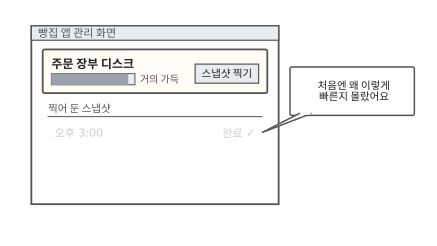

처음 장면의 관리 화면으로 돌아왔어요. 그때는 거의 가득 찬 디스크가 어떻게 순식간에 찍혔는지 몰랐어요.

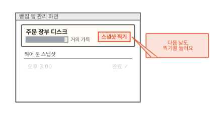

다음 날 가격표를 또 바꾸려고 찍기를 다시 눌러요.

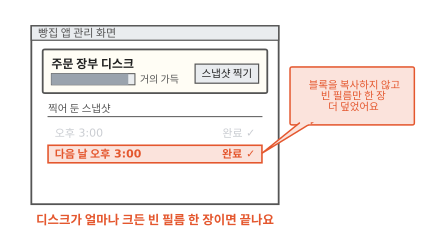

이번에도 블록은 한 칸도 옮기지 않았어요. 지금 맨 위 층을 잠그고 빈 필름을 한 장 더 덮었어요. 디스크가 작든 크든 스냅샷 찍기는 빈 필름 한 장을 덮는 일로 끝나요.

### 이 편에서 줄여 그린 것

그림을 쉽게 하려고 실제와 다르게 줄인 곳이 세 군데 있어요.

1. 블록 하나에 주문 하나를 그렸어요. 실제 블록은 아주 많고 데이터베이스는 주문을 자기 파일 형식으로 나눠 적어요. 주문 하나가 여러 블록에 걸치기도 하고 블록 하나에 주문 여럿이 들기도 해요.
2. 층을 두 장만 그렸어요. 스냅샷을 여러 번 찍으면 층이 여러 장 쌓여요. 블록을 읽을 때는 위층부터 차례로 내려가며 그 칸이 처음 채워진 층을 찾아요.
3. 장부에서 검색 저장소로 가는 길을 화살표 하나로 그렸어요. 실제로는 바뀐 내용을 모아 보내는 프로그램이 따로 있고 바뀐 주문은 조금 늦게 도착해요.

### 이 편에서 새로 나온 말

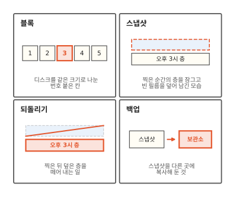

[^lh-snap]: Longhorn 문서는 스냅샷을 이미지의 층에 빗대고, 스냅샷은 볼륨 레플리카마다 그 일부로 저장되며 백업은 클러스터 바깥의 NFS나 S3 호환 백업 저장소에 둔다고 설명해요. Longhorn 1.13 기준. <https://longhorn.io/docs/1.13.0/concepts/>
[^lh-revert]: 같은 문서에 따르면 Longhorn 0.6.0부터 스냅샷 되돌리기에는 볼륨이 정비 모드(maintenance mode)여야 해요. 정비 모드는 볼륨을 붙이되 앱이 읽고 쓰는 입구는 열지 않는 상태예요. <https://longhorn.io/docs/1.13.0/concepts/>
[^k8s-snap]: <https://kubernetes.io/docs/concepts/storage/volume-snapshots/>
[^k8s-group]: 쿠버네티스 1.27에 알파로 들어왔고 1.36에서 정식 기능이 됐어요. <https://kubernetes.io/blog/2026/05/08/kubernetes-v1-36-volume-group-snapshot-ga/>
