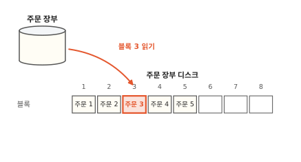
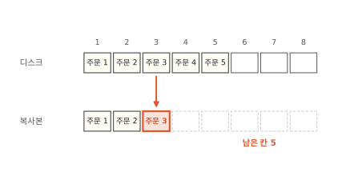
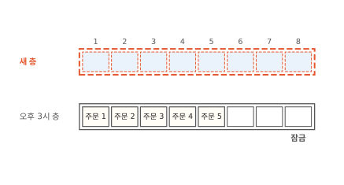
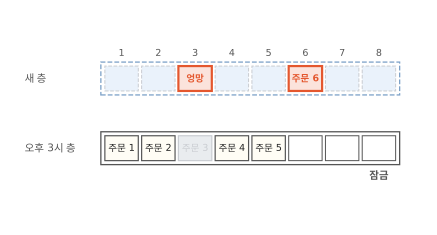
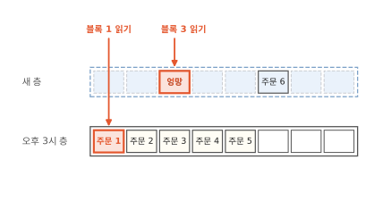
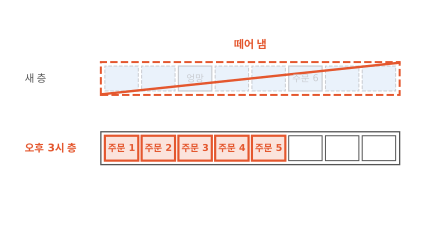
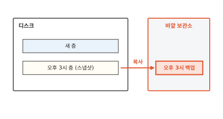
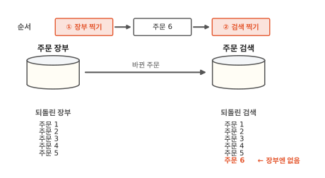
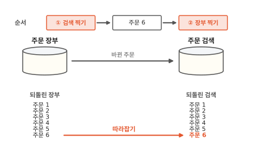

# 스냅샷: 디스크를 순식간에 찍고 되돌리는 방법

동네 빵집 주문 앱의 사장님이 가격표를 한꺼번에 바꾸기 전에 되돌아올 자리를 남기려고 "스냅샷 찍기"를 눌렀어요. 주문 장부 디스크는 거의 가득 차 있었는데 누르자마자 "완료"가 떴어요. 이 글을 읽고 나면 스냅샷이 디스크를 복사하지 않고도 지금 모습을 남기는 방법을 알게 돼요. 그러면 스냅샷을 언제 믿어도 되는지와 언제 백업이 따로 필요한지가 보여요.

!!! abstract "이 글에서 알게 되는 것"
    1. 스냅샷은 블록을 복사하지 않아요. 지금까지 쓴 블록을 한 층으로 잠그고 그 위에 빈 층을 하나 덮어서 디스크가 아무리 커도 순식간에 끝나요.
    2. 찍은 뒤에 바뀐 블록은 위층에만 써요. 그래서 되돌리기는 위층을 떼어 내는 일이에요. 다만 층이 모두 같은 디스크에 있어서 디스크를 잃는 일에는 바깥에 복사해 둔 백업이 필요해요.
    3. 한 저장소가 다른 저장소의 변경을 받아 쓴다면 받아 쓰는 쪽부터 찍어요. 그래야 되돌린 뒤에 따라잡기만 하면 돼요.

## 1. 디스크를 통째로 복사하면 디스크가 클수록 오래 걸려요

빵집 앱의 주문 장부는 주문을 적어 두는 데이터베이스예요. 주문 장부는 주문을 디스크에 적어요. 디스크는 전원이 꺼져도 내용이 남는 저장 장치예요([컴퓨터 5편](../computer/05-where-computers-remember.md)). 쿠버네티스에서는 파드가 디스크 신청서인 PVC를 내면 실제 디스크인 PV가 붙어요([11편](11-persistent-volume.md)).

디스크 안을 들여다보면 크기가 같은 칸이 번호 순서로 줄지어 있어요. 이 칸 하나를 **블록**이라고 해요. 디스크는 파일 이름을 몰라요. "3번 블록을 읽어 줘", "6번 블록에 이걸 써 줘"처럼 번호로만 부탁을 받아요.

아래 그림은 칸이 8개뿐인 작은 디스크예요. 1번부터 5번 블록에 주문 1부터 5가 들어 있고 6번부터 8번은 비었어요. 빨간 화살표가 3번 블록을 가리키는 걸 보세요.

**그림 1.** 주문 장부는 디스크에 "3번 블록"처럼 번호로 읽기를 부탁해요.
{ .fig-cap }

이 디스크의 지금 모습을 남기려면 어떻게 할까요? 가장 먼저 떠오르는 방법은 블록을 1번부터 차례로 다른 자리에 옮겨 적는 거예요. 아래 그림은 3번 블록까지 옮긴 모습이에요. 아래 줄에 남은 점선 칸을 세어 보세요.

**그림 2.** 한 칸씩 옮겨 적는 중이고 아직 다섯 칸이 남았어요.
{ .fig-cap }

8칸이면 금방이에요. 그런데 실제 디스크에는 블록이 아주 많아요. 다 옮기려면 블록 수만큼 시간이 걸려요. 디스크가 두 배로 크면 두 배로 오래 걸리는 거예요. 처음 장면처럼 누르자마자 끝날 수 없어요.

문제가 하나 더 있어요. 옮기는 동안에도 주문은 들어와요. 1번 블록을 옮길 때와 8번 블록을 옮길 때 사이에 디스크가 바뀌면 복사본의 앞쪽과 끝쪽이 서로 다른 순간의 모습이 돼요. 그래서 스냅샷은 블록을 옮기지 않아요.

## 2. 스냅샷은 지금 모습을 잠그고 빈 층을 하나 덮어요

오후 3시에 스냅샷 찍기를 눌렀어요. 디스크에는 주문 1부터 5까지 들어 있어요.

Longhorn 같은 저장 시스템은 먼저 지금까지 쓴 블록 전체를 한 층으로 묶어 잠가요. 이 층은 이제 고치지 않아요. 그리고 그 위에 빈 층을 하나 덮어요. 그림 위에 투명 필름을 한 장 덮는다고 생각해 보세요. 필름이 비어 있으니 아래 그림이 그대로 비쳐 보여요.

아래 그림에서 빨간 점선으로 그린 새 층을 보세요.

**그림 3.** 오후 3시 층은 잠겼고 그 위에 빈 새 층이 덮였어요.
{ .fig-cap }

블록은 한 칸도 옮기지 않았어요. 층 하나를 잠그고 빈 층 하나를 놓는 일은 디스크가 크든 작든 똑같이 짧아요. 그래서 누르자마자 끝났던 거예요.

이렇게 어느 순간의 디스크 모습을 잠가 둔 층을 **스냅샷**이라고 해요. 그림의 "오후 3시 층"이 스냅샷이에요. Longhorn 문서도 스냅샷을 이미지의 층처럼 설명해요. 가장 오래된 스냅샷이 맨 아래에 있고 새 스냅샷이 그 위에 쌓여요.[^lh-snap]

층을 겹치는 방식은 [2편](02-image-layers.md)에서도 봤어요. 컨테이너 이미지도 고친 것은 맨 위 층에만 쓰고 아래층은 건드리지 않았어요. 이걸 쓸 때 복사라고 불렀죠. 스냅샷도 같은 방식인데 파일 대신 블록 칸 단위로 위층에 써요.

## 3. 찍은 뒤에 바뀐 블록은 위층에만 써요

찍은 뒤에도 주문은 계속 들어와요. 주문 6이 들어와서 디스크가 6번 블록에 쓰려고 해요. 오후 3시 층은 잠겨 있으니 새 층의 6번 칸에 써요.

이번에는 사장님이 가격표를 바꾸다 실수를 해서 3번 블록이 엉망으로 덮어써졌어요. 이것도 새 층의 3번 칸에 써요. 아래 그림에서 아래층의 주문 3이 어떻게 됐는지 보세요.

**그림 4.** 새로 쓴 두 블록은 새 층에 들어갔고 아래층의 주문 3은 지워지지 않았어요.
{ .fig-cap }

주문 3은 그대로 남아 있어요. 흐리게 그린 건 위에 "엉망"이 덮여서 지금은 읽히지 않는다는 뜻이에요.

읽을 때는 위층부터 봐요. 위층에 그 칸이 있으면 위층을 읽고 비었으면 아래층으로 내려가요. 아래 그림에서 빨간 화살표 두 개가 어디서 멈추는지 보세요.

**그림 5.** 3번 블록은 새 층에서 읽고 1번 블록은 아래층까지 내려가서 읽어요.
{ .fig-cap }

주문 장부는 층이 몇 장인지 몰라요. 디스크 하나를 쓰는 것처럼 읽고 써요. 새 층에 쌓이는 건 찍은 뒤에 바뀐 블록뿐이에요. 그래서 스냅샷이 차지하는 자리도 바뀐 블록만큼만 늘어요.

## 4. 되돌리기는 위층을 떼어 내는 일이에요

이제 가격표 실수를 되돌려 볼게요.

먼저 주문 처리를 멈춰서 디스크를 쓰는 프로그램이 없게 해요. 주문 처리는 디스크에서 읽은 내용 일부를 메모리에 들고 있어요. 메모리는 전원이 꺼지면 내용이 사라지는 빠른 작업 공간이에요. 그 밑에서 디스크가 옛 모습으로 바뀌면 메모리와 디스크가 서로 어긋나요. 쓰던 블록이 반쯤만 남을 수도 있고요. Longhorn도 되돌릴 때는 볼륨을 앱이 쓸 수 없는 정비 상태로 둬요.[^lh-revert]

그다음 새 층을 통째로 떼어 내요. 아래 그림에서 빨간 사선이 그어진 새 층과 빨갛게 칠한 아래층을 보세요.

**그림 6.** 새 층을 떼어 내면 오후 3시 층이 다시 맨 위가 돼요.
{ .fig-cap }

이제 3번 블록을 읽으면 다시 주문 3이 나와요. 그런데 찍은 뒤에 들어온 주문 6도 함께 사라졌어요. 되돌리기는 찍은 뒤의 변경을 하나하나 골라내지 않아요. 위층에 쓴 것을 한꺼번에 버려요. 블록을 한 칸씩 되돌려 적지도 않으니 되돌리기도 빨라요.

## 5. 디스크를 잃는 일에는 바깥에 둔 백업이 필요해요

여기까지는 디스크가 멀쩡하다는 전제였어요. 스냅샷의 층은 모두 같은 디스크 안에 있어요.

Longhorn은 볼륨마다 엔진 하나가 쓰기를 받아 여러 노드의 볼륨 레플리카에 똑같이 보내요([12편](12-longhorn.md)). 스냅샷도 볼륨 레플리카마다 그 일부로 저장돼요.[^lh-snap] 그래서 노드 하나가 고장 나도 남은 레플리카에 스냅샷이 남아요. 하지만 실수로 볼륨을 지우면 스냅샷도 함께 사라져요.

그래서 스냅샷 하나를 골라 디스크 바깥의 보관소로 복사해 둬요. 이것을 **백업**이라고 해요. Longhorn은 백업을 클러스터 바깥의 NFS나 S3 호환 저장소에 둬요.[^lh-snap] 아래 그림에서 빨간 화살표가 어디로 가는지 보세요.

**그림 7.** 오후 3시 스냅샷을 디스크 바깥 보관소로 복사한 것이 백업이에요.
{ .fig-cap }

백업은 블록을 실제로 옮겨 적어요. 그래서 스냅샷처럼 순식간에 끝나지 않아요. 둘은 쓰는 자리가 달라요. 스냅샷은 같은 디스크 안에서 빨리 되돌리는 데 쓰고 백업은 디스크를 통째로 잃었을 때 살리는 데 써요.

## 6. 저장소 두 개는 받아 쓰는 쪽부터 찍어요

지금까지는 주문 장부 하나만 찍었어요. 이번에는 빵집 앱에 주문 검색 저장소를 붙였다고 해 볼게요. 손님이 지난 주문을 낱말로 찾을 수 있게 하는 저장소예요. 저장소가 둘일 때만 생기는 문제를 보려고 예시에 부품을 하나 더했어요.

검색 저장소는 장부가 바뀔 때마다 바뀐 주문을 받아 자기 쪽에 적어요. 장부가 보내는 쪽이고 검색 저장소는 받아 쓰는 쪽이에요. 두 저장소는 디스크가 따로라서 스냅샷도 따로 찍어요. 그런데 두 번 누르는 사이에도 주문은 들어와요.

장부를 먼저 찍어 볼게요. 장부를 찍은 다음 주문 6이 들어와 검색 저장소까지 갔어요. 그다음 검색 저장소를 찍었어요. 아래 그림의 맨 아래에서 두 사진으로 되돌린 모습을 보세요.

**그림 8.** 장부를 먼저 찍으면 되돌린 검색 저장소에만 주문 6이 남아요.
{ .fig-cap }

손님이 검색에서 주문 6을 눌러도 장부에서는 찾을 수 없어요. 그렇다고 검색 저장소가 스스로 주문 6을 지우지도 않아요. 검색 저장소는 장부가 보내 준 것만 고치는데 장부는 주문 6을 모르니 지우라는 연락을 보내지 않아요.

이번에는 순서를 바꿔요. 검색 저장소를 먼저 찍고 주문 6이 들어온 다음에 장부를 찍어요. 아래 그림에서 빨간 화살표를 보세요.

**그림 9.** 검색 저장소를 먼저 찍으면 검색 저장소가 주문 6을 다시 받아 따라잡아요.
{ .fig-cap }

이번에는 장부에 주문 6이 있고 검색 저장소에는 없어요. 검색 저장소가 조금 뒤처졌을 뿐이에요. 마지막으로 받은 주문 다음부터 다시 받으면 따라잡아요. 장부 내용으로 검색 저장소를 처음부터 다시 채워도 되고요.

받아 쓰는 쪽은 뒤처져도 괜찮아요. 따라잡으면 되거든요. 앞서 나가면 바로잡을 근거가 없어요. 그래서 받아 쓰는 쪽부터 찍어요. 저장소 셋이 줄줄이 이어져 있다면 맨 끝 저장소부터 거슬러 올라가며 찍어요.

??? info "찍는 순간 메모리에만 있던 내용은 어떻게 될까요"
    데이터베이스는 받은 주문을 곧바로 디스크에 쓰지 않고 메모리에 잠시 들고 있기도 해요. 스냅샷은 디스크의 블록만 잠가요. 메모리에만 있던 내용은 스냅샷에 들어가지 않아요.

    그래서 스냅샷으로 되돌린 디스크는 전원이 갑자기 꺼졌던 컴퓨터의 디스크와 같은 상태예요. 데이터베이스는 보통 이런 상태에서 다시 켜지면서 기록을 맞추는 방법을 갖추고 있어요. 쿠버네티스 문서는 이런 사진을 crash-consistent하다고 불러요.[^k8s-group] 앱이 하던 일을 멈추고 메모리 내용까지 디스크에 다 쓴 다음에 찍으면 다시 켤 때 맞출 일이 줄어요.

??? info "쿠버네티스에서 스냅샷을 찍고 되돌리는 문서"
    쿠버네티스에는 `VolumeSnapshot`이라는 문서 종류가 있어요. 어느 PVC를 찍을지 적어 두면 디스크를 만들어 붙이는 플러그인인 CSI 드라이버가 저장 시스템에 스냅샷을 찍게 해요.[^k8s-snap]

    되돌릴 때는 기존 디스크를 바꾸지 않아요. 새 PVC를 만들면서 `dataSource`에 그 스냅샷 이름을 적어요. 그러면 스냅샷 모습을 담은 새 디스크가 생겨요. 앱이 새 PVC를 쓰도록 바꾸면 되돌린 것과 같아요. 원래 디스크는 남아 있어서 마음이 바뀌면 그쪽으로 돌아갈 수도 있어요.

    PVC 여러 개를 라벨로 묶어 한 순간에 찍는 `VolumeGroupSnapshot`도 있어요. 쿠버네티스 1.36에서 정식 기능이 됐고 CSI 드라이버가 이 기능을 갖춰야 써요.[^k8s-group] 같은 저장 시스템 안의 디스크끼리만 묶을 수 있어요. 주문 장부와 검색 저장소가 서로 다른 저장 시스템에 있으면 6절의 순서로 맞춰요.

## 정리

처음 장면에서 거의 가득 찬 디스크가 순식간에 찍힌 건 블록을 한 칸도 옮기지 않았기 때문이에요. 스냅샷은 지금까지 쓴 블록을 오후 3시 층으로 잠그고 그 위에 빈 층을 하나 덮어요. 디스크 크기와 상관없이 할 일은 그것뿐이에요.

찍은 뒤에 들어온 주문 6과 엉망이 된 3번 블록은 새 층에만 쓰여요. 되돌리기는 그 새 층을 떼어 내는 일이라서 주문 3은 돌아오고 주문 6은 함께 사라져요. 층이 모두 같은 디스크 안에 있으니 볼륨을 잃는 일에 대비하려면 스냅샷을 바깥 보관소에 복사한 백업을 둬요. 주문 장부와 검색 저장소처럼 이어진 저장소는 받아 쓰는 검색 저장소부터 찍어야 되돌린 뒤에 따라잡기만 하면 돼요.

[14편](14-longhorn-v2-spdk.md)에서는 Longhorn이 블록을 더 빨리 읽고 쓰려고 만든 새 저장 엔진을 봐요.

### 새로 나온 말

- **블록**: 디스크를 같은 크기로 나눈 번호 붙은 칸. 주문 장부는 "3번 블록을 읽어 줘"처럼 번호로 부탁해요.
- **스냅샷**: 어느 순간의 디스크 모습을 잠가 둔 층. 오후 3시 층이 스냅샷이고 그 뒤의 변경은 위에 덮은 새 층에 쌓여요.
- **백업**: 스냅샷을 디스크 바깥의 보관소에 복사해 둔 것. 볼륨을 통째로 잃어도 백업으로 살려요.

[^lh-snap]: Longhorn 문서는 스냅샷을 이미지의 층에 빗대고, 스냅샷은 볼륨 레플리카마다 그 일부로 저장되며 백업은 클러스터 바깥의 NFS나 S3 호환 백업 저장소에 둔다고 설명해요. Longhorn 1.13 기준. <https://longhorn.io/docs/1.13.0/concepts/>
[^lh-revert]: 같은 문서에 따르면 Longhorn 0.6.0부터 스냅샷 되돌리기에는 볼륨이 정비 모드(maintenance mode)여야 해요. 정비 모드는 볼륨을 붙이되 앱이 읽고 쓰는 입구는 열지 않는 상태예요. <https://longhorn.io/docs/1.13.0/concepts/>
[^k8s-snap]: <https://kubernetes.io/docs/concepts/storage/volume-snapshots/>
[^k8s-group]: 쿠버네티스 1.27에 알파로 들어왔고 1.36에서 정식 기능이 됐어요. <https://kubernetes.io/blog/2026/05/08/kubernetes-v1-36-volume-group-snapshot-ga/>
