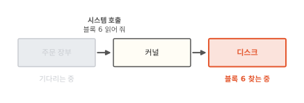
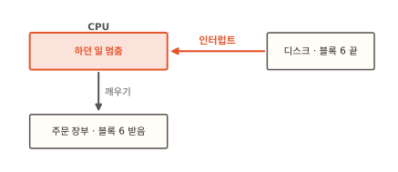
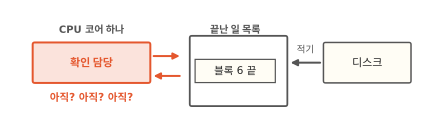
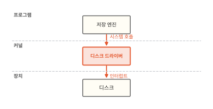
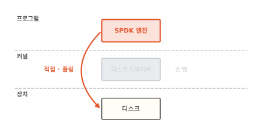
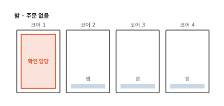
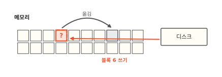
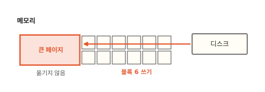
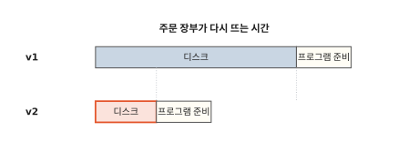

# Longhorn v2 엔진: 커널을 건너뛰고 디스크를 다루는 저장 엔진

빵집 주문 앱의 주문 장부는 주문을 디스크에 적어 두는 프로그램이에요. 새 버전으로 바뀔 때마다 다시 뜨는데 그때마다 한참 걸려서 그동안 손님 주문이 기다려요. 관리 화면을 보니 주문 장부 디스크의 저장 엔진을 v2로 바꾸는 칸이 있고 "더 빠름"이라고 적혀 있어요. 이 글을 읽고 나면 v2 엔진이 디스크를 다루는 방법이 무엇이 다른지와 그 대가로 무엇을 내주는지 알게 돼요. 그래야 엔진을 바꾸면 정말 빨라지는지 스스로 판단할 수 있어요.

!!! abstract "이 글에서 알게 되는 것"
    1. 보통 프로그램은 커널에 부탁해 디스크를 쓰고 일이 끝나면 디스크가 인터럽트로 CPU를 불러 세워요. 디스크가 아주 빨라지면 이렇게 부탁하고 불려 가는 비용이 커져요.
    2. Longhorn v2 엔진은 SPDK로 만들었어요. 커널을 거치지 않고 디스크를 직접 다루고 일이 끝났는지는 쉬지 않고 들여다봐요(폴링).
    3. 대신 CPU 코어 하나와 큰 메모리 페이지를 늘 차지해요. 그래서 기다림 대부분이 디스크일 때만 이득이에요.

## 1. 프로그램은 커널을 거쳐 디스크에 부탁하고 기다려요

프로그램은 디스크를 직접 만지지 않아요. 커널에 부탁해요. 커널은 운영체제의 중심으로 하드웨어를 여러 프로그램에 나눠 주는 관리자예요. 프로그램이 커널에 일을 부탁하는 창구를 시스템 호출이라고 했죠([4편](04-shared-kernel.md)).

주문 장부가 "블록 6 읽어 줘"라고 부탁한다고 해 볼게요. 블록은 디스크를 같은 크기로 나눈 번호 붙은 칸이에요([13편](13-snapshot.md)). 아래 그림에서 지금 일하는 상자가 어느 것인지 보세요.

**그림 1.** 커널이 부탁을 디스크에 전하고 디스크가 블록 6을 찾는 동안 주문 장부는 기다려요.
{ .fig-cap }

디스크는 CPU보다 훨씬 느려요. 그래서 CPU는 그동안 가만히 있지 않고 다른 프로그램의 일을 해요. 그럼 디스크 일이 끝난 건 어떻게 알까요?

## 2. 디스크는 일을 마치면 초인종을 눌러 CPU를 불러 세워요

택배를 기다리는 장면을 떠올려 보세요. 문 앞에 서 있지 않고 집안일을 하다가 초인종이 울리면 나가요. 컴퓨터도 보통 이렇게 해요.

디스크는 블록 6을 다 찾으면 CPU에 신호를 보내요. 초인종을 누르는 거예요. CPU는 하던 일을 잠깐 멈추고 이 신호부터 처리해요. 이렇게 장치가 일을 마쳤다고 CPU를 불러 세우는 신호를 **인터럽트**라고 해요. 아래 그림에서 빨간 화살표가 어디서 어디로 가는지 보세요.

**그림 2.** 디스크가 인터럽트로 CPU를 불러 세우면 커널이 기다리던 주문 장부를 깨워요.
{ .fig-cap }

커널은 인터럽트를 받고 기다리던 주문 장부를 깨워요. 주문 장부는 블록 6을 받고 하던 일을 이어 가요.

초인종 방식은 기다리는 동안 CPU를 다른 데 쓸 수 있어서 좋아요. 대신 초인종이 울릴 때마다 CPU는 하던 일을 내려놓고 인터럽트를 처리한 다음 다시 돌아와야 해요. 일을 바꿔 타는 데에도 시간이 들어요. 요즘 빠른 디스크는 1초에 아주 많은 부탁을 끝내서 초인종도 그만큼 자주 울려요. 그러면 일을 바꿔 타는 시간을 디스크가 일하는 시간에 비해 무시할 수 없게 돼요.[^spdk-user] 시스템 호출로 커널에 부탁하는 일에도 비용이 들고요.

## 3. 폴링은 끝났는지 쉬지 않고 들여다봐요

택배를 기다리는 다른 방법이 있어요. 문 앞에 서서 택배가 왔는지 계속 내다보는 거예요. 초인종을 기다리지 않아요.

컴퓨터로 옮기면 이래요. CPU 코어 하나에게 확인을 맡겨요. 코어는 CPU 안에서 따로따로 일하는 계산 장치예요. 디스크는 일을 마치면 메모리에 있는 "끝난 일 목록"에 적어요. 확인 담당 코어는 이 목록을 쉬지 않고 들여다봐요. 아래 그림에서 빨간 화살표 두 개가 오가는 곳을 보세요.

**그림 3.** 확인 담당은 목록을 계속 들여다보다가 디스크가 적은 "블록 6 끝"을 다음 확인에서 찾아요.
{ .fig-cap }

이렇게 일이 끝났는지 쉬지 않고 직접 들여다보는 방식을 **폴링**이라고 해요. 초인종이 없으니 CPU가 하던 일을 멈추고 바꿔 탈 일도 없어요. 끝나자마자 알아요.

목록을 한 번 들여다보는 일은 아주 가벼워요. 디스크 장치까지 가지 않고 메모리에 있는 목록만 읽으면 되거든요.[^spdk-user] 택배 비유와 다른 점도 있어요. 사람은 문 앞을 지키며 다른 일을 조금은 할 수 있어요. 확인 담당 코어는 확인 말고는 아무 일도 하지 않아요.

그런데 그림 1의 길에는 아직 커널이 끼어 있어요. 폴링을 하려면 커널이 디스크를 놓아줘야 해요.

## 4. SPDK 엔진은 커널을 건너뛰고 디스크를 직접 다뤄요

보통은 커널 안의 디스크 드라이버가 디스크를 맡아요. 드라이버는 장치 하나를 다루는 법을 아는 프로그램이에요. 저장 엔진은 Longhorn에서 볼륨마다 쓰기를 받아 여러 노드의 볼륨 레플리카에 보내는 부품이에요([12편](12-longhorn.md)). 아래 그림은 저장 엔진이 디스크까지 가는 보통 길이에요. 빨간 화살표 옆의 낱말을 보세요.

**그림 4.** 보통 길에서는 저장 엔진이 시스템 호출로 커널의 드라이버에 부탁하고 드라이버는 인터럽트로 끝을 알아요.
{ .fig-cap }

다른 길도 있어요. 먼저 커널의 드라이버가 디스크에서 손을 떼게 해요. 그다음 보통 프로그램 안에 디스크 드라이버를 넣어서 프로그램이 디스크를 직접 다뤄요. 아래 그림에서 빨간 곡선 화살표가 어디를 비켜 가는지 보세요.

**그림 5.** SPDK 엔진은 커널 자리를 비켜 디스크를 직접 다루고 끝났는지는 폴링으로 확인해요.
{ .fig-cap }

시스템 호출이 없으니 커널에 부탁하는 비용이 없어요. 초인종도 없으니 불려 가는 비용도 없어요. 이렇게 커널 바깥의 프로그램이 디스크를 직접 다루고 폴링으로 확인하게 해 주는 도구 모음이 **SPDK**예요.[^spdk-about] SPDK 문서는 인터럽트 대신 폴링을 쓰면 일이 끝나는 데 걸리는 시간도, 그 시간이 들쭉날쭉한 정도도 줄어든다고 설명해요.

Longhorn v2 엔진이 이 SPDK로 만든 엔진이에요. 노드마다 SPDK 프로그램이 돌면서 볼륨의 읽기와 쓰기를 처리해요.[^lh-pre] 관리 화면의 "더 빠름"은 여기서 나와요.

## 5. 대신 CPU 코어 하나와 큰 메모리 페이지를 늘 차지해요

빨라진 대신 내주는 것이 두 가지 있어요.

첫째는 CPU 코어 하나예요. 확인 담당은 일이 있든 없든 계속 목록을 들여다봐요. 낮에 주문이 몰릴 때도 그렇고 밤에 주문이 하나도 없을 때도 그래요. 아래 그림은 주문이 없는 밤이에요. 코어 1과 나머지 코어를 비교해 보세요.

**그림 6.** 주문이 없는 밤에도 확인 담당은 코어 1을 꽉 채워 써요.
{ .fig-cap }

Longhorn 문서에도 v2 엔진을 돌리는 파드가 CPU 코어 하나를 쓴다고 적혀 있어요.[^lh-pre] 이 코어는 앱에게 나눠 줄 수 없어요.

둘째는 큰 메모리 페이지예요. 메모리는 프로그램이 지금 쓰는 내용을 올려 두는 빠른 작업 공간이에요. 운영체제는 메모리를 작은 칸으로 나눠 프로그램에 빌려줘요. 이 칸을 페이지라고 해요. 운영체제는 필요하면 페이지를 다른 자리로 옮겨요. 보통 프로그램은 옮겨도 몰라요. 운영체제가 주소를 알아서 바꿔 주거든요.

그런데 SPDK 엔진에서는 디스크가 읽은 블록을 메모리의 정해진 자리에 직접 써요. 디스크는 운영체제가 페이지를 옮긴 걸 몰라요. 아래 그림에서 디스크가 쓰는 자리를 보세요.

**그림 7.** 페이지가 옮겨 갔는데 디스크는 옛 자리에 블록 6을 써요.
{ .fig-cap }

쓰는 사이에 페이지가 옮겨 가면 디스크는 엉뚱한 자리에 써요. 그래서 SPDK는 큰 메모리 페이지(hugepage)를 써요. 리눅스에서 큰 페이지는 운영체제가 자리를 옮기지 않아요.[^spdk-mem] 아래 그림에서 빨간 큰 페이지를 보세요.

**그림 8.** 옮기지 않는 큰 페이지에는 디스크가 늘 같은 자리에 안심하고 써요.
{ .fig-cap }

큰 페이지는 노드를 준비할 때 미리 떼어 둬요. 떼어 둔 만큼은 다른 앱이 쓸 수 없어요. Longhorn도 v2 엔진을 쓰는 노드마다 큰 페이지를 정해 둔 만큼 잡아 두라고 해요.[^lh-pre]

## 6. 기다림 대부분이 디스크일 때만 v2 엔진이 이득이에요

이제 처음 장면으로 돌아가 볼게요. 엔진을 바꾸기 전에 주문 장부가 다시 뜨는 시간을 재서 어디에 시간이 드는지 나눠 봐요. 대부분은 디스크를 기다린 시간이었어요. 적어 둔 장부를 디스크에서 블록마다 읽어 들이는 시간이에요. 프로그램이 스스로 준비하는 시간은 조금이었어요.

v2 엔진은 이 가운데 디스크를 기다리는 몫만 줄여요. 아래 그림에서 v1 막대와 v2 막대의 길이를 비교해 보세요.

**그림 9.** 주문 장부는 디스크 몫이 커서 v2로 바꾸면 전체 막대가 많이 짧아져요.
{ .fig-cap }

그래서 처음 장면에서는 엔진을 바꾸면 주문 장부가 뜨는 시간이 눈에 띄게 줄어요. 주문이 쉴 새 없이 들어와 디스크에 읽고 쓰기가 몰릴 때도 v2 엔진이 이득이에요. 그래도 노드마다 코어 하나와 큰 페이지를 내줄 수 있어야 해요.

주문 처리처럼 프로그램 준비가 긴 경우는 달라요. 디스크 몫이 작아서 엔진을 바꿔도 막대가 거의 그대로예요. 이럴 때는 엔진은 그대로 두고 프로그램이 뜨는 과정을 줄여요. 그 방법은 [16편](16-jvm-startup.md)에서 볼 수 있어요. 어느 쪽이든 먼저 기다림이 어디에 몰렸는지 재 봐야 알 수 있어요.

??? info "커널이 디스크를 놓아주면 노드에서 무엇이 달라지나요"
    SPDK는 먼저 커널의 드라이버를 디스크에서 떼어 내요. 그 자리에 `vfio`나 `uio`라는 빈껍데기 드라이버를 붙여요. 이 드라이버는 디스크를 초기화하지도 않고 무슨 장치인지도 몰라요. 프로그램이 장치의 제어 영역을 자기 메모리처럼 들여다볼 수 있게 길만 열어 줘요.[^spdk-user] 그래서 커널은 그 디스크를 더는 몰라요. 리눅스에서 디스크를 가리키던 `/dev/nvme0n1` 같은 이름도 사라져요.

    큰 페이지를 옮기지 않는 것은 일부러 정한 규칙이 아니에요. SPDK 문서는 지금 리눅스가 큰 페이지를 옮기지 않을 뿐이라서 나중에 바뀔 수도 있다고 밝혀요.[^spdk-mem] 그래서 더 오래갈 방법으로 IOMMU를 들어요. IOMMU는 장치가 보는 주소와 실제 메모리 자리를 하드웨어가 이어 주는 장치예요. 이걸 쓰면 페이지가 옮겨 가도 장치는 같은 주소로 맞는 자리에 써요. 두 드라이버 가운데 `vfio`가 IOMMU를 설정할 수 있어서 더 안전해요.

??? info "Longhorn 1.10.0 기준으로 v2 엔진을 켜는 조건"
    아래는 Longhorn 1.10.0 문서 기준이에요.[^lh-pre] 버전마다 요구 조건과 지원 기능이 달라지니 켜기 전에 쓰는 버전의 문서를 다시 봐요.

    - 문서 목차에 v2 엔진이 "Experimental(시험 단계)"로 표시돼 있어요.
    - v2 엔진을 켜면 엔진을 돌리는 파드인 `instance-manager`마다 CPU 코어 하나를 써요. 그 안의 `spdk_tgt` 프로세스가 폴링을 하기 때문이에요.
    - 노드마다 2 MiB 크기의 큰 페이지를 1024개, 모두 2 GiB 잡아 둬야 해요.
    - 커널 모듈 `vfio_pci`, `uio_pci_generic`, `nvme-tcp`가 필요해요.
    - 노드에 직접 꽂힌 NVMe 디스크를 강하게 권해요. 다른 디스크도 커널을 거치는 방식(AIO)으로 쓸 수 있지만 이때는 디스크 쪽에서 커널을 건너뛰지 않아요.

    Longhorn 1.10부터는 v2 엔진에 인터럽트 방식도 고를 수 있어요. 쉴 때 CPU를 덜 쓰는 대신 일이 끝나는 데 조금 더 걸릴 수 있어요. 문서는 CPU가 넉넉하지 않고 볼륨이 많지 않은 곳에 맞는다고 설명해요.[^lh-int] 1.10.0에서는 AIO로 붙인 디스크에서만 됐고 인터럽트 방식을 켜도 일부 확인은 여전히 폴링으로 돌아요. 그래서 볼륨이 쉬고 있어도 CPU를 조금씩 늘 써요.

## 정리

보통 프로그램은 시스템 호출로 커널에 부탁해 디스크를 쓰고 디스크는 일을 마치면 인터럽트로 CPU를 불러 세워요. 디스크가 아주 빨라지면 이렇게 부탁하고 불려 가는 비용이 커져요.

Longhorn v2 엔진은 SPDK로 만들어서 커널을 건너뛰고 디스크를 직접 다뤄요. 일이 끝났는지는 확인 담당 코어가 끝난 일 목록을 쉬지 않고 들여다봐서 알아요. 그 대가로 주문이 없는 밤에도 코어 하나를 꽉 채워 쓰고 운영체제가 옮기지 않는 큰 메모리 페이지를 미리 떼어 둬요. 그래서 관리 화면의 "더 빠름"은 기다림 대부분이 디스크일 때만 맞는 말이에요. 주문 처리처럼 프로그램 준비에 시간이 몰렸다면 엔진을 바꿔도 거의 빨라지지 않아요.

[15편](15-image-pull.md)에서는 주문 처리가 뜨기 전에 이미지를 받는 데 드는 시간을 봐요.

### 새로 나온 말

- **인터럽트**: 장치가 일을 마쳤다고 CPU를 불러 세우는 신호. 디스크가 블록 6을 다 찾으면 초인종을 누르듯 보내요.
- **폴링**: 일이 끝났는지 쉬지 않고 직접 들여다보는 방식. 확인 담당 코어가 끝난 일 목록을 계속 봐요.
- **SPDK**: 커널을 거치지 않고 프로그램이 디스크를 직접 다루며 폴링으로 확인하게 해 주는 도구 모음. Longhorn v2 엔진이 이것으로 만들어졌어요.

[^spdk-user]: SPDK 문서 "User Space Drivers". 인터럽트를 쓰면 일을 바꿔 타는 비용과 들쭉날쭉함이 생기고, NVMe 장치의 끝난 일 목록을 확인하는 일은 메모리만 읽어서 가볍다고 설명해요. 커널 드라이버를 떼어 내고 `vfio`·`uio`를 붙이는 과정도 여기 있어요. <https://spdk.io/doc/userspace.html>
[^spdk-about]: SPDK는 Storage Performance Development Kit의 줄임말이에요. SPDK 문서 "What is SPDK". 드라이버를 사용자 공간으로 옮겨 시스템 호출을 피하고, 인터럽트 대신 폴링으로 끝난 일을 확인한다고 설명해요. <https://spdk.io/doc/about.html>
[^spdk-mem]: SPDK 문서 "Direct Memory Access (DMA) From User Space". <https://spdk.io/doc/memory.html>
[^lh-pre]: Longhorn 1.10.0 문서 "Prerequisites"(V2 Data Engine). 이 편의 v2 엔진 상태는 1.10.0 문서 기준이에요. [12편](12-longhorn.md)과 [13편](13-snapshot.md)은 1.13 문서를 따랐지만 v2 엔진 내용은 1.13 문서에서 직접 확인하지 못했어요. <https://longhorn.io/docs/1.10.0/v2-data-engine/prerequisites/>
[^lh-int]: Longhorn 1.10.0 문서 "Interrupt Mode Support". <https://longhorn.io/docs/1.10.0/v2-data-engine/features/interrupt-mode>
