# 더 빠른 저장 엔진(Longhorn v2)은 무엇이 다를까요?

## 엔진을 바꾸면 빨라질까요?

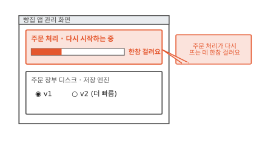

빵집 주문 앱의 주문 처리가 새 버전으로 바뀔 때마다 다시 떠요. 그런데 다시 뜨는 데 한참 걸려요. 그동안 손님 주문은 기다려야 해요.

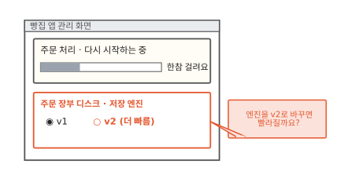

관리 화면을 보니 주문 장부 디스크의 저장 엔진을 v2로 바꾸는 칸이 있어요. "더 빠름"이라고 적혀 있어요. 엔진을 바꾸면 주문 처리도 빨리 뜰까요? v2가 무엇을 다르게 하는지 알면 답할 수 있어요.

먼저 프로그램이 디스크에 일을 부탁할 때 무슨 일이 생기는지 볼게요.

## 디스크에 부탁하면 프로그램은 기다려요

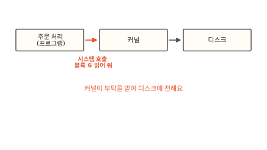

프로그램은 디스크를 직접 만지지 않아요. 커널에 부탁해요. 커널은 운영체제의 중심이에요. 하드웨어를 여러 프로그램에 나눠 주는 관리자예요. 프로그램이 커널에 일을 부탁하는 창구를 시스템 호출이라고 불러요([4편](04-shared-kernel.md)). 그림에서 주문 처리가 "블록 6 읽어 줘"라고 부탁했어요. 블록은 디스크를 같은 크기로 나눈 번호 붙은 칸이에요([13편](13-snapshot.md)).

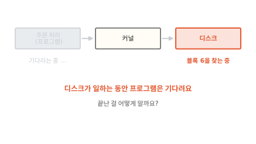

커널은 부탁을 디스크에 전해요. 디스크가 블록 6을 찾는 동안 주문 처리는 기다려요. 디스크는 CPU보다 훨씬 느려요. 그래서 CPU가 그동안 가만히 있으면 아까워요.

CPU는 기다리지 않고 다른 프로그램의 일을 해요. 그럼 디스크 일이 끝난 건 어떻게 알까요?

## 디스크가 끝나면 초인종을 눌러요

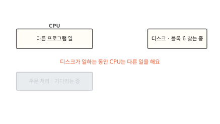

택배를 기다리는 장면을 떠올려 봐요. 문 앞에 서 있지 않고 집안일을 하다가 초인종이 울리면 나가요. 컴퓨터도 보통 이렇게 해요. 그림에서 CPU는 다른 프로그램의 일을 하고 있어요.

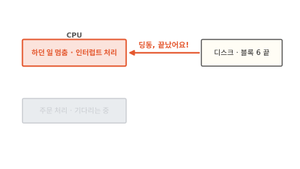

디스크가 블록 6을 다 찾으면 CPU에 신호를 보내요. 초인종을 누르는 거예요. CPU는 하던 일을 잠깐 멈추고 이 신호부터 처리해요.

이렇게 장치가 일을 마쳤다고 CPU를 불러 세우는 신호를 **인터럽트**(interrupt)라고 해요.

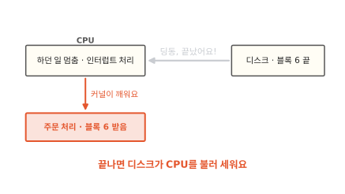

커널은 인터럽트를 받고 기다리던 주문 처리를 깨워요. 주문 처리는 블록 6을 받고 하던 일을 이어 가요.

초인종 방식은 기다리는 동안 CPU를 다른 데 쓸 수 있어서 좋아요. 대신 초인종이 울릴 때마다 CPU가 하던 일을 내려놓고 인터럽트를 처리한 뒤 다시 돌아와야 해요. 일을 바꿔 타는 데에도 시간이 들어요. 요즘 빠른 디스크는 1초에 아주 많은 부탁을 끝내요. 그러면 초인종도 그만큼 자주 울려요. 일을 바꿔 타는 시간이 디스크가 일하는 시간에 비해 무시할 수 없게 돼요.[^spdk-user]

초인종을 아예 없앨 수는 없을까요?

## 문 앞을 지키며 계속 확인해요

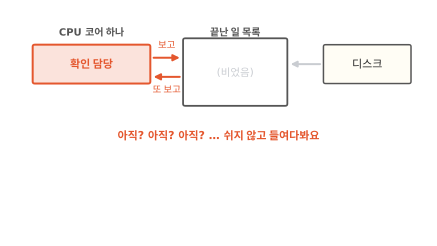

택배를 기다리는 다른 방법이 있어요. 문 앞에 서서 택배가 왔는지 계속 내다보는 거예요. 초인종을 기다리지 않아요. 그림에서 CPU 코어 하나가 확인 담당이 됐어요. 코어는 CPU 안에서 따로따로 일하는 계산 장치예요. 확인 담당은 "끝난 일 목록"을 쉬지 않고 들여다봐요. 디스크는 일을 마치면 이 목록에 적어요.

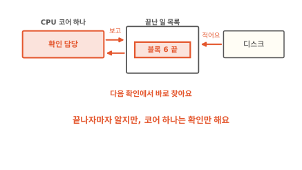

디스크가 목록에 "블록 6 끝"을 적었어요. 확인 담당은 다음 확인에서 바로 찾아요. 초인종이 없으니 CPU가 하던 일을 멈추고 바꿔 탈 일도 없어요.

이렇게 일이 끝났는지 쉬지 않고 직접 들여다보는 방식을 **폴링**(polling)이라고 해요.

목록을 한 번 들여다보는 일은 아주 가벼워요. 디스크 장치까지 가지 않고 메모리에 있는 목록만 읽으면 되기 때문이에요.[^spdk-user] 비유와 다른 점도 있어요. 사람은 문 앞을 지키며 다른 일을 조금은 할 수 있어요. 확인 담당 코어는 확인 말고는 아무 일도 하지 않아요.

그런데 그림의 길에는 아직 커널이 끼어 있어요. 폴링을 하려면 커널이 디스크를 놓아줘야 해요.

## 커널을 거치지 않고 디스크를 직접 다뤄요

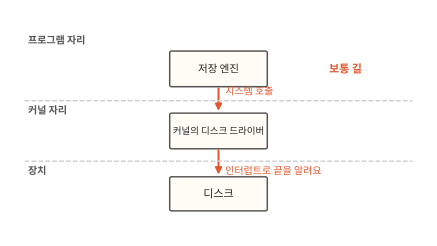

보통은 커널 안의 디스크 드라이버가 디스크를 맡아요. 드라이버는 장치 하나를 다루는 법을 아는 프로그램이에요. 저장 엔진은 시스템 호출로 드라이버에 부탁해요. 드라이버는 인터럽트로 끝을 알아요. 저장 엔진은 Longhorn에서 볼륨마다 하나씩 쓰기를 받아 여러 노드의 볼륨 레플리카에 보내는 부품이에요([12편](12-longhorn.md)).

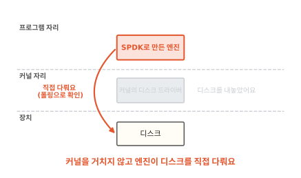

다른 길도 있어요. 먼저 커널의 드라이버가 디스크에서 손을 떼게 해요. 그다음 보통 프로그램이 디스크를 직접 다뤄요. 프로그램 안에 디스크 드라이버를 넣은 거예요. 시스템 호출이 없으니 커널에 부탁하는 비용도 없어요. 끝났는지는 폴링으로 확인해요.

커널 바깥의 프로그램이 디스크를 직접 다루고 폴링으로 확인하게 해 주는 도구 모음이 있어요. 이 도구 모음이 **SPDK**예요.[^spdk-about] SPDK 문서는 인터럽트 대신 폴링을 쓰면 일이 끝나는 데 걸리는 시간도, 그 시간이 들쭉날쭉한 정도도 줄어든다고 설명해요.

Longhorn v2 엔진이 이 SPDK로 만든 엔진이에요. 노드마다 SPDK 프로그램이 돌면서 볼륨의 읽기와 쓰기를 처리해요.[^lh-pre] 처음 장면의 "더 빠름"은 여기서 나와요.

??? info "심화: 커널이 디스크를 놓아주면 무엇이 달라지나요?"
    SPDK가 디스크를 차지한 노드에서 디스크가 어떻게 보이는지 궁금할 때 보는 칸이에요.

    SPDK는 먼저 커널의 드라이버를 디스크에서 떼어 내요. 그 자리에 `vfio`나 `uio`라는 빈껍데기 드라이버를 붙여요. 이 드라이버는 디스크를 초기화하지도 않고 무슨 장치인지도 몰라요. 프로그램이 장치의 제어 영역을 자기 메모리처럼 들여다볼 수 있게 길만 열어 줘요.[^spdk-user]

    그래서 커널은 그 디스크를 더는 몰라요. 리눅스에서 디스크를 가리키던 `/dev/nvme0n1` 같은 이름도 사라져요. 두 드라이버 가운데 `vfio`는 장치가 메모리의 어디까지 건드릴 수 있는지 막아 주는 하드웨어(IOMMU)를 설정할 수 있어서 더 안전해요.

## 빨라진 대신 치르는 값

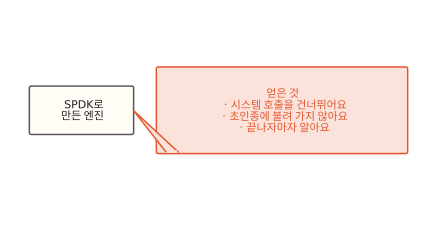

지금까지 SPDK 엔진이 얻은 것을 봤어요. 시스템 호출을 건너뛰고 초인종에 불려 가지 않아요. 디스크 일이 끝나자마자 알아요.

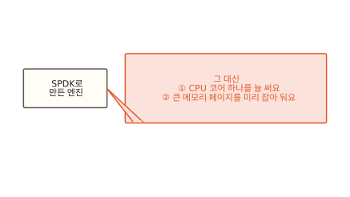

그 대신 두 가지를 내줘야 해요. 하나씩 볼게요.

### 첫째 값: CPU 코어 하나를 늘 써요

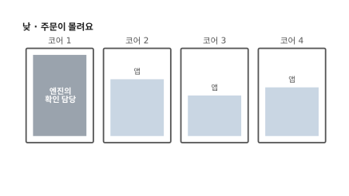

낮에는 주문이 몰려요. 코어 1은 엔진의 확인 담당이 꽉 채워 쓰고 나머지 코어는 앱이 나눠 써요.

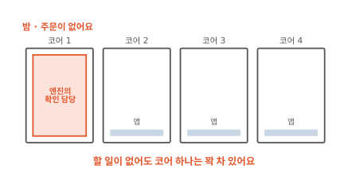

밤이 되어 주문이 없어도 코어 1은 꽉 차 있어요. 확인 담당은 일이 있든 없든 계속 목록을 들여다보기 때문이에요. Longhorn 문서에도 v2 엔진을 돌리는 파드가 CPU 코어 하나를 쓴다고 적혀 있어요.[^lh-pre] 이 코어는 앱에게 나눠 줄 수 없어요.

??? info "심화: 쉴 때도 코어를 붙잡아야 하나요?"
    밤처럼 디스크 일이 거의 없는 노드에서 코어 하나가 아까울 때 보는 칸이에요.

    Longhorn 1.10부터는 v2 엔진에 인터럽트 방식을 고를 수 있어요. 쉴 때 CPU를 덜 쓰는 대신 일이 끝나는 데 조금 더 걸릴 수 있어요. 문서는 CPU가 넉넉하지 않고 볼륨이 많지 않은 곳에 맞는다고 설명해요.[^lh-int]

    1.10.0에서는 커널을 거쳐 쓰는 방식(AIO)으로 붙인 디스크에서만 됐어요. 인터럽트 방식을 켜도 일부 확인은 여전히 폴링으로 돌아요. 그래서 볼륨이 쉬고 있어도 CPU를 조금씩 늘 써요.

### 둘째 값: 큰 메모리 페이지를 미리 잡아 둬요

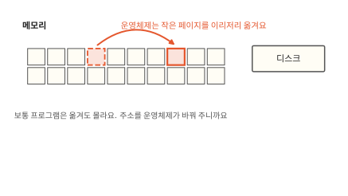

메모리는 프로그램이 지금 쓰는 내용을 올려 두는 빠른 작업 공간이에요. 운영체제는 메모리를 작은 칸으로 나눠 프로그램에 빌려줘요. 이 칸을 페이지라고 해요. 운영체제는 필요하면 페이지를 다른 자리로 옮겨요. 보통 프로그램은 옮겨도 몰라요. 운영체제가 주소를 알아서 바꿔 주기 때문이에요.

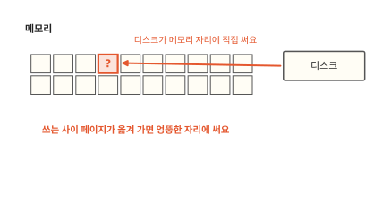

그런데 SPDK 엔진에서는 디스크가 읽은 블록을 메모리의 정해진 자리에 직접 써요. 디스크는 운영체제가 페이지를 옮긴 걸 몰라요. 쓰는 사이에 페이지가 옮겨 가면 엉뚱한 자리에 쓰게 돼요.

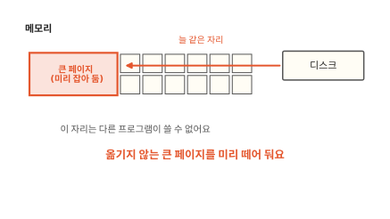

그래서 SPDK는 큰 메모리 페이지(hugepage)를 써요. 리눅스에서 큰 페이지는 운영체제가 자리를 옮기지 않아요.[^spdk-mem] 디스크는 늘 같은 자리에 안심하고 써요. 큰 페이지는 노드를 준비할 때 미리 떼어 둬요. 떼어 둔 만큼은 다른 앱이 쓸 수 없어요. Longhorn도 v2 엔진을 쓰는 노드마다 큰 페이지를 정해 둔 만큼 잡아 두라고 해요.[^lh-pre]

??? info "심화: 큰 페이지는 왜 옮기지 않을까요?"
    큰 페이지가 움직이지 않는다는 게 약속된 규칙인지 궁금할 때 보는 칸이에요.

    SPDK 문서는 이것이 일부러 정한 규칙은 아니라고 밝혀요. 지금 리눅스가 큰 페이지를 옮기지 않을 뿐이라서 나중에 바뀔 수도 있대요.[^spdk-mem]

    그래서 SPDK는 더 오래갈 방법으로 IOMMU를 들어요. IOMMU는 장치가 보는 주소와 실제 메모리 자리를 하드웨어가 이어 주는 장치예요. 이걸 쓰면 페이지가 옮겨 가도 장치는 같은 주소로 맞는 자리에 써요. 앞 심화 칸의 `vfio` 드라이버가 IOMMU를 설정해요.

## 더 빠른 엔진은 언제 쓸모 있을까요?

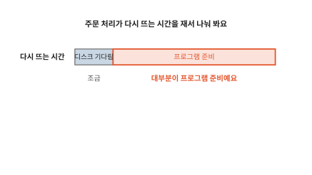

처음 장면으로 돌아가 주문 처리가 다시 뜨는 시간을 재서 나눠 봐요. 디스크를 기다린 시간은 조금이에요. 대부분은 프로그램이 스스로 준비하는 시간이에요. 프로그램 파일을 읽어 들이고 설정을 맞추고 첫 주문을 받을 준비를 하는 시간이에요.

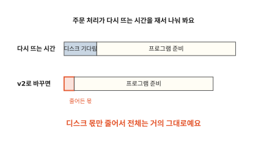

v2 엔진은 디스크를 기다리는 몫만 줄여요. 프로그램이 준비하는 시간은 그대로예요. 그래서 전체는 거의 그대로예요. 엔진을 바꾸기 전에 기다림이 어디에 몰렸는지부터 재야 해요.

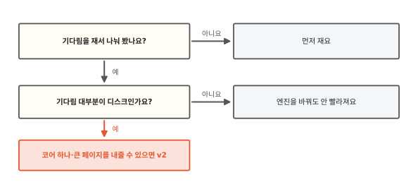

기다림 대부분이 디스크라면 v2 엔진이 이득이에요. 주문이 쉴 새 없이 들어와 디스크에 읽고 쓰기가 몰리는 장부가 그런 경우예요. 그래도 노드마다 코어 하나와 큰 페이지를 내줄 수 있어야 해요. 기다림이 프로그램 준비에 몰렸다면 엔진은 그대로 두고 프로그램이 뜨는 과정을 줄여요. 그 방법은 [16편](16-jvm-startup.md)에서 볼 수 있어요.

??? info "심화: Longhorn v2는 지금 어디까지 왔나요?"
    v2 엔진을 실제로 켜 볼 생각이 있을 때 보는 칸이에요. 아래는 Longhorn 1.10.0 문서 기준이에요.[^lh-pre]

    - 문서 목차에 v2 엔진이 "Experimental(시험 단계)"로 표시돼 있어요.
    - v2 엔진을 켜면 엔진을 돌리는 파드인 `instance-manager`마다 CPU 코어 하나를 써요. 그 안의 `spdk_tgt` 프로세스가 폴링을 하기 때문이에요.
    - 노드마다 2 MiB 크기의 큰 페이지를 1024개, 모두 2 GiB 잡아 둬야 해요.
    - 커널 모듈 `vfio_pci`, `uio_pci_generic`, `nvme-tcp`가 필요해요.
    - 노드에 직접 꽂힌 NVMe 디스크를 강하게 권해요. 다른 디스크도 커널을 거치는 방식(AIO)으로 쓸 수 있지만 이때는 디스크 쪽에서 커널을 건너뛰지 않아요.

    버전마다 요구 조건과 지원 기능이 달라지니 켜기 전에 쓰는 버전의 문서를 다시 봐요.

## 다시 v2 칸 앞에 서 볼게요

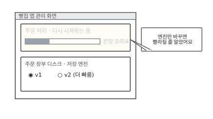

처음 장면의 관리 화면으로 돌아왔어요. 그때는 엔진만 바꾸면 주문 처리가 빨리 뜰 줄 알았어요.

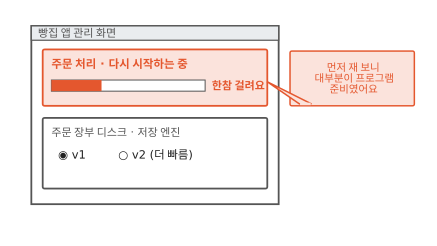

이번에는 먼저 재 봤어요. 다시 뜨는 시간 대부분은 프로그램이 준비하는 시간이었어요.

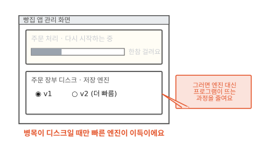

그래서 엔진은 v1 그대로 두고 프로그램이 뜨는 과정을 줄이기로 했어요. 엔진이 아무리 빨라도 줄여 주는 건 디스크를 기다리는 몫뿐이에요.

### 이 편에서 줄여 그린 것

그림을 쉽게 하려고 실제와 다르게 줄인 곳이 세 군데 있어요.

1. 커널 우회 그림에는 엔진과 디스크 하나만 그렸어요. 엔진이 쓰기를 여러 노드의 볼륨 레플리카로 나눠 보내는 일([12편](12-longhorn.md))은 그리지 않았어요.
2. 끝난 일 목록을 상자 하나로 그렸어요. 실제 NVMe 디스크는 부탁을 넣는 줄과 끝난 일을 적는 줄을 짝으로 여러 벌 두고 코어마다 따로 써요.
3. 인터럽트 그림에서는 디스크가 CPU를 바로 불렀어요. 실제로는 인터럽트를 받은 커널이 디스크 드라이버를 거쳐 기다리던 프로그램을 찾아 깨워요.

### 이 편에서 새로 나온 말

[^spdk-user]: SPDK 문서 "User Space Drivers". 인터럽트를 쓰면 일을 바꿔 타는 비용과 들쭉날쭉함이 생기고, NVMe 장치의 끝난 일 목록을 확인하는 일은 메모리만 읽어서 가볍다고 설명해요. 커널 드라이버를 떼어 내고 `vfio`·`uio`를 붙이는 과정도 여기 있어요. <https://spdk.io/doc/userspace.html>
[^spdk-about]: SPDK는 Storage Performance Development Kit의 줄임말이에요. SPDK 문서 "What is SPDK". 드라이버를 사용자 공간으로 옮겨 시스템 호출을 피하고, 인터럽트 대신 폴링으로 끝난 일을 확인한다고 설명해요. <https://spdk.io/doc/about.html>
[^spdk-mem]: SPDK 문서 "Direct Memory Access (DMA) From User Space". <https://spdk.io/doc/memory.html>
[^lh-pre]: Longhorn 1.10.0 문서 "Prerequisites"(V2 Data Engine). <https://longhorn.io/docs/1.10.0/v2-data-engine/prerequisites/>
[^lh-int]: Longhorn 1.10.0 문서 "Interrupt Mode Support". <https://longhorn.io/docs/1.10.0/v2-data-engine/features/interrupt-mode>
