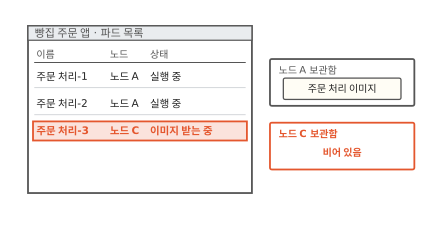
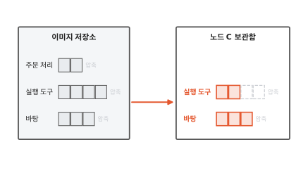
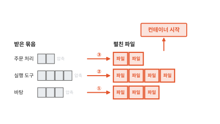
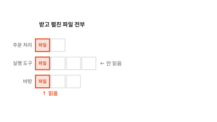
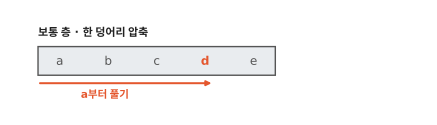
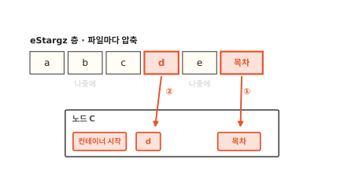
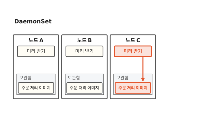
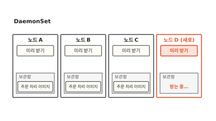

# 이미지 받기: 새 노드에서 컨테이너가 늦게 뜨는 까닭

주문이 몰려서 파드를 하나 더 띄웠어요. 그런데 어떤 노드에서는 곧바로 뜨고 어떤 노드에서는 한참 "이미지 받는 중"에 머물러요. 이 글을 읽고 나면 그 노드가 기다리는 동안 무슨 일을 하는지 알게 돼요. 그 일을 알면 기다림을 줄이는 방법 두 가지를 언제 골라 써야 하는지도 보여요.

!!! abstract "이 글에서 알게 되는 것"
    1. 컨테이너는 이미지의 층을 다 받고 압축을 풀어 펼친 다음에야 시작해요. 그래서 이미지가 없는 새 노드에서만 오래 걸려요.
    2. 시작할 때 읽는 파일은 그중 일부예요. 필요한 파일만 먼저 받고 나머지는 쓸 때 받는 방법을 지연 로딩이라고 해요.
    3. 쓸 이미지를 노드마다 미리 받아 두는 방법은 사전 풀이에요. 노드가 정해져 있으면 사전 풀, 노드가 자주 새로 생기면 지연 로딩이 맞아요.

## 1. 이미지가 없는 노드에서만 늦게 떠요

동네 빵집 주문 앱은 주문 장부, 주문 처리, 주문 화면 세 부품으로 돌아가요. 점심에 주문이 몰려서 주문 처리 파드를 두 개 더 띄웠어요. 파드는 쿠버네티스가 함께 띄우는 컨테이너 묶음이고 노드는 파드가 올라가는 컴퓨터 한 대예요.

노드 A에 놓인 주문 처리-2는 곧바로 "실행 중"이 됐어요. 오늘 새로 들어온 노드 C에 놓인 주문 처리-3은 한참이 지나도 "이미지 받는 중"이에요. 노드마다 받은 이미지를 넣어 두는 디스크 자리가 있는데 이 글에서는 보관함이라고 부를게요. 아래 화면에서 오른쪽 두 보관함을 비교해 보세요.

**그림 1.** 노드 A 보관함에는 주문 처리 이미지가 있고 노드 C 보관함은 비어 있어요.
{ .fig-cap }

같은 파드인데 이미지가 이미 있는 노드에서는 바로 뜨고 이미지가 없는 노드에서는 오래 걸렸어요. 노드 C는 그동안 이미지를 받고 있었어요. 이미지를 받는다는 게 어떤 일인지 한 단계씩 따라가 볼게요.

## 2. 층을 다 받고 다 펼쳐야 컨테이너가 시작해요

이미지는 컨테이너를 만드는 틀이에요. 투명 필름을 겹치듯 층 여러 장으로 되어 있고 이 층 하나를 레이어라고 불러요([2편](02-image-layers.md)). 주문 처리 이미지에는 층이 셋 있어요. 맨 아래는 운영체제의 기본 파일이 든 바탕 층, 가운데는 프로그램을 돌리는 실행 도구 층, 맨 위는 주문 처리 프로그램이 든 층이에요.

이미지는 평소 **이미지 저장소**에 있어요. 이미지를 올려 두고 내려받게 해 주는 서버예요. 영어로는 레지스트리(registry)라고 해요. 층은 저마다 압축해 묶은 파일 하나로 저장소에 올라가 있어요.[^content]

노드 C는 이 묶음을 저장소에서 하나씩 내려받아 보관함에 넣어요. 아래 그림에서 빨간 화살표로 들어오는 묶음을 보세요.

**그림 2.** 노드 C가 층 묶음을 하나씩 받고 있어요. 큰 묶음일수록 오래 걸려요.
{ .fig-cap }

세 묶음을 다 받아도 아직 컨테이너를 띄울 수 없어요. 보관함에 든 건 압축된 묶음이고 컨테이너가 읽는 건 그 안에 든 파일이거든요. 그래서 노드는 묶음의 압축을 풀어 파일로 펼쳐 놓아요.

펼치는 데도 차례가 있어요. 위층은 아래층에서 바뀐 것만 담고 있어서 바탕 층을 먼저 펼치고 그 위에 실행 도구 층, 다시 그 위에 주문 처리 층을 겹쳐 펼쳐요. 아래 그림에서 ①②③ 화살표의 차례를 보세요.

**그림 3.** 바탕 층부터 차례로 펼쳐서 맨 위 층까지 쌓은 다음에야 컨테이너가 시작해요.
{ .fig-cap }

처음 장면의 노드 C는 이 일을 하고 있었어요. 받는 시간과 펼치는 시간을 다 기다린 거예요. 전집만 파는 서점에서 1권만 읽고 싶은 손님을 떠올려 보세요. 전집이 다 배달되고 상자를 다 뜯어 꽂아야 겨우 1권을 펼 수 있어요.

## 3. 시작할 때 읽는 파일은 그중 일부예요

여기서 이런 생각이 들 거예요. 컨테이너는 시작할 때 이 파일을 정말 다 읽을까요?

아래 그림은 노드 C가 받고 펼친 파일 전부예요. 빨간 칸이 주문 처리 컨테이너가 시작할 때 읽은 파일이에요.

**그림 4.** 층마다 시작할 때 읽은 파일은 한 칸뿐이고 나머지는 아직 읽지 않았어요.
{ .fig-cap }

시작할 때는 프로그램 파일과 그 프로그램이 부르는 파일 몇 개만 읽어요. 바탕 층에는 프로그램이 한 번도 쓰지 않는 도구도 많이 들어 있어요. 컨테이너가 시작할 때 읽는 데이터는 받은 이미지의 작은 일부라는 연구도 있어요.[^slacker]

쓰지 않는 파일을 이미지에서 덜어 내면 받을 양이 줄어요. 그래도 덜어 낼 수 없는 파일이 남아요. 실행 도구처럼 지금은 안 읽어도 나중에 쓸 수 있는 파일이에요. 그렇다면 시작에 필요한 파일만 먼저 받을 수는 없을까요?

## 4. 목차를 붙인 층이면 필요한 파일만 먼저 받아요

보통 층은 파일을 한데 모아 한 덩어리로 압축해요. 이런 압축은 앞에서부터 차례로 풀어야 해요. 아래 그림에서 파일 d 하나만 필요할 때 어디부터 풀어야 하는지 보세요.

**그림 5.** 한 덩어리로 압축한 층에서는 d 하나를 꺼내려 해도 a부터 풀어야 해요.
{ .fig-cap }

그래서 층을 만들 때 모양을 바꿔요. 파일마다 따로 압축해서 이어 붙이고 맨 끝에 목차를 붙여요. 목차에는 파일마다 층 안의 어느 자리에 있는지 적혀 있어요. 이렇게 만든 층 모양을 eStargz라고 해요.[^estargz]

노드는 먼저 목차만 받아요. 목차에서 d의 자리를 찾고 저장소에 그 자리만 달라고 요청해요. 저장소는 파일 하나에서 원하는 구간만 떼어 보내 줄 수 있어요. 아래 그림에서 ①과 ② 화살표를 보세요.

**그림 6.** 목차(①)와 d(②)만 받고 컨테이너를 시작해요. 나머지 칸은 나중에 받아요.
{ .fig-cap }

나머지 파일은 컨테이너가 처음 읽으려 할 때 받아요. 이렇게 이미지를 다 받기 전에 컨테이너를 시작하고 파일은 쓸 때 받는 방식을 **지연 로딩**(lazy pulling)이라고 해요. 컨테이너를 실제로 만들고 돌리는 프로그램인 containerd에서는 stargz-snapshotter라는 부품이 이 일을 맡아요.[^snapshotter] 전집 서점이라면 목차부터 보내 주고 손님이 펼친 권만 그때그때 보내 주는 거예요.

지연 로딩에도 값이 있어요. 처음 읽는 파일은 그 순간 저장소에서 받아 오느라 느려요. 그래서 stargz-snapshotter는 시작할 때 자주 읽는 파일을 층 앞쪽에 모아 두고 한꺼번에 미리 받아요.[^estargz] 실행 중에도 아직 안 받은 파일은 저장소에 기대고요. 이미지도 이 모양으로 다시 만들어 올려야 해요. 다행히 eStargz 층은 보통 압축 파일로도 읽혀서 지연 로딩을 모르는 노드도 그대로 받아 써요.

## 5. 노드마다 미리 받아 두면 받을 일이 없어요

지연 로딩은 이미지가 없는 노드에서 기다림을 줄여요. 아예 이미지가 없는 노드를 만들지 않는 길도 있어요.

주문 처리 이미지를 쓰는 작은 파드를 노드마다 하나씩 띄워 둬요. 이 파드는 아무 일도 하지 않아요. 그래도 파드를 띄우려면 노드가 이미지를 받아야 하니까 노드마다 보관함에 이미지가 생겨요. 노드마다 파드를 하나씩 띄우는 일은 쿠버네티스의 DaemonSet이 맡아요. DaemonSet은 노드가 새로 들어오면 그 노드에도 파드를 띄워요.[^daemonset] 아래 그림에서 노드 C의 보관함을 보세요.

**그림 7.** 노드 C에도 미리 받기 파드가 떠서 보관함에 주문 처리 이미지가 들어왔어요.
{ .fig-cap }

이제 주문 처리-3이 노드 C에 놓이면 보관함에 이미지가 이미 있어요. 쿠버네티스는 노드에 이미지가 있으면 다시 받지 않고 그대로 쓸 수 있어요.[^policy] 이렇게 쓸 이미지를 노드에 미리 받아 두는 일을 **사전 풀**(pre-pull)이라고 해요. 여기서 풀은 영어 pull, 곧 받기예요. 압축을 푸는 일과는 다른 말이에요.

사전 풀에도 빈틈이 있어요. 아래 그림처럼 새 노드 D가 들어오면 DaemonSet이 미리 받기 파드를 띄우지만 그 파드도 이미지를 처음부터 받아야 해요.

**그림 8.** 새로 들어온 노드 D는 미리 받기 파드도 이미지를 처음부터 받는 중이에요.
{ .fig-cap }

주문 처리 파드가 그사이 노드 D에 놓이면 결국 같이 기다려요. 주문 처리 이미지가 새 버전으로 바뀔 때마다 미리 받기도 다시 해야 하고요.

## 6. 노드가 자주 새로 생기면 지연 로딩이 맞아요

두 방법을 다 봤어요. 이제 어느 쪽을 고를지 정리해 볼게요. 아래 그림을 위에서부터 따라가 보세요.

**그림 9.** 먼저 이미지를 줄여요. 그다음 노드가 정해져 있으면 사전 풀, 자주 새로 생기면 지연 로딩을 골라요.
{ .fig-cap }

먼저 이미지에서 안 쓰는 파일을 덜어 내요. 받을 양이 줄면 어느 방법을 쓰든 덜 기다려요. 파드가 뜰 노드가 늘 같고 이미지가 자주 바뀌지 않으면 사전 풀이 단순해요. 노드가 수시로 새로 생기면 새 노드는 늘 빈 보관함으로 시작해요. 이럴 때는 사전 풀이 따라가지 못해서 지연 로딩이 기다림을 줄여 줘요.

??? info "심화: 이미지를 다시 만들지 않는 지연 로딩"
    이미 만들어 둔 이미지가 많아서 eStargz로 다시 만들기가 부담스러울 때 보는 칸이에요.

    SOCI snapshotter는 이미지 층을 고치지 않아요. 대신 보통 층 안에서 파일을 찾아갈 수 있게 해 주는 색인을 따로 만들어 저장소에 함께 올려요. 노드는 그 색인을 보고 필요한 부분만 받아요. 원래 이미지가 그대로라서 이미지에 붙인 서명도 그대로 맞아요.[^soci]

## 정리

처음 장면의 노드 C는 주문 처리 이미지의 세 층을 저장소에서 다 받고 바탕 층부터 차례로 펼칠 때까지 컨테이너를 시작하지 못했어요. 노드 A가 빨랐던 건 그 일을 이미 해 둔 노드였기 때문이에요.

그런데 컨테이너가 시작할 때 읽는 파일은 층마다 몇 개뿐이에요. 층 끝에 목차를 붙여 두면 노드는 목차와 필요한 파일만 받고 시작할 수 있어요. 이게 지연 로딩이에요. 아예 노드마다 이미지를 미리 받아 두는 사전 풀도 있어요. 노드가 정해져 있으면 사전 풀이, 노드가 자주 새로 생기면 지연 로딩이 맞아요.

이미지를 다 받은 뒤에도 프로그램이 뜨는 데는 또 시간이 걸려요. 자바 프로그램이 뜰 때 하는 일은 [16편](16-jvm-startup.md)에서 볼게요.

### 새로 나온 말

- **이미지 저장소(레지스트리)**: 이미지를 올려 두고 내려받게 해 주는 서버. 노드 C는 여기서 주문 처리 이미지의 층 묶음 셋을 받았어요.
- **지연 로딩(lazy pulling)**: 이미지를 다 받기 전에 컨테이너를 시작하고 파일은 쓸 때 받는 방식. 노드 C는 목차와 파일 d만 받고 시작했어요.
- **사전 풀(pre-pull)**: 쓸 이미지를 노드에 미리 받아 두는 일. DaemonSet으로 노드마다 미리 받기 파드를 띄워서 해요.
- **eStargz**: 파일마다 따로 압축하고 끝에 목차를 붙인 층 모양. 지연 로딩이 파일 하나만 골라 받을 수 있게 해 줘요.

[^content]: containerd는 이미지를 받을 때 층 목록(manifest), 설정, 층 파일을 받아 저장해요. 층 파일은 gzip으로 압축한 tar 묶음이라 컨테이너가 바로 쓸 수 없어서 층마다 차례로 아래층 위에 펼쳐 쌓아요. 받은 묶음과 펼친 파일은 따로 둬요. <https://github.com/containerd/containerd/blob/main/docs/content-flow.md>
[^slacker]: Harter 외, "Slacker: Fast Distribution with Lazy Docker Containers", USENIX FAST '16. <https://www.usenix.org/conference/fast16/technical-sessions/presentation/harter>
[^estargz]: eStargz는 파일마다 따로 gzip으로 압축하고 층 끝에 목차(TOC)를 둬요. 저장소에 HTTP 구간 요청(Range Request)을 보내 파일 하나만 받아요. 미리 받을 파일은 층 앞쪽에 모아요. 보통 gzip tar로도 읽히게 만든 모양이에요. <https://github.com/containerd/stargz-snapshotter/blob/main/docs/estargz.md>
[^snapshotter]: <https://github.com/containerd/stargz-snapshotter>
[^soci]: <https://github.com/awslabs/soci-snapshotter>
[^daemonset]: DaemonSet은 모든(또는 고른) 노드에서 파드가 하나씩 돌게 해요. 노드가 들어오면 그 노드에 파드를 더하고 노드가 빠지면 그 파드를 치워요. <https://kubernetes.io/docs/concepts/workloads/controllers/daemonset/>
[^policy]: 컨테이너의 `imagePullPolicy`가 `IfNotPresent`면 노드에 없을 때만 받아요. 미리 받아 둔 이미지를 쓰는 방법은 쿠버네티스 문서의 "Pre-pulled images"에 있어요. <https://kubernetes.io/docs/concepts/containers/images/#image-pull-policy>
